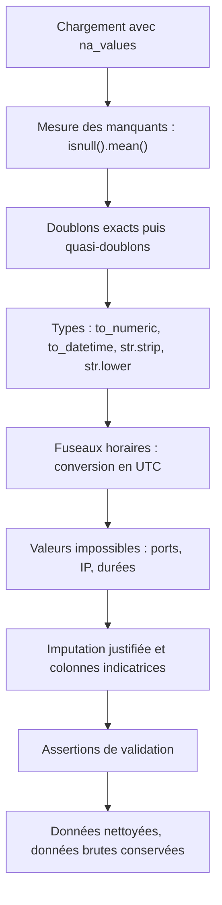

## Introduction

Ce chapitre met en pratique avec du code Pandas les principes de nettoyage vus au cours Data Science Complète (chapitre 2) : détection et traitement des valeurs manquantes, des doublons, et des types de données incohérents.

On dit souvent qu'un data scientist passe la majorité de son temps à nettoyer des données. En sécurité, c'est encore plus vrai. Les logs proviennent d'équipements hétérogènes qui n'ont jamais été conçus pour être analysés ensemble : un pare-feu écrit ses dates au format américain, un serveur Windows en heure locale, un proxy remplace les valeurs absentes par un tiret, un collecteur tombe en panne pendant deux heures et laisse un trou. Si tu ne nettoies pas ces données, ton analyse sera fausse sans que rien ne te prévienne : une chronologie d'incident mal ordonnée, une IP comptée deux fois, un volume moyen faussé par des lignes dupliquées.

À la fin de ce chapitre, tu sauras mesurer l'ampleur des valeurs manquantes, débusquer celles qui se cachent derrière des tirets ou des zéros, choisir une stratégie de traitement justifiée, éliminer les doublons, convertir les types correctement, gérer les fuseaux horaires et repérer les valeurs physiquement impossibles.

## Détecter les valeurs manquantes

### Compter et mesurer

Pandas représente une valeur manquante par `NaN` (Not a Number) pour les nombres, et par `None`, `NaN` ou `NA` selon le type de colonne pour le reste. Les méthodes `isnull()` et son alias `isna()` les détectent toutes.

```python
import pandas as pd
import numpy as np

df = pd.DataFrame({
    "ip": ["10.0.0.5", "10.0.0.12", None, "10.0.0.5"],
    "port": [443, np.nan, 80, 443]
})

print(df.isnull().sum())   # nombre de valeurs manquantes par colonne
print(df.isnull().mean())  # proportion de valeurs manquantes par colonne
```

```text
ip      1
port    1
dtype: int64
ip      0.25
port    0.25
dtype: float64
```

`isnull()` produit un DataFrame de booléens. Appliquer `sum()` compte les `True` de chaque colonne, c'est le nombre brut de valeurs manquantes. Appliquer `mean()` divise ce nombre par le nombre de lignes, c'est la proportion : ici 25 % pour chaque colonne. La proportion est plus parlante que le nombre brut, car 1 000 valeurs manquantes ne signifient pas la même chose sur 2 000 lignes ou sur 10 millions.

<CehCallout>
Vérifier systématiquement `df.isnull().sum()` juste après le chargement d'un jeu de données est un réflexe de base — il révèle immédiatement quelles colonnes nécessitent un traitement avant toute analyse ultérieure, évitant des erreurs silencieuses plus loin dans le pipeline.
</CehCallout>

### Les valeurs manquantes déguisées

Le piège le plus courant n'est pas la cellule vide, mais la valeur manquante déguisée. Par défaut, `read_csv` reconnaît déjà les marqueurs usuels comme une cellule vide, `NA`, `N/A`, `null` ou `NaN`. En revanche, un tiret, la chaîne `unknown`, une adresse `0.0.0.0` ou un port à 0 sont lus comme des valeurs ordinaires. Prenons un petit export volontairement sale :

```text
timestamp,ip_source,port,duree_s,octets,utilisateur
2026-11-02 08:00:01,10.0.0.5,443,12,2400,Alice
2026-11-02 08:00:01,10.0.0.5,443,12,2400,Alice
02/11/2026 08:03:15,10.0.0.12 ,22,340,890000,bob
2026-11-02 08:04:00,-,80,8,N/A,BOB
2026-11-02 08:05:30,192.168.1.3,443,-5,15000,carol
2026-11-02 08:06:12,10.0.0.300,99999,30,4200,alice
2026-11-02 08:07:45,192.168.1.3,443,,15000,
```

Ce fichier contient presque tous les problèmes de ce chapitre : un doublon exact, deux formats de date, un espace parasite après une IP, un tiret et un `N/A` à la place de valeurs absentes, une casse incohérente des noms d'utilisateur, une durée négative, une IP et un port impossibles. Le paramètre `na_values` déclare les marqueurs à traiter comme manquants dès la lecture :

```python
propre = pd.read_csv("export_sale.csv", na_values=["-", "N/A", ""])
print(propre.isnull().sum())
```

```text
timestamp      0
ip_source      1
port           0
duree_s        1
octets         1
utilisateur    1
dtype: int64
```

Sans `na_values`, le `N/A` et la cellule vide auraient bien été reconnus, mais la colonne `ip_source` n'aurait montré aucune valeur manquante : le tiret aurait été compté comme une adresse IP à part entière. Lister explicitement les marqueurs rend en outre ton intention lisible pour qui relira le code.

### Pourquoi les données manquent-elles ?

Avant de traiter, demande-toi pourquoi les données manquent. Les statisticiens distinguent trois mécanismes. Les données manquantes complètement au hasard (MCAR) n'ont aucun lien avec quoi que ce soit, comme un paquet UDP de syslog perdu de temps en temps. Les données manquantes au hasard conditionnellement (MAR) dépendent d'une autre variable observée, par exemple un champ `utilisateur` toujours vide pour un type d'équipement précis. Enfin, les données manquantes non au hasard (MNAR) dépendent de la valeur elle-même : un attaquant qui efface ses traces ou désactive la journalisation (technique MITRE ATT&CK T1070 et T1562.002) crée des trous qui sont précisément l'information la plus intéressante.

En sécurité, un trou dans les logs est donc parfois un indicateur en soi. Avant d'imputer, vérifie si les valeurs manquantes se concentrent sur une période, un hôte ou un type d'événement.

## Traiter les valeurs manquantes

<CompareTable
  titleA="Méthode Pandas"
  titleB="Effet"
  rows={[
    { a: "df.dropna()", b: "Supprime les lignes contenant au moins une valeur manquante" },
    { a: "df.fillna(valeur)", b: "Remplace les valeurs manquantes par une valeur fixe" },
    { a: "df.fillna(df.mean(numeric_only=True))", b: "Remplace par la moyenne de la colonne (imputation)" },
    { a: "df.ffill() / df.bfill()", b: "Propage la valeur précédente/suivante — utile pour des séries temporelles" },
]}
/>

<WarningCallout>
Rappel du cours Data Science Complète (chapitre 2) : `dropna()` appliqué sans réflexion peut introduire un biais si les valeurs manquantes ne sont pas réparties au hasard — toujours vérifier `isnull().mean()` par colonne avant de choisir entre suppression et imputation.
</WarningCallout>

### Choisir une stratégie

| Situation | Stratégie conseillée | Pourquoi |
| --- | --- | --- |
| Quelques lignes, manquants au hasard | `dropna()` | Perte négligeable, aucun biais introduit |
| Colonne numérique asymétrique (octets, durées) | `fillna(médiane)` | La médiane résiste aux valeurs extrêmes, contrairement à la moyenne |
| Colonne catégorielle (utilisateur, protocole) | `fillna("inconnu")` | Garde la ligne et rend l'absence explicite |
| Série temporelle régulière (métrique par minute) | `ffill()` | La dernière valeur connue est la meilleure estimation |
| Colonne vide à plus de 60 % | Supprimer la colonne | L'imputer reviendrait à inventer la majorité des données |
| Manquants porteurs d'information | Ajouter une colonne indicatrice | Le fait que la valeur manque devient une variable exploitable |

Le paramètre `subset` restreint la suppression à certaines colonnes : `df.dropna(subset=["ip_source"])` ne supprime que les lignes sans IP, même si d'autres colonnes sont incomplètes.

```python
# Indicateur de valeur manquante, puis imputation par la médiane
propre["octets_manquant"] = propre["octets"].isna()
propre["octets"] = propre["octets"].fillna(propre["octets"].median())

# Catégorie explicite pour le texte
propre["utilisateur"] = propre["utilisateur"].fillna("inconnu")
```

Pourquoi la médiane plutôt que la moyenne pour les octets ? Dans ce petit jeu, la moyenne des volumes connus dépasse 150 000 octets à cause d'un unique transfert de 890 000 octets, alors que la médiane vaut 9 600. Imputer par la moyenne attribuerait à une connexion banale un volume seize fois supérieur à la médiane.

## Détecter et traiter les doublons

### Doublons exacts

```python
# Détecter les lignes dupliquées
print(df.duplicated().sum())

# Supprimer les doublons, en gardant la première occurrence
df_sans_doublons = df.drop_duplicates()

# Détecter les doublons sur un sous-ensemble de colonnes seulement
print(df.duplicated(subset=["ip"]))
```

```text
1
0    False
1    False
2    False
3     True
dtype: bool
```

`duplicated()` marque à `True` chaque ligne identique à une ligne déjà vue plus haut. Dans notre petit DataFrame, la quatrième ligne répète exactement la première. Avec `subset=["ip"]`, seule la colonne `ip` est comparée : la ligne 3 est un doublon parce que `10.0.0.5` apparaît déjà en ligne 0, quelles que soient les autres colonnes. Le paramètre `keep` choisit quelle occurrence conserver : `"first"` par défaut, `"last"`, ou `False` pour marquer toutes les occurrences.

Les doublons exacts proviennent souvent de la collecte : un agent qui renvoie un lot après une coupure réseau, deux collecteurs configurés sur la même source, une concaténation de fichiers qui se chevauchent. Ils gonflent artificiellement les comptages, par exemple le nombre d'échecs d'authentification d'une IP.

### Quasi-doublons

<TipCallout>
Un doublon exact sur toutes les colonnes est facile à repérer avec `duplicated()`, mais un "quasi-doublon" (même IP source, timestamps très proches, légères variations) nécessite une logique métier plus fine — souvent un filtrage combiné sur plusieurs colonnes plutôt qu'une détection automatique unique.
</TipCallout>

Une technique simple consiste à arrondir l'horodatage à une fenêtre de temps avec `dt.floor`, puis à dédoublonner sur les colonnes significatives :

```python
propre["fenetre"] = propre["timestamp"].dt.floor("10s")   # tranches de 10 secondes
dedup = propre.drop_duplicates(subset=["ip_source", "port", "fenetre"])
```

Deux événements de la même IP vers le même port à 08:00:01 et 08:00:03 tombent dans la même fenêtre de 08:00:00 et ne sont comptés qu'une fois. Le choix de la fenêtre est une décision métier : trop large, elle fusionne de vraies connexions distinctes, comme les tentatives rapprochées d'une force brute ; trop étroite, elle laisse passer les répétitions.

## Convertir et normaliser les types de données

### Nombres et texte

```python
# Une colonne "date" chargée comme texte doit être convertie explicitement
df["timestamp"] = pd.to_datetime(df["timestamp"])

# Convertir une colonne numérique mal typée (chargée comme texte)
df["port"] = pd.to_numeric(df["port"], errors="coerce")  # les valeurs invalides deviennent NaN
```

Avec `errors="coerce"`, une valeur non convertible devient `NaN` au lieu de faire échouer toute la conversion :

```python
print(pd.to_numeric(pd.Series(["443", "22", "http", "8080"]), errors="coerce"))
```

```text
0     443.0
1      22.0
2      NaN
3    8080.0
dtype: float64
```

Remarque que la colonne est passée en `float64` : un entier NumPy ne sait pas représenter `NaN`. Si tu veux garder des entiers avec des valeurs manquantes, utilise le type nullable `Int64` (avec une majuscule) via `astype("Int64")`.

Le texte se normalise avec l'accesseur `.str`. Dans notre export, `Alice`, `alice`, `bob` et `BOB` désignent manifestement deux personnes, et `"10.0.0.12 "` porte un espace final qui l'empêcherait d'être regroupée avec `"10.0.0.12"` :

```python
propre["ip_source"] = propre["ip_source"].str.strip()       # retire les espaces
propre["utilisateur"] = propre["utilisateur"].str.lower()   # uniformise la casse
print(propre["utilisateur"].value_counts(dropna=False))
```

```text
utilisateur
alice    3
bob      2
carol    1
NaN      1
Name: count, dtype: int64
```

### Les dates : le piège des formats mélangés

<CehCallout>
Un fichier de logs exporté au format CSV charge presque toujours les dates comme du texte brut par défaut — oublier de les convertir explicitement en type datetime empêche tout tri chronologique correct ou calcul de durée entre deux événements, un piège fréquent lors d'une investigation temporelle.
</CehCallout>

Notre export mélange le format ISO `2026-11-02 08:03:15` et le format français `02/11/2026 08:03:15`. Une solution tentante consiste à écrire `pd.to_datetime(col, format="mixed", dayfirst=True)`. Regarde pourtant le résultat :

```text
0   2026-02-11 08:00:01
1   2026-02-11 08:00:01
2   2026-11-02 08:03:15
3   2026-02-11 08:04:00
```

Les dates ISO ont été interprétées avec le jour en premier : le 2 novembre est devenu le 11 février, sans aucune erreur. La méthode sûre consiste à parser chaque format explicitement, puis à combiner :

```python
iso = pd.to_datetime(propre["timestamp"], format="ISO8601", errors="coerce")
fr = pd.to_datetime(propre["timestamp"], format="%d/%m/%Y %H:%M:%S", errors="coerce")
propre["timestamp"] = iso.fillna(fr)
```

```text
0   2026-11-02 08:00:01
1   2026-11-02 08:03:15
2   2026-11-02 08:04:00
dtype: datetime64[us]
```

Les lignes qui ne correspondent à aucun des deux formats restent à `NaT` (Not a Time) et doivent être examinées à part. Note que pandas 3 stocke les dates en microsecondes (`datetime64[us]`), là où pandas 2 affichait des nanosecondes (`datetime64[ns]`).

### Les fuseaux horaires

Pour reconstruire la chronologie d'un incident à partir de plusieurs sources, toutes les dates doivent être exprimées dans le même fuseau, en pratique UTC. Une date sans fuseau est dite naïve ; `tz_localize` lui attribue son fuseau d'origine, puis `tz_convert` la convertit :

```python
t = pd.Series(pd.to_datetime(["2026-11-02 08:00:01", "2026-11-02 08:00:59"]))
print(t.dt.tz_localize("Europe/Paris").dt.tz_convert("UTC"))
```

```text
0   2026-11-02 07:00:01+00:00
1   2026-11-02 07:00:59+00:00
dtype: datetime64[us, UTC]
```

En novembre, Paris est à UTC+1, donc 08:00 locale correspond à 07:00 UTC. Une heure de décalage suffit à faire croire qu'une connexion a eu lieu avant l'exécution du malware, alors qu'elle a eu lieu après.

<AuditCallout>
L'ISO/IEC 27001:2022 exige, avec la mesure A.8.17 (synchronisation des horloges), que les horloges des systèmes soient synchronisées sur des sources de temps approuvées, et la mesure A.8.15 (journalisation) encadre la production et la protection des logs. Sans horloges synchronisées et fuseaux documentés, la corrélation d'événements entre sources perd sa valeur probante.
</AuditCallout>

## Valeurs impossibles et validation

Certaines valeurs ne sont pas manquantes mais physiquement impossibles : un port hors de l'intervalle 0 à 65535, une durée négative, une adresse IPv4 dont un octet dépasse 255. Elles signalent un bug d'export, une corruption, ou parfois une tentative d'injection dans les logs.

```python
import ipaddress

def ip_valide(valeur: str) -> bool:
    try:
        ipaddress.ip_address(valeur)
        return True
    except ValueError:
        return False

ip_invalides = propre["ip_source"].dropna().map(ip_valide)
print(propre.loc[ip_invalides[~ip_invalides].index, "ip_source"])  # 10.0.0.300
print(propre[~propre["port"].between(0, 65535)])                    # port 99999
print(propre[propre["duree_s"] < 0])                                 # durée -5

# Neutraliser les valeurs impossibles plutôt que de les laisser fausser les statistiques
propre.loc[~propre["port"].between(0, 65535), "port"] = np.nan
propre.loc[propre["duree_s"] < 0, "duree_s"] = np.nan
```

Le module standard `ipaddress` valide IPv4 et IPv6 bien plus sûrement qu'une expression régulière maison. La méthode `between(a, b)` teste l'appartenance à un intervalle, bornes incluses.

Enfin, termine ton nettoyage par des assertions : des vérifications qui font échouer le script si une hypothèse est violée, au lieu de laisser passer des données incohérentes.

```python
assert propre["timestamp"].notna().all(), "Dates non parsées"
assert not propre.duplicated().any(), "Doublons restants"
assert propre["port"].dropna().between(0, 65535).all(), "Port hors limites"
```



<WarningCallout>
Ne nettoie jamais en écrasant le fichier source. En investigation numérique, les logs bruts sont une pièce à conviction : ils doivent rester intacts, idéalement accompagnés de leur empreinte SHA-256. Travaille toujours sur une copie et documente chaque transformation, pour qu'un tiers puisse refaire exactement le même chemin.
</WarningCallout>

## Erreurs fréquentes

- **Oublier les valeurs manquantes déguisées** : tirets, `N/A`, `0.0.0.0` ou ports à 0 faussent les comptages. Déclare-les avec `na_values` ou remplace-les explicitement.
- **Imputer par la moyenne une colonne asymétrique** : un seul gros transfert déplace la moyenne. La médiane est presque toujours préférable pour les octets et les durées.
- **Imputer un trou qui est un indice** : un arrêt de journalisation pendant une attaque n'est pas un bruit à combler.
- **Parser des dates mélangées avec `dayfirst=True`** : les dates ISO sont réinterprétées silencieusement. Parse chaque format explicitement.
- **Mélanger des fuseaux horaires** : convertis toutes les sources en UTC avant de trier ou de corréler.
- **Dédoublonner trop agressivement** : une fenêtre de quasi-doublons trop large efface de vraies tentatives répétées, précisément celles d'une force brute.

## Lab — Mise en pratique

**Environnement** : Python 3.12 ou plus récent avec pandas installé (terminal Nyx Shell ou environnement local).

<Steps steps={[
  { title: "Charger un DataFrame avec valeurs manquantes", description: "Recrée le DataFrame d'exemple contenant des valeurs manquantes et affiche leur nombre puis leur proportion par colonne. Tu dois obtenir 25 % pour chaque colonne.", code: "import pandas as pd\nimport numpy as np\n\ndf = pd.DataFrame({\n    'ip': ['10.0.0.5', '10.0.0.12', None, '10.0.0.5'],\n    'port': [443, np.nan, 80, 443]\n})\n\nprint(df.isnull().sum())\nprint(df.isnull().mean())" },
  { title: "Supprimer les doublons", description: "Détecte puis supprime les lignes dupliquées du DataFrame. Compare ensuite avec une détection limitée à la colonne ip.", code: "print(df.duplicated().sum())\ndf_sans_doublons = df.drop_duplicates()\nprint(df_sans_doublons)\nprint(df.duplicated(subset=['ip']))" },
  { title: "Imputer les valeurs manquantes par la médiane", description: "Remplace les valeurs manquantes numériques de la colonne port par sa médiane, après avoir ajouté une colonne indicatrice.", code: "df['port_manquant'] = df['port'].isna()\ndf['port'] = df['port'].fillna(df['port'].median())\nprint(df)" },
  { title: "Convertir une colonne en type numérique", description: "Force la conversion d'une colonne texte en type numérique, les valeurs invalides devenant NaN. Observe le passage en float64.", code: "ports = pd.Series(['443', '22', 'http', '8080'])\nprint(pd.to_numeric(ports, errors='coerce'))" },
  { title: "Charger un export sale", description: "Enregistre l'export sale du chapitre dans un fichier export_sale.csv, puis compare le nombre de valeurs manquantes détectées avec et sans na_values.", code: "brut = pd.read_csv('export_sale.csv')\npropre = pd.read_csv('export_sale.csv', na_values=['-', 'N/A', ''])\nprint(brut.isnull().sum())\nprint(propre.isnull().sum())" },
  { title: "Parser des dates aux formats mélangés", description: "Parse les deux formats séparément puis combine-les. Vérifie que toutes les dates tombent bien le 2 novembre 2026, puis convertis-les en UTC depuis Europe/Paris.", code: "iso = pd.to_datetime(propre['timestamp'], format='ISO8601', errors='coerce')\nfr = pd.to_datetime(propre['timestamp'], format='%d/%m/%Y %H:%M:%S', errors='coerce')\npropre['timestamp'] = iso.fillna(fr)\nprint(propre['timestamp'].dt.date.value_counts())\npropre['ts_utc'] = propre['timestamp'].dt.tz_localize('Europe/Paris').dt.tz_convert('UTC')" },
  { title: "Normaliser, valider et vérifier", description: "Normalise le texte, neutralise les ports et durées impossibles, supprime les doublons, puis vérifie le résultat par des assertions. Le DataFrame final doit compter 6 lignes.", code: "propre['ip_source'] = propre['ip_source'].str.strip()\npropre['utilisateur'] = propre['utilisateur'].str.lower().fillna('inconnu')\npropre.loc[~propre['port'].between(0, 65535), 'port'] = np.nan\npropre.loc[propre['duree_s'] < 0, 'duree_s'] = np.nan\npropre = propre.drop_duplicates()\nassert not propre.duplicated().any()\nprint(propre.shape)\nprint(propre)" },
]} />

## À retenir

- `isnull().sum()` donne le nombre et `isnull().mean()` la proportion de valeurs manquantes par colonne ; la proportion guide le choix entre suppression et imputation.
- Les valeurs manquantes déguisées (tirets, `N/A`, zéros) se déclarent avec `na_values` dès le chargement.
- `dropna()` sans réflexion introduit un biais si les manquants ne sont pas aléatoires ; en sécurité, un trou dans les logs peut être un indice d'attaque.
- La médiane est l'imputation de référence pour les volumes et durées, et `ffill()` / `bfill()` conviennent aux séries temporelles.
- `duplicated()` et `drop_duplicates()` traitent les doublons exacts, `subset` restreint la comparaison, et `dt.floor` aide à repérer les quasi-doublons.
- `pd.to_numeric(errors="coerce")` transforme les valeurs invalides en `NaN`, et chaque format de date se parse explicitement avant conversion en UTC.
- Les données brutes ne sont jamais écrasées, et chaque décision de nettoyage est documentée et vérifiée par des assertions.

## Questions de révision

1. Quelle méthode Pandas révèle la proportion de valeurs manquantes par colonne, et pourquoi est-elle plus utile que le nombre brut ?
2. Pourquoi faut-il convertir explicitement une colonne de dates chargée depuis un CSV, et quel piège pose l'option `dayfirst=True` sur des formats mélangés ?
3. Pourquoi un « quasi-doublon » est-il plus difficile à détecter automatiquement qu'un doublon exact ?
4. Donne un exemple de valeurs manquantes non aléatoires dans des logs de sécurité, et explique pourquoi les imputer serait une erreur.
5. Pourquoi imputer par la médiane plutôt que par la moyenne une colonne de volumes en octets ?
6. Pourquoi faut-il convertir toutes les sources en UTC avant de reconstruire la chronologie d'un incident ?
7. Que deviennent les valeurs invalides avec `pd.to_numeric(..., errors="coerce")`, et pourquoi la colonne obtenue passe-t-elle en `float64` ?
