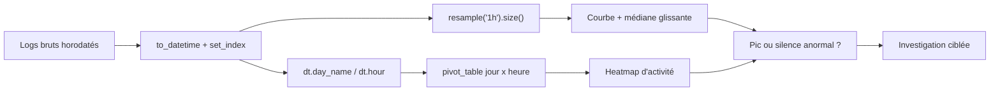

## Introduction

Ce chapitre met en pratique avec du code les types de visualisations déjà présentés au cours Data Science Complète (chapitre 3) : histogrammes, nuages de points, boxplots et matrices de corrélation, appliqués à des données de sécurité.

Un tableau de chiffres répond à une question qu'on a déjà posée ; un graphique fait souvent surgir celle qu'on n'avait pas pensé à poser. Un pic de connexions à deux heures du matin, une poignée de sessions au volume démesuré, un port dont les durées ne ressemblent à aucun autre : ces anomalies sautent aux yeux sur un graphique alors qu'elles se perdent dans un `describe()`. La visualisation sert aussi à communiquer : un responsable sécurité comprendra en trois secondes une courbe bien légendée, là où il ne lira jamais un tableau de mille lignes.

À la fin de ce chapitre, tu sauras tracer les graphiques essentiels avec Matplotlib et Seaborn, choisir le bon type de graphique pour chaque question, agréger des logs dans le temps avec `resample` pour révéler un pic d'activité, et produire des figures propres, honnêtes et exportables dans un rapport.

## Matplotlib — le socle de la visualisation Python

### Un premier histogramme

```python
import matplotlib.pyplot as plt

durees = [12, 450, 8, 230, 15, 9, 600, 45, 20]

plt.hist(durees, bins=10)
plt.xlabel("Durée de connexion (secondes)")
plt.ylabel("Nombre de connexions")
plt.title("Distribution des durées de connexion")
plt.show()
```

Un histogramme découpe l'intervalle des valeurs en classes de même largeur, et dessine pour chaque classe une barre dont la hauteur correspond au nombre de valeurs qu'elle contient. Le paramètre `bins=10` fixe le nombre d'intervalles. Ici, les durées vont de 8 à 600 secondes, donc chaque classe mesure environ 59 secondes de large. Tu observeras une grande barre à gauche, regroupant les six connexions de moins de 67 secondes, puis trois barres isolées pour 230, 450 et 600 secondes. C'est la forme typique des données réseau : beaucoup de connexions courtes et une longue traîne de connexions longues, celles qui méritent l'attention.

Le choix du nombre de classes change la lecture. Trop peu de classes écrasent les détails ; trop de classes produisent un graphique en dents de scie où chaque barre ne contient qu'une ou deux valeurs.

<CehCallout>
Matplotlib offre un contrôle très fin sur chaque élément d'un graphique (couleurs, axes, annotations) mais nécessite plus de code pour des graphiques statistiques standards — c'est précisément le vide que Seaborn vient combler.
</CehCallout>

### L'API orientée objet : figure et axes

Le style `plt.xxx()` ci-dessus agit sur un graphique « courant » implicite. Dès que tu combines plusieurs graphiques, préfère l'API orientée objet : `plt.subplots()` renvoie une figure (la page entière) et un ou plusieurs axes (chaque zone de tracé), et l'on appelle les méthodes directement sur les axes.

```python
fig, ax = plt.subplots(figsize=(8, 4))      # largeur et hauteur en pouces
ax.hist(durees, bins=10, color="steelblue", edgecolor="white")
ax.set_xlabel("Durée de connexion (secondes)")
ax.set_ylabel("Nombre de connexions")
ax.set_title("Distribution des durées de connexion")
fig.savefig("durees.png", dpi=150, bbox_inches="tight")   # export pour un rapport
plt.show()
```

Note la correspondance des noms : `plt.xlabel` devient `ax.set_xlabel`, `plt.title` devient `ax.set_title`. La méthode `savefig` écrit l'image sur disque ; `dpi` règle la résolution et `bbox_inches="tight"` supprime les marges inutiles. Sur un serveur sans écran, comme un conteneur ou une session SSH, `plt.show()` n'affiche rien : enregistre plutôt la figure avec `savefig`, au besoin après avoir choisi le moteur de rendu non interactif avec `matplotlib.use("Agg")`.

## Seaborn — des graphiques statistiques en une ligne

```python
import seaborn as sns
import pandas as pd

df = pd.DataFrame({
    "duree": [12, 450, 8, 230, 15, 9, 600],
    "port": [443, 22, 80, 443, 80, 22, 443]
})

# Boxplot par catégorie (rappel du cours Data Science Complète, chapitre 3)
sns.boxplot(data=df, x="port", y="duree")
plt.show()

# Matrice de corrélation
sns.heatmap(df.corr(numeric_only=True), annot=True, cmap="coolwarm")
plt.show()
```

<TipCallout>
Seaborn est construit directement au-dessus de Matplotlib — il génère des graphiques statistiques plus riches (boxplots par catégorie, heatmaps de corrélation) avec une syntaxe bien plus concise, tout en restant compatible avec les fonctions Matplotlib pour un réglage fin si nécessaire.
</TipCallout>

### Lire un boxplot

Un boxplot (boîte à moustaches) résume une distribution en cinq repères. La boîte s'étend du premier quartile Q1 au troisième quartile Q3 et contient donc la moitié centrale des valeurs ; le trait à l'intérieur marque la médiane. Les moustaches s'étendent jusqu'aux valeurs les plus éloignées situées à moins de 1,5 fois l'écart interquartile (Q3 moins Q1) des bords de la boîte. Les points au-delà sont dessinés individuellement : ce sont les valeurs atypiques.

Ici, chaque port ne compte que deux ou trois connexions, et le graphique montre surtout le contraste entre le port 80, aux durées très resserrées autour de 11 secondes, et les ports 22 et 443, aux durées très dispersées. Sur un vrai jeu de données, ce graphique permet de comparer d'un coup d'œil le comportement de dizaines de services.

### Lire une heatmap de corrélation

`df.corr()` calcule le coefficient de corrélation de Pearson entre chaque paire de colonnes numériques, une valeur entre -1 et 1. La heatmap le traduit en couleurs, avec `annot=True` pour afficher la valeur dans chaque case et la palette divergente `coolwarm` pour distinguer corrélations positives (rouge) et négatives (bleu). Ajoutons une colonne de volume au DataFrame pour avoir quelque chose à corréler :

```python
df["octets"] = [2400, 89000, 1200, 45000, 3000, 1800, 120000]
print(df.corr(numeric_only=True).round(2))
```

```text
        duree  octets  port
duree     1.0    1.00  0.30
octets    1.0    1.00  0.31
port      0.3    0.31  1.00
```

La diagonale vaut toujours 1, chaque variable étant parfaitement corrélée à elle-même. La durée et le volume sont presque parfaitement corrélés dans ce petit exemple construit à la main. En revanche, la corrélation de 0,30 avec le port n'a aucun sens : le numéro de port est une étiquette, pas une quantité, et la corrélation de Pearson suppose des variables numériques continues. Retire les identifiants et codes catégoriels avant de calculer une matrice de corrélation.

### Les autres graphiques courants de Seaborn

```python
sns.histplot(data=df, x="duree", bins=10, kde=True)        # histogramme + courbe de densité
sns.scatterplot(data=df, x="duree", y="octets", hue="port") # nuage de points coloré par port
sns.countplot(data=df, x="port")                            # nombre d'occurrences par catégorie
sns.violinplot(data=df, x="port", y="duree")                # distribution complète par catégorie
```

Le paramètre `hue` colore les points selon une troisième variable, un moyen simple d'ajouter une dimension à un graphique en deux dimensions. Seaborn propose aussi, depuis sa version 0.12, une interface déclarative appelée `seaborn.objects`, inspirée de la grammaire des graphiques ; l'interface classique présentée ici reste la plus répandue.

## Choisir le bon graphique

| Question posée | Graphique adapté | Fonction |
| --- | --- | --- |
| Comment se répartissent les valeurs d'une variable ? | Histogramme | `plt.hist`, `sns.histplot` |
| Une catégorie se comporte-t-elle différemment des autres ? | Boxplot ou violon par catégorie | `sns.boxplot`, `sns.violinplot` |
| Deux variables numériques évoluent-elles ensemble ? | Nuage de points | `sns.scatterplot` |
| Quelles variables sont liées entre elles ? | Heatmap de corrélation | `sns.heatmap(df.corr())` |
| Quelles sont les catégories les plus fréquentes ? | Diagramme en barres trié | `sns.countplot`, `Series.plot.barh` |
| Comment une activité évolue-t-elle dans le temps ? | Courbe temporelle | `Series.plot`, `sns.lineplot` |
| À quels moments de la semaine l'activité a-t-elle lieu ? | Heatmap heure par jour | `pivot_table` puis `sns.heatmap` |

Évite le diagramme circulaire (camembert) pour comparer plus de trois ou quatre catégories : l'œil humain compare mal des angles, alors qu'il compare très bien des longueurs de barres.

## Construire un graphique lisible et pertinent

<Steps steps={[
  { title: "Toujours nommer les axes et le titre", description: "Un graphique sans légende claire est inutilisable pour quelqu'un d'autre que son auteur, même techniquement correct." },
  { title: "Choisir une échelle adaptée", description: "Une distribution avec des valeurs très étalées peut nécessiter une échelle logarithmique pour rester lisible." },
  { title: "Éviter la surcharge visuelle", description: "Un graphique avec trop de couleurs ou de catégories simultanées devient illisible — préférer plusieurs graphiques simples à un seul graphique surchargé." },
]} />

L'échelle logarithmique mérite un exemple. Les volumes de transfert s'étalent souvent de quelques centaines d'octets à plusieurs gigaoctets. Sur une échelle linéaire, toutes les petites valeurs s'écrasent contre l'axe et seul le plus gros transfert est visible. Avec `ax.set_xscale("log")` ou `sns.histplot(..., log_scale=True)`, chaque graduation représente une multiplication par 10, et l'on distingue enfin les différents régimes de trafic.

Pense aussi aux daltoniens, environ 8 % des hommes : évite d'opposer uniquement le rouge et le vert, et préfère des palettes conçues pour être lisibles par tous, comme `viridis` pour une échelle continue ou `colorblind` dans Seaborn pour des catégories.

<WarningCallout>
Un graphique mal légendé ou à l'échelle trompeuse peut induire en erreur, y compris involontairement — rappel du piège de sur-interprétation visuelle vu au cours Data Science Complète (chapitre 3) : la façon de présenter un graphique influence directement l'interprétation qui en sera faite, une responsabilité à prendre au sérieux lors de la présentation de résultats de sécurité.
</WarningCallout>

L'exemple le plus classique est l'axe vertical tronqué : si un graphique en barres commence à 950 au lieu de 0, une hausse de 960 à 990 alertes paraît spectaculaire alors qu'elle ne représente que 3 %. Pour un diagramme en barres, l'axe doit partir de zéro ; pour une courbe, un axe resserré est acceptable s'il est clairement gradué.

## Visualiser une série temporelle de logs

### Agréger par intervalle avec resample

```python
df["timestamp"] = pd.to_datetime(df["timestamp"])
df_par_heure = df.set_index("timestamp").resample("1h").size()

df_par_heure.plot(figsize=(10, 4))
plt.ylabel("Nombre de connexions")
plt.title("Volume de connexions par heure")
plt.show()
```

<CehCallout>
`resample` est l'outil Pandas central pour l'analyse temporelle — il regroupe automatiquement les événements par intervalle de temps (heure, jour...), une étape indispensable avant de visualiser ou détecter une rupture dans un volume de trafic au fil du temps.
</CehCallout>

`resample` exige un index de type date, d'où le `set_index("timestamp")`. Il découpe ensuite le temps en intervalles réguliers et applique une agrégation à chacun : `size()` compte les lignes, `sum()` additionnerait une colonne comme les octets. Les alias de fréquence s'écrivent en minuscules : `"1h"` pour une heure, `"15min"` pour quinze minutes, `"1D"` pour un jour. L'ancien alias `"1H"` en majuscule, déprécié depuis pandas 2.2, est refusé par pandas 3 avec l'erreur `Invalid frequency: H. Did you mean h?`. Avantage décisif de `resample` sur un simple `groupby` : les heures sans aucun événement apparaissent avec un compte de zéro au lieu de disparaître, ce qui est indispensable pour repérer un silence anormal.

### Un exemple complet : repérer un pic nocturne

Générons deux jours de logs synthétiques avec un rythme de bureau réaliste, et injectons une rafale d'activité à deux heures du matin le second jour, comme le ferait un script d'exfiltration ou une force brute automatisée.

```python
import numpy as np

rng = np.random.default_rng(7)
heures = pd.date_range("2026-11-02 00:00", periods=48, freq="h")
profil = np.array([5, 4, 3, 3, 3, 4, 8, 20, 45, 60, 62, 58,
                   50, 55, 60, 58, 52, 40, 25, 15, 10, 8, 6, 5] * 2)   # rythme journalier
comptes = rng.poisson(profil)          # nombre aléatoire d'événements par heure
comptes[26] += 180                     # rafale injectée le 3 novembre à 02:00

horodatages = []
for h, c in zip(heures, comptes):      # c événements répartis au hasard dans l'heure h
    horodatages += list(h + pd.to_timedelta(rng.integers(0, 3600, c), unit="s"))
logs = pd.DataFrame({"timestamp": horodatages})

par_heure = logs.set_index("timestamp").resample("1h").size()
print(par_heure.iloc[24:29])
print(par_heure.idxmax(), par_heure.max())
```

```text
timestamp
2026-11-03 00:00:00      5
2026-11-03 01:00:00      1
2026-11-03 02:00:00    183
2026-11-03 03:00:00      5
2026-11-03 04:00:00      5
Freq: h, dtype: int64
2026-11-03 02:00:00 183
```

La loi de Poisson utilisée par `rng.poisson` modélise un nombre d'événements indépendants survenant dans un intervalle, ce qui convient bien à des arrivées de connexions. Avec 183 connexions contre 1 à 5 les heures voisines, le pic ne fait aucun doute. Visualisons-le en superposant une médiane glissante, qui représente le niveau « normal » récent, et en annotant le pic :

```python
fig, ax = plt.subplots(figsize=(10, 4))
par_heure.plot(ax=ax, label="Connexions par heure")
par_heure.rolling(6, min_periods=1).median().plot(ax=ax, linestyle="--", label="Médiane glissante (6 h)")
ax.annotate("Rafale nocturne", xy=(par_heure.idxmax(), par_heure.max()),
            xytext=(10, -10), textcoords="offset points")
ax.set_xlabel("Heure")
ax.set_ylabel("Nombre de connexions")
ax.set_title("Volume de connexions par heure — 2 et 3 novembre 2026")
ax.legend()
fig.savefig("volume_horaire.png", dpi=150, bbox_inches="tight")
```

Sur la courbe, tu verras deux bosses régulières correspondant aux journées de travail, culminant vers 10 heures, et un pic isolé en pleine nuit, plus haut que toute l'activité de bureau. La médiane glissante, elle, reste basse : c'est une référence robuste qui ne se laisse pas entraîner par la rafale, pour la même raison que la médiane résistait aux valeurs extrêmes au chapitre 2.

### La heatmap d'activité heure par jour

Pour des logs couvrant plusieurs semaines, une heatmap croisant le jour de la semaine et l'heure révèle les habitudes : une activité d'authentification le dimanche à 3 heures du matin sur un compte de comptable se voit immédiatement.

```python
logs["jour"] = logs["timestamp"].dt.day_name()
logs["heure"] = logs["timestamp"].dt.hour
grille = logs.pivot_table(index="jour", columns="heure", aggfunc="size", fill_value=0)
sns.heatmap(grille, cmap="viridis")
```



<AttackDefenseTable rows={[
  { phase: "Exfiltration", attack: "Transfert massif programmé la nuit, quand personne ne surveille (MITRE ATT&CK T1029, exfiltration planifiée)", defense: "resample par heure du volume sortant, comparaison avec une médiane glissante, alerte sur les pics hors heures ouvrées" },
  { phase: "Utilisation de comptes valides", attack: "Connexions avec des identifiants volés à des horaires inhabituels pour l'utilisateur (T1078)", defense: "Heatmap jour x heure par compte, comparaison avec le profil habituel de l'utilisateur" },
  { phase: "Neutralisation des défenses", attack: "Arrêt d'un agent ou de la journalisation, qui crée un silence dans les logs (T1562)", defense: "resample conserve les intervalles vides : un compte tombé à zéro sur une source habituellement active doit déclencher une alerte" },
]} />

## Erreurs fréquentes

- **Oublier titres, axes et unités** : un graphique sans légende ne peut pas être réutilisé dans un rapport.
- **Tronquer l'axe d'un diagramme en barres** : une variation minime paraît énorme. Les barres partent de zéro.
- **Utiliser une échelle linéaire sur des données très étalées** : seules les valeurs extrêmes restent visibles. Passe en échelle logarithmique.
- **Calculer la corrélation de colonnes catégorielles** : ports, codes et identifiants n'ont rien à faire dans une matrice de Pearson.
- **Utiliser `groupby` au lieu de `resample` pour une série temporelle** : les intervalles vides disparaissent, et avec eux les silences suspects.
- **Écrire `"1H"` dans `resample`** : l'alias est refusé par pandas 3. Écris `"1h"`.
- **Appeler `plt.show()` sur un serveur sans écran** : rien ne s'affiche. Utilise `savefig`.

## Lab — Mise en pratique

**Environnement** : Python 3.12 ou plus récent avec pandas, Matplotlib et Seaborn installés (terminal Nyx Shell ou environnement local). Sans affichage graphique, remplace `plt.show()` par `plt.savefig('nom.png')`.

<Steps steps={[
  { title: "Créer un histogramme des durées de connexion", description: "Génère un histogramme des durées de connexion, avec axes et titre correctement légendés. Observe la grande barre à gauche et les trois barres isolées à droite.", code: "import matplotlib.pyplot as plt\n\ndurees = [12, 450, 8, 230, 15, 9, 600, 45, 20]\n\nplt.hist(durees, bins=10)\nplt.xlabel('Duree de connexion (secondes)')\nplt.ylabel('Nombre de connexions')\nplt.title('Distribution des durees de connexion')\nplt.show()" },
  { title: "Créer un DataFrame à 3 colonnes numériques", description: "Construis un DataFrame avec trois colonnes numériques, dont deux corrélées entre elles.", code: "import pandas as pd\n\ndf = pd.DataFrame({\n    'duree': [12, 450, 8, 230, 15, 9, 600],\n    'octets': [2400, 89000, 1200, 45000, 3000, 1800, 120000],\n    'port': [443, 22, 80, 443, 80, 22, 443]\n})" },
  { title: "Afficher la matrice de corrélation en heatmap", description: "Calcule et visualise la matrice de corrélation des colonnes numériques avec Seaborn. Explique pourquoi la case port ne doit pas être interprétée.", code: "import seaborn as sns\n\nsns.heatmap(df.corr(numeric_only=True), annot=True, cmap='coolwarm')\nplt.show()" },
  { title: "Comparer les ports avec un boxplot", description: "Trace un boxplot des durées par port, puis un nuage de points durée contre volume coloré par port, côte à côte dans une même figure.", code: "fig, axes = plt.subplots(1, 2, figsize=(12, 4))\nsns.boxplot(data=df, x='port', y='duree', ax=axes[0])\naxes[0].set_title('Duree par port')\nsns.scatterplot(data=df, x='duree', y='octets', hue='port', ax=axes[1])\naxes[1].set_title('Volume selon la duree')\nplt.tight_layout()\nplt.show()" },
  { title: "Générer deux jours de logs synthétiques", description: "Reproduis le générateur du chapitre, avec une rafale injectée à 02:00 le second jour, puis agrège par heure avec resample('1h'). Vérifie que le maximum tombe le 3 novembre à 2 heures.", code: "import numpy as np\nrng = np.random.default_rng(7)\nheures = pd.date_range('2026-11-02 00:00', periods=48, freq='h')\nprofil = np.array([5,4,3,3,3,4,8,20,45,60,62,58,50,55,60,58,52,40,25,15,10,8,6,5] * 2)\ncomptes = rng.poisson(profil)\ncomptes[26] += 180\nts = []\nfor h, c in zip(heures, comptes):\n    ts += list(h + pd.to_timedelta(rng.integers(0, 3600, c), unit='s'))\nlogs = pd.DataFrame({'timestamp': ts})\npar_heure = logs.set_index('timestamp').resample('1h').size()\nprint(par_heure.idxmax(), par_heure.max())" },
  { title: "Tracer la série temporelle annotée", description: "Trace le volume horaire et sa médiane glissante sur 6 heures, annote le pic et exporte la figure en PNG. Observe que la médiane glissante n'est presque pas affectée par la rafale.", code: "fig, ax = plt.subplots(figsize=(10, 4))\npar_heure.plot(ax=ax, label='Connexions par heure')\npar_heure.rolling(6, min_periods=1).median().plot(ax=ax, linestyle='--', label='Mediane glissante')\nax.annotate('Rafale nocturne', xy=(par_heure.idxmax(), par_heure.max()))\nax.set_ylabel('Nombre de connexions')\nax.set_title('Volume de connexions par heure')\nax.legend()\nfig.savefig('volume_horaire.png', dpi=150, bbox_inches='tight')" },
  { title: "Construire une heatmap jour par heure", description: "Croise le jour et l'heure de chaque événement avec pivot_table, puis affiche la heatmap. Repère la case anormalement claire en pleine nuit.", code: "logs['jour'] = logs['timestamp'].dt.day_name()\nlogs['heure'] = logs['timestamp'].dt.hour\ngrille = logs.pivot_table(index='jour', columns='heure', aggfunc='size', fill_value=0)\nsns.heatmap(grille, cmap='viridis')\nplt.title('Activite par jour et par heure')\nplt.show()" },
]} />

## À retenir

- Matplotlib offre un contrôle fin mais verbeux ; Seaborn, construit dessus, simplifie les graphiques statistiques courants comme les boxplots et les heatmaps.
- L'API orientée objet (`fig, ax = plt.subplots()`) est la façon propre de combiner plusieurs graphiques et de les exporter avec `savefig`.
- Le type de graphique découle de la question : distribution, comparaison de catégories, relation entre deux variables, évolution dans le temps.
- Un graphique doit toujours être clairement légendé (axes, titre, unités) et à une échelle adaptée, logarithmique si les valeurs sont très étalées, pour rester interprétable honnêtement.
- `resample` regroupe des événements par intervalle de temps et conserve les intervalles vides, une étape clé avant toute visualisation ou détection de rupture temporelle.
- Une médiane glissante fournit une référence robuste pour faire ressortir un pic, et une heatmap jour par heure révèle les activités hors des horaires habituels.

## Questions de révision

1. Quelle est la différence de niveau d'abstraction entre Matplotlib et Seaborn ?
2. Pourquoi un graphique sans axes légendés est-il problématique, même s'il est techniquement correct ?
3. À quoi sert la fonction `resample` de Pandas pour l'analyse de logs, et pourquoi est-elle préférable à un `groupby` pour détecter un silence anormal ?
4. Que représentent la boîte, le trait central et les points isolés d'un boxplot ?
5. Dans quel cas utiliserais-tu une échelle logarithmique, et que représente alors chaque graduation ?
6. Pourquoi la corrélation calculée entre un numéro de port et une durée n'a-t-elle aucun sens ?
7. Quel graphique choisirais-tu pour montrer à un responsable qu'un compte se connecte à des horaires inhabituels, et pourquoi ?
