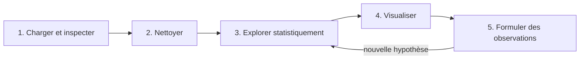

## Introduction

Ce chapitre réunit les compétences des cinq chapitres précédents dans un exercice complet : mener une analyse exploratoire (EDA, Exploratory Data Analysis) de bout en bout sur un jeu de données de connexions réseau, du chargement brut jusqu'aux observations exploitables.

L'analyse exploratoire est la phase où l'on apprend à connaître ses données avant de leur poser des questions précises ou d'entraîner un modèle. En sécurité, elle correspond très directement à la démarche de threat hunting : partir d'un volume de logs sans alerte préalable, chercher ce qui ne ressemble pas au reste, et formuler des hypothèses à vérifier. Une EDA bâclée produit des modèles qui apprennent des artefacts de collecte, et des rapports qui affirment des choses fausses.

À la fin de ce chapitre, tu sauras dérouler une EDA en cinq étapes reproductibles, lire les statistiques descriptives avec un œil critique, comprendre pourquoi une corrélation peut s'effondrer à cause de trois lignes, et rédiger des observations qu'un collègue pourra vérifier.



Le processus n'est pas strictement linéaire : une observation fait souvent naître une nouvelle question, qui renvoie à l'exploration statistique.

## Le jeu de données de travail

Pour que tu obtiennes exactement les mêmes résultats que ce chapitre, voici un générateur de données synthétiques mais réalistes. Il simule une semaine de connexions d'un réseau interne : du trafic web ordinaire, cent sessions longues vers le port 6667, trois transferts massifs très courts, quelques volumes manquants et des lignes dupliquées. Les chapitres 7 et 8 réutiliseront ce fichier.

```python
# generer_connexions.py — crée connexions.csv (une semaine de trafic simulé)
import numpy as np
import pandas as pd

rng = np.random.default_rng(2026)
n = 2000
ports = rng.choice([443, 80, 22, 53], size=n, p=[0.55, 0.25, 0.10, 0.10])
duree = rng.exponential(12, size=n).round(1) + 0.1           # beaucoup de sessions courtes
# 5 % de sessions longues, concentrées sur le port 6667
longues = rng.choice(n, size=100, replace=False)
ports[longues] = 6667
duree[longues] = rng.uniform(120, 1800, size=100).round(1)
octets = (duree * rng.normal(900, 250, size=n)).clip(60).round()  # volume lié à la durée
# 3 exfiltrations rapides : très courtes, très volumineuses
exfil = rng.choice(np.setdiff1d(np.arange(n), longues), size=3, replace=False)
duree[exfil] = [2.1, 3.4, 1.8]
octets[exfil] = [48_000_000, 52_500_000, 61_200_000]
ports[exfil] = 443
ips = np.array([f"10.0.{rng.integers(0, 4)}.{rng.integers(2, 254)}" for _ in range(n)])
ts = pd.Timestamp("2026-11-02") + pd.to_timedelta(np.sort(rng.integers(0, 7 * 86400, size=n)), unit="s")
df = pd.DataFrame({"timestamp": ts.strftime("%Y-%m-%d %H:%M:%S"), "ip_source": ips,
                   "port": ports, "duree_s": duree, "octets": octets})
df["est_suspect"] = ((df["port"] == 6667) | (df["octets"] > 10_000_000)).astype(int)
# Étiquettes d'analyste imparfaites : un peu d'IRC légitime, quelques autres cas jugés suspects
bruit = np.random.default_rng(1)
df.loc[bruit.choice(longues, size=10, replace=False), "est_suspect"] = 0
df.loc[bruit.choice(np.setdiff1d(np.arange(n), longues), size=15, replace=False), "est_suspect"] = 1
df.loc[rng.choice(n, size=40, replace=False), "octets"] = np.nan           # 2 % de volumes manquants
df = pd.concat([df, df.sample(25, random_state=1)]).reset_index(drop=True)  # 25 doublons
df.to_csv("connexions.csv", index=False)
print(df.shape)
```

La colonne `est_suspect` représente l'étiquette posée par un analyste : 1 pour une connexion jugée suspecte, 0 sinon. Elle servira à entraîner un modèle aux chapitres 7 et 8 ; pendant l'EDA, on l'observe sans s'en servir pour tirer des conclusions.

## Étape 1 — Charger et inspecter

```python
import pandas as pd

df = pd.read_csv("connexions.csv")

print(df.shape)        # (nombre de lignes, nombre de colonnes)
print(df.head())       # aperçu des premières lignes
print(df.dtypes)        # types de chaque colonne
print(df.isnull().sum())  # valeurs manquantes (chapitre 4)
```

```text
(2025, 6)
             timestamp   ip_source  port  duree_s    octets  est_suspect
0  2026-11-02 00:02:23  10.0.0.183   443      7.6    5261.0            0
1  2026-11-02 00:06:13   10.0.2.47    80     34.2   26157.0            0
2  2026-11-02 00:17:35  10.0.1.119   443      2.6    2689.0            0
3  2026-11-02 00:26:22  10.0.2.156   443     28.2       NaN            0
4  2026-11-02 00:34:30  10.0.2.227  6667   1058.7  853732.0            1
timestamp       str
ip_source       str
port          int64
duree_s     float64
octets      float64
est_suspect   int64
dtype: object
timestamp       0
ip_source       0
port            0
duree_s         0
octets         40
est_suspect     0
dtype: int64
```

<TipCallout>
Ces quatre lignes constituent le "premier réflexe" systématique face à tout nouveau jeu de données — avant même de penser à une quelconque analyse ou visualisation, elles répondent à "à quoi ai-je affaire ?".
</TipCallout>

Que nous apprend cette inspection ? Le fichier compte 2 025 lignes et 6 colonnes. La colonne `timestamp` est du texte (`str` avec pandas 3, `object` avec pandas 2) : il faudra la convertir. La colonne `octets` est en `float64` alors que des octets sont des entiers : c'est le signe qu'elle contient des `NaN`, et `isnull().sum()` le confirme avec 40 valeurs manquantes, soit 2 %. Le port est un entier, mais tu sais depuis le chapitre 1 qu'il faudra le traiter comme une catégorie.

Deux vérifications complémentaires sont utiles à ce stade : `df["ip_source"].nunique()` indique 862 adresses distinctes, et `df.duplicated().sum()` révèle 25 lignes en double.

## Étape 2 — Nettoyer

```python
# Suppression des doublons (chapitre 4)
df = df.drop_duplicates()

# Conversion des types (chapitre 4)
df["timestamp"] = pd.to_datetime(df["timestamp"])
df["octets"] = pd.to_numeric(df["octets"], errors="coerce")

# Imputation des valeurs manquantes numériques par la médiane
df["octets"] = df["octets"].fillna(df["octets"].median())
print(df.shape)   # (2000, 6)
```

Après suppression des 25 doublons, il reste 2 000 connexions. L'imputation par la médiane est justifiée ici : les valeurs manquantes sont réparties au hasard dans la semaine (tu peux le vérifier avec un `resample` de `df["octets"].isna()`), et la distribution des volumes est extrêmement asymétrique, comme on va le voir. Garde néanmoins en tête que chaque ligne imputée porte désormais un volume fictif de 7 497,5 octets ; ce détail aura une conséquence plus loin.

## Étape 3 — Explorer statistiquement

```python
print(df.describe())  # statistiques descriptives (cours Mathématiques Appliquées, ch.6)

# Corrélations entre variables numériques (cours Data Science Complète, ch.4)
print(df.corr(numeric_only=True))
```

Concentrons-nous sur les deux variables quantitatives, la durée et le volume :

```python
print(df[["duree_s", "octets"]].describe().round(1))
```

```text
       duree_s      octets
count   2000.0      2000.0
mean      61.0    131561.8
std      241.8   2105885.7
min        0.1        83.0
25%        3.8      3271.2
50%        9.0      7497.5
75%       19.0     17567.2
max     1795.0  61200000.0
```

### Lire les statistiques descriptives

La médiane des durées vaut 9 secondes, mais la moyenne vaut 61 secondes : près de sept fois plus. Pour le volume, l'écart est encore plus spectaculaire, avec une médiane de 7,5 Ko contre une moyenne de 131 Ko, et un maximum de 61,2 millions d'octets, soit plus de 8 000 fois la médiane. Une moyenne très supérieure à la médiane signale une distribution asymétrique à droite : quelques valeurs énormes tirent la moyenne vers le haut. Les quartiles complètent le tableau : trois connexions sur quatre durent moins de 19 secondes.

Calculons la proportion de connexions courtes et regardons où se trouvent les longues :

```python
print((df["duree_s"] < 60).mean())                        # 0.9445
print(df.loc[df["duree_s"] >= 60, "port"].value_counts())
```

```text
0.9445
port
6667    100
443       7
80        3
22        1
Name: count, dtype: int64
```

Environ 94 % des connexions durent moins d'une minute, et sur les 111 connexions plus longues, 100 visent le port 6667, historiquement associé à IRC (Internet Relay Chat), un protocole longtemps utilisé comme canal de commande et de contrôle par des botnets.

Une agrégation par port confirme que ce port se comporte comme aucun autre :

```python
print(df.groupby("port").agg(n=("duree_s", "size"),
                             duree_med=("duree_s", "median"),
                             octets_med=("octets", "median")).round(1))
```

```text
         n  duree_med  octets_med
port                             
22     180        8.0      7497.5
53     200        9.1      7446.0
80     511        8.6      7497.5
443   1009        7.9      6974.0
6667   100     1008.5    766715.0
```

### Le piège de la corrélation de Pearson

```python
print(df[["duree_s", "octets"]].corr().round(2))                   # Pearson
print(df[["duree_s", "octets"]].corr(method="spearman").round(2))  # Spearman
```

```text
         duree_s  octets
duree_s     1.00    0.08
octets      0.08    1.00
         duree_s  octets
duree_s     1.00    0.95
octets      0.95    1.00
```

La corrélation de Pearson entre durée et volume vaut 0,08 : on conclurait hâtivement que les deux variables n'ont rien à voir. Pourtant, par construction du trafic, le volume croît avec la durée. Que se passe-t-il ? Pearson mesure une relation linéaire et repose sur des moyennes et des écarts-types, donc il est extrêmement sensible aux valeurs extrêmes. Trois lignes à plus de 48 millions d'octets pour 2 à 3 secondes suffisent à écraser le coefficient.

La corrélation de Spearman calcule la même chose sur les rangs des valeurs plutôt que sur les valeurs elles-mêmes : elle mesure une relation monotone et reste robuste aux extrêmes. Elle vaut 0,95. Et si l'on retire les transferts de plus de 10 millions d'octets, Pearson remonte à 0,93. L'écart spectaculaire entre Pearson et Spearman est lui-même un signal : il y a des points qui cassent la relation générale, et ce sont précisément eux qu'il faut regarder.

<CompareTable
  titleA="Pearson"
  titleB="Spearman"
  rows={[
    { a: "Mesure une relation linéaire", b: "Mesure une relation monotone (croissante ou décroissante)" },
    { a: "Calculé sur les valeurs brutes", b: "Calculé sur les rangs des valeurs" },
    { a: "Très sensible aux valeurs extrêmes", b: "Robuste aux valeurs extrêmes" },
    { a: "df.corr()", b: "df.corr(method=\"spearman\")" },
]}
/>

## Étape 4 — Visualiser

```python
import seaborn as sns
import matplotlib.pyplot as plt

fig, axes = plt.subplots(1, 2, figsize=(12, 4))

sns.histplot(df["octets"], bins=30, ax=axes[0])
axes[0].set_title("Distribution du volume de données")

sns.boxplot(data=df, x="port", y="duree_s", ax=axes[1])
axes[1].set_title("Durée de connexion par port")

plt.tight_layout()
plt.show()
```

<CehCallout>
Combiner plusieurs graphiques dans une même figure (via `plt.subplots`) permet de comparer visuellement plusieurs aspects du jeu de données côte à côte, sans multiplier les fenêtres séparées — une pratique courante lors d'une exploration de logs de sécurité.
</CehCallout>

Sur l'histogramme de gauche, tu verras une seule barre géante près de zéro et un axe horizontal qui s'étire jusqu'à 60 millions : les trois transferts massifs écrasent tout le reste. C'est le cas d'école pour l'échelle logarithmique du chapitre 5 ; avec `sns.histplot(df["octets"], bins=30, log_scale=True)`, la masse du trafic ordinaire, autour de quelques kilo-octets, et le groupe des sessions IRC, autour de quelques centaines de kilo-octets, apparaissent comme deux bosses distinctes. Sur le boxplot de droite, la boîte du port 6667 flotte très au-dessus des autres, dont les boîtes sont écrasées près de zéro, avec quelques points atypiques.

Le graphique le plus révélateur ici est le nuage de points en échelle logarithmique sur les deux axes :

```python
ax = sns.scatterplot(data=df, x="duree_s", y="octets", hue="port", palette="colorblind", alpha=0.6)
ax.set(xscale="log", yscale="log", xlabel="Durée (s)", ylabel="Volume (octets)",
       title="Volume selon la durée de connexion")
plt.show()
```

La grande majorité des points forme une bande diagonale : plus une connexion dure, plus elle transfère de données. Les sessions IRC prolongent cette bande vers la droite. Et trois points isolés se détachent tout en haut à gauche, très loin de la diagonale : très courts, très volumineux.

### Chercher ce qui casse la règle

Formalisons ce que le nuage de points montre, avec un filtre et une variable dérivée, le débit :

```python
courtes_lourdes = df[(df["duree_s"] < 10) & (df["octets"] > 1_000_000)]
print(courtes_lourdes[["timestamp", "ip_source", "port", "duree_s", "octets"]])
```

```text
               timestamp   ip_source  port  duree_s      octets
62   2026-11-02 04:48:09  10.0.1.102   443      3.4  52500000.0
88   2026-11-02 07:07:42   10.0.3.12   443      2.1  48000000.0
1246 2026-11-06 10:33:57  10.0.1.246   443      1.8  61200000.0
```

Trois connexions HTTPS de moins de 4 secondes ont chacune transféré entre 48 et 61 millions d'octets, depuis trois machines différentes, dont une à 4 h 48 du matin. Un débit de l'ordre de 15 à 34 Mo par seconde vers l'extérieur, en une rafale, est cohérent avec une exfiltration rapide d'archive.

<WarningCallout>
Si tu calcules le débit `octets / duree_s` et que tu tries par ordre décroissant, les lignes 4 et 5 du classement sont des connexions de 0,2 et 0,7 seconde avec exactement 7 497,5 octets : ce sont des lignes dont le volume a été imputé par la médiane à l'étape 2. L'imputation a fabriqué de faux débits élevés. Garde toujours une colonne indicatrice des valeurs imputées, et exclue ces lignes des calculs qui en dépendent.
</WarningCallout>

## Étape 5 — Formuler des observations exploitables

<WarningCallout>
Une analyse exploratoire n'a de valeur que si elle débouche sur des observations formulées clairement — "quelques connexions au port 6667 présentent des volumes largement supérieurs à la médiane" est actionnable, alors que "les données ont été analysées" ne l'est pas. Rappel du principe du cours Rédaction de Rapports : une observation doit toujours être spécifique et vérifiable.
</WarningCallout>

Voici le format attendu, sur un exemple type de jeu de connexions :

```text
Exemple d'observations formulées à l'issue d'une EDA :

1. 95% des connexions durent moins de 60 secondes ; les 5% restantes,
   concentrées sur le port 6667 (souvent associé à IRC), méritent
   une investigation manuelle.

2. Le volume de données (octets) est fortement corrélé à la durée
   de connexion (r = 0.82), sans surprise, mais 3 connexions courtes
   présentent un volume disproportionné — candidates à une exfiltration
   rapide de données.
```

Ce qui rend la seconde observation intéressante, c'est le contraste : la règle générale (le volume suit la durée) rend d'autant plus suspects les points qui la violent. Une connexion longue et volumineuse est normale ; une connexion courte et massive ne l'est pas.

Appliqué à notre propre jeu de données, cela donne :

```text
Observations — connexions internes du 2 au 8 novembre 2026 (2 000 connexions après dédoublonnage)

1. 94,5 % des connexions durent moins de 60 secondes. Sur les 111 plus longues,
   100 visent le port 6667 (IRC), avec une durée médiane de 1 008 s et un volume
   médian de 767 Ko, contre 8 s et 7,5 Ko pour les autres ports. Action : identifier
   les hôtes concernés et vérifier si un usage IRC est légitime.

2. Le volume suit fortement la durée (Spearman = 0,95), mais 3 connexions HTTPS de
   moins de 4 s ont transféré 48 à 61 Mo chacune (10.0.1.102, 10.0.3.12, 10.0.1.246),
   dont une à 04:48. Action : identifier les destinations et le processus émetteur.

3. Limite : 40 volumes manquants (2 %) ont été imputés par la médiane ; 25 doublons
   exacts ont été retirés. Les données brutes sont conservées.
```

Chaque phrase contient un chiffre, une période, un périmètre et, quand c'est pertinent, une action. Un collègue peut refaire chaque calcul et arriver au même résultat. La troisième observation documente les limites : c'est ce qui rend l'analyse digne de confiance.

<AttackDefenseTable rows={[
  { phase: "Commande et contrôle", attack: "Canal C2 sur un protocole applicatif comme IRC (MITRE ATT&CK T1071), sessions longues et persistantes", defense: "Agrégation par port de la durée médiane, boxplot par port, inventaire des ports autorisés en sortie" },
  { phase: "Exfiltration", attack: "Transfert massif et bref sur le canal C2 ou en HTTPS (T1041, T1048) pour se fondre dans le trafic web", defense: "Nuage de points durée/volume en échelle log, recherche des points hors de la diagonale, débit par connexion" },
  { phase: "Évasion par le volume", attack: "Fractionner l'exfiltration en nombreux petits transferts sous les seuils", defense: "Agréger le volume par hôte et par jour avec groupby et resample, pas seulement connexion par connexion" },
]} />

## Erreurs fréquentes

- **Sauter l'inspection** : entraîner un modèle sur des dates restées en texte, des doublons ou des `NaN` produit des résultats faux sans message d'erreur.
- **Se fier à la moyenne** sur des données réseau : elle est dominée par quelques valeurs extrêmes. Regarde toujours la médiane et les quartiles.
- **Conclure à l'absence de lien sur la seule corrélation de Pearson** : compare avec Spearman et regarde le nuage de points.
- **Oublier les effets de ses propres traitements** : une imputation crée des valeurs artificielles qui peuvent ressortir comme anomalies.
- **Utiliser l'étiquette cible pour orienter l'exploration**, puis s'étonner que le modèle semble parfait : l'EDA doit décrire les données, pas valider une conclusion décidée d'avance.
- **Rédiger des observations vagues** : sans chiffre, sans période ni périmètre, une observation n'est ni vérifiable ni actionnable.

## Lab — Mise en pratique

**Environnement** : Python 3.12 ou plus récent avec pandas, NumPy, Matplotlib et Seaborn (terminal Nyx Shell ou environnement local).

<Steps steps={[
  { title: "Générer le jeu de données", description: "Copie le script generer_connexions.py du chapitre dans un fichier et exécute-le. Il doit afficher (2025, 6) et créer connexions.csv, réutilisé aux chapitres 7 et 8.", code: "python generer_connexions.py\nhead -3 connexions.csv" },
  { title: "Charger et inspecter le jeu de données", description: "Charge l'export de logs réseau et affiche sa forme, son aperçu, ses types et ses valeurs manquantes. Explique pourquoi la colonne octets est en float64.", code: "import pandas as pd\n\ndf = pd.read_csv('connexions.csv')\n\nprint(df.shape)\nprint(df.head())\nprint(df.dtypes)\nprint(df.isnull().sum())\nprint(df.duplicated().sum(), df['ip_source'].nunique())" },
  { title: "Nettoyer le jeu de données", description: "Supprime les doublons, convertis les types, ajoute une colonne indicatrice puis impute les valeurs manquantes numériques par la médiane. Il doit rester 2 000 lignes.", code: "df = df.drop_duplicates()\ndf['timestamp'] = pd.to_datetime(df['timestamp'])\ndf['octets'] = pd.to_numeric(df['octets'], errors='coerce')\ndf['octets_impute'] = df['octets'].isna()\ndf['octets'] = df['octets'].fillna(df['octets'].median())\nprint(df.shape)" },
  { title: "Explorer statistiquement", description: "Calcule les statistiques descriptives, la proportion de connexions de moins de 60 secondes et une agrégation par port. Compare moyenne et médiane.", code: "print(df[['duree_s', 'octets']].describe().round(1))\nprint((df['duree_s'] < 60).mean())\nprint(df.groupby('port').agg(n=('duree_s', 'size'), duree_med=('duree_s', 'median'), octets_med=('octets', 'median')))" },
  { title: "Comparer Pearson et Spearman", description: "Calcule les deux corrélations entre durée et volume, puis recalcule Pearson sans les transferts de plus de 10 Mo. Explique l'écart.", code: "cols = ['duree_s', 'octets']\nprint(df[cols].corr().round(2))\nprint(df[cols].corr(method='spearman').round(2))\nprint(df.loc[df['octets'] < 10_000_000, cols].corr().round(2))" },
  { title: "Visualiser", description: "Trace côte à côte l'histogramme des volumes en échelle logarithmique et le boxplot des durées par port, puis le nuage de points durée/volume en double échelle log. Repère les trois points isolés en haut à gauche.", code: "import seaborn as sns\nimport matplotlib.pyplot as plt\n\nfig, axes = plt.subplots(1, 2, figsize=(12, 4))\nsns.histplot(df['octets'], bins=30, log_scale=True, ax=axes[0])\naxes[0].set_title('Distribution du volume de donnees')\nsns.boxplot(data=df, x='port', y='duree_s', ax=axes[1])\naxes[1].set_title('Duree de connexion par port')\nplt.tight_layout()\nplt.show()\n\nax = sns.scatterplot(data=df, x='duree_s', y='octets', hue='port', alpha=0.6)\nax.set(xscale='log', yscale='log')\nplt.show()" },
  { title: "Isoler les connexions suspectes", description: "Identifie les connexions dont le volume dépasse dix fois la médiane, puis les connexions courtes et massives, en excluant les lignes imputées. Tu dois retrouver les trois transferts de 48 à 61 Mo.", code: "seuil = df['octets'].median() * 10\nsuspectes = df[(df['octets'] > seuil) & ~df['octets_impute']]\nprint(suspectes['port'].value_counts())\ncourtes_lourdes = df[(df['duree_s'] < 10) & (df['octets'] > 1_000_000)]\nprint(courtes_lourdes[['timestamp', 'ip_source', 'port', 'duree_s', 'octets']])" },
  { title: "Rédiger tes observations", description: "Rédige trois observations chiffrées sur le modèle du chapitre : un fait, un périmètre, une période et une action. Ajoute une ligne de limites (doublons, imputations)." },
]} />

## À retenir

- Une analyse exploratoire complète suit une séquence reproductible : inspection, nettoyage, statistiques, visualisation, observations, avec des allers-retours quand une observation fait naître une hypothèse.
- Les quatre commandes du premier réflexe sont `df.shape`, `df.head()`, `df.dtypes` et `df.isnull().sum()`.
- Sur des données réseau, la médiane et les quartiles décrivent mieux le trafic typique que la moyenne, dominée par quelques extrêmes.
- La corrélation de Pearson peut s'effondrer à cause de quelques points ; Spearman et le nuage de points en échelle logarithmique révèlent la vraie relation et les points qui la violent.
- Combiner plusieurs graphiques dans une même figure facilite la comparaison visuelle de plusieurs aspects d'un jeu de données.
- Les traitements de nettoyage, comme l'imputation, peuvent créer de fausses anomalies : marque toujours les valeurs imputées.
- Une EDA n'a de valeur que si elle débouche sur des observations spécifiques et vérifiables, accompagnées de leurs limites, pas de simples constats vagues.

## Questions de révision

1. Quelles sont les quatre premières commandes à exécuter systématiquement face à un nouveau jeu de données, et que t'apprend chacune ?
2. Pourquoi combiner plusieurs graphiques dans une même figure est-il utile lors d'une EDA ?
3. Pourquoi « les données ont été analysées » n'est-elle pas une observation exploitable, contrairement à une observation chiffrée et spécifique ?
4. Dans le jeu de ce chapitre, la moyenne des durées vaut 61 secondes et la médiane 9 secondes : qu'en déduis-tu sur la distribution ?
5. Pourquoi la corrélation de Pearson entre durée et volume vaut-elle 0,08 alors que Spearman vaut 0,95 ? Qu'est-ce que cet écart doit te pousser à faire ?
6. Pourquoi une connexion courte et très volumineuse est-elle plus suspecte qu'une connexion longue et très volumineuse ?
7. Comment l'imputation par la médiane a-t-elle produit de faux débits élevés, et comment s'en prémunir ?
