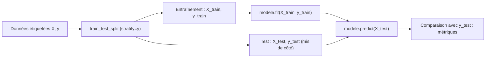

## Introduction

Ce chapitre met en pratique avec du code les concepts de machine learning supervisé vus au cours Data Science Complète (chapitres 5 et 7) — entraîner un premier modèle de classification avec scikit-learn, la bibliothèque de référence pour le machine learning classique en Python.

Le machine learning supervisé consiste à apprendre une règle de décision à partir d'exemples dont on connaît déjà la réponse. En sécurité, les cas d'usage sont nombreux : classer un email en phishing ou légitime, un fichier en malveillant ou bénin, une connexion en normale ou suspecte, ou prioriser des alertes SOC. Un filtre anti-phishing ne remplace pas l'analyste, mais il trie des milliers de messages par heure pour que l'analyste regarde les bons.

À la fin de ce chapitre, tu sauras entraîner un classifieur, l'évaluer honnêtement sur des données qu'il n'a jamais vues, lire les métriques qui comptent vraiment quand les attaques sont rares, comparer plusieurs algorithmes à une référence naïve, et ajuster le compromis entre attaques manquées et fausses alertes.

## L'API commune de scikit-learn

### Vocabulaire

Quelques termes reviennent sans cesse. Les caractéristiques (features), notées `X`, sont les colonnes décrivant chaque exemple : nombre de liens, présence de mots d'urgence, etc. `X` est un tableau à deux dimensions, une ligne par exemple et une colonne par caractéristique. La cible (target), notée `y`, est la réponse à prédire, une valeur par exemple : 0 pour un email normal, 1 pour un phishing. Un estimateur est tout objet scikit-learn qui apprend à partir de données ; un classifieur est un estimateur qui prédit une catégorie.

<CehCallout>
Presque tous les modèles scikit-learn partagent la même interface : `.fit(X, y)` pour entraîner, `.predict(X)` pour prédire — cette cohérence permet de changer d'algorithme (k-NN, arbre de décision, autre) en modifiant une seule ligne de code, sans réécrire tout le pipeline autour.
</CehCallout>

| Méthode | Rôle | Disponible sur |
| --- | --- | --- |
| `fit(X, y)` | Apprend les paramètres à partir des données d'entraînement | Tous les estimateurs |
| `predict(X)` | Renvoie la classe prédite pour chaque ligne | Classifieurs et régresseurs |
| `predict_proba(X)` | Renvoie la probabilité estimée de chaque classe | La plupart des classifieurs |
| `score(X, y)` | Renvoie une métrique par défaut (l'accuracy pour un classifieur) | Classifieurs et régresseurs |
| `transform(X)` | Transforme les données (normalisation, encodage) | Transformateurs |
| `fit_transform(X)` | Apprend puis transforme en une étape | Transformateurs |

Après `fit`, les paramètres appris sont stockés dans des attributs dont le nom se termine par un tiret bas, comme `feature_importances_` ou `classes_`. C'est une convention : un attribut avec tiret bas final n'existe qu'une fois le modèle entraîné.

### Un premier modèle

```python
from sklearn.model_selection import train_test_split
from sklearn.neighbors import KNeighborsClassifier
from sklearn.metrics import classification_report

# X : caractéristiques (features), y : étiquettes (0 = normal, 1 = phishing)
X_train, X_test, y_train, y_test = train_test_split(X, y, test_size=0.2, random_state=42)

modele = KNeighborsClassifier(n_neighbors=5)  # rappel du cours Data Science Complète, ch.5
modele.fit(X_train, y_train)

predictions = modele.predict(X_test)
print(classification_report(y_test, predictions))
```

Le k-NN (k plus proches voisins) classe un nouvel exemple selon la classe majoritaire de ses cinq voisins les plus proches dans les données d'entraînement. `train_test_split` mélange les lignes puis en réserve une partie pour le test : `test_size=0.2` en garde 20 %, et `random_state=42` fixe la graine du mélange pour obtenir le même découpage à chaque exécution.

<WarningCallout>
Rappel du cours Data Science Complète (chapitre 7) : `train_test_split` sépare systématiquement les données en un jeu d'entraînement et un jeu de test JAMAIS utilisé pendant l'entraînement — évaluer un modèle sur les données qui ont servi à l'entraîner donnerait une estimation trompeusement optimiste de sa performance réelle.
</WarningCallout>

Un modèle évalué sur ses propres données d'entraînement, c'est un étudiant qui passe un examen dont il a appris les réponses par cœur : la note ne dit rien de sa capacité à résoudre un nouveau problème. Un arbre de décision sans limite de profondeur atteint d'ailleurs souvent 100 % sur ses données d'entraînement, tout en se trompant beaucoup plus sur de nouveaux exemples. Ce phénomène s'appelle le surapprentissage.

Quand une classe est rare, ajoute `stratify=y` : le découpage conserve alors la même proportion de chaque classe dans l'entraînement et dans le test. Sans lui, un jeu de test pourrait, par malchance, contenir très peu d'exemples de phishing.



## Lire un rapport de classification

```text
              precision    recall  f1-score   support

           0       0.98      0.99      0.99       950
           1       0.85      0.72      0.78        50

    accuracy                           0.97      1000
```

Chaque ligne correspond à une classe, et chaque colonne à une métrique :

- **precision** (précision) : parmi les emails que le modèle a déclarés phishing, quelle proportion l'était vraiment ? Une précision de 0,85 signifie que 15 % des alertes sont de fausses alertes.
- **recall** (rappel) : parmi les vrais phishing, quelle proportion le modèle a-t-il détectée ? Un rappel de 0,72 signifie qu'il en a trouvé 72 %.
- **f1-score** : la moyenne harmonique de la précision et du rappel, qui n'est élevée que si les deux le sont : `2 × P × R / (P + R)`. Pour la classe 1 : 2 × 0,85 × 0,72 / (0,85 + 0,72) ≈ 0,78.
- **support** : le nombre d'exemples réels de chaque classe dans le jeu de test, ici 950 normaux et 50 phishing.
- **accuracy** (exactitude) : la proportion totale de bonnes prédictions, toutes classes confondues.

<CehCallout>
Rappel du cours Data Science Complète (chapitre 7) : sur ce jeu déséquilibré (950 exemples normaux contre 50 phishing), l'accuracy globale de 0.97 est moins informative que le rappel de la classe 1 (0.72) — cela signifie que 28% des emails de phishing réels ne sont PAS détectés, une information cruciale masquée par l'accuracy globale.
</CehCallout>

Pour mesurer à quel point l'accuracy peut tromper, imagine un « modèle » qui déclare tous les emails légitimes, sans rien apprendre. Sur ce jeu, il obtiendrait 950 bonnes réponses sur 1 000, soit 0,95 d'accuracy, pour un rappel de zéro : il ne détecte aucune attaque.

### La matrice de confusion

La matrice de confusion détaille les quatre issues possibles. Par convention dans scikit-learn, les lignes correspondent à la classe réelle et les colonnes à la classe prédite.

| | Prédit normal | Prédit phishing |
| --- | --- | --- |
| **Réellement normal** | Vrais négatifs (VN) | Faux positifs (FP) : fausses alertes |
| **Réellement phishing** | Faux négatifs (FN) : attaques manquées | Vrais positifs (VP) |

La précision vaut VP / (VP + FP) et le rappel VP / (VP + FN). En sécurité, ces deux erreurs n'ont pas le même coût : un faux négatif est une attaque qui passe, un faux positif fait perdre du temps à un analyste. Trop de faux positifs finissent pourtant par coûter cher eux aussi, car un SOC submergé d'alertes inutiles finit par ignorer les vraies, un phénomène appelé fatigue d'alerte.

## Un exemple complet — détection de phishing simplifiée

### Le jeu de données

Pour pouvoir exécuter l'exemple, génère un jeu synthétique de 4 000 emails décrits par quatre caractéristiques, avec environ 5 % de phishing :

```python
# generer_emails.py — crée emails.csv (4 000 emails, environ 5 % de phishing)
import numpy as np
import pandas as pd

rng = np.random.default_rng(42)
n = 4000
est_phishing = (rng.random(n) < 0.05).astype(int)
p = est_phishing == 1
df = pd.DataFrame({
    "nb_liens": np.where(p, rng.poisson(5, n), rng.poisson(2, n)),
    "contient_urgence": np.where(p, rng.random(n) < 0.7, rng.random(n) < 0.08).astype(int),
    "domaine_recent": np.where(p, rng.random(n) < 0.6, rng.random(n) < 0.03).astype(int),
    "nb_fautes": np.where(p, rng.poisson(3, n), rng.poisson(0.8, n)),
    "est_phishing": est_phishing,
})
df.to_csv("emails.csv", index=False)
```

`nb_liens` compte les liens du message, `contient_urgence` vaut 1 si le texte contient des formules comme « action requise » ou « votre compte sera suspendu », `domaine_recent` vaut 1 si le domaine expéditeur a été enregistré récemment, et `nb_fautes` compte les fautes d'orthographe. Chaque caractéristique est plus fréquente ou plus élevée chez les phishing, mais aucune ne suffit seule : des emails légitimes contiennent aussi des liens et des urgences.

### Entraîner et évaluer

```python
import pandas as pd
from sklearn.model_selection import train_test_split
from sklearn.ensemble import RandomForestClassifier
from sklearn.metrics import classification_report

df = pd.read_csv("emails.csv")

X = df[["nb_liens", "contient_urgence", "domaine_recent", "nb_fautes"]]
y = df["est_phishing"]

X_train, X_test, y_train, y_test = train_test_split(X, y, test_size=0.25, random_state=42)

modele = RandomForestClassifier(n_estimators=200, random_state=42)
modele.fit(X_train, y_train)

predictions = modele.predict(X_test)
print(classification_report(y_test, predictions))
```

En ajoutant `stratify=y` au découpage, on obtient :

```text
              precision    recall  f1-score   support

           0       0.99      0.99      0.99       951
           1       0.85      0.71      0.78        49

    accuracy                           0.98      1000
   macro avg       0.92      0.85      0.88      1000
weighted avg       0.98      0.98      0.98      1000
```

Le résultat est très proche du rapport étudié plus haut : une accuracy flatteuse de 0,98, mais un rappel de 0,71 sur le phishing. Les lignes `macro avg` et `weighted avg` sont deux moyennes des classes : la moyenne macro donne le même poids à chaque classe, ce qui fait ressortir la faiblesse sur la classe rare, tandis que la moyenne pondérée suit le support et reste donc dominée par la classe majoritaire.

```python
from sklearn.metrics import confusion_matrix
print(confusion_matrix(y_test, predictions))
print({col: round(float(v), 3) for col, v in zip(X.columns, modele.feature_importances_)})
```

```text
[[945   6]
 [ 14  35]]
{'nb_liens': 0.332, 'contient_urgence': 0.145, 'domaine_recent': 0.2, 'nb_fautes': 0.323}
```

Sur 49 phishing, 35 sont détectés et 14 passent ; sur 951 emails légitimes, 6 déclenchent une fausse alerte. Vérifions le rappel à la main : 35 / (35 + 14) = 0,714. Les importances indiquent quelles caractéristiques la forêt a le plus utilisées pour séparer les classes : ici le nombre de liens et de fautes. Elles décrivent le modèle, pas une relation de cause à effet.

<TipCallout>
Une forêt aléatoire (Random Forest) combine de nombreux arbres de décision (chapitre 5 du cours Data Science Complète) entraînés sur des sous-échantillons différents des données, puis fait voter leurs prédictions — cette approche d'ensemble réduit généralement le risque de surapprentissage d'un arbre unique.
</TipCallout>

## Comparer plusieurs modèles

```python
from sklearn.tree import DecisionTreeClassifier
from sklearn.ensemble import RandomForestClassifier

modeles = {
    "k-NN": KNeighborsClassifier(n_neighbors=5),
    "Arbre de décision": DecisionTreeClassifier(max_depth=5),
    "Forêt aléatoire": RandomForestClassifier(n_estimators=100),
}

for nom, modele in modeles.items():
    modele.fit(X_train, y_train)
    score = modele.score(X_test, y_test)
    print(f"{nom} : {score:.3f}")
```

Cette boucle illustre la force de l'API commune, mais elle compare les modèles sur l'accuracy, la métrique la moins utile ici. Améliorons la comparaison en ajoutant le rappel et le F1, et surtout une référence naïve, le `DummyClassifier`, qui prédit toujours la classe majoritaire. Tout modèle doit battre nettement cette référence pour avoir un intérêt.

```python
from sklearn.dummy import DummyClassifier
from sklearn.linear_model import LogisticRegression
from sklearn.pipeline import make_pipeline
from sklearn.preprocessing import StandardScaler
from sklearn.metrics import recall_score, f1_score

modeles = {
    "Référence (classe majoritaire)": DummyClassifier(strategy="most_frequent"),
    "k-NN": KNeighborsClassifier(n_neighbors=5),
    "k-NN normalisé": make_pipeline(StandardScaler(), KNeighborsClassifier(n_neighbors=5)),
    "Arbre de décision": DecisionTreeClassifier(max_depth=5, random_state=42),
    "Forêt aléatoire": RandomForestClassifier(n_estimators=100, random_state=42),
    "Régression logistique équilibrée": LogisticRegression(class_weight="balanced"),
}
for nom, m in modeles.items():
    m.fit(X_train, y_train)
    pred = m.predict(X_test)
    print(f"{nom:<34} accuracy {m.score(X_test, y_test):.3f}  "
          f"recall {recall_score(y_test, pred):.2f}  f1 {f1_score(y_test, pred, zero_division=0):.2f}")
```

```text
Référence (classe majoritaire)     accuracy 0.951  recall 0.00  f1 0.00
k-NN                               accuracy 0.977  recall 0.59  f1 0.72
k-NN normalisé                     accuracy 0.983  recall 0.69  f1 0.80
Arbre de décision                  accuracy 0.978  recall 0.63  f1 0.74
Forêt aléatoire                    accuracy 0.980  recall 0.69  f1 0.77
Régression logistique équilibrée   accuracy 0.951  recall 0.84  f1 0.63
```

Trois enseignements ressortent. D'abord, la référence naïve atteint déjà 0,951 d'accuracy avec un rappel nul : un écart de deux ou trois points d'accuracy entre modèles cache des différences énormes de détection. Ensuite, le k-NN progresse nettement une fois les données normalisées, car il repose sur des distances : sans normalisation, une caractéristique à grande échelle, comme un nombre de liens, écrase une caractéristique binaire. Enfin, la régression logistique avec `class_weight="balanced"`, qui pénalise davantage les erreurs sur la classe rare, détecte 84 % des phishing, au prix de bien plus de fausses alertes et d'une accuracy en baisse.

### Pipeline : enchaîner prétraitement et modèle

`make_pipeline(StandardScaler(), KNeighborsClassifier())` crée un objet unique qui normalise puis classe. Le `StandardScaler` centre chaque colonne sur la moyenne et la divise par l'écart-type. Le pipeline garantit que ces moyennes et écarts-types sont appris uniquement sur les données d'entraînement lors du `fit`, puis simplement appliqués aux données de test lors du `predict`. Normaliser tout le jeu avant le découpage ferait fuiter des informations du test vers l'entraînement : c'est une fuite de données, que le cours Machine Learning détaille.

## Ajuster le seuil de décision

Un classifieur probabiliste ne répond pas directement 0 ou 1 : `predict_proba` renvoie une probabilité, et `predict` applique un seuil de 0,5. Abaisser ce seuil fait détecter plus de phishing, au prix de plus de fausses alertes.

```python
proba = modele.predict_proba(X_test)[:, 1]      # probabilité d'être un phishing
predictions_03 = (proba >= 0.3).astype(int)
print(confusion_matrix(y_test, predictions_03))
```

```text
[[939  12]
 [ 13  36]]
```

Avec un seuil de 0,3, la forêt détecte un phishing de plus et fait six fausses alertes de plus. Le bon seuil n'est pas une question technique mais une décision métier : combien de fausses alertes l'équipe peut-elle absorber pour chaque attaque supplémentaire détectée ?

<CompareTable
  titleA="Seuil bas (rappel élevé)"
  titleB="Seuil haut (précision élevée)"
  rows={[
    { a: "Peu d'attaques manquées", b: "Peu de fausses alertes" },
    { a: "Plus de charge pour les analystes", b: "Davantage d'attaques qui passent" },
    { a: "Adapté au tri initial, avec revue humaine", b: "Adapté au blocage automatique sans revue" },
]}
/>

## Angle offensif : attaquer le classifieur

Un modèle de détection est une cible. Un attaquant qui connaît les caractéristiques utilisées peut les contourner : utiliser un domaine ancien acheté d'occasion, supprimer les fautes, limiter le nombre de liens. On parle d'attaque par évasion, une famille d'attaques contre l'apprentissage automatique répertoriée dans le référentiel MITRE ATLAS.

<AttackDefenseTable rows={[
  { phase: "Hameçonnage", attack: "Phishing ciblé avec lien (MITRE ATT&CK T1566.002) conçu pour ressembler à un email légitime", defense: "Classifieur entraîné sur des caractéristiques multiples, seuil réglé pour la revue humaine" },
  { phase: "Évasion du modèle", attack: "Ajuster les caractéristiques connues du filtre (domaine vieilli, pas de fautes, un seul lien)", defense: "Ne pas publier les caractéristiques, combiner modèle, réputation et règles, réentraîner avec les contournements observés" },
  { phase: "Empoisonnement", attack: "Signaler massivement des phishing comme légitimes pour fausser les étiquettes du prochain entraînement", defense: "Contrôler la qualité et la provenance des étiquettes, surveiller l'évolution des performances" },
]} />

## Erreurs fréquentes

- **Évaluer sur les données d'entraînement** : le score est trompeusement optimiste. Garde toujours un jeu de test séparé.
- **Juger un modèle sur la seule accuracy** quand une classe est rare : regarde le rappel, la précision et la matrice de confusion de la classe minoritaire.
- **Oublier la référence naïve** : sans `DummyClassifier`, impossible de savoir si 0,97 est un bon score.
- **Oublier `stratify=y`** : le jeu de test peut contenir trop peu d'exemples de la classe rare pour une mesure fiable.
- **Ne pas normaliser pour les modèles à distance** comme le k-NN ou les SVM, ou normaliser avant le découpage au lieu d'utiliser un pipeline.
- **Interpréter les importances comme des causes** : elles décrivent ce que le modèle utilise, pas pourquoi un email est malveillant.

## Lab — Mise en pratique

**Environnement** : Python 3.12 ou plus récent avec pandas et scikit-learn (terminal Nyx Shell ou environnement local). Le fichier `connexions.csv` est celui généré au chapitre 6.

<Steps steps={[
  { title: "Préparer les données d'entraînement et de test", description: "Charge le jeu de connexions étiquetées du chapitre 6, nettoie-le, puis sépare-le en jeu d'entraînement et de test en conservant la proportion de connexions suspectes.", code: "import pandas as pd\nfrom sklearn.model_selection import train_test_split\n\ndf = pd.read_csv('connexions.csv').drop_duplicates()\ndf['octets'] = df['octets'].fillna(df['octets'].median())\nX = df[['duree_s', 'octets', 'port']]\ny = df['est_suspect']\n\nX_train, X_test, y_train, y_test = train_test_split(X, y, test_size=0.2, random_state=42, stratify=y)\nprint(X_train.shape, X_test.shape, y_test.mean().round(3))" },
  { title: "Entraîner un premier modèle k-NN", description: "Entraîne un classifieur k-NN et affiche son rapport de classification. Repère le rappel de la classe 1.", code: "from sklearn.neighbors import KNeighborsClassifier\nfrom sklearn.metrics import classification_report\n\nmodele = KNeighborsClassifier(n_neighbors=5)\nmodele.fit(X_train, y_train)\n\npredictions = modele.predict(X_test)\nprint(classification_report(y_test, predictions))" },
  { title: "Comparer avec un arbre de décision et une référence", description: "Compare le score du k-NN, d'un k-NN normalisé et d'un arbre de décision à celui d'un DummyClassifier sur le même jeu de test.", code: "from sklearn.tree import DecisionTreeClassifier\nfrom sklearn.dummy import DummyClassifier\nfrom sklearn.pipeline import make_pipeline\nfrom sklearn.preprocessing import StandardScaler\n\nmodeles = {\n    'Reference': DummyClassifier(strategy='most_frequent'),\n    'k-NN': KNeighborsClassifier(n_neighbors=5),\n    'k-NN normalise': make_pipeline(StandardScaler(), KNeighborsClassifier(n_neighbors=5)),\n    'Arbre de decision': DecisionTreeClassifier(max_depth=5, random_state=42),\n}\n\nfor nom, m in modeles.items():\n    m.fit(X_train, y_train)\n    print(f'{nom} : {m.score(X_test, y_test):.3f}')" },
  { title: "Générer le jeu d'emails", description: "Exécute le script generer_emails.py du chapitre et vérifie la proportion de phishing, proche de 5 %.", code: "python generer_emails.py\npython -c \"import pandas as pd; print(pd.read_csv('emails.csv')['est_phishing'].value_counts())\"" },
  { title: "Entraîner le détecteur de phishing", description: "Entraîne la forêt aléatoire sur les quatre caractéristiques, puis affiche le rapport de classification et la matrice de confusion. Calcule le rappel à la main à partir de la matrice.", code: "from sklearn.ensemble import RandomForestClassifier\nfrom sklearn.metrics import confusion_matrix\n\nemails = pd.read_csv('emails.csv')\nX = emails[['nb_liens', 'contient_urgence', 'domaine_recent', 'nb_fautes']]\ny = emails['est_phishing']\nX_train, X_test, y_train, y_test = train_test_split(X, y, test_size=0.25, random_state=42, stratify=y)\nrf = RandomForestClassifier(n_estimators=200, random_state=42).fit(X_train, y_train)\npred = rf.predict(X_test)\nprint(classification_report(y_test, pred))\nprint(confusion_matrix(y_test, pred))" },
  { title: "Ajuster le seuil de décision", description: "Calcule les probabilités, puis compare les matrices de confusion pour des seuils de 0,5, 0,3 et 0,1. Note combien d'attaques supplémentaires sont détectées et combien de fausses alertes apparaissent.", code: "proba = rf.predict_proba(X_test)[:, 1]\nfor seuil in [0.5, 0.3, 0.1]:\n    print(seuil, confusion_matrix(y_test, (proba >= seuil).astype(int)).ravel())" },
  { title: "Classer un nouvel email", description: "Construis un email suspect fictif et demande au modèle sa prédiction et sa probabilité. Modifie ensuite ses caractéristiques comme le ferait un attaquant (domaine ancien, aucune faute) et observe l'effet.", code: "nouveau = pd.DataFrame([{'nb_liens': 6, 'contient_urgence': 1, 'domaine_recent': 1, 'nb_fautes': 3}])\nprint(rf.predict(nouveau), rf.predict_proba(nouveau).round(2))\nevasion = pd.DataFrame([{'nb_liens': 1, 'contient_urgence': 1, 'domaine_recent': 0, 'nb_fautes': 0}])\nprint(rf.predict(evasion), rf.predict_proba(evasion).round(2))" },
]} />

## À retenir

- L'API commune de scikit-learn (`.fit`, `.predict`, `.predict_proba`, `.transform`) permet de changer facilement d'algorithme sans réécrire tout le pipeline.
- `train_test_split` garantit une évaluation honnête, sur des données jamais vues pendant l'entraînement ; `stratify=y` préserve la proportion de la classe rare.
- Un rapport de classification révèle des informations (comme un rappel faible sur la classe minoritaire) masquées par la seule accuracy globale.
- La matrice de confusion distingue attaques manquées (faux négatifs) et fausses alertes (faux positifs), dont les coûts diffèrent.
- Tout modèle se compare à une référence naïve ; les modèles à distance exigent une normalisation, apprise dans un Pipeline.
- Le seuil de décision règle le compromis entre rappel et précision, et c'est une décision métier.
- Une forêt aléatoire combine de nombreux arbres entraînés sur des sous-échantillons différents, dont les prédictions sont votées.

## Questions de révision

1. Quelles sont les deux méthodes communes à presque tous les modèles scikit-learn, et à quoi sert `predict_proba` ?
2. Pourquoi ne faut-il jamais évaluer un modèle sur les données utilisées pour l'entraîner ?
3. Pourquoi un rapport de classification est-il plus informatif qu'un simple score d'accuracy sur un jeu de données déséquilibré ?
4. À partir de la matrice `[[945, 6], [14, 35]]`, calcule la précision et le rappel de la classe phishing.
5. Pourquoi le k-NN progresse-t-il une fois les données normalisées, et pourquoi faut-il faire cette normalisation dans un Pipeline ?
6. Dans quel contexte choisirais-tu un seuil de décision bas, et dans lequel un seuil haut ?
7. Comment un attaquant pourrait-il contourner le détecteur de phishing de ce chapitre, et comment s'en protéger ?
