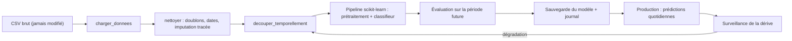

## Introduction

Ce dernier chapitre referme le cours en assemblant chaque brique des sept chapitres précédents — NumPy, Pandas, nettoyage, visualisation, EDA, scikit-learn — dans un pipeline Python unique et structuré, de bout en bout.

Jusqu'ici, tu as écrit du code d'exploration : des cellules exécutées une par une, des variables qui traînent, des chemins de fichiers en dur. C'est parfait pour comprendre un jeu de données, mais inutilisable pour un outil qui doit tourner chaque nuit sur les logs de la veille, être relu par un collègue, ou rejouer exactement une analyse six mois plus tard lors d'un audit. La différence entre un notebook d'exploration et un pipeline fiable tient à quelques principes d'ingénierie logicielle, que ce chapitre met en pratique.

À la fin de ce chapitre, tu sauras organiser un pipeline en fonctions, en faire un script en ligne de commande, regrouper prétraitement et modèle dans un objet scikit-learn unique, évaluer de façon réaliste avec un découpage temporel, tester ton nettoyage, sauvegarder un modèle en connaissant les risques, et surveiller sa dégradation dans le temps.

## Un pipeline complet, étape par étape

### La version de départ

```python
import pandas as pd
from sklearn.model_selection import train_test_split
from sklearn.ensemble import RandomForestClassifier
from sklearn.metrics import classification_report

def charger_donnees(chemin):
    df = pd.read_csv(chemin)
    return df

def nettoyer(df):
    df = df.drop_duplicates()
    df["timestamp"] = pd.to_datetime(df["timestamp"])
    for col in df.select_dtypes(include="number").columns:
        df[col] = df[col].fillna(df[col].median())
    return df

def explorer(df):
    print(df.describe())
    print(df.corr(numeric_only=True))

def entrainer_modele(df, colonnes_features, colonne_cible):
    X = df[colonnes_features]
    y = df[colonne_cible]
    X_train, X_test, y_train, y_test = train_test_split(X, y, test_size=0.2, random_state=42)
    modele = RandomForestClassifier(n_estimators=200, random_state=42)
    modele.fit(X_train, y_train)
    predictions = modele.predict(X_test)
    print(classification_report(y_test, predictions))
    return modele

# Assemblage du pipeline complet
df = charger_donnees("connexions.csv")
df = nettoyer(df)
explorer(df)
modele = entrainer_modele(df, ["duree_s", "octets", "port"], "est_suspect")
```

Chaque fonction correspond à une étape vue dans le cours. `charger_donnees` lit le fichier (chapitre 3). `nettoyer` assemble trois traitements du chapitre 4 : la suppression des doublons, la conversion des dates et l'imputation par la médiane de chaque colonne numérique, sélectionnée avec `select_dtypes(include="number")`. `explorer` affiche les statistiques et corrélations du chapitre 6. Enfin, `entrainer_modele` reprend le chapitre 7 : ses arguments sont le DataFrame, la liste des colonnes de caractéristiques et le nom de la colonne cible, ici `est_suspect`, la variable à prédire.

Exécutée sur le fichier `connexions.csv` généré au chapitre 6, la dernière étape affiche :

```text
              precision    recall  f1-score   support

           0       0.99      0.99      0.99       386
           1       0.80      0.86      0.83        14

    accuracy                           0.99       400
   macro avg       0.90      0.92      0.91       400
weighted avg       0.99      0.99      0.99       400
```

<CehCallout>
Structurer le code en fonctions distinctes (charger, nettoyer, explorer, entraîner) plutôt qu'en un long script linéaire rend chaque étape testable et réutilisable indépendamment — un principe de base de l'ingénierie logicielle qui s'applique tout autant à la data science.
</CehCallout>

### Ce que cette version ne dit pas

Ce premier pipeline fonctionne, mais il a plusieurs faiblesses, que l'on va corriger une à une :

- **Le port est traité comme un nombre.** Pour la forêt, le port 6667 est « plus grand » que le port 443, ce qui n'a aucun sens. Il faut l'encoder comme une catégorie.
- **Le découpage est aléatoire.** En production, le modèle prédira toujours le futur à partir du passé. Mélanger les jours de la semaine dans l'entraînement et le test surestime ses performances.
- **L'imputation porte aussi sur la cible et ne laisse aucune trace** : on ne sait plus quelles lignes ont été imputées.
- **Rien n'est journalisé ni sauvegardé**, et aucun paramètre ne peut être changé sans modifier le code.



## Industrialiser avec un Pipeline scikit-learn

### ColumnTransformer : un traitement par type de colonne

Le `ColumnTransformer` applique des transformations différentes à différentes colonnes, puis concatène le résultat. Ici, on applique un logarithme aux colonnes numériques, très étalées comme l'a montré le chapitre 6, et un encodage one-hot au port. L'encodage one-hot remplace une colonne catégorielle par une colonne binaire par valeur possible : `port_22`, `port_53`, `port_80`, `port_443`, `port_6667`, chacune valant 1 ou 0.

Le `Pipeline` enchaîne ensuite ce prétraitement et le classifieur dans un seul objet, qui possède lui-même `fit` et `predict`. C'est la garantie que le prétraitement appris sur l'entraînement sera appliqué à l'identique aux nouvelles données, sans fuite d'information du test vers l'entraînement.

### Le script complet

```python
"""Pipeline de détection de connexions suspectes : chargement, nettoyage, entraînement, sauvegarde."""
import argparse
import logging
from pathlib import Path

import joblib
import numpy as np
import pandas as pd
from sklearn.compose import ColumnTransformer
from sklearn.ensemble import RandomForestClassifier
from sklearn.metrics import classification_report
from sklearn.pipeline import Pipeline
from sklearn.preprocessing import FunctionTransformer, OneHotEncoder

logging.basicConfig(level=logging.INFO, format="%(asctime)s %(levelname)s %(message)s")
log = logging.getLogger("pipeline")

NUMERIQUES = ["duree_s", "octets"]
CATEGORIELLES = ["port"]
CIBLE = "est_suspect"


def charger_donnees(chemin: Path) -> pd.DataFrame:
    df = pd.read_csv(chemin)
    log.info("Chargé %s : %d lignes, %d colonnes", chemin, *df.shape)
    return df


def nettoyer(df: pd.DataFrame) -> pd.DataFrame:
    avant = len(df)
    df = df.drop_duplicates().copy()          # copie : l'appelant garde ses données intactes
    df["timestamp"] = pd.to_datetime(df["timestamp"])
    df["octets_impute"] = df["octets"].isna()  # tracer les imputations
    df["octets"] = df["octets"].fillna(df["octets"].median())
    log.info("Nettoyage : %d doublons retirés, %d volumes imputés", avant - len(df), df["octets_impute"].sum())
    assert df["timestamp"].notna().all(), "Dates non parsées"
    return df


def construire_modele() -> Pipeline:
    pretraitement = ColumnTransformer([
        ("log", FunctionTransformer(np.log1p), NUMERIQUES),              # écrase les ordres de grandeur
        ("ports", OneHotEncoder(handle_unknown="ignore"), CATEGORIELLES),  # le port est une catégorie
    ])
    return Pipeline([
        ("pretraitement", pretraitement),
        ("classifieur", RandomForestClassifier(n_estimators=200, class_weight="balanced", random_state=42)),
    ])


def decouper_temporellement(df: pd.DataFrame, date_coupure: str) -> tuple[pd.DataFrame, pd.DataFrame]:
    passe = df[df["timestamp"] < date_coupure]
    futur = df[df["timestamp"] >= date_coupure]
    log.info("Entraînement : %d lignes, test : %d lignes (coupure %s)", len(passe), len(futur), date_coupure)
    return passe, futur


def main() -> None:
    parser = argparse.ArgumentParser(description=__doc__)
    parser.add_argument("donnees", type=Path)
    parser.add_argument("--coupure", default="2026-11-07")
    parser.add_argument("--sortie", type=Path, default=Path("modele_connexions.joblib"))
    args = parser.parse_args()

    df = nettoyer(charger_donnees(args.donnees))
    entrainement, test = decouper_temporellement(df, args.coupure)
    modele = construire_modele()
    modele.fit(entrainement[NUMERIQUES + CATEGORIELLES], entrainement[CIBLE])
    print(classification_report(test[CIBLE], modele.predict(test[NUMERIQUES + CATEGORIELLES]), digits=2))
    joblib.dump(modele, args.sortie)
    log.info("Modèle enregistré dans %s", args.sortie)


if __name__ == "__main__":
    main()
```

```bash
python pipeline_detection.py connexions.csv --coupure 2026-11-07
```

```text
2026-11-09 13:51:37,409 INFO Chargé connexions.csv : 2025 lignes, 6 colonnes
2026-11-09 13:51:37,417 INFO Nettoyage : 25 doublons retirés, 40 volumes imputés
2026-11-09 13:51:37,420 INFO Entraînement : 1418 lignes, test : 582 lignes (coupure 2026-11-07)
              precision    recall  f1-score   support

           0       0.99      1.00      0.99       551
           1       0.92      0.77      0.84        31

    accuracy                           0.98       582
   macro avg       0.96      0.89      0.92       582
weighted avg       0.98      0.98      0.98       582

2026-11-09 13:51:38,189 INFO Modèle enregistré dans modele_connexions.joblib
```

Détaillons les choix. Les annotations de type, comme `-> pd.DataFrame`, documentent ce que chaque fonction attend et renvoie. Le module `logging` remplace les `print` de contrôle : chaque message est horodaté et peut être redirigé vers un fichier. `argparse` transforme le script en outil en ligne de commande, dont on change le fichier d'entrée ou la date de coupure sans toucher au code. Le bloc `if __name__ == "__main__"` permet d'importer les fonctions depuis un autre fichier, notamment un fichier de tests, sans lancer tout le pipeline.

Le découpage temporel entraîne sur les cinq premiers jours et teste sur les deux derniers. Le score obtenu est celui d'un modèle qui découvre des journées qu'il n'a jamais vues, exactement la situation de production. Avec seulement 31 connexions suspectes dans la période de test, chaque erreur fait bouger le rappel de plus de trois points : garde cette incertitude en tête avant de comparer deux modèles à un ou deux points près.

## Panorama complet du cours

<CompareTable
  titleA="Chapitre"
  titleB="Brique du pipeline"
  rows={[
    { a: "1. Écosystème", b: "Choix et installation des bibliothèques" },
    { a: "2. NumPy", b: "Calcul vectorisé sous-jacent à tout le reste" },
    { a: "3. Pandas", b: "Chargement et manipulation tabulaire" },
    { a: "4. Nettoyage", b: "Fiabiliser les données avant analyse" },
    { a: "5. Visualisation", b: "Comprendre visuellement les données" },
    { a: "6. EDA complète", b: "Assembler chargement, nettoyage, stats, visualisation" },
    { a: "7. scikit-learn", b: "Entraîner et évaluer un premier modèle" },
    { a: "8. Synthèse", b: "Structurer l'ensemble en pipeline réutilisable" },
]}
/>

## Bonnes pratiques pour du code de data science durable

<Steps steps={[
  { title: "Versionner le code avec Git", description: "Un pipeline de data science évolue — le versionner permet de revenir à une version antérieure si un changement dégrade les résultats." },
  { title: "Séparer données brutes et données nettoyées", description: "Ne jamais écraser les données brutes originales — toujours travailler sur une copie nettoyée distincte." },
  { title: "Documenter les décisions de nettoyage", description: "Pourquoi telle colonne a-t-elle été supprimée, telle imputation choisie ? Une décision non documentée devient une source d'erreur silencieuse des mois plus tard." },
  { title: "Réévaluer régulièrement un modèle en production", description: "Rappel du cours Data Science Complète (chapitre 8) : la dérive de concept impose un suivi et un réentraînement réguliers, pas un déploiement figé indéfiniment." },
]} />

### Organiser le projet

```text
detection-connexions/
├── pyproject.toml          # dépendances (uv add …) et métadonnées
├── uv.lock                 # versions exactes figées
├── data/
│   ├── raw/                # données brutes, en lecture seule, jamais versionnées si sensibles
│   └── processed/          # données nettoyées, régénérables
├── notebooks/              # exploration (sorties nettoyées avant commit)
├── src/pipeline_detection.py
├── tests/test_pipeline.py
└── models/                 # modèles entraînés, avec leur date et leurs métriques
```

Le fichier `.gitignore` doit exclure `data/` et `models/` : Git est fait pour du code, pas pour des gigaoctets de logs qui contiennent souvent des données personnelles. La reproductibilité repose sur trois éléments : le code versionné, les versions de bibliothèques figées dans `uv.lock` ou `requirements.txt`, et des graines aléatoires fixées avec `random_state`.

### Tester le nettoyage

Un test automatisé vérifie qu'une fonction se comporte comme prévu, et le revérifie à chaque modification. Avec pytest :

```python
# tests/test_pipeline.py
import numpy as np
import pandas as pd

from pipeline_detection import nettoyer


def test_nettoyer_supprime_doublons_et_impute():
    brut = pd.DataFrame({
        "timestamp": ["2026-11-02 08:00:00", "2026-11-02 08:00:00", "2026-11-02 09:00:00"],
        "ip_source": ["10.0.0.5", "10.0.0.5", "10.0.0.6"],
        "port": [443, 443, 22],
        "duree_s": [12.0, 12.0, 30.0],
        "octets": [2400.0, 2400.0, np.nan],
        "est_suspect": [0, 0, 0],
    })
    propre = nettoyer(brut)
    assert len(propre) == 2
    assert propre["octets"].notna().all()
    assert propre["octets_impute"].sum() == 1
    assert brut["octets"].isna().sum() == 1   # les données brutes ne sont pas modifiées
```

```text
$ python -m pytest -q
.                                                                        [100%]
1 passed in 2.01s
```

La dernière assertion vérifie une propriété essentielle : la fonction ne modifie pas le DataFrame qu'on lui passe, grâce au `.copy()`.

### Sauvegarder un modèle sans s'exposer

`joblib.dump` sérialise le pipeline entier dans un fichier, que `joblib.load` recharge pour prédire sans réentraîner. Ce format repose sur pickle, le mécanisme de sérialisation de Python.

<WarningCallout>
Charger un fichier pickle ou joblib exécute du code : un modèle piégé peut lancer n'importe quelle commande sur la machine qui l'ouvre. Ne charge jamais un modèle téléchargé ou reçu d'une source non vérifiée, contrôle l'empreinte SHA-256 des modèles que tu déploies, et envisage des formats qui n'exécutent pas de code, comme skops pour scikit-learn ou ONNX pour l'export vers d'autres environnements.
</WarningCallout>

### Surveiller la dérive

Un modèle de détection se dégrade avec le temps : les usages légitimes changent, de nouveaux services apparaissent, et surtout les attaquants s'adaptent. C'est la dérive de concept, vue au cours Data Science Complète. Deux signaux simples à suivre chaque semaine : la distribution des caractéristiques d'entrée, comparée à celle de l'entraînement (par exemple la médiane des durées ou la part de chaque port), et la proportion d'alertes produites. Une proportion d'alertes qui double ou s'effondre sans incident connu indique que le modèle ne voit plus le monde pour lequel il a été entraîné. Le cours Machine Learning approfondit ces méthodes d'évaluation et de mise en production.

<AuditCallout>
Un modèle utilisé pour détecter des incidents est un composant du dispositif de sécurité. Dans un système de management ISO/IEC 27001:2022, il relève notamment de la surveillance des activités (mesure A.8.16) et de la gestion des changements (A.8.32) : version du modèle, données d'entraînement, métriques et date de mise en service doivent être documentées. Si le système d'IA entre dans le champ de l'AI Act européen, des obligations de documentation et de traçabilité s'ajoutent selon son niveau de risque.
</AuditCallout>

## Où aller ensuite

<Steps steps={[
  { title: "Vers IA & Agents en Cybersécurité", description: "Approfondir les réseaux de neurones et les agents autonomes, au-delà du machine learning classique vu ici." },
  { title: "Vers Analyse SOC", description: "Voir comment ce type de pipeline s'intègre concrètement dans le travail quotidien d'un analyste SOC, notamment pour le triage d'alertes." },
]} />

Le cours Machine Learning est aussi une suite naturelle : il ouvre les algorithmes utilisés ici comme des boîtes noires, régression logistique, arbres, forêts, k-NN, et détaille la validation croisée, les fuites de données et la mise en production.

## Erreurs fréquentes

- **Modifier le DataFrame reçu en argument** : l'appelant voit ses données changer. Travaille sur une copie.
- **Imputer la colonne cible** : une étiquette inventée n'est plus une étiquette. Supprime plutôt les lignes sans cible.
- **Encoder des catégories comme des nombres** : un port ou un code d'événement doit passer par un encodage one-hot.
- **Évaluer avec un découpage aléatoire des données temporelles** : préfère entraîner sur le passé et tester sur le futur.
- **Faire le prétraitement hors du Pipeline** : les paramètres appris peuvent fuiter du test vers l'entraînement, et le prétraitement de production risque de différer de celui de l'entraînement.
- **Charger un modèle pickle de provenance inconnue** : c'est une exécution de code arbitraire.
- **Déployer puis oublier** : sans surveillance, la dégradation du modèle passe inaperçue.

## Lab — Mise en pratique

**Environnement** : Python 3.12 ou plus récent avec pandas, scikit-learn et pytest, et le fichier `connexions.csv` du chapitre 6.

<Steps steps={[
  { title: "Structurer le chargement et le nettoyage en fonctions", description: "Reprends un script d'analyse précédent et sépare-le en fonctions charger_donnees et nettoyer. Le nettoyage doit assembler la suppression des doublons, la conversion des dates et l'imputation des valeurs numériques manquantes.", code: "import pandas as pd\n\ndef charger_donnees(chemin):\n    return pd.read_csv(chemin)\n\ndef nettoyer(df):\n    df = df.drop_duplicates().copy()\n    df['timestamp'] = pd.to_datetime(df['timestamp'])\n    for col in df.select_dtypes(include='number').columns:\n        df[col] = df[col].fillna(df[col].median())\n    return df" },
  { title: "Ajouter les fonctions d'exploration et d'entraînement", description: "Complète le pipeline avec les fonctions explorer et entrainer_modele.", code: "from sklearn.model_selection import train_test_split\nfrom sklearn.ensemble import RandomForestClassifier\nfrom sklearn.metrics import classification_report\n\ndef explorer(df):\n    print(df.describe())\n    print(df.corr(numeric_only=True))\n\ndef entrainer_modele(df, colonnes_features, colonne_cible):\n    X, y = df[colonnes_features], df[colonne_cible]\n    X_train, X_test, y_train, y_test = train_test_split(X, y, test_size=0.2, random_state=42)\n    modele = RandomForestClassifier(n_estimators=200, random_state=42)\n    modele.fit(X_train, y_train)\n    print(classification_report(y_test, modele.predict(X_test)))\n    return modele" },
  { title: "Exécuter le pipeline complet", description: "Assemble et exécute les quatre fonctions à la suite sur le jeu de connexions. Note le rappel de la classe 1.", code: "df = charger_donnees('connexions.csv')\ndf = nettoyer(df)\nexplorer(df)\nmodele = entrainer_modele(df, ['duree_s', 'octets', 'port'], 'est_suspect')" },
  { title: "Passer au script industrialisé", description: "Copie le script pipeline_detection.py du chapitre et exécute-le en ligne de commande. Observe les messages de journalisation et le fichier de modèle créé.", code: "python pipeline_detection.py connexions.csv --coupure 2026-11-07\nls -lh modele_connexions.joblib\nsha256sum modele_connexions.joblib" },
  { title: "Comparer découpage aléatoire et temporel", description: "Change la date de coupure (par exemple 2026-11-06 puis 2026-11-08) et compare les rappels obtenus. Explique pourquoi le nombre de connexions suspectes du test influence la stabilité du score.", code: "python pipeline_detection.py connexions.csv --coupure 2026-11-06\npython pipeline_detection.py connexions.csv --coupure 2026-11-08" },
  { title: "Écrire et lancer un test", description: "Crée tests/test_pipeline.py avec le test du chapitre, puis lance pytest. Casse volontairement nettoyer (retire le .copy()) et observe quel test échoue.", code: "pip install pytest\npython -m pytest -q" },
  { title: "Recharger le modèle et prédire", description: "Recharge le modèle sauvegardé (de confiance, puisque tu l'as produit toi-même) et classe deux connexions fictives : une session HTTPS ordinaire et une session longue vers le port 6667.", code: "import joblib\nimport pandas as pd\n\nmodele = joblib.load('modele_connexions.joblib')\nnouvelles = pd.DataFrame({'duree_s': [8.0, 1500.0], 'octets': [7000.0, 900000.0], 'port': [443, 6667]})\nprint(modele.predict(nouvelles))\nprint(modele.predict_proba(nouvelles).round(2))" },
]} />

## À retenir

- Un pipeline de data science complet enchaîne chargement, nettoyage, exploration, visualisation et modélisation, idéalement structuré en fonctions réutilisables et testables.
- Un `Pipeline` scikit-learn avec un `ColumnTransformer` regroupe prétraitement et modèle dans un objet unique, ce qui évite les fuites de données et les écarts entre entraînement et production.
- Les catégories comme les ports s'encodent en one-hot, et les données temporelles s'évaluent en entraînant sur le passé et en testant sur le futur.
- Versionner le code, figer les versions des bibliothèques, séparer données brutes et nettoyées, et documenter les décisions de nettoyage évitent des erreurs coûteuses à long terme.
- Un modèle sérialisé avec pickle ou joblib peut exécuter du code au chargement : ne charge que des modèles de confiance.
- Un modèle déployé nécessite un suivi et un réentraînement réguliers, jamais un déploiement figé indéfiniment, car la dérive de concept le dégrade.

## Questions de révision

1. Pourquoi structurer un pipeline en fonctions distinctes plutôt qu'en un long script linéaire ?
2. Pourquoi est-il important de ne jamais écraser les données brutes originales ?
3. Pourquoi un modèle de détection déployé en production nécessite-t-il un suivi et un réentraînement réguliers ? Quels signaux simples permettent de repérer une dérive ?
4. Pourquoi faut-il encoder le port comme une catégorie plutôt que comme un nombre ?
5. Qu'apporte un découpage temporel par rapport à un découpage aléatoire pour un modèle de détection d'intrusion ?
6. Pourquoi faut-il placer la normalisation ou l'encodage à l'intérieur d'un Pipeline scikit-learn ?
7. Pourquoi charger un modèle au format joblib de provenance inconnue est-il dangereux, et quelles alternatives existent ?

Félicitations, tu viens de terminer le cours **Python pour la Data Science** ! Tu disposes maintenant des compétences pratiques pour mettre en œuvre chaque notion des cours Data Science Complète et Algèbre Linéaire — direction **IA & Agents en Cybersécurité** pour la suite de la roadmap.
