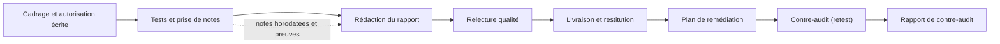

## Introduction

Un pentester brillant qui ne sait pas écrire un rapport clair produit, en pratique, un travail sans valeur pour son client : la vulnérabilité qu'il a trouvée ne sera jamais corrigée si personne ne la comprend. Ce cours part d'un principe simple : **la compétence technique et la compétence rédactionnelle ne sont pas séparables en cybersécurité**. Ce sont les deux faces d'un même métier.

Pense à la vie d'une vulnérabilité après ta mission. Le rapport est lu par une directrice qui doit débloquer un budget, transmis à un chef de projet qui doit planifier un correctif, puis à un développeur qui doit comprendre exactement quoi changer dans le code. Six mois plus tard, un auditeur demandera la preuve que la faille a été traitée. À aucune de ces étapes tu ne seras présent pour expliquer oralement ce que tu voulais dire. Le document doit porter seul tout le travail.

Ce premier chapitre pose les bases du cours. À la fin, tu sauras expliquer pourquoi le rapport est le véritable livrable d'une mission, identifier les différents publics d'un même document, distinguer documentation vivante et documentation figée, citer les référentiels qui imposent une documentation rigoureuse, et protéger un rapport qui contient, par nature, la carte des faiblesses d'une organisation.

## Le rapport, pas l'exploit, est le livrable

<CehCallout>
En CEH comme en OSCP, l'épreuve pratique ne s'arrête pas à l'obtention d'un flag ou d'un accès root : elle inclut la production d'un rapport. À l'examen OSCP+ (la version de la certification introduite par OffSec fin 2024), tu disposes d'environ 24 heures de pratique, puis de 24 heures supplémentaires pour rendre un rapport professionnel au format PDF. Un exploit sans preuve documentée ne rapporte aucun point.
</CehCallout>

Un client qui paie pour un audit de sécurité paie en réalité pour trois choses, dans cet ordre d'importance.

1. **Savoir où il est exposé** : la synthèse des risques, compréhensible sans expertise technique, qui lui permet de décider.
2. **Savoir comment corriger** : des recommandations précises et actionnables par ses équipes, avec des priorités.
3. **Avoir la preuve technique** : de quoi rejouer et valider chaque vulnérabilité trouvée, avant et après correction.

L'exploitation technique elle-même, le « comment j'ai obtenu le shell root », n'est qu'un moyen d'arriver à ces trois livrables. Ce n'est jamais une fin en soi pour le client. C'est souvent difficile à accepter au début : la partie la plus excitante de la mission est aussi celle qui intéresse le moins le lecteur final.

### Ce que coûte un mauvais rapport

Un rapport mal écrit n'est pas simplement « moins agréable à lire ». Il a des conséquences mesurables.

- **Des failles jamais corrigées.** Si la recommandation est vague, du type « renforcer la sécurité de l'application », l'équipe de développement ne sait pas quoi faire. Le ticket reste ouvert, puis il est fermé sans action.
- **De mauvaises priorités.** Si la sévérité est mal justifiée, l'organisation corrige d'abord des détails cosmétiques et laisse de côté la faille réellement critique.
- **Une perte de crédibilité.** Une seule erreur factuelle, comme une adresse IP hors périmètre ou une capture qui ne correspond pas au texte, fait douter le lecteur de tout le reste.
- **Un risque juridique.** Si le périmètre testé n'est pas décrit précisément, il devient impossible de prouver que tu es resté dans le cadre de ton autorisation.
- **Une mission à refaire.** Sans preuve reproductible, le client ne peut pas vérifier la correction, et il faudra re-tester.

### Le rapport dans le cycle de vie d'une mission

Le rapport n'arrive pas seulement à la fin. Il est préparé dès le cadrage et il continue à vivre après la livraison, à travers le plan de remédiation et le contre-audit. Le schéma suivant montre où il s'inscrit.



La flèche en pointillés est essentielle : un bon rapport se construit **pendant** les tests, grâce à des notes horodatées et à des captures prises au fil de l'eau. Le pentester qui attend la fin de la mission pour se souvenir de ce qu'il a fait perd des détails, et parfois des vulnérabilités entières.

## Un même rapport, plusieurs lecteurs

<CompareTable
  titleA="Public"
  titleB="Ce qu'il attend du document"
  rows={[
    { a: "Direction / RSSI", b: "Synthèse en 1 page, niveau de risque global, décision à prendre" },
    { a: "Équipe technique / DevOps", b: "Détail exact de la faille, requêtes, code vulnérable, correctif précis" },
    { a: "Juridique / Conformité", b: "Périmètre exact testé, autorisation, éventuelles obligations réglementaires déclenchées" },
    { a: "Toi-même, 6 mois plus tard", b: "Contexte suffisant pour comprendre ta propre mission sans tout re-tester" },
  ]}
/>

Détaillons ce que chaque lecteur cherche réellement.

La **direction** et le **RSSI**, c'est-à-dire le responsable de la sécurité des systèmes d'information, lisent pour décider. Ils veulent savoir si la situation est grave, ce que cela peut coûter à l'organisation, et ce qu'on leur demande : un budget, un report de mise en production, une décision d'arbitrage. Ils lisent rarement plus de deux pages.

L'**équipe technique** lit pour agir. Elle a besoin de l'URL exacte, du paramètre vulnérable, de la requête qui déclenche la faille, de la version du composant et d'une recommandation qu'elle peut transformer en ticket. Elle a horreur des généralités.

Le **juridique** et la **conformité** lisent pour se protéger et pour respecter leurs obligations. Ils vérifient que le périmètre testé correspond à la convention signée, que les dates sont exactes, et que les constats ne déclenchent pas une obligation de notification, par exemple si des données personnelles ont été réellement exposées.

Enfin, **toi-même dans six mois** es un lecteur à part entière. Lors du contre-audit, tu devras retrouver le contexte de chaque finding, le mot anglais couramment utilisé pour désigner un constat ou une vulnérabilité relevée. Si ton rapport ne contient pas les informations nécessaires, tu devras tout redécouvrir.

<TipCallout>
Un rapport qui essaie de satisfaire tous ces publics dans un seul flux de texte échoue en général à satisfaire aucun d'entre eux. La solution structurelle, vue au chapitre 2, consiste à séparer clairement les sections selon le public visé : une synthèse pour la direction, des fiches détaillées pour la technique, une section périmètre et méthodologie pour le juridique.
</TipCallout>

### Adapter le registre sans trahir les faits

Écrire pour plusieurs publics ne veut pas dire changer les faits selon le lecteur. Le même constat s'exprime simplement à des niveaux de détail différents. Voici un exemple pour une seule vulnérabilité.

```text
Pour la direction :
Un attaquant sur Internet peut, sans compte, lire l'intégralité du fichier clients
(environ 40 000 personnes). Correction impérative avant la mise en production.

Pour l'équipe technique :
Le paramètre « q » de GET /recherche est concaténé directement dans une requête SQL
(fichier search.php, ligne 42). Utiliser une requête préparée avec PDO et des
paramètres liés ; ajouter un test de non-régression.

Pour le juridique :
La vulnérabilité concerne des données personnelles au sens du RGPD. Aucune extraction
massive n'a été réalisée pendant le test : seuls 3 enregistrements ont été lus pour
preuve, puis supprimés des notes du testeur.
```

Les trois versions sont vraies, cohérentes entre elles, et chacune répond à la question de son lecteur.

## Les qualités d'un bon document de sécurité

Quel que soit le type de document, on retrouve les mêmes exigences de fond. Elles serviront de grille de relecture tout au long du cours.

| Qualité | Ce que cela signifie concrètement |
| --- | --- |
| Exactitude | Chaque adresse, version, date et capture est vérifiée. Aucune affirmation sans preuve. |
| Clarté | Phrases courtes, un terme technique défini à sa première apparition, pas de jargon gratuit. |
| Reproductibilité | Un tiers compétent peut rejouer chaque constat à partir du document seul. |
| Actionnabilité | Chaque problème est accompagné d'une action précise, d'un responsable possible et d'une priorité. |
| Neutralité | On décrit des faits et des risques, sans juger ni humilier les équipes. |
| Traçabilité | Version du document, auteurs, relecteurs, dates et diffusion sont identifiés. |
| Confidentialité | Le document est classifié et protégé à la hauteur de ce qu'il révèle. |

La **neutralité** mérite une attention particulière. Un rapport qui écrit « les développeurs ont été négligents » braque immédiatement ses lecteurs, qui chercheront alors à contester le constat plutôt qu'à le corriger. Écris plutôt « l'application ne valide pas les entrées sur ce paramètre ». Le fait est le même, mais il est orienté vers la solution.

## Documentation « vivante » et documentation « figée »

Deux familles de documents cohabitent en sécurité, avec des règles de gestion différentes.

- **Documentation figée** : le rapport de pentest, le rapport d'audit, le rapport d'incident final. Une fois livré et signé, il ne change plus. Il fait foi à une date donnée, comme une photographie de la situation.
- **Documentation vivante** : les runbooks SOC, les procédures de durcissement, les playbooks de réponse à incident, la politique de sauvegarde. Elle est mise à jour en continu, versionnée, et n'est jamais « terminée ».

Un **runbook** est une procédure opérationnelle pas à pas, utilisée par une équipe d'exploitation ou un SOC, le centre des opérations de sécurité, pour traiter une situation précise. Un **playbook** décrit plus largement la stratégie de réponse à un type d'incident, comme un rançongiciel ou un hameçonnage, et peut renvoyer vers plusieurs runbooks.

<CompareTable
  titleA="Documentation figée"
  titleB="Documentation vivante"
  rows={[
    { a: "Décrit une situation à une date précise", b: "Décrit comment agir, aujourd'hui" },
    { a: "Versions numérotées jusqu'à une version finale signée", b: "Versions successives sans fin, avec date de dernière revue" },
    { a: "Toute correction après livraison passe par une nouvelle version ou un erratum", b: "Toute amélioration est intégrée dès qu'elle est validée" },
    { a: "Valeur probatoire : elle prouve ce qui était connu à cette date", b: "Valeur opérationnelle : elle doit refléter la réalité actuelle" },
    { a: "Exemples : rapport de pentest, rapport d'audit ISO 27001, post-mortem", b: "Exemples : runbook, playbook, procédure de sauvegarde, wiki SOC" },
  ]}
/>

<WarningCallout>
Confondre les deux est une erreur fréquente chez les débutants : ils traitent un runbook comme un rapport figé, jamais mis à jour après sa première rédaction, ou, à l'inverse, laissent un rapport de pentest « en brouillon » indéfiniment modifiable. Le runbook figé devient dangereux, car il prescrit des commandes qui ne fonctionnent plus. Le rapport jamais figé perd toute valeur probatoire en cas de litige, puisqu'on ne peut plus prouver ce qu'il disait à la date de livraison.
</WarningCallout>

### Le contrôle documentaire

Pour qu'un document figé fasse foi, il faut pouvoir l'identifier sans ambiguïté. C'est le rôle du **contrôle documentaire**, un petit tableau placé au début du rapport.

```text
Version | Date       | Auteur        | Modification
0.1     | 2026-03-10 | A. Testeur    | Premier jet
0.2     | 2026-03-12 | B. Relecteur  | Relecture qualité, corrections
1.0     | 2026-03-13 | A. Testeur    | Version livrée au client
1.1     | 2026-05-02 | A. Testeur    | Ajout des résultats du contre-audit
```

On y ajoute la liste de diffusion, c'est-à-dire les personnes autorisées à recevoir le document, et son niveau de classification. Pour un document vivant, on garde aussi un historique, mais on y ajoute surtout une **date de prochaine revue** : un runbook qui n'a pas été relu depuis deux ans doit être considéré comme suspect.

## Pourquoi la documentation est aussi une obligation

Au-delà de la qualité professionnelle, de nombreux référentiels exigent explicitement une documentation rigoureuse. Les connaître t'aide à justifier le temps passé à rédiger.

<AuditCallout>
ISO/IEC 27001:2022 consacre sa clause 7.5 aux « informations documentées » : création, mise à jour, maîtrise des versions, diffusion et conservation. Dans l'Annexe A, plusieurs mesures reposent directement sur la documentation : A.5.37 (procédures d'exploitation documentées, c'est-à-dire les runbooks), A.5.24 à A.5.28 (gestion des incidents, dont A.5.27 sur les enseignements tirés et A.5.28 sur la collecte de preuves), A.8.8 (gestion des vulnérabilités techniques) et A.5.12 et A.5.13 (classification et marquage de l'information). Attention à ne plus citer l'ancienne numérotation de 2013, du type A.12.6.1 : elle a été remplacée.
</AuditCallout>

D'autres cadres renforcent ce besoin.

- **PCI DSS 4.0.1**, la norme de sécurité des données de cartes de paiement, demande à l'exigence 11.4 une méthodologie de test d'intrusion définie et documentée, des tests internes et externes réguliers, et la correction puis la re-vérification des vulnérabilités exploitables trouvées. Sans rapport précis, impossible de démontrer la conformité.
- **NIS2**, la directive européenne sur la sécurité des réseaux et de l'information, impose aux entités essentielles et importantes des mesures de gestion des risques et des obligations de notification d'incident en plusieurs étapes. Ces notifications reposent sur une documentation d'incident tenue à jour.
- **DORA**, le règlement européen sur la résilience opérationnelle numérique du secteur financier, prévoit des tests d'intrusion fondés sur la menace, appelés TLPT, pour les entités financières désignées, ainsi que des rapports d'incidents majeurs aux autorités. Le rapport de test est une pièce réglementaire.
- En France, l'ANSSI qualifie des prestataires d'audit sous le label **PASSI**. Le référentiel associé impose, entre autres, un rapport d'audit structuré et une gestion stricte de la confidentialité des livrables.

<LegalCallout>
Un test d'intrusion n'est légal que s'il est couvert par une autorisation écrite du propriétaire du système, qui définit le périmètre, les dates et les techniques autorisées. Le rapport doit rappeler cette autorisation et décrire précisément ce qui a été testé. En France, l'accès ou le maintien frauduleux dans un système de traitement automatisé de données est réprimé par l'article 323-1 du Code pénal : en cas de contestation, ton rapport et tes notes horodatées sont tes meilleures preuves de bonne foi.
</LegalCallout>

## Le rapport, un actif sensible : angle offensif et défensif

Un rapport de pentest est l'un des documents les plus dangereux qu'une organisation possède. Il liste ses faiblesses, explique comment les exploiter et contient parfois des extraits de mots de passe ou de données personnelles. Pour un attaquant, c'est une feuille de route prête à l'emploi.

<AttackDefenseTable rows={[
  { phase: "Interception", attack: "Récupérer le rapport envoyé en pièce jointe non chiffrée ou via un lien de partage public", defense: "Livraison par plateforme d'échange sécurisée ou archive chiffrée, mot de passe transmis par un autre canal" },
  { phase: "Fuite interne", attack: "Retrouver un ancien rapport sur un partage réseau accessible à tous les employés", defense: "Classification, liste de diffusion nominative, droits d'accès restreints, durée de conservation définie" },
  { phase: "Réutilisation de secrets", attack: "Exploiter un mot de passe ou un jeton laissé en clair dans une capture d'écran du rapport", defense: "Masquer systématiquement secrets et données personnelles, ne garder que le minimum nécessaire à la preuve" },
  { phase: "Falsification", attack: "Modifier un rapport pour minimiser un constat ou en ajouter un faux", defense: "Empreinte SHA-256 communiquée à la livraison, version PDF signée, contrôle documentaire" },
  { phase: "Poste du testeur", attack: "Compromettre l'ordinateur du pentester qui stocke les rapports de plusieurs clients", defense: "Chiffrement du disque, cloisonnement par client, suppression sécurisée en fin de conservation" },
]} />

### Classifier avec le Traffic Light Protocol

Le **Traffic Light Protocol**, ou TLP, est une convention de marquage maintenue par le FIRST, l'organisation internationale des équipes de réponse à incident. Sa version 2.0 définit quatre couleurs, dont une déclinaison. **TLP:RED** signifie que l'information est réservée aux seuls destinataires nommés. **TLP:AMBER** autorise un partage limité au sein de l'organisation du destinataire et à ses clients ou partenaires qui en ont besoin, et **TLP:AMBER+STRICT** restreint ce partage à l'organisation seule. **TLP:GREEN** autorise le partage au sein d'une communauté, sans publication. Enfin, **TLP:CLEAR**, qui remplace l'ancien TLP:WHITE, signifie que l'information est publique.

Un rapport de pentest est en général marqué TLP:AMBER+STRICT ou TLP:RED. Ce marquage doit figurer sur la page de garde et en pied de chaque page.

## Erreurs fréquentes

- **Considérer la rédaction comme une corvée de fin de mission.** Résultat : des notes incomplètes, des captures manquantes et un rapport bâclé rédigé de mémoire.
- **Écrire pour soi.** Le rapport utilise un jargon et des raccourcis que seul son auteur comprend.
- **Mélanger les publics.** La synthèse de direction contient des requêtes SQL, tandis que les fiches techniques manquent de détails.
- **Ne pas figer le rapport.** Le document livré continue d'être modifié sans nouvelle version, et on ne sait plus ce que le client a réellement reçu.
- **Négliger la confidentialité.** Le rapport est envoyé en clair par courriel, avec des mots de passe visibles dans les captures.
- **Juger plutôt que décrire.** Un ton accusateur pousse le lecteur à contester au lieu de corriger.

## Lab — Mise en pratique

**Environnement** : terminal Kali (Nyx Shell) et réflexion guidée. Tu vas préparer l'espace de travail documentaire d'une mission fictive et appliquer les règles vues dans ce chapitre.

<Steps steps={[
  { title: "Identifier les publics", description: "Pour un rapport de pentest web ayant trouvé une injection SQL critique, liste les trois informations que la direction veut lire en premier et les trois informations que l'équipe technique veut lire en premier. Observe ce qui diffère : le niveau de détail, mais aussi la nature de la question posée (décider ou agir)." },
  { title: "Classer des documents", description: "Range ces documents en « vivant » ou « figé » : rapport d'audit ISO 27001, procédure de sauvegarde, rapport de test d'intrusion signé, playbook de réponse au phishing, post-mortem d'incident validé, runbook de désactivation de compte. Justifie chaque choix en une phrase." },
  { title: "Créer l'arborescence d'une mission", description: "Crée un dossier de mission cloisonné, avec un espace pour les notes horodatées, les preuves et le rapport. Observe que les preuves sont séparées du texte du rapport, ce qui facilitera la distinction entre corps et annexes au chapitre 2.", code: "mkdir -p ~/missions/2026-03-client-demo/{notes,preuves,rapport}\ncd ~/missions/2026-03-client-demo\necho \"$(date -u +%Y-%m-%dT%H:%M:%SZ) Début de mission, périmètre : shop.lab (10.10.0.10)\" >> notes/journal.txt\ncat notes/journal.txt" },
  { title: "Versionner le rapport avec Git", description: "Initialise un dépôt Git local pour le rapport et crée une étiquette pour la version livrée. Observe que l'étiquette v1.0 identifie de façon permanente la version figée envoyée au client.", code: "cd ~/missions/2026-03-client-demo/rapport\ngit init\nprintf '# Rapport de test d intrusion\\n\\nClassification : TLP:AMBER+STRICT\\n' > rapport.md\ngit add rapport.md\ngit commit -m \"Premier jet du rapport\"\ngit tag -a v1.0 -m \"Version livrée au client\"\ngit log --oneline --decorate" },
  { title: "Calculer une empreinte d'intégrité", description: "Calcule l'empreinte SHA-256 du rapport. Elle sera communiquée au client par un canal séparé, pour qu'il puisse vérifier que le document reçu n'a pas été modifié. Modifie ensuite un seul caractère du fichier et recalcule : l'empreinte change totalement.", code: "sha256sum rapport.md\necho ' ' >> rapport.md\nsha256sum rapport.md\ngit checkout rapport.md" },
  { title: "Chiffrer le livrable", description: "Chiffre le rapport avec un mot de passe en AES-256 grâce à GnuPG. Le mot de passe doit être transmis par un autre canal que le fichier, par exemple par téléphone. Vérifie que le fichier produit n'est pas lisible en clair.", code: "gpg --symmetric --cipher-algo AES256 rapport.md\nls -l rapport.md.gpg\nhead -c 64 rapport.md.gpg | xxd | head -3" },
  { title: "Réécrire un constat de façon neutre", description: "Réécris cette phrase pour qu'elle soit factuelle et orientée solution : « L'équipe de développement a complètement bâclé la gestion des mots de passe. » Vérifie que ta version décrit un fait observable, son risque et la direction de la correction." },
]} />

## À retenir

- Le rapport, pas l'exploit technique, est le vrai livrable d'une mission de sécurité : le client paie pour savoir où il est exposé, comment corriger, et pour disposer de la preuve technique.
- Un même rapport a plusieurs publics, direction, technique, juridique et toi-même plus tard, dont les attentes diffèrent ; on y répond en séparant les sections.
- La documentation figée, comme les rapports, fait foi à une date donnée ; la documentation vivante, comme les runbooks, doit être revue en continu.
- Le contrôle documentaire, avec versions, auteurs, diffusion et classification, donne au rapport sa valeur probatoire.
- ISO 27001:2022, PCI DSS 4.0.1, NIS2 et DORA rendent la documentation obligatoire dans de nombreux contextes.
- Un rapport de pentest est un actif sensible : marquage TLP, chiffrement, empreinte d'intégrité et masquage des secrets sont indispensables.

## Questions de révision

1. Pourquoi un exploit technique sans preuve documentée n'a-t-il aucune valeur pour un client ?
2. Cite deux publics différents d'un rapport de pentest et ce que chacun en attend.
3. Donne un exemple de document « vivant » et un exemple de document « figé » en cybersécurité, et explique la conséquence d'une confusion entre les deux.
4. Quelles sont, dans l'ordre d'importance, les trois choses qu'un client paie réellement lors d'un audit ?
5. À quoi sert le tableau de contrôle documentaire placé au début d'un rapport ?
6. Pourquoi un rapport de pentest doit-il être protégé comme un actif sensible, et quelles mesures concrètes appliquer ?
7. Quelle clause d'ISO/IEC 27001:2022 encadre les informations documentées, et quelle mesure de l'Annexe A concerne les procédures d'exploitation ?
