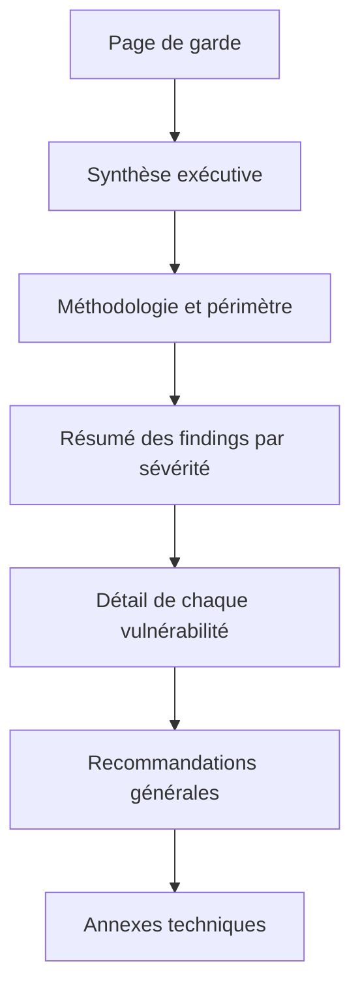
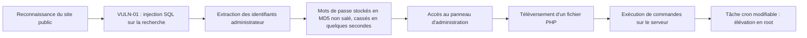

## Introduction

Ce chapitre détaille la structure canonique d'un rapport de pentest, celle qu'utilise, avec des variations mineures, la quasi-totalité des cabinets de conseil en cybersécurité et qu'exigent des certifications comme l'OSCP+. Maîtriser cette structure permet de ne jamais repartir d'une page blanche, et surtout de garantir que chaque lecteur trouve rapidement ce qu'il cherche.

Au chapitre 1, tu as vu qu'un même rapport sert plusieurs publics. La structure est la réponse concrète à ce problème : chaque section a un lecteur principal et une question à laquelle elle répond. La direction lit la synthèse exécutive, le juridique vérifie le périmètre, l'équipe technique plonge dans les fiches de vulnérabilité et les annexes.

À la fin de ce chapitre, tu sauras construire le plan complet d'un rapport, rédiger une synthèse exécutive en une page, décrire un périmètre et une méthodologie sans ambiguïté, raconter un chemin d'attaque, proposer un plan de remédiation priorisé et répartir correctement le contenu entre corps du rapport et annexes. Le détail d'une fiche de vulnérabilité et le calcul du score CVSS feront l'objet du chapitre 3.

## Le plan type d'un rapport de pentest



Ce plan suit une logique d'**entonnoir** : on commence par le plus synthétique, destiné au lecteur le plus pressé, et on descend progressivement vers le plus détaillé. Un lecteur peut s'arrêter à n'importe quel niveau en ayant obtenu une information complète pour son besoin.

<Steps steps={[
  { title: "Page de garde", description: "Nom du client, dates du test, version du document, mention de confidentialité, auteurs." },
  { title: "Synthèse exécutive (1 page maximum)", description: "Contexte de la mission, nombre de vulnérabilités par sévérité, verdict global, sans jargon technique." },
  { title: "Méthodologie et périmètre", description: "Ce qui a été testé, ce qui ne l'a PAS été, dates, adresses IP/domaines, type de test (boîte noire/grise/blanche)." },
  { title: "Résumé des findings", description: "Tableau récapitulatif : titre, sévérité, statut (nouveau/déjà connu), composant concerné." },
  { title: "Détail de chaque vulnérabilité", description: "Une fiche complète par vulnérabilité (voir chapitre 3)." },
  { title: "Recommandations générales", description: "Au-delà du correctif ponctuel : tendances observées, axes d'amélioration structurels." },
  { title: "Annexes techniques", description: "Sorties d'outils complètes (nmap, burp, sqlmap), logs, captures, pour l'équipe qui doit corriger." },
]} />

Ce plan n'est pas une invention arbitraire. Le **PTES**, le Penetration Testing Execution Standard, consacre une section entière au reporting et distingue déjà un rapport exécutif d'un rapport technique. Le **guide de test de la sécurité web de l'OWASP**, le WSTG, propose lui aussi une structure de rapport avec synthèse, périmètre, findings et annexes. Le **NIST SP 800-115**, guide technique du NIST sur les tests de sécurité, plus ancien puisqu'il date de 2008, reste cité pour ses principes de planification et de rapport. Tu peux donc t'appuyer sur ces références pour justifier ta structure auprès d'un client.

## La page de garde et le contrôle documentaire

La page de garde semble anodine, mais c'est elle qui identifie le document. Elle contient le nom du client et de la cible, l'intitulé de la mission, les dates du test, le numéro de version, les auteurs, et une mention de confidentialité claire, par exemple « TLP:AMBER+STRICT, diffusion restreinte aux destinataires listés ».

Juste après, on place le **contrôle documentaire** vu au chapitre 1 : l'historique des versions, la liste de diffusion nominative et les contacts. Les contacts sont précieux en cas de question urgente : qui, chez le prestataire, a réalisé les tests, et qui, chez le client, était l'interlocuteur technique.

Un **avertissement** complète souvent ces premières pages. Il rappelle qu'un test d'intrusion est réalisé sur une durée limitée, qu'il ne garantit pas l'absence d'autres vulnérabilités, et que les résultats reflètent l'état du système aux dates indiquées. Ce n'est pas une formule juridique creuse : c'est une information honnête sur la portée du travail.

## La synthèse exécutive, l'endroit qui compte le plus

<CehCallout>
La synthèse exécutive est la partie la plus lue d'un rapport, et parfois la seule que lit la direction. Une synthèse mal écrite peut faire échouer un audit pourtant techniquement excellent, parce qu'elle ne réussit pas à convaincre de l'urgence des corrections. Elle tient en une page maximum.
</CehCallout>

Une bonne synthèse exécutive répond, dans l'ordre, à ces questions.

1. Qu'est-ce qui a été testé, et pourquoi ?
2. Quel est le niveau de risque global, en une phrase ?
3. Combien de vulnérabilités par sévérité, présentées dans un tableau ou un graphique simple ?
4. Quelle est la recommandation prioritaire numéro un ?

```text
Exemple de synthèse exécutive :

Entre le 3 et le 10 mars 2026, [Cabinet] a réalisé un test d'intrusion en boîte grise
sur l'application web de gestion commerciale de [Client]. Ce test a révélé une
vulnérabilité critique (injection SQL permettant l'extraction de la base clients)
ainsi que 4 vulnérabilités de sévérité moyenne liées à la gestion des sessions.

Niveau de risque global : ÉLEVÉ. La vulnérabilité critique doit être corrigée
avant toute mise en production, dans un délai maximal de 5 jours ouvrés.
```

Analysons cet exemple. La première phrase répond à la question « quoi, quand, comment » : une application précise, des dates, un type de test. La deuxième phrase résume les constats en termes compréhensibles : on ne parle pas de « paramètre non assaini », mais d'« extraction de la base clients ». Le verdict est donné en un mot, ÉLEVÉ, puis transformé en action datée.

### Enrichir la synthèse sans la surcharger

Selon le contexte, la synthèse peut aussi contenir quelques éléments supplémentaires, à condition de rester sur une page.

- **Un tableau de répartition par sévérité**, du critique à l'informatif. C'est souvent le seul élément chiffré que retiendra la direction.
- **Les points positifs.** Mentionner ce qui fonctionne bien, comme une authentification multifacteur correctement déployée ou une bonne segmentation réseau, rend le rapport plus juste et plus crédible. Cela évite aussi de démoraliser les équipes.
- **Les trois actions prioritaires**, formulées comme des décisions : « corriger l'injection SQL avant la mise en production », « imposer l'authentification multifacteur aux comptes administrateurs », « planifier un contre-audit sous un mois ».
- **Une phrase sur le scénario d'attaque le plus grave**, en termes métier : « un attaquant anonyme sur Internet peut lire les coordonnées de tous les clients ».

| Sévérité | Nombre | Exemple de constat |
| --- | --- | --- |
| Critique | 1 | Injection SQL permettant l'extraction de la base clients |
| Élevée | 0 | Aucune |
| Moyenne | 4 | Cookies de session sans attribut Secure, absence d'expiration de session |
| Faible | 2 | En-têtes de sécurité HTTP manquants |
| Informative | 3 | Version du serveur web divulguée dans les en-têtes |

<TipCallout>
Écris toujours la synthèse exécutive en dernier, une fois le rapport complet rédigé. C'est la seule façon de garantir qu'elle reflète fidèlement l'ensemble des findings, y compris ceux découverts tardivement dans la mission. Relis-la ensuite en te mettant à la place d'une personne qui ne connaît ni SQL ni HTTP : chaque phrase doit rester compréhensible.
</TipCallout>

### Les pièges de la synthèse

Trois défauts reviennent constamment. Le premier est le **jargon** : « XSS stockée via un paramètre non échappé » ne dit rien à un directeur financier, alors que « un attaquant peut piéger les autres utilisateurs pour voler leur session » est clair. Le deuxième est l'**absence de verdict** : énumérer des failles sans dire si la situation est grave laisse le lecteur sans décision possible. Le troisième est la **surenchère** : qualifier tout de « critique » banalise le mot et fait perdre la confiance du lecteur le jour où une vraie urgence se présente.

## Méthodologie et périmètre

Cette section intéresse en premier lieu le juridique et l'équipe technique. Elle doit permettre de répondre sans ambiguïté à la question : « qu'est-ce qui a été testé, et qu'est-ce qui ne l'a pas été ? ».

### Décrire le périmètre

Le périmètre liste précisément les cibles autorisées : adresses IP ou plages réseau, noms de domaine, URL d'applications, comptes de test fournis, environnement concerné (production, préproduction, recette). Il précise aussi les **exclusions**, c'est-à-dire ce qui était explicitement hors périmètre, comme un service de paiement opéré par un tiers ou des tests de déni de service.

| Élément | Valeur |
| --- | --- |
| Cible | Application de gestion commerciale, `https://gestion.client.example` |
| Environnement | Préproduction, données de test |
| Adresses autorisées | 10.10.0.10 et 10.10.0.11 |
| Comptes fournis | 1 compte « commercial », 1 compte « manager » |
| Exclusions | Passerelle de paiement tierce, déni de service, ingénierie sociale |
| Fenêtre de test | Du 3 au 10 mars 2026, de 9 h à 18 h (heure de Paris, UTC+1) |
| Adresse source du testeur | 203.0.113.25 |

L'adresse source du testeur est un détail souvent oublié. Elle permet au client de distinguer, dans ses journaux, les actions du pentester de celles d'un éventuel attaquant réel qui aurait agi pendant la même période.

### Décrire la méthodologie

La méthodologie explique comment le test a été conduit. On y précise d'abord le **type de test**. En **boîte noire**, le testeur ne dispose d'aucune information préalable, comme un attaquant externe. En **boîte grise**, il dispose d'informations partielles, typiquement des comptes utilisateurs. En **boîte blanche**, il a accès au code source, à l'architecture et à la documentation.

On cite ensuite les **référentiels** suivis. Pour une application web, ce sera typiquement l'OWASP WSTG pour les tests et l'OWASP Top 10 2025 pour classer les constats. Pour une mission orientée adversaire, comme un exercice Red Team, on cartographie souvent les techniques utilisées avec **MITRE ATT&CK**, par exemple T1190 pour l'exploitation d'une application exposée sur Internet ou T1078 pour l'utilisation de comptes valides. On décrit enfin les grandes phases suivies, de la reconnaissance à la post-exploitation, et la **méthode de notation** des sévérités, en général CVSS 4.0 ou CVSS 3.1, éventuellement ajustée au contexte métier.

### Les limites du test

Une section honnête sur les **limites** est un signe de professionnalisme. Si un serveur était indisponible pendant deux jours, si un compte de test a été bloqué, ou si une fonctionnalité n'a pas pu être testée faute de données, il faut l'écrire. Le client saura ainsi que l'absence de constat sur cette partie ne signifie pas qu'elle est sûre.

## Le résumé des findings

Le résumé des findings est un tableau récapitulatif qui sert de sommaire opérationnel. Chaque ligne correspond à une vulnérabilité et renvoie vers sa fiche détaillée.

| ID | Titre | Sévérité | Statut | Composant |
| --- | --- | --- | --- | --- |
| VULN-01 | Injection SQL sur le paramètre q de /recherche | Critique | Nouveau | Module de recherche |
| VULN-02 | Absence d'expiration des sessions | Moyenne | Déjà connu | Gestion des sessions |
| VULN-03 | Cookie de session sans attribut Secure | Moyenne | Nouveau | Gestion des sessions |
| VULN-04 | En-tête Content-Security-Policy absent | Faible | Nouveau | Serveur web |

La colonne **statut** indique si la vulnérabilité est nouvelle ou déjà connue d'un audit précédent. Une faille déjà signalée et toujours présente est un signal fort pour la direction : elle révèle un problème de processus de correction, pas seulement un problème technique. Les **identifiants stables**, comme VULN-01, permettent de suivre chaque constat dans les tickets, dans le plan de remédiation et lors du contre-audit.

## Raconter le chemin d'attaque

Les fiches de vulnérabilité présentent chaque faille isolément. Or, le vrai risque vient souvent de leur **enchaînement** : une faille moyenne combinée à une autre faille moyenne peut aboutir à une compromission totale. C'est pourquoi beaucoup de rapports incluent une section **récit d'attaque**, ou attack narrative, qui raconte chronologiquement comment le testeur est passé d'un accès nul au contrôle complet.



Ce schéma correspond au lab web-001 de Nyx. Remarque que le récit met en évidence des **points de rupture** : corriger l'injection SQL casse la chaîne dès le début, mais un stockage robuste des mots de passe ou un contrôle strict des fichiers téléversés l'auraient aussi interrompue plus loin. C'est le principe de la défense en profondeur, et le récit d'attaque est le meilleur outil pour le faire comprendre à un lecteur non technique.

## Recommandations générales et plan de remédiation

Les fiches de vulnérabilité donnent des correctifs ponctuels. La section de recommandations générales prend de la hauteur : elle identifie les **causes structurelles** communes à plusieurs constats. Si quatre failles proviennent d'une validation d'entrée absente, la vraie recommandation est d'adopter une bibliothèque de validation centralisée et des revues de code, pas seulement de corriger quatre paramètres.

Cette section se conclut idéalement par un **plan de remédiation priorisé**, organisé en horizons de temps.

| Horizon | Actions | Constats traités |
| --- | --- | --- |
| Immédiat (moins de 5 jours ouvrés) | Corriger l'injection SQL par requêtes préparées, réinitialiser les mots de passe administrateurs | VULN-01 |
| Court terme (1 mois) | Configurer l'expiration des sessions et les attributs de cookies | VULN-02, VULN-03 |
| Moyen terme (3 mois) | Déployer les en-têtes de sécurité, migrer le stockage des mots de passe vers Argon2id ou bcrypt | VULN-04 et causes structurelles |
| Long terme (6 à 12 mois) | Intégrer des tests de sécurité automatisés dans la chaîne CI/CD et former les développeurs | Prévention de la récidive |

On distingue souvent les **quick wins**, des corrections rapides à fort impact, des chantiers structurels qui demandent un budget et une planification. La direction apprécie particulièrement cette distinction, car elle lui permet de montrer des progrès rapides tout en lançant les travaux de fond.

## Corps du rapport et annexes : où mettre quoi

<CompareTable
  titleA="Dans le corps du rapport"
  titleB="En annexe technique"
  rows={[
    { a: "Description de la vulnérabilité en langage clair", b: "Sortie brute complète de sqlmap/burp/nmap" },
    { a: "Une capture d'écran illustrant l'impact", b: "L'intégralité des requêtes/réponses HTTP capturées" },
    { a: "Le score CVSS et sa justification résumée", b: "Le détail complet du calcul vectoriel CVSS" },
    { a: "La recommandation de correctif", b: "Des exemples de code corrigé si pertinent" },
  ]}
/>

La règle générale est simple : le corps du rapport doit rester **lisible d'une traite** par quelqu'un qui n'a pas d'outil sous la main. Tout ce qui est volumineux, brut ou utile seulement pour rejouer en détail part en annexe, avec une référence explicite depuis le corps, par exemple « voir annexe B, sortie complète du scan de ports ».

Les annexes typiques comprennent la liste des outils et de leurs versions, les sorties complètes des scans, la liste des comptes créés ou des fichiers déposés pendant le test et à supprimer, un glossaire, et la grille de notation utilisée. La **liste des artefacts laissés sur le système** est particulièrement importante : si tu as téléversé un webshell pour prouver une faille, le client doit savoir où il se trouve pour le supprimer.

<AuditCallout>
Dans un audit ISO 27001, l'auditeur applique le même principe de séparation : le rapport d'audit présente les non-conformités et leur impact, tandis que les preuves d'audit (captures, extraits de journaux, comptes rendus d'entretiens) sont archivées séparément et référencées, pas noyées dans le corps du texte. ISO 19011, la norme de lignes directrices pour l'audit des systèmes de management, formalise cette distinction entre constats et preuves d'audit.
</AuditCallout>

## Angle offensif et défensif : ce que le rapport révèle

Un rapport bien structuré n'est pas seulement lisible, il est aussi utile à la défense. Chaque constat devrait idéalement indiquer comment **détecter** l'attaque, et pas seulement comment la corriger.

<AttackDefenseTable rows={[
  { phase: "Accès initial", attack: "Injection SQL sur un formulaire public (OWASP A05:2025 Injection, ATT&CK T1190)", defense: "Requêtes préparées, pare-feu applicatif, alerte sur les erreurs SQL dans les journaux applicatifs" },
  { phase: "Accès aux identifiants", attack: "Extraction et cassage de hachages MD5 non salés", defense: "Stockage Argon2id ou bcrypt, rotation des mots de passe après incident" },
  { phase: "Persistance", attack: "Webshell PHP téléversé via le panneau d'administration", defense: "Liste blanche d'extensions, stockage hors racine web, surveillance d'intégrité des fichiers" },
  { phase: "Élévation de privilèges", attack: "Script cron exécuté en root et modifiable par l'utilisateur web", defense: "Permissions strictes, audit des tâches planifiées, règles auditd sur /etc/cron.d" },
]} />

Pour la classification OWASP, note que l'injection est la catégorie A05 dans l'édition 2025 du Top 10, alors qu'elle était A03 dans l'édition 2021. Précise toujours l'année de l'édition que tu cites, car les numéros changent d'une version à l'autre.

## Erreurs fréquentes

- **Commencer par les détails techniques.** Le lecteur pressé abandonne avant d'avoir compris le niveau de risque.
- **Un périmètre flou.** Des formulations comme « l'infrastructure du client » ne permettent ni de prouver que tu es resté dans le cadre, ni de savoir ce qui reste à tester.
- **Oublier les limites et les exclusions.** Le client croit à tort que tout a été vérifié.
- **Des identifiants instables.** Renuméroter les vulnérabilités entre deux versions rend impossible le suivi dans les tickets.
- **Pas de plan de remédiation.** Une liste de failles sans priorisation laisse le client seul face à vingt chantiers simultanés.
- **Des annexes non référencées.** Une annexe que rien ne cite dans le corps ne sera jamais ouverte.
- **Oublier les artefacts.** Ne pas lister les fichiers et comptes laissés sur le système crée une porte dérobée involontaire.

## Lab — Mise en pratique

**Environnement** : réflexion guidée, avec ton expérience du lab web-001 (SQLi, webshell, élévation de privilèges) et un éditeur de texte dans le terminal Nyx.

<Steps steps={[
  { title: "Préparer le squelette du rapport", description: "Crée un fichier Markdown contenant uniquement les titres du plan type. Observe que ce squelette pourra devenir ton gabarit réutilisable, sujet du chapitre 5.", code: "mkdir -p ~/rapports && cd ~/rapports\ncat > rapport-web-001.md << 'EOF'\n# Rapport de test d'intrusion : shop.lab\n## Contrôle documentaire\n## Synthèse exécutive\n## Méthodologie et périmètre\n## Résumé des findings\n## Récit d'attaque\n## Détail des vulnérabilités\n## Recommandations générales et plan de remédiation\n## Annexes\nEOF\ngrep '^#' rapport-web-001.md" },
  { title: "Rédiger le périmètre", description: "Remplis un tableau de périmètre pour web-001 : cible shop.lab (10.10.0.10), environnement de lab isolé, type de test, fenêtre horaire avec fuseau explicite, exclusions. Vérifie qu'un juriste pourrait dire, à la seule lecture, si une action donnée était autorisée ou non." },
  { title: "Construire le résumé des findings", description: "Liste les vulnérabilités trouvées dans web-001 avec un identifiant stable (VULN-01 et suivants), un titre précis incluant le composant, une sévérité provisoire et un statut. Observe comment le titre seul doit permettre de localiser le problème." },
  { title: "Raconter le chemin d'attaque", description: "Dessine en Mermaid le chemin d'attaque de web-001, de la reconnaissance à root. Repère ensuite au moins deux points de rupture où une seule mesure défensive aurait stoppé toute la chaîne." },
  { title: "Rédiger une synthèse exécutive", description: "À partir des résultats du lab web-001, rédige une synthèse exécutive de huit lignes maximum, sans jargon technique. Fais relire ta synthèse à une personne non technique, ou relis-la en remplaçant mentalement chaque terme technique : si une phrase devient incompréhensible, reformule-la." },
  { title: "Trier corps et annexe", description: "Pour les éléments suivants, indique s'ils vont dans le corps du rapport ou en annexe : capture d'écran du panneau admin compromis, sortie complète de « nmap -A », tableau récapitulatif des findings, dump complet de « sqlmap --dump », liste des fichiers déposés sur le serveur pendant le test." },
  { title: "Bâtir le plan de remédiation", description: "Organise les corrections de web-001 en quatre horizons (immédiat, court, moyen et long terme). Identifie au moins une cause structurelle commune à plusieurs constats et formule-la comme une recommandation générale." },
]} />

## À retenir

- Un rapport de pentest suit un plan type en entonnoir : page de garde, synthèse exécutive, méthodologie et périmètre, résumé des findings, détail des vulnérabilités, recommandations, annexes.
- La synthèse exécutive tient en une page, répond à quatre questions dans l'ordre, et se rédige en dernier pour refléter tous les findings.
- Le périmètre précise ce qui a été testé et ce qui ne l'a pas été, avec dates, adresses, type de test, exclusions et limites.
- Le résumé des findings utilise des identifiants stables, une sévérité et un statut nouveau ou déjà connu.
- Le récit d'attaque montre comment des failles s'enchaînent et où une mesure défensive aurait rompu la chaîne.
- Le plan de remédiation priorise les corrections par horizon de temps et traite les causes structurelles.
- Le corps du rapport reste lisible sans jargon ; les preuves brutes et volumineuses vont en annexe, toujours référencées.

## Questions de révision

1. Pourquoi vaut-il mieux rédiger la synthèse exécutive en dernier ?
2. Cite les trois premières sections d'un rapport de pentest professionnel.
3. Donne un exemple d'élément qui doit aller en annexe plutôt que dans le corps du rapport, et explique pourquoi.
4. Quelles informations la section méthodologie et périmètre doit-elle contenir pour protéger juridiquement le testeur ?
5. Pourquoi la colonne « statut » du résumé des findings est-elle un indicateur précieux pour la direction ?
6. Comment un récit d'attaque aide-t-il à faire comprendre la défense en profondeur ?
7. Quelle différence fais-tu entre une recommandation ponctuelle et une recommandation structurelle ? Donne un exemple de chaque.
