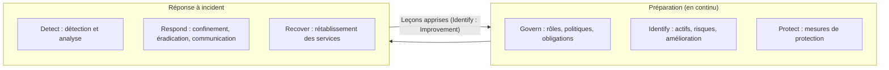

## Introduction

La rédaction en cybersécurité défensive obéit à des contraintes très différentes de celles du pentest. Un rapport de pentest se rédige au calme, après une mission planifiée. Un document d'incident, lui, se produit souvent dans l'urgence, sous pression, avec des informations incomplètes qui évoluent d'heure en heure. Il doit servir à la fois d'**outil opérationnel** pendant la crise et de **mémoire organisationnelle** après la crise.

Concrètement, les écrits d'un SOC, le centre des opérations de sécurité, ont des conséquences directes. Une timeline mal datée fait perdre des heures d'investigation. Un rapport sans cause racine laisse la porte ouverte à une récidive. Une notification envoyée trop tard à l'autorité de contrôle expose l'entreprise à une sanction. Et un runbook vague laisse un analyste de niveau 1 seul face à une alerte qu'il ne sait pas traiter, à trois heures du matin.

Ce chapitre couvre les deux grandes familles de documents SOC : le **rapport d'incident**, aussi appelé post-mortem, qui décrit ce qui s'est passé, et le **runbook**, qui prescrit ce qu'il faut faire. À la fin, tu sauras situer ces documents dans le cadre du NIST, construire une timeline fiable, présenter des indicateurs de compromission, écrire pour la direction comme pour les techniciens, respecter les délais réglementaires et rédiger un runbook utilisable sous stress.

## Le cadre de référence : NIST SP 800-61r3

Le **NIST SP 800-61** est le guide de référence internationale sur la gestion des incidents de sécurité. Sa révision 2, publiée en 2012, décrivait un cycle de vie en quatre phases devenu célèbre : préparation ; détection et analyse ; confinement, éradication et rétablissement ; activités post-incident. Tu retrouveras encore ce cycle dans beaucoup de procédures d'entreprise et dans les supports de certification.

En avril 2025, le NIST a publié la **révision 3**, intitulée « Incident Response Recommendations and Considerations for Cybersecurity Risk Management: A CSF 2.0 Community Profile ». Le changement est profond : la réponse à incident n'est plus présentée comme un cycle isolé, mais comme une partie intégrante de la gestion des risques, organisée selon les six fonctions du **NIST Cybersecurity Framework 2.0**.



Pour un rédacteur, trois conséquences pratiques découlent de cette révision. D'abord, la fonction **Govern** rappelle que les rôles, les circuits de décision et les obligations de notification doivent être écrits avant l'incident. Ensuite, la communication fait partie de la fonction **Respond** : rendre compte à la direction, aux autorités et aux clients n'est pas une formalité, c'est une activité de réponse à part entière. Enfin, les leçons apprises alimentent la catégorie « Improvement » de la fonction **Identify** : le rapport post-mortem n'est pas une fin, c'est l'entrée du cycle d'amélioration suivant.

L'ISO/IEC 27001:2022 rejoint le NIST sur ce point. Les contrôles de l'Annexe A consacrés aux incidents, de A.5.24 (planification et préparation de la gestion des incidents) à A.5.28 (collecte des preuves), en passant par A.5.26 (réponse aux incidents) et A.5.27 (tirer des enseignements des incidents), exigent des traces écrites. Un auditeur demandera tes rapports d'incident et vérifiera que les actions issues des leçons apprises ont bien été suivies jusqu'à leur clôture.

## Le rapport d'incident post-mortem

Le rapport post-mortem se rédige une fois l'incident maîtrisé. Il répond à une question simple : que s'est-il passé, pourquoi, et qu'est-ce qui va changer ? Il suit une structure en six sections, que tu retrouveras dans la plupart des modèles professionnels.

<Steps steps={[
  { title: "Résumé de l'incident", description: "Quoi, quand, impact en une phrase — lisible par un dirigeant en 30 secondes." },
  { title: "Timeline détaillée", description: "Chronologie horodatée de la détection à la remédiation, avec les actions entreprises à chaque étape." },
  { title: "Cause racine (root cause)", description: "Le mécanisme technique précis ayant permis l'incident — pas juste le symptôme observé." },
  { title: "Impact réel", description: "Systèmes touchés, données concernées, durée d'indisponibilité, éventuelle obligation de notification (CNIL, clients)." },
  { title: "Actions correctives", description: "Ce qui a été fait immédiatement (containment) et ce qui doit l'être à moyen terme (remédiation structurelle)." },
  { title: "Leçons apprises", description: "Ce que l'organisation change dans ses processus pour éviter la récidive — la section la plus souvent bâclée, pourtant la plus utile." },
]} />

### Le résumé de l'incident

Le résumé tient en quelques lignes. Il dit ce qui s'est passé, quand, quel a été l'impact, et où en est la situation. Un dirigeant doit pouvoir le lire en trente secondes et savoir s'il doit s'inquiéter. Évite le jargon : on écrit « un attaquant a pris le contrôle d'un compte administrateur grâce à un courriel piégé », pas « compromission d'un compte à privilèges via T1566.001 ».

### La cause racine, au-delà du symptôme

La **cause racine** est le mécanisme qui a rendu l'incident possible. Le symptôme, c'est « un compte administrateur a été utilisé depuis une adresse IP inconnue ». La cause racine, c'est « ce compte n'avait pas d'authentification multifacteur, et son mot de passe a été saisi sur une fausse page de connexion ». Une technique simple pour descendre jusqu'à la cause racine consiste à demander « pourquoi ? » plusieurs fois de suite, la méthode dite des **cinq pourquoi**. Pourquoi l'attaquant a-t-il pu se connecter ? Parce qu'il avait le mot de passe. Pourquoi l'avait-il ? Parce que l'utilisateur l'a saisi sur une page d'hameçonnage. Pourquoi cela a-t-il suffi ? Parce que le compte n'exigeait pas de second facteur. Pourquoi ? Parce que les comptes d'administration historiques avaient été exclus du déploiement de la MFA. On tient là une cause organisationnelle, bien plus utile qu'un simple constat technique.

### L'impact réel

La section impact doit être factuelle et chiffrée : quels systèmes ont été touchés, quelles données sont concernées et en quel volume, combien de temps les services ont été indisponibles, et si une obligation de notification s'applique, auprès de la CNIL, d'un régulateur sectoriel ou des clients. Distingue toujours ce qui est **établi** de ce qui est **présumé**. Écrire « aucune exfiltration n'a été constatée dans les journaux disponibles » est honnête ; écrire « aucune donnée n'a fuité » sans preuve est un engagement que tu ne peux pas tenir.

### Les actions correctives et les trois temporalités

<CehCallout>
Distingue toujours confinement (containment — arrêter la propagation), éradication (supprimer la cause), et remédiation (corriger durablement) dans la section actions — ce sont trois temporalités différentes de la réponse à incident, et les confondre rend le rapport confus sur ce qui a réellement été résolu.
</CehCallout>

Prenons notre exemple. Le **confinement**, c'est désactiver le compte compromis et isoler le poste de l'utilisateur piégé : on arrête la propagation en quelques minutes. L'**éradication**, c'est supprimer ce que l'attaquant a laissé derrière lui, par exemple une règle de transfert de courriel malveillante ou une tâche planifiée, et réinitialiser les secrets exposés. La **remédiation**, c'est étendre la MFA à tous les comptes d'administration et renforcer le filtrage des courriels : une correction durable qui prend des semaines. Le **rétablissement**, enfin, consiste à remettre les services en production sous surveillance renforcée. Chaque action du rapport doit indiquer sa catégorie, son responsable, son échéance et son statut.

### Les leçons apprises

Cette section est la plus souvent bâclée, pourtant c'est la plus utile. Elle ne cherche pas un coupable : un post-mortem efficace est **sans reproche**, en anglais « blameless ». Si l'analyste qui a cliqué sur le lien est désigné comme fautif, les prochains incidents seront cachés au lieu d'être signalés. On s'intéresse aux processus et aux contrôles : qu'est-ce qui a bien fonctionné, qu'est-ce qui a manqué, qu'est-ce qu'on change ? Chaque leçon doit déboucher sur une action concrète, avec un responsable et une date, sinon elle reste un vœu pieux.

## Construire une timeline lisible

La timeline est le squelette du rapport. Voici d'abord une première version, telle qu'on la note souvent à chaud pendant l'incident.

```text
Exemple de timeline d'incident :

14:02 — Alerte SIEM : connexion admin depuis IP inhabituelle (Russie)
14:07 — Analyste SOC N1 confirme l'alerte, escalade vers N2
14:15 — N2 confirme une compromission du compte admin@societe.fr
14:18 — Décision : désactivation immédiate du compte (containment)
14:25 — Analyse des logs d'authentification des 72h précédentes lancée
15:40 — Identification du vecteur initial : phishing reçu le jour précédent à 09:12
16:10 — Réinitialisation de tous les mots de passe à privilèges élevés
18:00 — Incident déclaré clos (containment), investigation approfondie en cours
```

Cette timeline est lisible, mais elle a deux défauts. Le premier : aucune date ni aucun fuseau horaire. Le second : elle mélange l'heure où un événement s'est produit et l'heure où on l'a découvert. À 15:40, on découvre qu'un courriel d'hameçonnage a été reçu la veille à 09:12. Dans une timeline rigoureuse, ce courriel apparaît à sa propre date, en tête de chronologie, avec mention de l'heure de sa découverte.

<TipCallout>
Toujours horodater en heure locale ET fuseau explicite (ou en UTC) — un incident impliquant plusieurs équipes ou pays sans fuseau clair génère des timelines incohérentes qui ralentissent l'investigation elle-même.
</TipCallout>

La convention la plus sûre est le format **ISO 8601** en UTC, par exemple `2026-03-11T13:02:00Z`, où le Z signifie UTC. Voici la même timeline, retravaillée pour un rapport final. On suppose ici que les heures locales sont celles de Paris, à UTC+1 en mars.

```text
| Horodatage (UTC)      | Source            | Événement                                              | Acteur      |
|-----------------------|-------------------|--------------------------------------------------------|-------------|
| 2026-03-10T08:12:00Z  | Passerelle mail   | Réception du courriel d'hameçonnage (découvert à 15:40 le 11) | Attaquant   |
| 2026-03-10T08:19:00Z  | Proxy web         | Clic de l'utilisateur, saisie des identifiants         | Utilisateur |
| 2026-03-11T13:02:00Z  | SIEM              | Alerte : connexion admin depuis une IP inhabituelle    | SOC N1      |
| 2026-03-11T13:07:00Z  | Ticket INC-0412   | Confirmation de l'alerte, escalade vers N2             | SOC N1      |
| 2026-03-11T13:15:00Z  | Entra ID          | Compromission du compte admin confirmée                | SOC N2      |
| 2026-03-11T13:18:00Z  | Ticket INC-0412   | Désactivation du compte (confinement)                  | SOC N2      |
| 2026-03-11T15:10:00Z  | Ticket INC-0412   | Réinitialisation des comptes à privilèges (éradication)| IT          |
| 2026-03-11T17:00:00Z  | Ticket INC-0412   | Confinement terminé, investigation en cours            | Responsable |
```

Chaque ligne cite sa **source** : un journal, un ticket, un témoignage. C'est ce qui permet à un relecteur, à un auditeur ou à un expert judiciaire de vérifier chaque affirmation. Garde aussi une trace des décisions et de leur auteur : « décision de couper l'accès VPN prise par la directrice des opérations à 13:40 UTC » est une information précieuse lors du retour d'expérience.

Quelques indicateurs se calculent directement à partir de la timeline. Le **délai de détection**, souvent appelé dwell time ou MTTD, va de la compromission initiale à la première alerte : ici, environ vingt-neuf heures. Le **délai de réponse**, ou MTTR selon les définitions, va de l'alerte au confinement : ici, seize minutes. Ces chiffres parlent à la direction et permettent de mesurer les progrès d'un incident à l'autre.

## Présenter les indicateurs de compromission

Un **indicateur de compromission**, ou IOC, est un artefact observable qui signale une activité malveillante : une adresse IP, un nom de domaine, une URL, l'empreinte d'un fichier, une adresse d'expéditeur. Le rapport technique les regroupe dans un tableau dédié, pour qu'ils puissent être bloqués, recherchés dans d'autres systèmes et partagés avec des partenaires.

```text
| Type          | Valeur (neutralisée)                         | Contexte                       | Première vue (UTC)   |
|---------------|----------------------------------------------|--------------------------------|----------------------|
| Domaine       | portail-societe-fr[.]com                     | Fausse page de connexion       | 2026-03-10T08:12Z    |
| URL           | hxxps://portail-societe-fr[.]com/login       | Lien du courriel d'hameçonnage | 2026-03-10T08:12Z    |
| IPv4          | 203.0.113[.]45                               | Connexion admin frauduleuse    | 2026-03-11T13:01Z    |
| Expéditeur    | support@portail-societe-fr[.]com             | En-tête From du courriel       | 2026-03-10T08:12Z    |
| SHA-256       | 3f5a...c91e (empreinte complète en annexe)   | Pièce jointe HTML              | 2026-03-10T08:12Z    |
```

Note la **neutralisation**, ou « defanging » : on remplace `http` par `hxxp` et on entoure les points de crochets. Ainsi, personne ne clique par erreur sur un lien malveillant dans un PDF, et aucun client de messagerie ne transforme l'adresse en lien actif. Pour les fichiers, utilise SHA-256 : MD5 et SHA-1 sont encore rencontrés dans les flux de renseignement par compatibilité, mais ils sont cassés pour la résistance aux collisions et ne doivent jamais être la seule empreinte d'un échantillon.

Pour le partage entre organisations, les IOC sont souvent exportés au format **STIX 2.1** ou dans une plateforme comme **MISP**, et marqués avec le **Traffic Light Protocol** vu au chapitre 1, par exemple TLP:AMBER pour un partage limité aux organisations concernées. Rattacher chaque comportement observé à une technique **MITRE ATT&CK** facilite aussi la lecture par d'autres équipes : ici, l'hameçonnage par lien correspond à T1566.002 et l'usage d'un compte légitime volé à T1078.

<AttackDefenseTable rows={[
  { phase: "Accès initial", attack: "Courriel d'hameçonnage avec lien vers une fausse page de connexion (T1566.002)", defense: "Filtrage des courriels, signalement par les utilisateurs, blocage du domaine dans le proxy, sensibilisation" },
  { phase: "Accès aux identifiants", attack: "Identifiants saisis sur la page piégée et réutilisés par l'attaquant", defense: "MFA résistante à l'hameçonnage (FIDO2), alerte sur les connexions depuis des pays inhabituels" },
  { phase: "Utilisation du compte", attack: "Connexion avec un compte administrateur valide (T1078)", defense: "Comptes d'administration dédiés, accès conditionnel, revue des journaux d'authentification" },
  { phase: "Persistance", attack: "Création d'une règle de transfert de courriel vers l'extérieur", defense: "Alerte sur la création de règles de boîte aux lettres, blocage du transfert automatique externe" },
]} />

## Écrire pour deux publics : exécutif et technique

Comme pour le pentest, un même incident a plusieurs lecteurs. La direction veut savoir si l'entreprise est en danger, combien cela coûte, et quelles décisions on attend d'elle. L'équipe technique veut les journaux, les IOC, les commandes et l'état précis de chaque système. Le juridique veut savoir si une notification s'impose et quand.

<CompareTable
  titleA="Version exécutive"
  titleB="Version technique"
  rows={[
    { a: "Une page, sans jargon", b: "Autant de pages que nécessaire, précision maximale" },
    { a: "Impact métier : clients, chiffre d'affaires, image, obligations légales", b: "Impact technique : hôtes, comptes, journaux, IOC" },
    { a: "Décisions attendues et budget nécessaire", b: "Actions de confinement, d'éradication et de remédiation détaillées" },
    { a: "Niveau de confiance exprimé simplement", b: "Sources, méthodes d'analyse et hypothèses non vérifiées" },
  ]}
/>

Pendant un incident long, la direction reçoit aussi des **points de situation** réguliers, par exemple toutes les quatre heures. Un format efficace tient en cinq rubriques : situation actuelle, ce qui a changé depuis le dernier point, impact connu, prochaines actions, décisions attendues. On y ajoute l'heure du prochain point. Ce rythme évite que les dirigeants interrompent l'équipe technique toutes les vingt minutes pour demander des nouvelles.

## Notification réglementaire : les délais à connaître

Un incident peut déclencher des obligations légales de notification, avec des délais courts qui courent à partir du moment où l'organisation **a connaissance** de l'incident. Le rapport doit permettre de prouver que ces délais ont été respectés : l'heure de prise de connaissance et l'heure de chaque notification figurent dans la timeline.

<LegalCallout>
Le RGPD, à son article 33, impose de notifier une violation de données personnelles à l'autorité de contrôle, la CNIL en France, dans les 72 heures après en avoir pris connaissance, sauf si la violation est peu susceptible d'engendrer un risque pour les personnes. L'article 34 impose d'informer les personnes concernées dans les meilleurs délais lorsque le risque est élevé. Toute violation, même non notifiée, doit être consignée dans un registre interne. La directive NIS2, à son article 23, impose aux entités essentielles et importantes une alerte précoce sous 24 heures pour un incident important, une notification d'incident sous 72 heures, puis un rapport final au plus tard un mois après la notification. Les modalités exactes dépendent de la transposition nationale.
</LegalCallout>

| Texte | Qui est concerné | Délais | Destinataire |
| --- | --- | --- | --- |
| RGPD, articles 33 et 34 | Tout responsable de traitement de données personnelles | 72 heures pour l'autorité ; personnes concernées dans les meilleurs délais si risque élevé | CNIL en France ; personnes concernées |
| NIS2, article 23 | Entités essentielles et importantes | Alerte précoce sous 24 heures ; notification sous 72 heures ; rapport final sous un mois | CSIRT national ou autorité compétente |
| DORA | Entités financières de l'Union européenne | Notification initiale, rapport intermédiaire et rapport final pour les incidents TIC majeurs, selon des délais fixés par les normes techniques associées | Autorité de supervision financière |

Ces délais ont une conséquence directe sur la rédaction : on n'attend pas d'avoir tout compris pour notifier. Une notification initiale peut être incomplète, à condition de le dire et de la compléter ensuite. C'est pourquoi beaucoup d'organisations préparent des **modèles de notification** pré-remplis, intégrés à leurs runbooks, avec les champs attendus par l'autorité : nature de l'incident, catégories et nombre approximatif de personnes et de données concernées, conséquences probables, mesures prises.

## Le runbook — documentation vivante pour l'urgence

Un runbook n'est pas un rapport : c'est une procédure opérationnelle, écrite pour être suivie sous pression, par quelqu'un qui n'a peut-être jamais géré ce type d'incident auparavant. On parle aussi de **playbook**, terme souvent réservé à la logique de décision d'ensemble, tandis que le runbook détaille les gestes techniques. Dans les plateformes d'automatisation de type SOAR, une partie du runbook est d'ailleurs exécutée automatiquement.

<CompareTable
  titleA="Rapport d'incident"
  titleB="Runbook"
  rows={[
    { a: "Écrit APRÈS l'incident", b: "Écrit et maintenu AVANT l'incident" },
    { a: "Décrit ce qui s'est passé", b: "Prescrit ce qu'il faut faire" },
    { a: "Figé une fois validé", b: "Mis à jour à chaque exercice ou incident réel" },
    { a: "Lu une fois, archivé", b: "Suivi étape par étape, en direct" },
  ]}
/>

<WarningCallout>
Un runbook rédigé avec des instructions vagues ("analyser la situation", "prendre les mesures appropriées") est inutilisable en pleine crise, quand la charge cognitive de l'analyste est déjà saturée — un bon runbook donne des commandes exactes, des seuils numériques précis, et des critères de décision binaires (si X alors Y).
</WarningCallout>

### Anatomie d'un bon runbook

Un runbook efficace commence par un **déclencheur** clair : quelle alerte ou quelle situation l'active. Il précise le **périmètre** et le **niveau d'autorité** de l'analyste : peut-il désactiver un compte seul, ou doit-il obtenir l'accord d'un responsable ? Viennent ensuite les étapes numérotées, chacune avec une action précise, la commande ou l'écran à utiliser, le résultat attendu et le critère de décision pour passer à l'étape suivante. Il se termine par les **conditions d'escalade**, les contacts d'astreinte et la liste des preuves à conserver.

Voici un extrait de runbook pour l'alerte de notre exemple.

```text
RUNBOOK RB-07 — Connexion administrateur depuis un pays inhabituel
Version 2.3 — Propriétaire : responsable SOC — Dernier exercice : 2026-02-14

Déclencheur : alerte SIEM « Admin sign-in from unusual country »
Autorité : un analyste N1 peut désactiver le compte sans validation préalable.

1. Ouvrir un ticket d'incident et y noter l'heure de l'alerte en UTC.
2. Vérifier dans le SIEM si le titulaire du compte a déclaré un déplacement
   (calendrier des déplacements, ticket d'accès à distance).
   -> Déplacement déclaré ET MFA validée : clore en faux positif, fin.
   -> Sinon : passer à l'étape 3.
3. Désactiver le compte et révoquer ses sessions actives.
   Résultat attendu : statut « désactivé », aucune session ouverte.
4. Rechercher les autres connexions depuis la même IP sur les 72 dernières heures.
   -> Plus de 1 compte concerné : escalader immédiatement au N2 (astreinte).
5. Conserver les journaux d'authentification bruts (export horodaté dans le ticket).
6. Si des données personnelles ont pu être consultées : prévenir le DPO,
   le délai RGPD de 72 heures court depuis l'étape 1.
```

Compare cette rédaction à « en cas d'alerte suspecte, analyser la situation et agir en conséquence ». Chaque étape dit quoi faire, comment vérifier que c'est fait, et quoi faire ensuite selon le résultat. L'analyste n'a pas à improviser.

### Faire vivre la documentation

Un runbook vieillit vite : un outil change d'interface, un contact quitte l'entreprise, une commande ne fonctionne plus. Inscris en tête une version, un propriétaire et la date du dernier exercice. Teste les runbooks lors d'**exercices sur table**, où l'équipe déroule un scénario fictif, et mets-les à jour après chaque incident réel. Une bonne pratique consiste à relier chaque action du post-mortem au runbook qu'elle modifie : ainsi, les leçons apprises se traduisent réellement en changements opérationnels.

## Erreurs fréquentes

- **Une timeline sans fuseau ni date.** Elle devient incohérente dès que deux équipes ou deux pays sont impliqués.
- **Confondre l'heure de l'événement et l'heure de sa découverte.** Le délai de détection devient alors impossible à calculer.
- **S'arrêter au symptôme.** « Un compte a été compromis » n'est pas une cause racine ; il faut expliquer pourquoi c'était possible.
- **Mélanger confinement, éradication et remédiation.** Le lecteur ne sait plus ce qui est réellement résolu.
- **Désigner un coupable.** Un post-mortem accusateur décourage le signalement des incidents futurs.
- **Des leçons apprises sans propriétaire ni date.** Elles ne seront jamais mises en œuvre.
- **Des IOC actifs dans un document.** Un lien malveillant cliquable dans un PDF est un risque ; neutralise-les.
- **Attendre la fin de l'enquête pour notifier.** Les délais RGPD et NIS2 courent dès la prise de connaissance.
- **Un runbook vague ou jamais testé.** Il échoue précisément le jour où on en a besoin.

## Lab — Mise en pratique

**Environnement** : terminal Kali de Nyx et un éditeur de texte. Tu travailles sur un petit journal fictif créé pour l'exercice.

<Steps steps={[
  { title: "Créer un journal d'événements en désordre", description: "Crée un fichier contenant des événements horodatés en heure de Paris, volontairement dans le désordre. Observe qu'à la lecture brute, il est difficile de reconstituer l'histoire.", code: "mkdir -p ~/incident && cd ~/incident\ncat > events.txt << 'EOF'\n2026-03-11 09:45 +0100|EDR|Isolement de la machine PC-COMPTA-04\n2026-03-11 09:15 +0100|SIEM|Alerte : exécution PowerShell encodée sur PC-COMPTA-04\n2026-03-10 08:00 +0100|Mail|Réception d'un courriel avec pièce jointe piégée\n2026-03-11 09:40 +0100|SOC N2|Confirmation de compromission de PC-COMPTA-04\nEOF\ncat events.txt" },
  { title: "Convertir en UTC au format ISO 8601", description: "Convertis chaque horodatage en UTC avec la commande date de GNU coreutils, puis trie la chronologie. Vérifie que le courriel de la veille apparaît désormais en premier.", code: "while IFS='|' read -r ts src msg; do\n  printf '%s|%s|%s\\n' \"$(date -u -d \"$ts\" +%Y-%m-%dT%H:%M:%SZ)\" \"$src\" \"$msg\"\ndone < events.txt | sort > timeline.txt\ncat timeline.txt" },
  { title: "Calculer le délai de détection", description: "Calcule l'écart entre la réception du courriel et la première alerte SIEM. Observe que ce chiffre, environ 25 heures ici, est l'un des indicateurs les plus parlants pour la direction.", code: "debut=$(date -u -d '2026-03-10T07:00:00Z' +%s)\nalerte=$(date -u -d '2026-03-11T08:15:00Z' +%s)\necho \"Délai de détection : $(( (alerte - debut) / 3600 )) heures\"" },
  { title: "Rédiger le tableau d'IOC", description: "Construis un tableau Markdown d'IOC pour cet incident fictif avec au moins un domaine, une URL et une empreinte SHA-256 de la pièce jointe. Neutralise chaque domaine et chaque URL avec [.] et hxxp, puis vérifie avec grep qu'aucun lien actif ne subsiste.", code: "grep -nE 'https?://' ioc.md || echo 'Aucun lien actif : OK'" },
  { title: "Identifier les trois temporalités", description: "Classe les actions suivantes en confinement, éradication ou remédiation : isoler PC-COMPTA-04, supprimer la tâche planifiée créée par le maliciel, bloquer l'exécution des macros venant d'Internet sur tout le parc, réinitialiser le mot de passe de l'utilisateur." },
  { title: "Écrire deux résumés", description: "Rédige un résumé exécutif de cinq lignes maximum, sans aucun terme technique, puis un résumé technique qui cite les techniques ATT&CK concernées (par exemple T1566.001 pour la pièce jointe piégée et T1059.001 pour PowerShell). Compare ce que chaque version laisse de côté." },
  { title: "Vérifier les délais de notification", description: "Suppose que la machine contenait des fichiers de paie et que l'entreprise est une entité importante au sens de NIS2. À partir de l'heure de confirmation en UTC, calcule les échéances : alerte précoce NIS2 à 24 heures, notification RGPD et NIS2 à 72 heures. Note-les dans la timeline." },
  { title: "Corriger un runbook vague", description: "Réécris cette instruction de runbook pour qu'elle soit actionnable : « En cas d'alerte suspecte, analyser la situation et agir en conséquence. » Ton résultat doit contenir un déclencheur, des étapes numérotées, un critère de décision binaire et une condition d'escalade." },
]} />

## À retenir

- Le NIST SP 800-61r3, publié en avril 2025, inscrit la réponse à incident dans les six fonctions du CSF 2.0, et les leçons apprises nourrissent l'amélioration continue.
- Un rapport d'incident post-mortem comprend résumé, timeline, cause racine, impact réel, actions correctives et leçons apprises.
- Confinement, éradication et remédiation sont trois temporalités distinctes à ne pas confondre dans un rapport.
- Une timeline fiable utilise l'UTC au format ISO 8601, cite ses sources et distingue l'heure d'un événement de l'heure de sa découverte.
- Les IOC se présentent dans un tableau, neutralisés, avec des empreintes SHA-256, et se partagent sous marquage TLP.
- La version exécutive parle d'impact métier et de décisions, la version technique de journaux, d'IOC et d'actions précises.
- Le RGPD impose 72 heures pour notifier l'autorité ; NIS2 impose une alerte précoce à 24 heures, une notification à 72 heures et un rapport final sous un mois.
- Un runbook est un document vivant et prescriptif, écrit avant la crise, avec des commandes exactes et des critères de décision binaires.

## Questions de révision

1. Quelle est la différence entre confinement, éradication et remédiation ? Illustre chacune avec un exemple.
2. Pourquoi faut-il toujours horodater une timeline d'incident avec un fuseau explicite, idéalement en UTC ?
3. En quoi la révision 3 du NIST SP 800-61 change-t-elle la façon de présenter la réponse à incident par rapport à la révision 2 ?
4. Pourquoi un post-mortem doit-il être « sans reproche », et que risque une organisation qui désigne des coupables ?
5. Pourquoi neutralise-t-on les URL et les domaines dans un tableau d'IOC ?
6. Une entité importante au sens de NIS2 confirme un incident important un lundi à 10 heures UTC. Quelles sont ses échéances de notification ?
7. En quoi un runbook diffère-t-il fondamentalement d'un rapport d'incident ?
8. Qu'est-ce qui distingue une cause racine d'un symptôme ? Applique la méthode des cinq pourquoi à un incident de ton choix.
