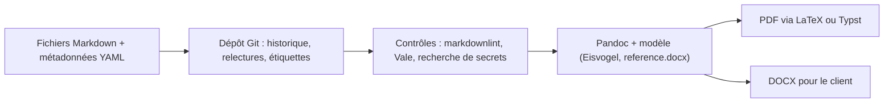

## Introduction

Ce dernier chapitre referme le cours en abordant l'aspect pratique et logistique de la rédaction : avec quels outils écrire, comment ne jamais repartir de zéro, et comment restituer à l'oral des résultats qu'on a pourtant déjà parfaitement documentés à l'écrit.

Ces questions paraissent secondaires face à la technique, mais elles pèsent lourd dans la réalité d'un métier. Un pentesteur passe souvent autant de temps à rédiger qu'à tester. Si chaque rapport repart d'une page blanche, si la mise en page se fait à la main la veille de la livraison, et si la réunion de restitution se transforme en lecture de captures d'écran, la qualité du travail technique se perd en route. À l'inverse, un bon outillage libère du temps pour l'analyse, garantit une qualité constante d'une mission à l'autre et rend le rapport plus fiable.

À la fin de ce chapitre, tu sauras choisir un outil selon le contexte, monter une chaîne de production Markdown, Pandoc et LaTeX versionnée avec Git, comparer les plateformes de reporting dédiées, construire un gabarit et une bibliothèque de findings, et préparer une restitution orale qui transforme le rapport en engagements concrets.

## Choisir ses outils de rédaction

Il n'existe pas d'outil universel. Le bon choix dépend de trois questions : qui écrit, seul ou en équipe ; qui impose le format, toi ou le client ; et quelle est la nature du document, figé comme un rapport ou vivant comme un runbook.

<CompareTable
  titleA="Outil"
  titleB="Cas d'usage typique"
  rows={[
    { a: "Markdown + Pandoc (éditeur au choix : VS Code, Typora, Obsidian)", b: "Rapports versionnables avec Git, conversion facile en PDF/Word" },
    { a: "Dradis / PlexTrac", b: "Plateformes dédiées pentest — gabarits de findings réutilisables, export automatisé" },
    { a: "SysReptor / Ghostwriter", b: "Plateformes de reporting open source auto-hébergeables, rédaction en Markdown ou gabarits Word" },
    { a: "Notion / Confluence", b: "Documentation vivante collaborative (runbooks, wikis SOC)" },
    { a: "Word/LibreOffice avec gabarit", b: "Quand le client impose un format spécifique en entreprise" },
  ]}
/>

Le **traitement de texte** reste incontournable dans beaucoup d'entreprises. Il est familier pour les relecteurs, il gère les commentaires et le suivi des modifications, et certains clients exigent un fichier Word pour l'intégrer à leur propre documentation. Son défaut : la mise en forme se mélange au contenu, les copier-coller de sorties d'outils cassent la typographie, et comparer deux versions reste pénible.

Les **wikis collaboratifs** comme Notion ou Confluence conviennent mal au rapport de pentest, document figé et confidentiel, mais très bien à la documentation vivante vue aux chapitres 1 et 4 : runbooks, procédures du SOC, bases de connaissances. Leur historique de pages, leurs liens internes et leur édition à plusieurs en font de bons supports pour des documents qui évoluent chaque semaine.

### Markdown, Pandoc et LaTeX : la chaîne « docs as code »

**Markdown** est un langage de balisage léger : un titre s'écrit avec un dièse, une liste avec un tiret, un bloc de code entre trois accents graves. Le texte reste lisible tel quel, sans logiciel particulier. **Pandoc** est un convertisseur universel de documents : il transforme un fichier Markdown en PDF, en Word, en HTML et en bien d'autres formats. Pour produire un PDF, Pandoc s'appuie par défaut sur **LaTeX**, un système de composition typographique très utilisé dans le monde scientifique, qui gère finement les tables des matières, la numérotation et la mise en page. Les versions récentes de Pandoc savent aussi utiliser **Typst**, un moteur de composition plus récent et plus rapide, comme alternative à LaTeX.

<TipCallout>
Rédiger en Markdown puis exporter en PDF (via Pandoc) présente un avantage souvent sous-estimé : le rapport peut être versionné dans Git comme du code, avec un historique clair des révisions — précieux quand un rapport passe par plusieurs relectures avant livraison finale.
</TipCallout>

Concrètement, un rapport commence par un bloc de métadonnées au format YAML, puis le contenu en Markdown.

```markdown
---
title: "Rapport de test d'intrusion — shop.lab"
subtitle: "TLP:AMBER+STRICT — Diffusion restreinte"
author: ["Aure — Nyx Security"]
date: "2026-03-14"
lang: fr
toc: true
numbersections: true
---

# Synthèse exécutive

Entre le 3 et le 10 mars 2026, un test d'intrusion en boîte grise a été réalisé...

# Détail des vulnérabilités

## VULN-01 — Injection SQL dans le paramètre `id` de /product.php
```

La conversion se fait en une commande. Les options importantes sont expliquées dans les commentaires.

```bash
# Installer Pandoc et un moteur LaTeX sous Kali ou Debian
sudo apt install pandoc texlive-xetex texlive-fonts-recommended

# PDF : --pdf-engine=xelatex gère correctement les accents et les polices système,
# --toc ajoute une table des matières, --number-sections numérote les titres
pandoc rapport.md -o rapport.pdf --pdf-engine=xelatex --toc --number-sections

# Word : --reference-doc applique les styles d'un modèle .docx (charte du cabinet ou du client)
pandoc --print-default-data-file reference.docx > modele.docx   # point de départ à personnaliser
pandoc rapport.md -o rapport.docx --reference-doc=modele.docx
```

```text
$ pandoc --version | head -1
pandoc 3.1.11.1
$ ls -lh rapport.*
-rw-r--r-- 1 kali kali  14K mars 14 10:02 rapport.docx
-rw-r--r-- 1 kali kali  9,8K mars 14 10:01 rapport.md
-rw-r--r-- 1 kali kali  86K mars 14 10:02 rapport.pdf
```

Pour un rendu professionnel sans écrire de LaTeX, la communauté utilise souvent le modèle **Eisvogel**, un gabarit Pandoc libre qui produit une page de garde, des en-têtes et des blocs de code colorés ; plusieurs modèles de rapport OSCP en Markdown publiés par la communauté reposent dessus. On l'installe dans le dossier des modèles de Pandoc, puis on l'appelle avec l'option `--template eisvogel`. Pour aller plus loin, les **filtres Lua** de Pandoc, passés avec `--lua-filter`, permettent de transformer le document pendant la conversion, par exemple pour colorer automatiquement les badges de sévérité.



Cette approche, souvent appelée « docs as code », apporte les bénéfices du développement logiciel à la rédaction. Chaque relecture devient une modification traçable, et `git diff --word-diff` montre mot par mot ce qui a changé entre deux versions. Une étiquette Git marque la version livrée, ce qui rejoint le contrôle documentaire du chapitre 1. Des outils de vérification automatique peuvent tourner avant chaque génération : **markdownlint** contrôle la syntaxe Markdown, **Vale** applique des règles de style, comme l'interdiction de certains termes vagues, et un simple `grep` détecte les mots de passe ou adresses internes oubliés dans le texte.

<WarningCallout>
Un dépôt Git de rapports contient des informations extrêmement sensibles : vulnérabilités non corrigées, captures, parfois des extraits de données. Il ne doit jamais être poussé sur un service public. Héberge-le sur une forge interne avec accès restreint, chiffre les disques, et rappelle-toi qu'un secret commité reste dans l'historique même après sa suppression du fichier.
</WarningCallout>

## Les plateformes de reporting dédiées

Quand une équipe réalise des dizaines de missions par an, les plateformes spécialisées deviennent rentables. Elles centralisent les missions, importent les résultats des scanners, gèrent une bibliothèque de findings et génèrent le rapport final dans la charte du cabinet.

| Plateforme | Modèle | Points forts | Rédaction et export |
| --- | --- | --- | --- |
| Dradis | Édition Community open source, édition Pro commerciale | Import des sorties de nombreux outils (Nmap, Nessus, Burp, Qualys…), collaboration, méthodologies sous forme de listes de contrôle | Export Word ou HTML à partir de gabarits |
| PlexTrac | Plateforme commerciale, en SaaS ou hébergée | Bibliothèque de findings réutilisables, suivi de la remédiation, tableaux de bord, intégrations avec les scanners et les outils de tickets | Rapports générés depuis des modèles personnalisables |
| SysReptor | Édition Community open source auto-hébergeable, offre commerciale | Rédaction en Markdown, mise en page en HTML et CSS, modèles prêts à l'emploi pour des certifications comme l'OSCP | Rendu PDF |
| Ghostwriter | Open source, développé par SpecterOps | Gestion des clients, des projets, de l'infrastructure de red team et d'une bibliothèque de findings | Gabarits Word et PowerPoint basés sur Jinja2 |

<CehCallout>
Les plateformes professionnelles comme PlexTrac ou Dradis existent précisément pour industrialiser cette logique de gabarit : une bibliothèque de findings réutilisables (ex: "Injection SQL générique") que le pentester adapte au cas rencontré plutôt que de rédiger à chaque fois depuis zéro.
</CehCallout>

### Les outils obsolètes à éviter

Tu croiseras encore **Serpico** dans d'anciens tutoriels et dans certaines listes d'outils. C'était un outil libre de génération de rapports de pentest à partir de gabarits Word, mais il n'est plus maintenu depuis des années. Un outil abandonné ne reçoit plus de correctifs de sécurité, alors qu'une plateforme de reporting stocke précisément les informations les plus sensibles d'un client. Ne l'installe pas pour un usage réel ; préfère Dradis, SysReptor ou Ghostwriter, qui sont activement maintenus. Le même raisonnement vaut pour tout outil que tu adoptes : regarde la date du dernier commit et de la dernière version avant de lui confier des données de mission.

### Critères de choix

Pour choisir, pose-toi les questions suivantes. Où sont stockées les données, sur ton infrastructure ou dans un nuage tiers, et le contrat client l'autorise-t-il ? L'outil importe-t-il les sorties de tes scanners habituels ? Le rendu final peut-il respecter la charte imposée ? Combien coûte la licence par utilisateur ? Et peux-tu exporter tes données si tu changes d'outil ? Pour un pentesteur indépendant ou un étudiant, une chaîne Markdown et Pandoc ou une instance SysReptor suffisent largement. Pour un cabinet de vingt personnes, une plateforme avec bibliothèque partagée et suivi de remédiation fait gagner un temps considérable.

## Construire un gabarit réutilisable

Un gabarit, ou template, est la structure de départ de chaque rapport. Un gabarit de rapport de pentest typique définit à l'avance quatre éléments.

<Steps steps={[
  { title: "La structure figée", description: "Les titres de section qui ne changent jamais d'une mission à l'autre (garde, synthèse, méthodologie...)." },
  { title: "Le gabarit de fiche de vulnérabilité", description: "Un bloc réutilisable avec les champs vus au chapitre 3 (titre, CVSS, description, PoC, impact, recommandation)." },
  { title: "La charte graphique minimale", description: "Code couleur par sévérité (rouge/orange/jaune/bleu), pagination, mention de confidentialité en pied de page." },
  { title: "Un glossaire type", description: "Définitions des termes techniques récurrents (CVSS, IDOR, SSRF...) pour les lecteurs non techniques." },
]} />

Voici un exemple de gabarit de fiche de vulnérabilité en Markdown. Les champs entre crochets sont à remplacer à chaque mission.

```markdown
## VULN-[NN] — [Type de vulnérabilité] dans [composant précis]

| Champ            | Valeur                                              |
|------------------|-----------------------------------------------------|
| Sévérité         | [Critique / Élevée / Moyenne / Faible / Info]       |
| Score CVSS 4.0   | [score] — [vecteur complet CVSS:4.0/AV:.../...]     |
| Composant        | [URL, hôte, fonction]                               |
| Statut           | [Nouveau / Déjà connu / Corrigé lors du contre-test] |
| Références       | [CWE-xxx, catégorie OWASP avec année, ATT&CK Txxxx] |

### Description
[Ce qu'est la faille, en deux ou trois phrases compréhensibles.]

### Preuve de concept
[Requête ou commande exacte, réponse observée, capture référencée.]

### Impact
[Conséquence concrète pour le métier du client.]

### Recommandation
[Correctif précis, puis mesure de défense en profondeur.]
```

Pour la charte graphique, garde une contrainte d'accessibilité en tête : environ un homme sur douze présente une forme de daltonisme, et un rapport imprimé en noir et blanc perd ses couleurs. Le niveau de sévérité doit donc toujours être écrit en toutes lettres à côté de la couleur, jamais signalé par la couleur seule.

### La bibliothèque de findings

Au-delà du gabarit, les équipes matures maintiennent une **bibliothèque de findings** : des fiches génériques déjà rédigées et relues pour les vulnérabilités récurrentes, comme une injection SQL, un en-tête de sécurité manquant ou un protocole TLS obsolète. Le pentesteur part de la fiche générique et l'adapte : il remplace la preuve de concept, précise le composant, ajuste l'impact et le score au contexte. C'est exactement ce que proposent Dradis, PlexTrac, SysReptor et Ghostwriter.

Le piège est de livrer une fiche générique sans l'adapter. Un client qui lit « cette vulnérabilité peut permettre l'accès à des données sensibles » sans aucun détail sur son propre système comprend immédiatement que le texte a été copié. Chaque fiche issue de la bibliothèque doit contenir au moins une preuve propre à la mission et un impact formulé pour ce client. Pense aussi à relire régulièrement la bibliothèque : une fiche qui cite encore CVSS 3.1 sans le dire, ou le Top 10 OWASP 2021 comme s'il était le plus récent, dégrade la crédibilité de tous les rapports qui l'utilisent.

## Préparer une restitution orale

Un rapport écrit, aussi bon soit-il, est souvent complété par une réunion de restitution — l'occasion de répondre aux questions et de créer l'adhésion nécessaire à la correction effective des failles. C'est souvent là que se décide si les corrections seront financées et planifiées.

<Steps steps={[
  { title: "Ouvrir par le niveau de risque global", description: "Ne commence jamais par le détail technique — l'auditoire (souvent mixte technique/direction) a besoin du verdict avant les preuves." },
  { title: "Une slide par vulnérabilité critique/élevée maximum", description: "Titre, impact en une phrase, capture d'écran, recommandation — pas de sortie d'outil brute projetée." },
  { title: "Anticiper les objections", description: "Prépare une réponse aux réactions fréquentes : 'ce n'est pas exploitable en pratique', 'ça coûte trop cher à corriger', 'on le savait déjà'." },
  { title: "Terminer par un plan d'action daté", description: "Qui corrige quoi, et pour quelle date — transformer le rapport en engagement concret plutôt qu'en simple constat." },
]} />

### Structurer le discours

Le principe à retenir est celui de la conclusion d'abord, que les militaires anglophones appellent BLUF, « bottom line up front ». On annonce le verdict, puis on le justifie. Une restitution d'une heure peut suivre ce déroulé : cinq minutes de rappel du contexte et du périmètre, cinq minutes de verdict global et de chiffres clés, vingt minutes sur les vulnérabilités critiques et élevées, dix minutes sur les tendances et les recommandations structurelles, puis vingt minutes de questions et de construction du plan d'action. Les vulnérabilités moyennes et faibles sont regroupées sur une seule diapositive de synthèse : elles sont dans le rapport, inutile de les détailler une par une.

Voici un exemple d'ouverture, à prononcer en moins d'une minute.

```text
« Merci de nous recevoir. Nous avons testé votre application de gestion commerciale
du 3 au 10 mars. Le niveau de risque global est élevé : nous avons trouvé une faille
critique qui permettrait à un attaquant, depuis Internet et sans compte, de copier
l'intégralité de votre fichier clients. Elle se corrige en quelques jours. Nous avons
aussi relevé deux faiblesses moyennes sur la gestion des sessions. Je vous propose de
commencer par la faille critique, puis de construire ensemble le plan de correction. »
```

### Soigner les supports

Chaque diapositive porte un seul message, formulé comme une phrase dans son titre : « Un attaquant peut copier tout le fichier clients sans compte » est plus parlant que « VULN-01 : SQLi ». La capture d'écran choisie montre l'impact, par exemple un extrait de données masquées, et non la commande. Les secrets, mots de passe et données personnelles sont floutés ou remplacés avant la projection, car une capture vue par vingt personnes en réunion, puis partagée, est une fuite potentielle.

<WarningCallout>
Projeter une sortie brute de terminal (100 lignes de sqlmap) pendant une restitution devant un public mixte est une erreur classique : cela n'apporte rien à la direction et ralentit inutilement la réunion — garde les preuves techniques pour un échange en aparté avec l'équipe technique.
</WarningCallout>

### Répondre aux objections

Les objections sont normales : personne n'aime entendre que son système est vulnérable. Prépare des réponses factuelles et calmes. À « ce n'est pas exploitable en pratique », réponds par la preuve de concept réalisée pendant le test et par les conditions exactes de l'exploitation. À « ça coûte trop cher à corriger », propose une mesure de réduction du risque immédiate et peu coûteuse en attendant la correction complète, et rappelle le coût potentiel d'un incident, notamment les obligations de notification vues au chapitre 4. À « on le savait déjà », note-le sans polémique : la colonne statut du rapport le montre, et une faille connue mais non corrigée est un signal de gouvernance intéressant pour la direction. Ne débats jamais d'un score CVSS en séance : propose de revoir le vecteur après la réunion avec l'équipe technique.

### Conclure par un plan d'action

La restitution se termine par un tableau simple : pour chaque correction prioritaire, un responsable nommé, une échéance et, si possible, la date d'un contre-test qui vérifiera la correction. Envoie ce plan par écrit dans les vingt-quatre heures, en le joignant au compte rendu de la réunion. C'est ce document, plus que le rapport lui-même, qui transforme le constat en engagement.

## Erreurs fréquentes

- **Mettre en page à la main à chaque mission.** C'est long, source d'erreurs, et la qualité varie d'un rapport à l'autre ; un gabarit règle le problème.
- **Adopter un outil abandonné.** Une plateforme non maintenue, comme Serpico, stocke des données sensibles sans recevoir de correctifs.
- **Pousser un dépôt de rapports sur un service public.** Le contenu d'un rapport non corrigé est une carte d'attaque pour qui le trouve.
- **Livrer une fiche de bibliothèque sans l'adapter.** Le client remarque immédiatement le texte générique et perd confiance.
- **Signaler la sévérité uniquement par la couleur.** Les lecteurs daltoniens et les impressions en noir et blanc perdent l'information.
- **Commencer la restitution par la technique.** La direction décroche avant d'avoir entendu le verdict.
- **Projeter des captures non masquées.** Mots de passe et données personnelles se retrouvent devant une salle entière.
- **Finir sans plan d'action daté.** La réunion se termine sur un constat et rien ne bouge.

## Lab — Mise en pratique

**Environnement** : terminal Kali de Nyx, avec Pandoc et Git. Tu construis ton propre gabarit et ta chaîne de génération, que tu pourras réutiliser pour chaque lab terminé.

<Steps steps={[
  { title: "Installer la chaîne de production", description: "Installe Pandoc et un moteur LaTeX, puis vérifie les versions. Note la version de Pandoc : certaines options, comme le moteur Typst, dépendent de versions récentes.", code: "sudo apt update && sudo apt install -y pandoc texlive-xetex texlive-fonts-recommended\npandoc --version | head -1\nxelatex --version | head -1" },
  { title: "Créer le dépôt du gabarit", description: "Crée un dépôt Git dédié aux rapports, avec un dossier pour la bibliothèque de findings. Observe la structure : le gabarit, les fiches génériques et chaque mission sont séparés.", code: "mkdir -p ~/rapports/{bibliotheque,missions} && cd ~/rapports\ngit init -b main\nprintf '*.pdf\\n*.docx\\n' > .gitignore\ntree -a -L 1" },
  { title: "Écrire le gabarit de fiche de vulnérabilité", description: "Enregistre dans bibliotheque/fiche-modele.md un gabarit vide avec les champs titre, sévérité, score et vecteur CVSS 4.0, composant, statut, références, description, preuve de concept, impact et recommandation. Vérifie qu'il ne contient aucune donnée réelle." },
  { title: "Rédiger une fiche générique", description: "À partir du modèle, rédige une fiche générique « Injection SQL » dans la bibliothèque, puis copie-la dans missions/web-001.md et adapte-la au lab web-001 : composant exact, preuve propre au lab, impact formulé pour l'entreprise fictive. Compare les deux versions avec Git.", code: "git add . && git commit -m \"Gabarit et fiche générique\"\ncp bibliotheque/injection-sql.md missions/web-001.md\n# ... adaptation de la fiche ...\ngit diff --no-index --word-diff bibliotheque/injection-sql.md missions/web-001.md" },
  { title: "Générer le PDF et le DOCX", description: "Ajoute un bloc de métadonnées YAML en tête de missions/web-001.md (titre, auteur, date, mention TLP), puis génère les deux formats. Ouvre le PDF et vérifie la table des matières, la numérotation et le rendu des blocs de code.", code: "cd ~/rapports/missions\npandoc web-001.md -o web-001.pdf --pdf-engine=xelatex --toc --number-sections\npandoc web-001.md -o web-001.docx\nls -lh web-001.*" },
  { title: "Ajouter un contrôle avant génération", description: "Ajoute une vérification simple qui bloque la génération si le rapport contient un lien actif ou un mot de passe en clair. Observe que ce type de garde-fou évite des erreurs embarrassantes lors des livraisons pressées.", code: "grep -nEi 'https?://|password=|mot de passe *:' web-001.md && echo 'À corriger avant livraison' || echo 'Contrôle OK'" },
  { title: "Préparer la restitution", description: "Rédige les trois premières phrases que tu prononcerais pour ouvrir une restitution annonçant une faille critique et deux failles moyennes, puis le titre-phrase de la diapositive consacrée à la faille critique. Chronomètre ton ouverture : elle doit tenir en moins d'une minute." },
  { title: "Préparer les objections et le plan d'action", description: "Écris une réponse factuelle à chacune des trois objections classiques, puis un tableau de plan d'action avec, pour chaque correction, un responsable, une échéance et une date de contre-test." },
]} />

## À retenir

- Le choix d'outil dépend du contexte : Markdown et Pandoc pour versionner, plateformes dédiées pour industrialiser, traitement de texte quand le client impose son format, wiki pour la documentation vivante.
- Rédiger en Markdown permet de versionner le rapport dans Git comme du code, avec un historique clair des révisions.
- Pandoc convertit le Markdown en PDF via LaTeX ou Typst, et en Word avec un modèle de styles grâce à l'option reference-doc.
- Dradis et PlexTrac industrialisent la rédaction avec une bibliothèque de findings réutilisables ; SysReptor et Ghostwriter sont des alternatives open source maintenues ; Serpico est abandonné.
- Un gabarit réutilisable comprend une structure figée, une fiche de vulnérabilité type, une charte graphique minimale et un glossaire type.
- Une restitution orale s'ouvre par le niveau de risque global, consacre au plus une diapositive par vulnérabilité critique ou élevée et évite les sorties brutes.
- On anticipe les objections et on termine par un plan d'action daté, qui transforme le rapport en engagement concret.

## Questions de révision

1. Quel est l'avantage principal de rédiger un rapport en Markdown plutôt que directement en Word ?
2. Explique le rôle de Pandoc et de LaTeX dans une chaîne de production de rapports.
3. Que doit contenir un gabarit de fiche de vulnérabilité réutilisable ?
4. Pourquoi faut-il éviter d'utiliser un outil de reporting qui n'est plus maintenu, comme Serpico ?
5. Quels critères examines-tu avant d'adopter une plateforme de reporting pour un cabinet ?
6. Quel est le risque d'une bibliothèque de findings mal utilisée, et comment l'éviter ?
7. Pourquoi ne faut-il jamais projeter une sortie d'outil brute pendant une restitution devant un public mixte ?
8. Comment répondrais-tu à un client qui affirme qu'une faille critique « n'est pas exploitable en pratique » ?

Félicitations, tu viens de terminer le cours **Rédaction de Rapports et Documentation Technique** ! Ces compétences s'appliquent directement à chaque lab Nyx que tu termines — prends l'habitude d'en rédiger une fiche complète.
