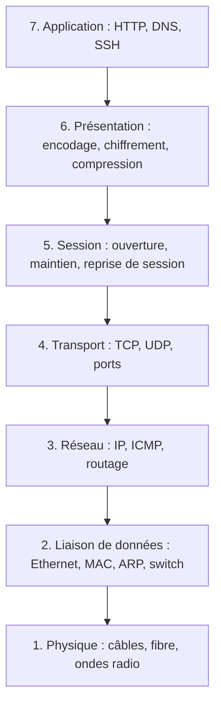
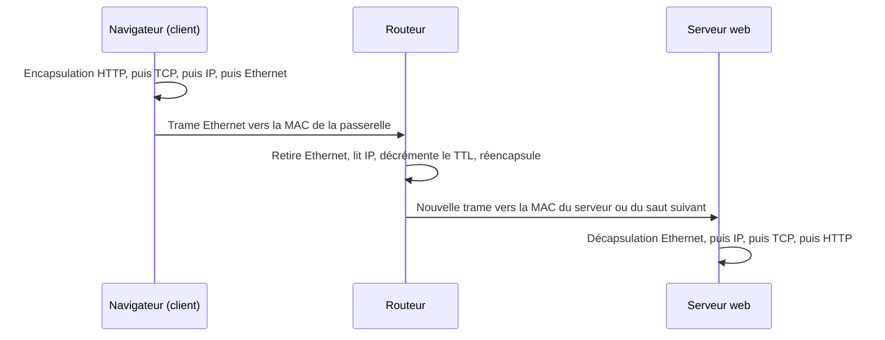

## Introduction

Tout ce que tu feras en pentest réseau, en analyse de trafic ou en durcissement de serveur repose sur un principe simple : une communication réseau est découpée en **couches**, chacune avec une responsabilité précise. Une couche rend un service à la couche du dessus et s'appuie sur la couche du dessous, sans avoir besoin de savoir comment elles fonctionnent en interne. C'est ce découpage qui permet à ton navigateur de parler HTTP sans se soucier de savoir si le paquet voyagera sur un câble cuivre, une fibre optique ou une liaison Wi-Fi.

Comprendre ces couches n'a rien d'un exercice académique. Quand un scan Nmap ne renvoie rien, la question « à quelle couche ça bloque ? » te fait gagner un temps considérable : est-ce un câble débranché (couche 1), une mauvaise adresse MAC dans le cache ARP (couche 2), une route absente (couche 3), un port filtré par un pare-feu (couche 4) ou une application qui refuse la requête (couche 7) ? De la même façon, les attaques et les défenses se décrivent presque toujours par la couche qu'elles visent : l'ARP spoofing est une attaque de couche 2, le SYN flood une attaque de couche 4, l'injection SQL une attaque de couche 7.

À la fin de ce chapitre, tu sauras décrire les 7 couches du modèle OSI, les relier au modèle TCP/IP réellement implémenté sur Internet, suivre le parcours d'une requête web de l'application jusqu'au câble, lire une trame brute en hexadécimal et ranger chaque outil de pentest dans la bonne couche.

## Pourquoi un modèle en couches

### Le problème que résout le découpage

Imagine qu'il faille réécrire chaque application pour chaque type de câble ou de carte réseau. Ce serait ingérable. Le modèle en couches impose deux règles. D'abord, chaque couche ne dialogue qu'avec ses voisines immédiates, au travers d'une interface bien définie. Ensuite, chaque couche dialogue logiquement avec **la même couche** sur la machine distante, au moyen d'un **protocole** : un ensemble de règles qui fixe le format des messages et leur ordre. TCP sur ta machine « parle » à TCP sur le serveur, même si physiquement les octets passent par toutes les couches inférieures.

### Deux modèles, deux usages

Le **modèle OSI** (Open Systems Interconnection) a été normalisé par l'ISO en 1984 (norme ISO/IEC 7498-1). Il compte 7 couches. Les protocoles OSI eux-mêmes n'ont jamais percé, mais le modèle est resté la **référence pédagogique** et le vocabulaire commun de toute la profession : quand quelqu'un parle de « pare-feu de couche 7 » ou de « switch de niveau 3 », il utilise la numérotation OSI.

Le **modèle TCP/IP**, issu des travaux de l'ARPANET et formalisé dans la RFC 1122, compte 4 couches. C'est lui qui décrit ce qui est réellement implémenté dans les systèmes d'exploitation et sur Internet. Les deux modèles ne s'opposent pas : on implémente TCP/IP, et on raisonne et on communique avec la numérotation OSI.

## Le modèle OSI en 7 couches



<CompareTable
  titleA="Couche OSI"
  titleB="Exemple / Protocole"
  rows={[
    { a: "7. Application", b: "HTTP, DNS, SSH, FTP, SMTP" },
    { a: "6. Présentation", b: "Chiffrement TLS, encodage des données (UTF-8, ASN.1), compression" },
    { a: "5. Session", b: "Établissement/maintien de sessions (NetBIOS, RPC)" },
    { a: "4. Transport", b: "TCP, UDP" },
    { a: "3. Réseau", b: "IP, ICMP, routage" },
    { a: "2. Liaison de données", b: "Ethernet, adresses MAC, ARP, switches, Wi-Fi 802.11" },
    { a: "1. Physique", b: "Câbles, signaux électriques/optiques, ondes radio, hubs" },
  ]}
/>

### Couche 1 : Physique

La couche physique transporte des **bits** sous forme de signaux : tensions électriques sur une paire torsadée, impulsions lumineuses dans une fibre, ondes radio pour le Wi-Fi. Elle définit les connecteurs (RJ45), les débits et les distances. Côté sécurité, c'est la couche des attaques matérielles : brancher un implant sur une prise réseau libre dans une salle de réunion, poser un « tap » (dérivation passive) sur un câble, ou brouiller une bande radio. La défense commence par la sécurité physique des locaux et la désactivation des prises inutilisées.

### Couche 2 : Liaison de données

La couche liaison organise les bits en **trames** et assure la livraison sur un même segment local. Chaque carte réseau possède une **adresse MAC** (Media Access Control) de 48 bits, écrite en hexadécimal, par exemple `08:00:27:ab:cd:ef`. Les trois premiers octets identifient le fabricant (l'OUI, Organizationally Unique Identifier). Le **switch** travaille à ce niveau : il apprend quelle adresse MAC se trouve derrière quel port. Le protocole **ARP** (Address Resolution Protocol) fait le lien entre une adresse IP et une adresse MAC sur le réseau local ; comme il n'authentifie rien, l'**ARP spoofing** est une attaque de couche 2. Les VLAN, que tu verras au chapitre 5, appartiennent aussi à cette couche.

### Couche 3 : Réseau

La couche réseau achemine des **paquets** d'un réseau à un autre, potentiellement à travers des dizaines de routeurs. C'est le domaine du protocole **IP** (Internet Protocol), des adresses IP, du **routage** et d'**ICMP** (Internet Control Message Protocol, utilisé par `ping` et `traceroute`). Le **routeur** est l'équipement emblématique de cette couche. L'IP spoofing, qui consiste à falsifier l'adresse IP source d'un paquet, est une attaque de couche 3.

### Couche 4 : Transport

La couche transport assure la communication **de bout en bout entre deux applications**, identifiées par des **numéros de port**. **TCP** (Transmission Control Protocol) offre une livraison fiable et ordonnée, avec établissement de connexion ; **UDP** (User Datagram Protocol) envoie des datagrammes sans garantie, mais avec très peu de surcoût. L'unité de données s'appelle **segment** pour TCP et **datagramme** pour UDP. Le scan de ports et le SYN flood se situent ici. Le chapitre 3 y est entièrement consacré.

### Couche 5 : Session

La couche session gère l'ouverture, le maintien, la synchronisation et la fermeture d'un dialogue entre deux applications. Dans la pratique moderne, cette fonction est rarement un protocole isolé : on la retrouve dans NetBIOS, dans les appels RPC (Remote Procedure Call) ou dans la reprise de session TLS. Le détournement de session (session hijacking) est souvent rattaché à cette couche dans les supports de certification.

### Couche 6 : Présentation

La couche présentation s'occupe de la **forme** des données : encodage des caractères (ASCII, UTF-8), sérialisation (ASN.1, utilisé par les certificats X.509), compression et chiffrement. TLS y est souvent rangé par commodité pédagogique, même s'il s'intercale en réalité entre TCP et l'application. Les attaques par désérialisation ou par confusion d'encodage exploitent cette couche.

### Couche 7 : Application

La couche application est celle des protocoles que les programmes utilisent directement : HTTP, DNS, SSH, FTP, SMTP, LDAP, SMB. Attention : la couche 7 n'est pas « l'application » au sens du logiciel (Firefox), mais le protocole qu'il parle. C'est la couche où se concentre l'essentiel des vulnérabilités exploitées aujourd'hui : injections, contournement d'authentification, logique métier.

<TipCallout>
Moyen mnémotechnique classique pour retenir l'ordre des couches (de 7 à 1) : "**A**ll **P**eople **S**eem **T**o **N**eed **D**ata **P**rocessing" — Application, Présentation, Session, Transport, Réseau (Network), Liaison (Data), Physique. Dans l'autre sens, de 1 à 7, beaucoup retiennent « Please Do Not Throw Sausage Pizza Away ».
</TipCallout>

### Les unités de données de protocole

Chaque couche nomme différemment ce qu'elle manipule. On parle de **PDU** (Protocol Data Unit). Utiliser le bon terme évite des confusions en entretien comme en rapport d'audit.

| Couche | PDU | Adresse ou identifiant utilisé | Équipement typique |
| --- | --- | --- | --- |
| 7, 6, 5 | Données (message) | Noms de domaine, URL | Proxy, pare-feu applicatif (WAF) |
| 4 - Transport | Segment (TCP) ou datagramme (UDP) | Numéro de port | Pare-feu stateful, répartiteur de charge |
| 3 - Réseau | Paquet | Adresse IP | Routeur, switch de niveau 3 |
| 2 - Liaison | Trame | Adresse MAC | Switch, point d'accès Wi-Fi |
| 1 - Physique | Bit | Aucune | Câble, hub, répéteur |

## Le modèle TCP/IP, celui réellement utilisé

En pratique, Internet ne suit pas strictement les 7 couches OSI : le modèle TCP/IP, plus simple, en compte 4. Les trois couches hautes d'OSI y sont fusionnées en une seule couche Application, parce que dans les implémentations réelles, la gestion de session et le format des données sont pris en charge par l'application elle-même ou par une bibliothèque comme OpenSSL.

<CompareTable
  titleA="Couche TCP/IP"
  titleB="Équivalent OSI"
  rows={[
    { a: "Application", b: "Application + Présentation + Session (couches 7, 6, 5)" },
    { a: "Transport", b: "Transport (couche 4)" },
    { a: "Internet", b: "Réseau (couche 3)" },
    { a: "Accès réseau", b: "Liaison de données + Physique (couches 2, 1)" },
  ]}
/>

Ainsi, HTTP et DNS appartiennent à la couche Application du modèle TCP/IP, TCP et UDP à la couche Transport, IP et ICMP à la couche Internet, et Ethernet ou Wi-Fi à la couche Accès réseau.

### Le modèle hybride à 5 couches

En pratique pédagogique, beaucoup de formations (dont le CEH) et de manuels de référence utilisent un modèle hybride à 5 couches. Il reprend les 3 couches hautes du modèle OSI simplifiées en une seule couche Application, mais garde séparées les couches Transport, Réseau, Liaison et Physique. C'est un compromis entre la simplicité du TCP/IP à 4 couches et la précision de l'OSI à 7 couches. Ne sois donc pas surpris si certains supports présentent un découpage légèrement différent : le vocabulaire des couches basses reste stable, seule la partie haute varie dans son niveau de détail.

<CehCallout>
Le CEH v13 utilise principalement le modèle OSI pour catégoriser les attaques : ARP spoofing en couche 2, IP spoofing en couche 3, TCP SYN flood en couche 4, injection SQL en couche 7. Les questions du type « à quelle couche opère cet outil ou cette attaque ? » tombent aussi à Security+ (SY0-701). C'est le référentiel commun de tout le domaine.
</CehCallout>

## Encapsulation : comment les données voyagent

### Descendre les couches à l'émission

À chaque couche descendante, les données reçues de la couche supérieure deviennent la **charge utile** (payload) de la couche courante, qui y ajoute son propre **en-tête** (et parfois une queue, comme le contrôle d'erreur CRC d'Ethernet). Ce principe s'appelle l'**encapsulation**. Pour une requête HTTP envoyée par ton navigateur, l'ordre est le suivant.

1. La couche Application produit la requête HTTP, par exemple `GET /index.html HTTP/1.1`.
2. La couche Transport ajoute un **en-tête TCP** : ports source et destination, numéro de séquence, drapeaux.
3. La couche Internet ajoute un **en-tête IP** : adresses IP source et destination, durée de vie (TTL), protocole transporté.
4. La couche Accès réseau ajoute un **en-tête Ethernet** : adresses MAC source et destination, type de protocole. La trame est ensuite convertie en signal physique.

### Remonter les couches à la réception

À l'arrivée, le processus inverse s'appelle la **décapsulation**. La carte réseau vérifie que l'adresse MAC de destination la concerne, retire l'en-tête Ethernet et lit le champ EtherType pour savoir à quel protocole confier le reste. La pile IP vérifie l'adresse de destination, lit le champ « protocole » (6 pour TCP, 17 pour UDP) et transmet à TCP. TCP lit le port de destination (443 par exemple) et remet les données au processus qui écoute sur ce port, ici le serveur web.



Un point essentiel se lit dans ce diagramme : **les adresses MAC changent à chaque saut**, alors que les adresses IP source et destination restent les mêmes de bout en bout (sauf traduction d'adresse NAT, vue au chapitre 6). Le routeur retire l'en-tête de couche 2, consulte l'en-tête de couche 3 pour choisir la route, puis construit un nouvel en-tête de couche 2 pour le lien suivant.

### Taille maximale et fragmentation

Chaque lien impose une taille maximale de trame. Sur Ethernet, la **MTU** (Maximum Transmission Unit) vaut classiquement 1500 octets de charge utile. Un paquet IP plus grand doit être fragmenté ou, en IPv6, rejeté avec un message ICMPv6 « Packet Too Big ». Les en-têtes ont un coût : 14 octets pour Ethernet, 20 octets minimum pour IPv4, 20 octets minimum pour TCP. Il reste donc au plus 1460 octets de données applicatives par segment TCP sur un lien Ethernet standard, valeur que tu retrouveras dans l'option MSS (Maximum Segment Size) des captures.

<WarningCallout>
Cette encapsulation est directement exploitable en attaque : le spoofing consiste précisément à falsifier un en-tête à une couche donnée (adresse MAC en couche 2, adresse IP en couche 3) pour tromper un équipement réseau. La fragmentation est elle aussi détournée : découper un paquet en fragments minuscules (option `-f` de Nmap) peut empêcher un IDS mal configuré de reconstituer la signature d'une attaque.
</WarningCallout>

## Lire une trame réseau octet par octet

### Une trame Ethernet en hexadécimal

Comprendre l'encapsulation en théorie est une chose ; savoir la reconnaître dans une capture hexadécimale brute en est une autre. C'est une compétence directement utile en analyse forensique réseau et pour écrire des signatures de détection. Avec `tcpdump`, l'option `-X` affiche le paquet en hexadécimal et en ASCII à partir de l'en-tête IP, tandis que `-XX` inclut aussi l'en-tête Ethernet. Voici le début d'une trame capturée avec `-XX`.

```text
0x0000:  5254 0012 3502 0800 27ab cdef 0800 4500  RT..5...'.....E.
0x0010:  003c 1c46 4000 4006 0a3b c0a8 0a05 5db8  .<.F@.@..;....].
0x0020:  d822 b4a2 0050 ...
```

Décodons-la morceau par morceau.

| Octets | Valeur | Signification |
| --- | --- | --- |
| 0 à 5 | `5254 0012 3502` | Adresse MAC de destination : 52:54:00:12:35:02 (la passerelle) |
| 6 à 11 | `0800 27ab cdef` | Adresse MAC source : 08:00:27:ab:cd:ef (ta carte réseau) |
| 12 et 13 | `0800` | EtherType : la charge utile est un paquet IPv4 |
| 14 | `45` | Version IP 4, longueur d'en-tête 5 mots de 32 bits, soit 20 octets |
| 22 | `40` | TTL de 64, valeur par défaut sous Linux |
| 23 | `06` | Protocole transporté : 6, c'est-à-dire TCP |
| 26 à 29 | `c0a8 0a05` | IP source : 192.168.10.5 |
| 30 à 33 | `5db8 d822` | IP destination : 93.184.216.34 |
| 36 et 37 | `0050` | Port TCP de destination : 0x50, soit 80 (HTTP) |

### Les valeurs d'EtherType à connaître

Le champ **EtherType**, juste après les deux adresses MAC, indique quel protocole de couche 3 est transporté. Le repérer permet d'identifier immédiatement le protocole sans même lire la suite.

| EtherType (hexadécimal) | Protocole transporté |
| --- | --- |
| `0800` | IPv4 |
| `86DD` | IPv6 |
| `0806` | ARP |
| `8100` | Trame taguée 802.1Q (VLAN), le vrai type suit le tag |
| `888E` | EAPOL, authentification 802.1X |

<TipCallout>
Le champ EtherType `0800` juste après les adresses MAC indique que la charge utile est un paquet IPv4 — `86DD` indiquerait de l'IPv6, `0806` de l'ARP. En filtre tcpdump, l'expression `ether proto 0x0806` capture uniquement l'ARP, et `vlan` capture les trames taguées.
</TipCallout>

## Situer outils, attaques et défenses par couche

### Chaque outil de pentest à sa couche

Relier systématiquement un outil à sa couche OSI aide à structurer ta méthodologie de reconnaissance et à comprendre pourquoi un outil échoue. Un outil de couche 2 comme `arp-scan` ne fonctionne que sur ton segment local, car l'ARP ne traverse pas les routeurs ; un outil de couche 3 ou 4 comme Nmap peut atteindre des réseaux distants.

<CompareTable
  titleA="Couche"
  titleB="Outils typiques"
  rows={[
    { a: "2 - Liaison de données", b: "arp-scan, ettercap, Bettercap, macof (attaques et découverte ARP/MAC)" },
    { a: "3 - Réseau", b: "ping, traceroute, hping3 (manipulation de paquets IP/ICMP)" },
    { a: "4 - Transport", b: "Nmap (scan TCP/UDP), hping3 (paquets TCP forgés, tests de SYN flood en lab)" },
    { a: "7 - Application", b: "Burp Suite, sqlmap, gobuster, ffuf (tout ce qui parle HTTP/DNS/SSH directement)" },
    { a: "Toutes", b: "Wireshark et tcpdump (capture et décodage de chaque couche)" },
  ]}
/>

### Attaques et contre-mesures couche par couche

<AttackDefenseTable rows={[
  { phase: "Couche 1 - Physique", attack: "Implant branché sur une prise libre, tap sur un câble, brouillage radio", defense: "Contrôle d'accès aux locaux, désactivation des prises inutilisées, 802.1X sur les ports" },
  { phase: "Couche 2 - Liaison", attack: "ARP spoofing, MAC flooding, VLAN hopping", defense: "Dynamic ARP Inspection, port security, désactivation de DTP" },
  { phase: "Couche 3 - Réseau", attack: "IP spoofing, routage malveillant, reconnaissance ICMP", defense: "Filtrage anti-usurpation (BCP 38, uRPF), ACL sur les routeurs" },
  { phase: "Couche 4 - Transport", attack: "Scan de ports, SYN flood, détournement de connexion", defense: "Pare-feu stateful, SYN cookies, limitation de débit" },
  { phase: "Couches 5 à 7", attack: "Vol de session, injection SQL, XSS, abus de DNS", defense: "TLS partout, WAF, validation des entrées, durcissement applicatif" },
]} />

<CehCallout>
Face à un outil inconnu, la première question à te poser est « à quelle couche opère-t-il ? » — cela détermine immédiatement le type d'information qu'il peut révéler et les protections qui peuvent le contrer. Un pare-feu de couche 4 ne voit pas une injection SQL ; un WAF de couche 7 ne voit pas un ARP spoofing.
</CehCallout>

## Erreurs fréquentes

La première erreur consiste à croire que le modèle OSI décrit le fonctionnement réel d'Internet. C'est un modèle de référence : la pile réellement implémentée est TCP/IP, et certains protocoles se rangent mal dans une seule case. TLS, par exemple, est souvent placé en couche 6 alors qu'il fonctionne au-dessus de TCP et sous l'application.

La deuxième erreur est de confondre l'application au sens logiciel et la couche Application. Firefox n'est pas en couche 7 ; c'est le protocole HTTP qu'il utilise qui l'est.

La troisième erreur est de penser que les adresses MAC voyagent de bout en bout. Elles ne servent que sur un segment local et sont réécrites par chaque routeur. Si tu captures du trafic Internet sur ta machine, l'adresse MAC de destination est celle de ta passerelle, pas celle du serveur distant.

Enfin, beaucoup confondent switch et routeur. Le switch classique décide en fonction de l'adresse MAC (couche 2), le routeur en fonction de l'adresse IP (couche 3). Les switches dits « de niveau 3 » font les deux, ce qui entretient la confusion.

## Lab — Mise en pratique

**Environnement** : Kali Linux (terminal Nyx Shell). Les commandes de capture nécessitent les droits root, d'où `sudo`. Remplace `eth0` par le nom de ton interface si elle diffère.

<Steps steps={[
  { title: "Identifier ta couche 2", description: "Affiche tes interfaces et leurs adresses MAC sous forme compacte. Repère l'interface principale et note son adresse MAC : les trois premiers octets désignent le fabricant ou l'hyperviseur.", code: "ip -br link show" },
  { title: "Identifier ta couche 3", description: "Affiche tes adresses IPv4 et IPv6 ainsi que ta route par défaut. Note l'adresse IP de la passerelle : c'est vers son adresse MAC que partiront tes trames à destination d'Internet.", code: "ip -br addr show\nip route show default" },
  { title: "Observer la résolution ARP", description: "Affiche la table de voisinage, qui associe adresses IP et adresses MAC. Tu dois y voir l'adresse IP de la passerelle et son adresse MAC.", code: "ip neigh show" },
  { title: "Observer l'en-tête Ethernet", description: "Capture quelques paquets en affichant les en-têtes de couche 2 avec l'option -e, sans résolution de noms (-nn). Repère les adresses MAC et le mot ethertype IPv4 ou ARP sur chaque ligne.", code: "sudo tcpdump -i eth0 -c 5 -nn -e" },
  { title: "Voir l'encapsulation en hexadécimal", description: "Dans un second terminal, lance une requête HTTP. Dans le premier, capture-la avec -XX pour voir la trame complète. Retrouve les adresses MAC, l'EtherType 0800, le protocole 06 et le port 0050.", code: "sudo tcpdump -i eth0 -c 3 -nn -XX 'tcp port 80'\n# second terminal :\ncurl -s http://example.com > /dev/null" },
  { title: "Isoler l'ARP par son EtherType", description: "Vide l'entrée ARP de la passerelle puis capture uniquement l'EtherType 0806. Tu dois voir une requête « who-has » suivie d'une réponse « is-at » quand le trafic reprend.", code: "sudo ip neigh flush dev eth0\nsudo tcpdump -i eth0 -c 4 -nn 'ether proto 0x0806'" },
]} />

Voici à quoi ressemble la sortie de l'étape 4 sur une machine virtuelle typique.

```text
10:42:01.120345 08:00:27:ab:cd:ef > 52:54:00:12:35:02, ethertype IPv4 (0x0800), length 74: 192.168.10.5.46242 > 93.184.216.34.80: Flags [S], seq 3021553870, win 64240, options [mss 1460,sackOK,TS val 1 ecr 0,nop,wscale 7], length 0
10:42:01.121010 08:00:27:ab:cd:ef > ff:ff:ff:ff:ff:ff, ethertype ARP (0x0806), length 42: Request who-has 192.168.10.1 tell 192.168.10.5, length 28
```

Remarque l'option `mss 1460` dans le segment SYN : c'est exactement 1500 octets de MTU moins 20 octets d'en-tête IP et 20 octets d'en-tête TCP.

## À retenir

- Le modèle OSI (7 couches) est le référentiel pédagogique et le vocabulaire commun de toute analyse réseau et de sécurité ; le modèle TCP/IP (4 couches) est celui réellement implémenté.
- La couche Application TCP/IP regroupe les couches 7, 6 et 5 d'OSI ; le modèle hybride à 5 couches garde Transport, Réseau, Liaison et Physique séparées.
- Chaque couche a son unité de données : bit, trame, paquet, segment ou datagramme, puis données.
- À l'émission, chaque couche encapsule les données dans un nouvel en-tête (TCP, puis IP, puis Ethernet) ; à la réception, la décapsulation suit l'ordre inverse.
- Les adresses MAC changent à chaque saut, les adresses IP restent constantes de bout en bout hors NAT.
- L'EtherType révèle le protocole transporté : `0800` pour IPv4, `86DD` pour IPv6, `0806` pour ARP, `8100` pour une trame VLAN.
- Le spoofing falsifie un en-tête à une couche donnée ; chaque attaque et chaque défense se situe à une couche précise.

## Questions de révision

1. Combien de couches compte le modèle OSI, et combien le modèle TCP/IP ? Quelles couches OSI sont regroupées dans la couche Application de TCP/IP ?
2. À quelle couche OSI se situe une attaque ARP spoofing, et pourquoi ne fonctionne-t-elle que sur le segment local ?
3. Décris l'ordre dans lequel les en-têtes sont ajoutés quand ton navigateur envoie une requête HTTP.
4. Pourquoi l'adresse MAC de destination d'un paquet envoyé vers un serveur Internet est-elle celle de ta passerelle ?
5. Dans une trame capturée avec `tcpdump -XX`, comment identifies-tu en un coup d'œil qu'elle transporte de l'IPv6 ?
6. Un pare-feu qui filtre uniquement sur les adresses IP et les ports peut-il bloquer une injection SQL ? Justifie avec le modèle en couches.
7. Pourquoi l'option MSS d'un segment SYN vaut-elle souvent 1460 sur un réseau Ethernet ?
