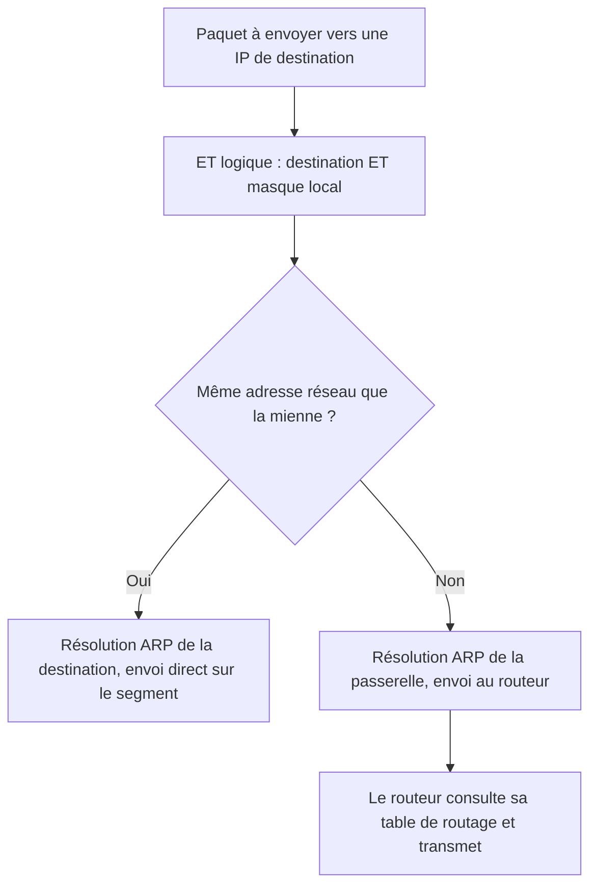

## Introduction

Avant de scanner un réseau, tu dois savoir le lire. Combien de machines peut-il contenir ? Quelle est son adresse de broadcast ? L'adresse que tu viens de trouver dans un fichier de configuration est-elle routable sur Internet ou appartient-elle à un réseau interne ? Ces questions reviennent à chaque mission de pentest, à chaque analyse d'alerte dans un SOC et à chaque fois qu'un administrateur conçoit un plan d'adressage.

Le découpage en sous-réseaux, ou **subnetting**, est aussi un outil de sécurité : un réseau bien segmenté limite la propagation d'une compromission, alors qu'un grand réseau plat offre à l'attaquant un terrain de jeu sans obstacle. Enfin, IPv6 est désormais activé par défaut sur la quasi-totalité des systèmes, souvent sans que personne ne le surveille.

À la fin de ce chapitre, tu sauras convertir une adresse en binaire, calculer toutes les caractéristiques d'un sous-réseau à la main puis avec un outil, découper un réseau avec VLSM, reconnaître les plages spéciales d'un coup d'œil, lire une adresse IPv6 et utiliser la notation CIDR pour cibler efficacement un scan.

## Structure d'une adresse IPv4

### 32 bits en notation décimale pointée

Une adresse IPv4 est composée de **32 bits**, découpés en 4 octets de 8 bits. Pour la lisibilité, chaque octet est écrit en décimal, de 0 à 255, séparé par des points : c'est la notation décimale pointée.

```text
192.168.1.10
= 11000000.10101000.00000001.00001010
```

Pour convertir un octet, on utilise les poids des 8 bits, de gauche à droite : 128, 64, 32, 16, 8, 4, 2, 1. Prenons 192 : il contient 128, il reste 64, qui contient 64, il reste 0. Les bits de poids 128 et 64 sont à 1, les autres à 0, ce qui donne `11000000`. Prenons 168 : 128 (reste 40), pas 64, 32 (reste 8), pas 16, 8 (reste 0). On obtient `10101000`. Avec un peu d'entraînement, ces conversions deviennent instantanées, et elles sont indispensables pour comprendre les masques.

### Partie réseau et partie hôte

Une adresse IP se divise en deux parties : la **partie réseau**, commune à toutes les machines d'un même sous-réseau, et la **partie hôte**, qui identifie une machine précise dans ce sous-réseau. Le **masque de sous-réseau** indique où se trouve la frontière : ses bits à 1 couvrent la partie réseau, ses bits à 0 la partie hôte. Le masque `255.255.255.0` s'écrit `11111111.11111111.11111111.00000000` : 24 bits réseau, 8 bits hôte.

### La notation CIDR

La notation CIDR (Classless Inter-Domain Routing, RFC 4632) exprime le masque par le **nombre de bits réseau à partir de la gauche** de l'adresse : `192.168.1.0/24` signifie que les 24 premiers bits identifient le réseau et les 8 bits restants les hôtes. CIDR a remplacé dans les années 1990 l'ancien système des **classes** (classe A en /8, B en /16, C en /24), trop rigide et qui gaspillait énormément d'adresses. Tu croiseras encore le vocabulaire « classe C » dans certains outils, mais il n'a plus de valeur technique.

<CompareTable
  titleA="Notation CIDR"
  titleB="Masque décimal / Hôtes disponibles"
  rows={[
    { a: "/8", b: "255.0.0.0 — 16 777 214 hôtes utilisables" },
    { a: "/16", b: "255.255.0.0 — 65 534 hôtes utilisables" },
    { a: "/24", b: "255.255.255.0 — 254 hôtes utilisables" },
    { a: "/25", b: "255.255.255.128 — 126 hôtes utilisables" },
    { a: "/26", b: "255.255.255.192 — 62 hôtes utilisables" },
    { a: "/27", b: "255.255.255.224 — 30 hôtes utilisables" },
    { a: "/28", b: "255.255.255.240 — 14 hôtes utilisables" },
    { a: "/30", b: "255.255.255.252 — 2 hôtes utilisables (liaison point-à-point)" },
    { a: "/32", b: "255.255.255.255 — un hôte unique (route ou règle de pare-feu ciblée)" },
  ]}
/>

<TipCallout>
Formule à retenir : nombre d'hôtes utilisables = 2^(32 - préfixe) - 2. Les 2 adresses soustraites sont l'adresse réseau (tous les bits hôte à 0) et l'adresse de broadcast (tous les bits hôte à 1), non attribuables à une machine. Exception : un /31 est utilisable pour un lien point-à-point avec ses deux adresses (RFC 3021).
</TipCallout>

## Calculer un sous-réseau à la main

### L'opération ET logique

Une machine détermine si une destination est sur son réseau local en appliquant un **ET logique** bit à bit entre l'adresse et le masque. Un bit vaut 1 dans le résultat seulement si les deux bits valent 1. Le résultat est l'**adresse réseau**. Si l'adresse réseau de la destination est identique à la sienne, la machine envoie directement la trame (après une résolution ARP) ; sinon, elle l'envoie à sa passerelle par défaut.



### Exemple complet pas à pas

Prenons l'adresse `172.16.45.130/26`. Le masque /26 vaut `255.255.255.192`. Les trois premiers octets du masque valent 255, ils recopient l'adresse : `172.16.45`. Tout se joue sur le dernier octet.

```text
Adresse, 4e octet :  130 = 1000 0010
Masque, 4e octet  :  192 = 1100 0000
ET logique        :        1000 0000 = 128   -> adresse réseau 172.16.45.128

Bits hôte à 1     :        1011 1111 = 191   -> broadcast      172.16.45.191
Première adresse  :  172.16.45.129
Dernière adresse  :  172.16.45.190
Hôtes utilisables :  2^(32-26) - 2 = 64 - 2 = 62
```

### La méthode du nombre magique

Pour aller plus vite, repère l'octet où le masque n'est ni 255 ni 0, ici 192. Calcule 256 moins cette valeur : 256 - 192 = 64. C'est la **taille de bloc**, ou nombre magique : les sous-réseaux commencent tous à un multiple de 64 dans cet octet, donc à 0, 64, 128 et 192. L'adresse 130 tombe dans le bloc qui commence à 128 et se termine juste avant 192, soit à 191. Tu retrouves le même résultat en quelques secondes, sans écrire de binaire.

## Découper un réseau en sous-réseaux

### Découpage en sous-réseaux égaux

Découper un réseau, c'est **emprunter des bits** à la partie hôte pour les ajouter à la partie réseau. Chaque bit emprunté double le nombre de sous-réseaux et divise par deux leur taille.

<Steps steps={[
  { title: "Identifier le préfixe cible", description: "Exemple : découper 192.168.1.0/24 en 4 sous-réseaux égaux nécessite d'emprunter 2 bits supplémentaires (2 puissance 2 égale 4), ce qui donne un /26." },
  { title: "Calculer le nombre d'adresses par sous-réseau", description: "Avec un /26, chaque sous-réseau contient 2^(32-26) = 64 adresses, dont 62 utilisables." },
  { title: "Lister les sous-réseaux obtenus", description: "On avance par blocs de 64 : 192.168.1.0/26, 192.168.1.64/26, 192.168.1.128/26 et 192.168.1.192/26." },
  { title: "Noter les bornes de chacun", description: "Pour 192.168.1.64/26 : réseau .64, premier hôte .65, dernier hôte .126, broadcast .127." },
]} />

### VLSM : des sous-réseaux de tailles différentes

Le subnetting classique découpe un réseau en sous-réseaux de taille identique — mais en pratique, un service compte 100 postes, un autre 10 serveurs, un troisième une seule liaison point-à-point. Le **VLSM (Variable Length Subnet Masking)** permet d'adapter la taille de chaque sous-réseau à son besoin réel, sans gaspiller d'adresses. La règle d'or est d'attribuer **d'abord les plus grands besoins**, afin que chaque bloc reste aligné sur un multiple de sa taille.

```text
Exemple : découper 192.168.1.0/24 selon les besoins réels
- Service A (100 postes)  → 192.168.1.0/25   (126 hôtes utilisables)
- Service B (50 postes)   → 192.168.1.128/26 (62 hôtes utilisables)
- Service C (10 serveurs) → 192.168.1.192/28 (14 hôtes utilisables)
- Liaison routeur-routeur → 192.168.1.208/30 (2 hôtes utilisables)
- Reste disponible        → 192.168.1.212 à 192.168.1.255
```

Le service C reçoit un /28 plutôt qu'un /25 comme le service A parce que 14 adresses suffisent largement à 10 serveurs : lui donner 126 adresses en gaspillerait plus d'une centaine. Pour choisir le préfixe, cherche la plus petite puissance de 2 qui, moins 2, couvre le besoin : pour 50 postes, 64 - 2 = 62 suffit, donc 6 bits hôte, soit un /26.

<TipCallout>
Le VLSM est la norme en entreprise : découper systématiquement en sous-réseaux égaux (tous en /26 par exemple) gaspille souvent des centaines d'adresses inutilisées sur les petits segments — un problème d'autant plus critique en IPv4, où l'espace d'adressage reste une ressource limitée. Prévois toutefois une marge de croissance : un sous-réseau rempli à 100 % le jour de sa création devra être renuméroté.
</TipCallout>

## Adresses privées, publiques et réservées

### Les plages privées de la RFC 1918

<CompareTable
  titleA="Plage privée (RFC 1918)"
  titleB="Usage typique"
  rows={[
    { a: "10.0.0.0/8", b: "Grands réseaux d'entreprise, clouds privés" },
    { a: "172.16.0.0/12 (172.16.0.0 à 172.31.255.255)", b: "Réseaux de taille moyenne, réseaux Docker par défaut" },
    { a: "192.168.0.0/16", b: "Réseaux domestiques et petites entreprises" },
  ]}
/>

Ces plages ne sont jamais routées sur Internet public : la RFC 1918 les réserve à l'usage interne, n'importe quelle organisation peut les réutiliser, et les routeurs des opérateurs les ignorent. Pour communiquer vers l'extérieur, elles nécessitent une traduction d'adresse (NAT), étudiée au chapitre 6. Attention au piège du 172.16.0.0/12 : l'adresse 172.32.0.1 est publique, car la plage s'arrête à 172.31.255.255.

### Les autres plages spéciales

| Plage | Rôle | Ce que ça t'apprend en audit |
| --- | --- | --- |
| `127.0.0.0/8` | Boucle locale (loopback), 127.0.0.1 désigne la machine elle-même | Un service qui n'écoute que sur 127.0.0.1 n'est pas joignable à distance |
| `169.254.0.0/16` | Link-local (APIPA), auto-attribuée quand le DHCP échoue | Une machine en 169.254 n'a pas obtenu de bail : panne ou DHCP bloqué |
| `100.64.0.0/10` | Shared address space pour le CGNAT des opérateurs (RFC 6598) | Ton IP « publique » est partagée, les connexions entrantes sont impossibles |
| `0.0.0.0` | « Toutes les interfaces » pour un service, ou route par défaut en `0.0.0.0/0` | Un service en écoute sur 0.0.0.0 est exposé sur toutes les interfaces |
| `224.0.0.0/4` | Multicast | Trafic de groupe : mDNS, protocoles de routage, découverte de services |
| `255.255.255.255` | Broadcast limité au segment local | Utilisé par DHCP Discover |
| `192.0.2.0/24`, `198.51.100.0/24`, `203.0.113.0/24` | Réservées à la documentation (RFC 5737) | À utiliser dans tes rapports et exemples, jamais de vraies IP de tiers |

<CehCallout>
Repérer qu'une adresse appartient à une plage privée (RFC 1918) t'indique immédiatement que tu es sur un réseau interne — un signal utile en phase de reconnaissance pour cartographier l'architecture d'une cible. Une adresse privée qui fuit dans un en-tête HTTP, un message d'erreur ou un certificat est une divulgation d'information à consigner dans le rapport.
</CehCallout>

## IPv6 : la réponse à l'épuisement d'IPv4

### Pourquoi IPv6

L'épuisement des adresses IPv4 (32 bits, environ 4,3 milliards d'adresses) a motivé IPv6 (128 bits, soit environ 3,4 × 10^38 adresses). Les registres régionaux ont distribué leurs derniers blocs IPv4 libres au cours des années 2010, et le NAT a servi de rustine. Le pentester doit savoir lire IPv6, car de plus en plus d'infrastructures l'activent en parallèle d'IPv4, en **double pile** (dual-stack), et tous les systèmes modernes l'activent par défaut.

### Lire et compresser une adresse

Une adresse IPv6 s'écrit en 8 groupes de 4 chiffres hexadécimaux séparés par deux-points. Deux règles de compression s'appliquent : on supprime les zéros en tête de chaque groupe, et on remplace **une seule** suite de groupes entièrement nuls par `::`.

```text
Adresse IPv6 complète :  2001:0db8:0000:0000:0000:ff00:0042:8329
Forme compressée :        2001:db8::ff00:42:8329
```

Le `::` ne peut apparaître qu'une fois, sinon on ne saurait plus combien de groupes nuls il remplace. Par convention (RFC 5952), on compresse la plus longue suite de zéros et on écrit les lettres en minuscules.

### Préfixes et types d'adresses

En IPv6, un sous-réseau standard est un **/64** : les 64 premiers bits forment le préfixe réseau, les 64 derniers l'identifiant d'interface. Un site reçoit typiquement un /48 ou un /56 de son opérateur, qu'il découpe en /64.

<CompareTable
  titleA="Élément IPv6"
  titleB="Équivalent / rôle"
  rows={[
    { a: "::1", b: "Équivalent de 127.0.0.1 (loopback)" },
    { a: "fe80::/10", b: "Adresses link-local, auto-configurées, non routées, présentes sur toute interface IPv6" },
    { a: "2000::/3", b: "Adresses globales unicast (GUA), routables sur Internet" },
    { a: "fc00::/7 (en pratique fd00::/8)", b: "Unique Local Addresses (ULA), équivalent conceptuel des plages RFC 1918" },
    { a: "ff00::/8", b: "Multicast ; ff02::1 joint tous les nœuds du lien local" },
    { a: "2001:db8::/32", b: "Plage réservée à la documentation" },
    { a: "::/0", b: "Route par défaut (équivalent de 0.0.0.0/0 en IPv4)" },
  ]}
/>

### Auto-configuration et découverte de voisins

IPv6 n'utilise pas ARP. Il s'appuie sur **NDP** (Neighbor Discovery Protocol), qui fonctionne au-dessus d'ICMPv6. Les routeurs annoncent leur présence et le préfixe du réseau par des messages **Router Advertisement** (RA). Grâce à **SLAAC** (Stateless Address Autoconfiguration), chaque machine se fabrique alors une adresse globale toute seule, sans serveur DHCP. Les systèmes modernes utilisent des identifiants d'interface aléatoires ou temporaires (RFC 8981) plutôt que l'ancien format EUI-64 dérivé de l'adresse MAC, qui permettait de pister un appareil.

<WarningCallout>
Un réseau audité « sécurisé » en IPv4 peut rester totalement exposé en IPv6 si le pare-feu ne filtre que le trafic v4 — un oubli de configuration fréquent, à vérifier systématiquement (`ip -6 addr show`) lors d'un audit réseau. De même, comme NDP n'est pas authentifié, une machine malveillante peut envoyer de faux Router Advertisements ou répondre aux requêtes DHCPv6 de Windows pour devenir serveur DNS de tout le segment : c'est le principe de l'outil mitm6, très utilisé en test d'intrusion Active Directory.
</WarningCallout>

## Le subnetting au service de la reconnaissance et de la défense

### Nmap et la notation CIDR

La maîtrise du CIDR se traduit directement en efficacité opérationnelle : plutôt que de scanner IP par IP, la notation CIDR permet de cibler un sous-réseau entier en une seule commande. L'option `-sn` désactive le scan de ports et ne fait que la **découverte d'hôtes** (ping scan). Sur un réseau local, Nmap utilise alors automatiquement des requêtes ARP, impossibles à filtrer par un pare-feu hôte, ce qui rend la découverte très fiable.

```bash
# Découvrir les hôtes actifs de tout un sous-réseau /24 (254 adresses potentielles)
sudo nmap -sn 192.168.1.0/24

# Scanner uniquement une plage précise dans un sous-réseau plus large
sudo nmap -sn 192.168.1.1-50

# Lister les cibles sans rien envoyer (vérifier son périmètre avant de scanner)
nmap -sL -n 10.10.0.0/28
```

```text
Starting Nmap 7.95 ( https://nmap.org )
Nmap scan report for 192.168.1.1
Host is up (0.00052s latency).
MAC Address: 52:54:00:12:35:02 (QEMU virtual NIC)
Nmap scan report for 192.168.1.23
Host is up (0.00071s latency).
MAC Address: 08:00:27:3A:91:0C (Oracle VirtualBox virtual NIC)
Nmap done: 256 IP addresses (2 hosts up) scanned in 2.14 seconds
```

<LegalCallout>
Le périmètre d'un test d'intrusion est défini par des plages CIDR dans la lettre de mission. Une erreur de calcul, par exemple scanner un /16 au lieu d'un /24, peut te faire toucher des adresses appartenant à un tiers : c'est un accès non autorisé. Vérifie toujours ta liste de cibles avec `nmap -sL` ou un script avant de lancer un scan.
</LegalCallout>

### Reconnaître la taille d'une cible

Côté reconnaissance externe, les bases WHOIS des registres régionaux (RIPE NCC pour l'Europe, AFRINIC pour l'Afrique, ARIN pour l'Amérique du Nord) indiquent quelles plages appartiennent à une organisation. La commande `whois 193.0.6.139` renvoie par exemple le bloc `inetnum` et le système autonome (ASN) correspondant. Savoir qu'une cible possède un /22 te dit qu'elle dispose de 1024 adresses publiques à cartographier.

### La segmentation comme mesure de défense

Pour le défenseur, le plan d'adressage est la base de la segmentation : un sous-réseau par fonction (postes, serveurs, administration, invités, objets connectés) permet ensuite d'appliquer des règles de filtrage entre zones. Les chapitres 5 et 6 montreront comment VLAN et pare-feu s'appuient sur ce découpage.

<AttackDefenseTable rows={[
  { phase: "Découverte", attack: "Balayage ARP ou ICMP de tout le /24 pour trouver les hôtes actifs", defense: "Segmentation fine, détection des balayages par l'IDS, inventaire des actifs à jour" },
  { phase: "Fuite d'information", attack: "Repérage d'IP internes dans des en-têtes HTTP ou messages d'erreur", defense: "Nettoyage des en-têtes en sortie de proxy, pages d'erreur génériques" },
  { phase: "Angle mort IPv6", attack: "Accès aux services par leur adresse IPv6 non filtrée, faux Router Advertisements", defense: "Politique de filtrage IPv6 équivalente à IPv4, RA Guard sur les switches, désactivation contrôlée si inutilisé" },
  { phase: "Pivot", attack: "Après compromission, rebond vers les autres sous-réseaux joignables", defense: "Filtrage inter-sous-réseaux par défaut en refus, réseau d'administration dédié" },
]} />

## Erreurs fréquentes

Oublier de soustraire 2 est l'erreur la plus classique : un /24 contient 256 adresses mais seulement 254 hôtes utilisables. À l'inverse, certains soustraient 2 sur un /32, qui désigne un hôte unique et n'a pas d'adresse réseau ni de broadcast au sens usuel.

Deuxième erreur : croire que 172.16.0.0/12 s'arrête à 172.16.255.255. La plage va jusqu'à 172.31.255.255, et tout ce qui dépasse est public.

Troisième erreur : faire commencer un sous-réseau n'importe où. Un /26 commence forcément à un multiple de 64 dans le dernier octet ; 192.168.1.50/26 n'est pas une adresse réseau mais un hôte du sous-réseau 192.168.1.0/26.

Quatrième erreur : utiliser plusieurs `::` dans une adresse IPv6, ou supprimer des zéros à la fin d'un groupe. Seuls les zéros en tête de groupe peuvent disparaître : `0042` devient `42`, mais `4200` reste `4200`.

Enfin, ignorer IPv6 parce que « le réseau est en IPv4 » est une faute d'audit : si les machines ont une adresse link-local, elles parlent IPv6 sur le segment.

<WarningCallout>
Une erreur de calcul de sous-réseau en environnement réel peut créer des chevauchements d'adresses ou isoler des machines du reste du réseau — vérifie toujours tes calculs avec un outil comme `ipcalc` avant modification d'une configuration en production.
</WarningCallout>

## Lab — Mise en pratique

**Environnement** : Kali Linux (terminal Nyx Shell). L'outil `ipcalc` est installable avec `sudo apt install ipcalc` s'il manque.

<Steps steps={[
  { title: "Identifier ton adressage actuel", description: "Relève ton adresse IPv4 et son préfixe CIDR, puis ta passerelle. Calcule de tête l'adresse réseau et le broadcast avant de passer à l'étape suivante.", code: "ip -4 -br addr show\nip route show default" },
  { title: "Vérifier ton calcul avec ipcalc", description: "Compare les champs Network, HostMin, HostMax, Broadcast et Hosts/Net avec ton calcul manuel. La ligne binaire montre la frontière entre bits réseau et bits hôte.", code: "ipcalc 172.16.45.130/26" },
  { title: "Découper un réseau en sous-réseaux égaux", description: "Utilise le module ipaddress de Python pour découper 10.10.0.0/24 en /26. Tu dois obtenir 4 sous-réseaux commençant à .0, .64, .128 et .192.", code: "python3 -c \"import ipaddress; [print(n, n.num_addresses - 2, 'hôtes') for n in ipaddress.ip_network('10.10.0.0/24').subnets(new_prefix=26)]\"" },
  { title: "Tester l'appartenance à une plage privée", description: "Vérifie quelles adresses sont privées. Observe en particulier 172.31.255.1 (privée) et 172.32.0.1 (publique), ainsi que 100.64.1.1 qui relève du CGNAT.", code: "python3 -c \"import ipaddress; [print(a, ipaddress.ip_address(a).is_private) for a in ['10.1.2.3','172.31.255.1','172.32.0.1','192.168.1.1','8.8.8.8','100.64.1.1']]\"" },
  { title: "Observer ton adressage IPv6", description: "Affiche tes adresses IPv6. Tu dois au minimum voir une adresse fe80:: (link-local) sur ton interface principale, preuve qu'IPv6 est actif sur le segment.", code: "ip -6 addr show" },
  { title: "Découvrir les hôtes du sous-réseau", description: "Liste d'abord les cibles sans rien envoyer, puis lance la découverte d'hôtes sur le sous-réseau du lab. Compte les hôtes actifs et note leurs adresses MAC.", code: "nmap -sL -n 10.10.0.0/28 | head\nsudo nmap -sn 10.10.0.0/24" },
  { title: "Découvrir les voisins IPv6", description: "Envoie un ping au groupe multicast de tous les nœuds du lien, puis affiche la table des voisins IPv6. Les machines qui répondent sont joignables en IPv6 même si personne ne l'a configuré.", code: "ping -6 -c 2 ff02::1%eth0\nip -6 neigh show" },
]} />

Voici la sortie attendue à l'étape 2.

```text
Address:   172.16.45.130        10101100.00010000.00101101.10 000010
Netmask:   255.255.255.192 = 26 11111111.11111111.11111111.11 000000
Wildcard:  0.0.0.63             00000000.00000000.00000000.00 111111
=>
Network:   172.16.45.128/26     10101100.00010000.00101101.10 000000
HostMin:   172.16.45.129        10101100.00010000.00101101.10 000001
HostMax:   172.16.45.190        10101100.00010000.00101101.10 111110
Broadcast: 172.16.45.191        10101100.00010000.00101101.10 111111
Hosts/Net: 62                    Class B, Private Internet
```

## À retenir

- Une adresse IPv4 fait 32 bits ; la notation CIDR (/24, /26...) exprime le nombre de bits réseau à partir de la gauche.
- Le nombre d'hôtes utilisables se calcule par 2^(32 - préfixe) - 2 : 254 pour un /24, 62 pour un /26, 14 pour un /28.
- L'adresse réseau s'obtient par un ET logique entre l'adresse et le masque ; la taille de bloc (256 moins l'octet du masque) accélère le calcul.
- Le VLSM dimensionne chaque sous-réseau selon son besoin réel, en servant d'abord les plus grands.
- Les plages RFC 1918 (10.0.0.0/8, 172.16.0.0/12, 192.168.0.0/16) sont privées et non routées sur Internet ; 127.0.0.0/8, 169.254.0.0/16 et 100.64.0.0/10 ont aussi un rôle spécial.
- IPv6 utilise 128 bits, des sous-réseaux en /64, la compression par `::` une seule fois, et des adresses link-local en fe80::/10.
- Un filtrage limité à IPv4 laisse souvent IPv6 grand ouvert : c'est un point de contrôle systématique en audit.

## Questions de révision

1. Combien d'hôtes utilisables contient un réseau en /28, et quel est son masque décimal ?
2. Calcule l'adresse réseau, le broadcast et la plage d'hôtes de 10.20.30.77/27.
3. Pourquoi les adresses 192.168.0.0/16 ne sont-elles jamais routées sur Internet public, et comment une machine qui en utilise une accède-t-elle quand même au Web ?
4. Que représentent l'adresse réseau et l'adresse de broadcast dans un sous-réseau, et pourquoi ne peut-on pas les attribuer à une machine ?
5. Tu dois adresser un service de 25 postes, un de 60 postes et deux liaisons point-à-point dans 192.168.50.0/24. Propose un plan VLSM.
6. Compresse l'adresse 2001:0db8:0000:0042:0000:0000:0000:0001 et explique pourquoi on ne peut pas utiliser `::` deux fois.
7. Une machine Windows d'un réseau « 100 % IPv4 » possède une adresse fe80::. Quels risques cela fait-il peser et que vérifies-tu ?
