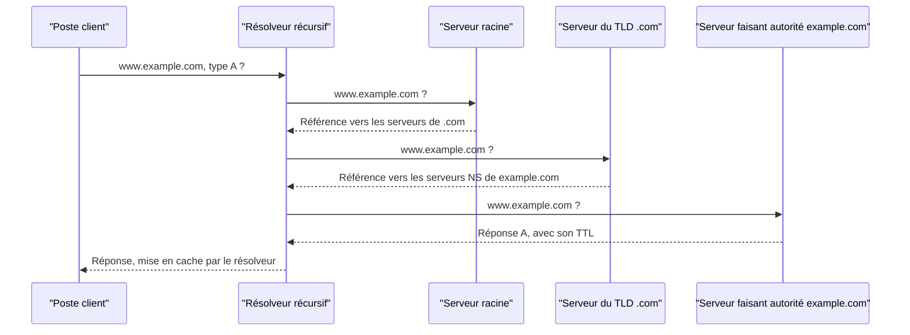
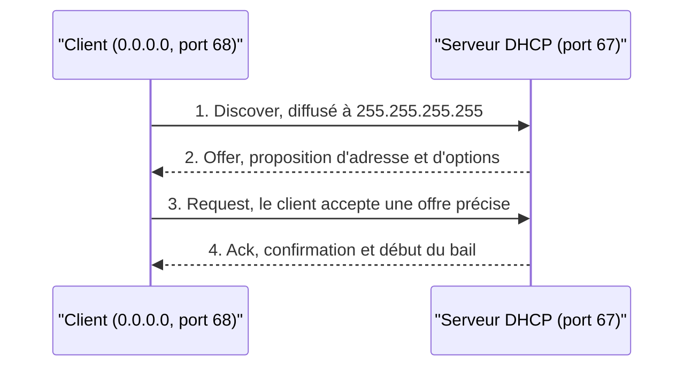

## Introduction

Les chapitres précédents t'ont montré comment les paquets sont adressés et transportés. Ce chapitre monte d'un cran, à la couche application, là où se trouvent les protocoles que tu utilises sans y penser des centaines de fois par jour. Trois d'entre eux structurent presque toute l'activité d'un réseau d'entreprise : **HTTP**, le protocole du web et de la quasi-totalité des API ; **DNS**, l'annuaire qui traduit les noms en adresses ; et **DHCP**, le service qui donne automatiquement une configuration réseau à chaque machine qui se branche.

Ces trois protocoles ont un point commun gênant : ils ont été conçus à une époque où l'on faisait confiance au réseau. HTTP transmet tout en clair, DNS n'authentifie pas ses réponses, DHCP accepte la première offre venue. Comprendre précisément comment ils fonctionnent permet donc de comprendre pourquoi ils sont si souvent impliqués dans les incidents, et surtout comment les durcir et les surveiller. Pour un analyste SOC, ce sont aussi les journaux les plus riches : les logs DNS et les logs du proxy web racontent souvent toute l'histoire d'une compromission.

À la fin de ce chapitre, tu sauras lire un échange HTTP brut et ses en-têtes de sécurité, vérifier un certificat TLS, suivre une résolution DNS de la racine jusqu'au serveur faisant autorité, interroger les principaux types d'enregistrements, expliquer DNSSEC et le transfert de zone, et décrire l'échange DHCP ainsi que les protections des switches qui l'encadrent.

## HTTP : le protocole du web

### Un protocole requête-réponse et sans état

**HTTP** (HyperText Transfer Protocol) fonctionne sur un modèle simple : un client envoie une **requête**, le serveur renvoie une **réponse**. Il est **sans état** (stateless) : chaque requête est indépendante, et le serveur ne se souvient pas, par lui-même, de la requête précédente. C'est pour cela que les applications web utilisent des **cookies** ou des jetons : ils réintroduisent la notion de session au-dessus d'un protocole qui n'en a pas. Voler un cookie de session revient donc souvent à voler la session elle-même, ce qui explique l'importance des protections que tu verras plus bas.

Le sémantisme de HTTP est aujourd'hui décrit par la RFC 9110, et il existe trois versions en usage. **HTTP/1.1** (RFC 9112) est un protocole texte, lisible tel quel. **HTTP/2** (RFC 9113) garde la même sémantique mais encode les messages en binaire et multiplexe plusieurs requêtes sur une seule connexion TCP. **HTTP/3** (RFC 9114) remplace TCP par **QUIC**, un transport chiffré construit sur UDP, généralement sur le port 443. Quelle que soit la version, les notions de méthode, de code de statut et d'en-tête restent identiques.

### Anatomie d'une requête et d'une réponse

Une requête HTTP/1.1 contient une ligne de requête (méthode, chemin, version), des en-têtes, une ligne vide, puis éventuellement un corps. La réponse suit la même structure avec une ligne de statut.

```http
GET /produits?id=42 HTTP/1.1
Host: shop.lab
User-Agent: curl/8.11.1
Accept: */*
Cookie: session=7f3a9c

HTTP/1.1 200 OK
Content-Type: text/html; charset=utf-8
Content-Length: 1834
Set-Cookie: session=7f3a9c; Secure; HttpOnly; SameSite=Lax
Strict-Transport-Security: max-age=31536000; includeSubDomains
```

L'en-tête `Host` est obligatoire en HTTP/1.1 : il permet à un même serveur, sur une même adresse IP, d'héberger plusieurs sites (les « hôtes virtuels »). La partie après le point d'interrogation, ici `id=42`, est la **chaîne de requête** : un paramètre transmis par le client, donc à considérer comme non fiable côté serveur.

### Les méthodes HTTP

| Méthode | Usage | Propriété |
| --- | --- | --- |
| GET | Lire une ressource | Sûre et idempotente : ne doit rien modifier |
| HEAD | Comme GET, mais sans le corps de la réponse | Utile pour lire uniquement les en-têtes |
| POST | Envoyer des données (formulaire, création) | Ni sûre ni idempotente |
| PUT | Remplacer une ressource | Idempotente |
| PATCH | Modifier partiellement une ressource | Non idempotente en général |
| DELETE | Supprimer une ressource | Idempotente |
| OPTIONS | Demander les méthodes acceptées, utilisée par CORS | Sûre |

Une méthode est dite **idempotente** quand la répéter plusieurs fois produit le même effet qu'une seule fois. Côté défense, un serveur ne devrait accepter que les méthodes dont l'application a réellement besoin : une méthode `PUT` ou `DELETE` laissée active sur un serveur de fichiers statiques est une mauvaise configuration classique relevée en audit.

### Les codes de statut

Les codes de statut sont regroupés par centaine. Le premier chiffre suffit à savoir de quel type de réponse il s'agit : 1xx information, 2xx succès, 3xx redirection, 4xx erreur du client, 5xx erreur du serveur.

<CompareTable
  titleA="Code de statut"
  titleB="Signification"
  rows={[
    { a: "200 OK", b: "Requête traitée avec succès" },
    { a: "201 Created", b: "Ressource créée, typiquement après un POST" },
    { a: "301 Moved Permanently", b: "Redirection permanente : le navigateur et les moteurs de recherche retiennent la nouvelle adresse" },
    { a: "302 Found / 307 Temporary Redirect", b: "Redirection temporaire" },
    { a: "304 Not Modified", b: "La copie en cache du client est encore valide" },
    { a: "400 Bad Request", b: "Requête mal formée" },
    { a: "401 Unauthorized", b: "Non authentifié : il faut d'abord prouver son identité" },
    { a: "403 Forbidden", b: "Accès refusé : l'identité est connue, ou non, mais l'accès est interdit" },
    { a: "404 Not Found", b: "Ressource introuvable" },
    { a: "429 Too Many Requests", b: "Limitation de débit (rate limiting) déclenchée" },
    { a: "500 Internal Server Error", b: "Erreur interne du serveur" },
    { a: "502 / 503 / 504", b: "Passerelle en erreur, service indisponible, délai dépassé côté passerelle" },
  ]}
/>

La différence entre 401 et 403 tombe souvent en examen : 401 signifie « je ne sais pas qui tu es », 403 signifie « je sais ou je ne cherche pas à savoir qui tu es, mais c'est non ». Côté supervision, une rafale de 401 ou de 403 depuis une même adresse est un signal de tentative de force brute ou d'exploration, tandis qu'une montée soudaine des 5xx peut trahir une attaque applicative ou un incident de disponibilité.

### Les en-têtes qui comptent pour la sécurité

Certains en-têtes de réponse protègent directement l'utilisateur. Ils sont gratuits à mettre en place et figurent dans toutes les grilles d'audit web.

| En-tête | Rôle |
| --- | --- |
| `Strict-Transport-Security` (HSTS) | Oblige le navigateur à n'utiliser que HTTPS pour ce domaine pendant la durée `max-age` |
| `Content-Security-Policy` (CSP) | Liste les sources autorisées de scripts, styles, images : limite fortement l'impact d'une injection XSS |
| `X-Content-Type-Options: nosniff` | Empêche le navigateur de deviner le type d'un fichier |
| `X-Frame-Options` ou `frame-ancestors` dans la CSP | Empêche l'intégration du site dans une iframe (clickjacking) |
| `Referrer-Policy` | Limite les informations envoyées au site suivant dans l'en-tête Referer |
| Attributs de cookie `Secure`, `HttpOnly`, `SameSite` | Cookie envoyé seulement en HTTPS, inaccessible au JavaScript, non envoyé sur les requêtes intersites |

À l'inverse, certains en-têtes informent trop. `Server: Apache/2.4.41 (Ubuntu)` ou `X-Powered-By: PHP/7.4.3` dévoilent la pile logicielle et sa version exacte, ce qui permet à n'importe qui de la comparer à une base de vulnérabilités connues.

<CehCallout>
Les en-têtes HTTP de réponse (`Server`, `X-Powered-By`) révèlent souvent la stack technique d'une cible. C'est une information exploitée lors de la reconnaissance, et donc la première chose à masquer côté défense : `ServerTokens Prod` et `ServerSignature Off` sous Apache, `server_tokens off;` sous nginx, `expose_php = Off` dans php.ini.
</CehCallout>

### HTTPS : HTTP protégé par TLS

HTTP transmet tout en clair : identifiants, cookies, contenu des pages. Toute personne placée sur le chemin, par exemple sur un Wi-Fi public ou sur un segment réseau compromis, peut le lire ou le modifier. **HTTPS** est simplement HTTP transporté à l'intérieur d'une session **TLS** (Transport Layer Security), sur le port 443. TLS apporte trois garanties : la **confidentialité** grâce au chiffrement, l'**intégrité** grâce à un code d'authentification sur chaque message, et l'**authentification du serveur** grâce à un certificat X.509 signé par une autorité de certification reconnue.

La version recommandée est **TLS 1.3** (RFC 8446), plus rapide et débarrassée des algorithmes faibles ; TLS 1.2 reste acceptable avec une configuration moderne. SSL 2.0, SSL 3.0, TLS 1.0 et TLS 1.1 sont officiellement obsolètes (RFC 8996) et doivent être désactivés. Lors de la poignée de main, le client indique le nom du site demandé dans l'extension **SNI** (Server Name Indication), ce qui permet d'héberger plusieurs certificats sur une même adresse IP ; ce nom circule encore en clair dans la plupart des connexions, ce qui explique que les proxys et pare-feu puissent filtrer HTTPS par nom de domaine sans déchiffrer le trafic.

```bash
# Examiner le certificat et la version TLS négociée
openssl s_client -connect example.com:443 -servername example.com </dev/null 2>/dev/null \
  | grep -E "Protocol|Cipher|subject=|issuer="

# Lire les dates de validité du certificat
echo | openssl s_client -connect example.com:443 -servername example.com 2>/dev/null \
  | openssl x509 -noout -subject -issuer -dates
```

```text
subject=CN=www.example.org
issuer=C=US, O=DigiCert Inc, CN=DigiCert Global G3 TLS ECC SHA384 2020 CA1
notBefore=Jan 15 00:00:00 2026 GMT
notAfter=Jan 15 23:59:59 2027 GMT
```

Les dates et l'émetteur que tu obtiendras seront différents : les certificats sont renouvelés régulièrement, et la durée de vie maximale des certificats publics est en train d'être progressivement réduite par le CA/Browser Forum, ce qui pousse à automatiser leur renouvellement avec le protocole ACME (celui de Let's Encrypt).

<WarningCallout>
Un certificat expiré, auto-signé ou émis pour un autre domaine déclenche une alerte dans le navigateur. Cela ne signifie pas que le trafic n'est pas chiffré, mais que le client ne peut plus vérifier à qui il parle. Un utilisateur qui clique sur « continuer quand même » accepte potentiellement une interception de type homme du milieu. C'est précisément ce que HSTS empêche : sur un domaine HSTS, le navigateur ne propose plus de contourner l'alerte.
</WarningCallout>

## DNS : l'annuaire d'Internet

### Pourquoi DNS existe

Les machines communiquent avec des adresses IP, les humains retiennent des noms. Le **DNS** (Domain Name System) fait la traduction. C'est une base de données **distribuée et hiérarchique** : aucun serveur ne connaît tous les noms, chacun est responsable d'une portion de l'arbre appelée **zone**. DNS utilise principalement **UDP sur le port 53** pour les requêtes courtes, et **TCP sur le port 53** pour les réponses volumineuses et les transferts de zone.

L'arbre commence par la **racine**, notée par un point final. En dessous viennent les **domaines de premier niveau** (TLD) comme `.com`, `.fr` ou `.cg`, puis les domaines de second niveau comme `example.com`, puis les sous-domaines. Un nom écrit avec tous ses niveaux jusqu'à la racine, comme `www.example.com.`, est appelé **FQDN** (Fully Qualified Domain Name).

### Une résolution pas à pas

Quand ton poste veut joindre `www.example.com`, il ne parcourt pas l'arbre lui-même. Il interroge un **résolveur récursif** (celui de ton entreprise, de ton fournisseur d'accès ou un résolveur public), qui fait le travail à sa place en interrogeant successivement les serveurs **faisant autorité**, puis garde la réponse en **cache** pendant la durée indiquée par le **TTL** (Time To Live) de l'enregistrement.



La requête du poste au résolveur est dite **récursive** (« donne-moi la réponse finale »), celles du résolveur vers les serveurs faisant autorité sont dites **itératives** (« dis-moi ce que tu sais, ou à qui demander »). La commande `dig +trace` rejoue exactement ce parcours et te montre chaque référence.

### Les types d'enregistrements

<CompareTable
  titleA="Type d'enregistrement"
  titleB="Rôle"
  rows={[
    { a: "A", b: "Associe un nom de domaine à une adresse IPv4" },
    { a: "AAAA", b: "Associe un nom de domaine à une adresse IPv6" },
    { a: "CNAME", b: "Alias : le nom pointe vers un autre nom de domaine, qui sera résolu à son tour" },
    { a: "MX", b: "Serveur de messagerie du domaine, avec une priorité (le plus petit nombre est préféré)" },
    { a: "NS", b: "Serveurs de noms faisant autorité sur le domaine" },
    { a: "SOA", b: "Début de zone : serveur primaire, contact, numéro de série et temporisations de la zone" },
    { a: "PTR", b: "Résolution inverse : associe une adresse IP à un nom" },
    { a: "TXT", b: "Texte libre : SPF, DKIM, DMARC, preuves de propriété de domaine" },
    { a: "SRV", b: "Localise un service (par exemple les contrôleurs de domaine Active Directory)" },
    { a: "CAA", b: "Liste les autorités de certification autorisées à émettre des certificats pour le domaine" },
  ]}
/>

Trois de ces enregistrements jouent un rôle majeur dans la lutte contre l'usurpation d'e-mail : **SPF** (un TXT listant les serveurs autorisés à envoyer pour le domaine), **DKIM** (une clé publique publiée en TXT pour vérifier la signature des messages) et **DMARC** (un TXT sous `_dmarc` indiquant quoi faire des messages qui échouent aux contrôles). Un domaine sans DMARC en politique `quarantine` ou `reject` est facile à usurper dans une campagne de phishing.

```bash
# Interroger différents types d'enregistrements
dig example.com A +short
dig example.com MX +short
dig example.com NS +short
dig _dmarc.example.com TXT +short
dig -x 8.8.8.8 +short          # résolution inverse (PTR)
```

```text
93.184.215.14
0 .
a.iana-servers.net.
b.iana-servers.net.
"v=DMARC1;p=reject;sp=reject;adkim=s;aspf=s"
dns.google.
```

Les valeurs exactes peuvent changer avec le temps. Remarque le MX `0 .` : c'est un « MX nul » (RFC 7505), la façon officielle de déclarer qu'un domaine ne reçoit aucun e-mail.

<TipCallout>
L'ancienne requête `dig example.com ANY` est de moins en moins utile : la RFC 8482 autorise les serveurs à répondre de façon minimale, et beaucoup le font. Pour cartographier un domaine, interroge plutôt chaque type explicitement. Pour la défense, souviens-toi que les noms DNS publics sont aussi visibles dans les journaux de transparence des certificats (Certificate Transparency) : un sous-domaine « caché » mais doté d'un certificat public ne l'est pas.
</TipCallout>

### Le transfert de zone et pourquoi le restreindre

Un domaine a généralement plusieurs serveurs faisant autorité : un **primaire**, où l'administrateur modifie la zone, et des **secondaires**, qui en gardent une copie. Les secondaires récupèrent la zone complète par un **transfert de zone**, appelé **AXFR** (ou IXFR pour un transfert incrémental), sur TCP 53.

Le problème apparaît quand le serveur accepte ce transfert depuis n'importe quelle adresse. Une seule requête suffit alors à obtenir **l'intégralité des enregistrements** de la zone : noms des serveurs internes, environnements de test, interfaces d'administration, adresses IP. C'est une carte complète offerte à quiconque la demande, ce qui en fait une mauvaise configuration critique.

La correction est simple : n'autoriser le transfert qu'aux adresses des serveurs secondaires, et l'authentifier avec une clé partagée **TSIG** (RFC 8945). Sous BIND, cela passe par la directive `allow-transfer` dans la définition de la zone. Pour vérifier ta propre configuration, tu peux demander un transfert depuis une machine qui n'est pas un secondaire : la réponse attendue est un refus.

```bash
# Vérifier que TON serveur refuse le transfert à une machine non autorisée
dig axfr lab.local @10.10.0.53
```

```text
; <<>> DiG 9.20.4 <<>> axfr lab.local @10.10.0.53
;; global options: +cmd
; Transfer failed.
```

<CehCallout>
Un transfert de zone DNS non restreint (AXFR ouvert à quiconque) est une mauvaise configuration classique de l'examen CEH : elle révèle d'un coup l'intégralité des enregistrements d'un domaine. Retiens la cause (absence de `allow-transfer`), la conséquence (fuite de la cartographie interne) et la correction (liste blanche des secondaires et TSIG).
</CehCallout>

### DNSSEC : authentifier les réponses

Le DNS classique ne prouve pas l'origine de ses réponses. Un attaquant capable d'injecter une fausse réponse dans le cache d'un résolveur (empoisonnement de cache) peut rediriger tous ses utilisateurs vers une adresse de son choix ; le dernier chapitre de ce cours revient sur ces attaques. **DNSSEC** (DNS Security Extensions) ajoute des **signatures cryptographiques** aux enregistrements. Chaque zone signe ses données avec une clé publiée dans un enregistrement **DNSKEY** ; les signatures sont stockées dans des enregistrements **RRSIG** ; la zone parente publie une empreinte de la clé de la zone enfant dans un enregistrement **DS**, ce qui forme une **chaîne de confiance** jusqu'à la racine. Un résolveur validant vérifie cette chaîne et rejette toute réponse falsifiée.

```bash
# Voir les clés publiques d'une zone signée
dig example.com DNSKEY +short | head -2

# Demander la réponse avec ses signatures
dig +dnssec example.com A

# Valider la chaîne de confiance complète (outil fourni avec BIND)
delv example.com A
```

```text
; fully validated
example.com.		300	IN	A	93.184.215.14
example.com.		300	IN	RRSIG	A 13 2 300 20261120000000 20261106000000 ...
```

Dans la sortie de `dig +dnssec`, le drapeau `ad` (Authenticated Data) dans l'en-tête indique que le résolveur a validé la réponse. DNSSEC garantit l'**authenticité et l'intégrité**, mais pas la confidentialité : les requêtes restent lisibles. C'est le rôle de **DoT** (DNS over TLS, RFC 7858, port 853) et de **DoH** (DNS over HTTPS, RFC 8484, port 443), qui chiffrent le trajet entre le client et le résolveur. Côté entreprise, DoH est à double tranchant : il protège la vie privée, mais il permet aussi à un poste ou à un malware de contourner le résolveur interne et sa journalisation. La bonne pratique est de fournir un résolveur interne chiffré et de bloquer les résolveurs DoH externes non approuvés.

<AuditCallout>
Malgré son intérêt, DNSSEC reste inégalement déployé en 2026, notamment pour les zones d'entreprise. Les auditeurs le relèvent souvent comme axe d'amélioration. Dans ISO/IEC 27001:2022, la sécurité des services réseau relève du contrôle A.8.21, et la journalisation des requêtes DNS alimente directement la surveillance demandée par A.8.16.
</AuditCallout>

## DHCP : la configuration automatique

### Le rôle de DHCP

Configurer à la main l'adresse IP, le masque, la passerelle et les serveurs DNS de chaque poste serait ingérable. **DHCP** (Dynamic Host Configuration Protocol, RFC 2131) automatise cette tâche. Un serveur DHCP gère une **plage** (pool) d'adresses et les **loue** aux clients pour une durée limitée, appelée **bail** (lease). DHCP fonctionne sur UDP : le serveur écoute sur le **port 67**, le client sur le **port 68**.

### L'échange DORA

Un client qui arrive sur le réseau n'a pas encore d'adresse IP ; il ne connaît pas non plus le serveur. Il commence donc par diffuser sa demande à tout le segment. L'échange se déroule en quatre messages, dont les initiales forment l'acronyme **DORA**.



Le **Discover** est diffusé car le client ne connaît personne. Chaque serveur présent peut répondre par une **Offer**. Le client choisit une offre et la confirme par un **Request**, lui aussi diffusé pour que les autres serveurs sachent que leur offre est déclinée. Le serveur choisi valide avec un **Ack** ; s'il refuse, il envoie un **Nak**. Sur un réseau segmenté, les messages diffusés ne traversent pas les routeurs : on configure alors un **relais DHCP** (sur Cisco, la commande `ip helper-address`) qui transmet les demandes au serveur central.

Le bail n'est pas permanent. À la moitié de sa durée (temporisation T1), le client tente de le renouveler directement auprès de son serveur ; à 87,5 % (T2), il s'adresse à n'importe quel serveur. Sans réponse à l'expiration, il doit abandonner l'adresse.

### Ce que DHCP transmet vraiment

L'adresse IP n'est qu'une partie de l'offre. Les **options DHCP** transmettent le reste de la configuration, et c'est justement ce qui rend le protocole si sensible.

| Option | Contenu | Pourquoi c'est sensible |
| --- | --- | --- |
| 1 | Masque de sous-réseau | Définit le périmètre du réseau local |
| 3 | Passerelle par défaut (routeur) | Tout le trafic sortant passera par cette adresse |
| 6 | Serveurs DNS | Toutes les résolutions de noms passeront par eux |
| 15 | Nom de domaine | Suffixe ajouté aux noms courts |
| 51 | Durée du bail | Fréquence de renouvellement |
| 66 et 67 | Serveur et fichier de démarrage réseau (PXE) | Indique d'où télécharger un système au démarrage |

En IPv6, la configuration automatique repose sur **SLAAC** (l'hôte construit lui-même son adresse à partir des annonces du routeur) et éventuellement sur **DHCPv6**. Les annonces de routeur (Router Advertisement) posent le même problème de confiance que DHCP, et se protègent avec **RA Guard** sur les switches.

### Le serveur DHCP non autorisé

Un client accepte la première offre reçue et ne vérifie pas l'identité du serveur. Un **serveur DHCP non autorisé** (rogue DHCP) branché sur le réseau, qu'il soit malveillant ou simplement une box oubliée par un employé, peut donc distribuer sa propre passerelle et ses propres DNS. Dans le cas malveillant, tout le trafic des victimes transite par une machine contrôlée par l'attaquant ou est résolu vers des adresses de son choix. Dans le cas accidentel, des postes se retrouvent avec une mauvaise configuration et perdent l'accès au réseau.

<WarningCallout>
Un serveur DHCP non autorisé installé sur un réseau peut rediriger tout le trafic des victimes vers une passerelle ou des DNS malveillants. C'est une menace de couche 2 redoutable dans un réseau d'entreprise mal segmenté, parce qu'elle ne demande aucune vulnérabilité logicielle : elle exploite simplement l'absence d'authentification du protocole.
</WarningCallout>

La parade standard s'appelle **DHCP snooping**. Le switch classe ses ports en ports de confiance (ceux qui mènent au vrai serveur ou au relais) et ports non fiables (ceux des utilisateurs). Les messages de serveur, Offer et Ack, arrivant d'un port non fiable sont bloqués. Au passage, le switch construit une **table de liaison** qui associe adresse MAC, adresse IP, port et VLAN ; cette table sert ensuite à d'autres protections comme l'inspection ARP dynamique, abordée au dernier chapitre.

<AuditCallout>
La détection et le blocage des serveurs DHCP non autorisés (DHCP snooping) est une fonctionnalité standard des switches d'entreprise et un contrôle recommandé par les guides de durcissement réseau, comme les benchmarks CIS des équipements réseau. Côté supervision, un serveur DHCP inconnu qui répond sur un segment doit déclencher une alerte.
</AuditCallout>

## Angle offensif et défensif

<AttackDefenseTable rows={[
  { phase: "Reconnaissance HTTP", attack: "Lecture des en-têtes Server et X-Powered-By pour identifier les versions vulnérables", defense: "Masquer les bannières, maintenir les versions à jour, inventaire des applications exposées" },
  { phase: "Interception HTTP", attack: "Lecture des identifiants et cookies transmis en clair sur un réseau partagé", defense: "HTTPS partout, HSTS avec preload, cookies Secure et HttpOnly" },
  { phase: "Reconnaissance DNS", attack: "Transfert de zone AXFR ouvert révélant toute la cartographie", defense: "allow-transfer limité aux secondaires, TSIG, séparation DNS interne et externe" },
  { phase: "Usurpation DNS", attack: "Empoisonnement de cache pour rediriger les utilisateurs", defense: "DNSSEC avec résolveurs validants, ports source aléatoires, résolveurs à jour" },
  { phase: "Tunnel et exfiltration DNS", attack: "Données encodées dans des sous-domaines pour sortir malgré le pare-feu", defense: "Forcer l'usage du résolveur interne, analyser la longueur et l'entropie des requêtes" },
  { phase: "Usurpation DHCP", attack: "Serveur DHCP non autorisé distribuant une fausse passerelle ou de faux DNS", defense: "DHCP snooping, RA Guard en IPv6, alerte sur tout nouveau serveur DHCP" },
]} />

## Erreurs fréquentes

La première erreur est de croire que HTTPS rend un site « sûr ». TLS protège le transport, pas l'application : une injection SQL ou une faille de contrôle d'accès passe parfaitement à travers un tunnel chiffré. La deuxième est de confondre 401 et 403, ou de penser qu'une redirection 301 et une 302 sont interchangeables : la 301 est mémorisée par les navigateurs et les moteurs de recherche, ce qui la rend difficile à annuler.

Côté DNS, beaucoup d'apprenants confondent résolveur récursif et serveur faisant autorité. Le premier cherche les réponses pour ses clients et les garde en cache, le second détient la vérité sur sa zone. Mélanger les deux rôles sur un même serveur exposé à Internet crée un **résolveur ouvert**, utilisable pour des attaques par amplification. Autre confusion fréquente : penser que DNSSEC chiffre les requêtes. Il les signe, il ne les cache pas. Enfin, oublier le TTL conduit à des diagnostics faux : après une modification de zone, l'ancienne réponse peut rester en cache jusqu'à expiration.

Côté DHCP, on oublie souvent que le Discover et le Request sont diffusés et ne franchissent pas les routeurs sans relais, et qu'un serveur DHCP non autorisé peut être un équipement grand public branché de bonne foi.

## Lab — Mise en pratique

**Environnement** : Kali Linux (terminal Nyx Shell), avec la cible du lab en 10.10.0.10 si elle est disponible, ou un accès Internet pour les commandes visant example.com. Toutes les commandes sont de l'observation ou de la vérification de configuration.

<Steps steps={[
  { title: "Observer un échange HTTP complet", description: "Lance une requête verbeuse. Les lignes précédées de > sont envoyées par le client, celles précédées de < sont reçues du serveur. Repère la ligne de requête, l'en-tête Host, le code de statut et les en-têtes de réponse.", code: "curl -sv http://example.com -o /dev/null 2>&1 | grep -E '^[<>]'" },
  { title: "Auditer les en-têtes de sécurité", description: "Récupère uniquement les en-têtes d'un site en HTTPS, puis vérifie la présence de HSTS, CSP, X-Content-Type-Options et des attributs des cookies. Note ceux qui manquent et ceux qui révèlent une version logicielle.", code: "curl -sI https://example.com | grep -iE 'strict-transport|content-security|x-content-type|x-frame|set-cookie|server|x-powered-by'" },
  { title: "Vérifier un certificat TLS", description: "Affiche la version de TLS négociée, l'émetteur et les dates de validité. Vérifie que la version est TLS 1.2 ou 1.3 et que le nom du certificat correspond au site.", code: "echo | openssl s_client -connect example.com:443 -servername example.com 2>/dev/null | grep -E 'Protocol|Cipher'\necho | openssl s_client -connect example.com:443 -servername example.com 2>/dev/null | openssl x509 -noout -subject -issuer -dates" },
  { title: "Suivre une résolution DNS de bout en bout", description: "Rejoue la résolution depuis la racine. Tu dois voir trois étapes de référence : les serveurs racine, ceux du TLD, puis les serveurs faisant autorité qui donnent la réponse finale.", code: "dig +trace www.example.com A | grep -E 'IN\\s+(NS|A)\\s'" },
  { title: "Interroger plusieurs types d'enregistrements", description: "Récupère les enregistrements A, AAAA, MX, NS, SOA et le TXT DMARC. Pour chacun, explique en une phrase à quoi il sert et ce qu'un défenseur doit vérifier.", code: "for t in A AAAA MX NS SOA; do echo \"== $t\"; dig example.com $t +short; done\ndig _dmarc.example.com TXT +short" },
  { title: "Contrôler DNSSEC", description: "Valide la chaîne de confiance avec delv, puis repère le drapeau ad dans l'en-tête de dig. Compare avec un domaine non signé : delv indique alors une réponse non signée.", code: "delv example.com A\ndig +dnssec example.com A | grep -E 'flags|RRSIG'" },
  { title: "Observer DNS sur le réseau", description: "Dans un premier terminal, capture le trafic DNS. Dans un second, lance une résolution. Observe la requête UDP vers le port 53, son identifiant de transaction et la réponse qui porte le même identifiant.", code: "sudo tcpdump -i any -nn -c 4 'udp port 53'\n# second terminal :\ndig nyx-lab.example.com A +short" },
  { title: "Lire ta configuration DHCP", description: "Sur une machine qui obtient son adresse par DHCP, affiche les options reçues : adresse, passerelle (option 3), DNS (option 6) et durée du bail. Si tu es dans un conteneur à adresse fixe, observe simplement qu'aucune option DHCP n'apparaît et explique pourquoi.", code: "nmcli -f DHCP4 device show eth0 2>/dev/null || echo 'Pas de NetworkManager : adresse probablement statique'\nip -4 route show default\ncat /etc/resolv.conf" },
]} />

Voici un extrait de la sortie attendue à l'étape 1.

```text
> GET / HTTP/1.1
> Host: example.com
> User-Agent: curl/8.11.1
> Accept: */*
>
< HTTP/1.1 200 OK
< Content-Type: text/html
< Cache-Control: max-age=2797
< Content-Length: 1256
```

## À retenir

- HTTP est un protocole requête-réponse sans état ; les sessions reposent sur des cookies qu'il faut protéger avec les attributs Secure, HttpOnly et SameSite.
- Les codes de statut se lisent par centaine : 2xx succès, 3xx redirection (301 permanente), 4xx erreur client (401 non authentifié, 403 accès refusé, 404 introuvable), 5xx erreur serveur.
- HTTPS ajoute TLS, idéalement en version 1.3 : confidentialité, intégrité et authentification du serveur, mais aucune protection contre les failles applicatives.
- DNS est une base distribuée : le résolveur récursif interroge la racine, le TLD puis le serveur faisant autorité, et met la réponse en cache selon le TTL.
- Les types A, AAAA, CNAME, MX, NS, SOA, PTR et TXT sont à connaître par cœur ; SPF, DKIM et DMARC protègent le domaine contre l'usurpation d'e-mail.
- Un transfert de zone AXFR ouvert révèle toute la zone ; DNSSEC signe les réponses mais ne les chiffre pas, DoT et DoH chiffrent le trajet.
- DHCP attribue la configuration par l'échange Discover, Offer, Request, Ack ; un serveur non autorisé est neutralisé par le DHCP snooping.

## Questions de révision

1. Que signifie le code HTTP 403, et en quoi diffère-t-il du code 401 ?
2. Quelle est la différence entre une redirection 301 et une redirection 302, et pourquoi la 301 est-elle plus difficile à annuler ?
3. Cite trois en-têtes de réponse HTTP qui renforcent la sécurité et explique ce que chacun empêche.
4. Décris les étapes d'une résolution DNS de `www.example.com` en distinguant requête récursive et requêtes itératives.
5. Quel type d'enregistrement DNS indique le serveur de messagerie d'un domaine, et lequel crée un alias vers un autre nom ?
6. Pourquoi un transfert de zone AXFR non restreint est-il critique, et comment le corrige-t-on ?
7. Qu'apporte DNSSEC par rapport au DNS classique, et que n'apporte-t-il pas ?
8. Quelles sont les quatre étapes de l'échange DHCP, et pourquoi un serveur DHCP non autorisé peut-il détourner le trafic de tout un segment ?
