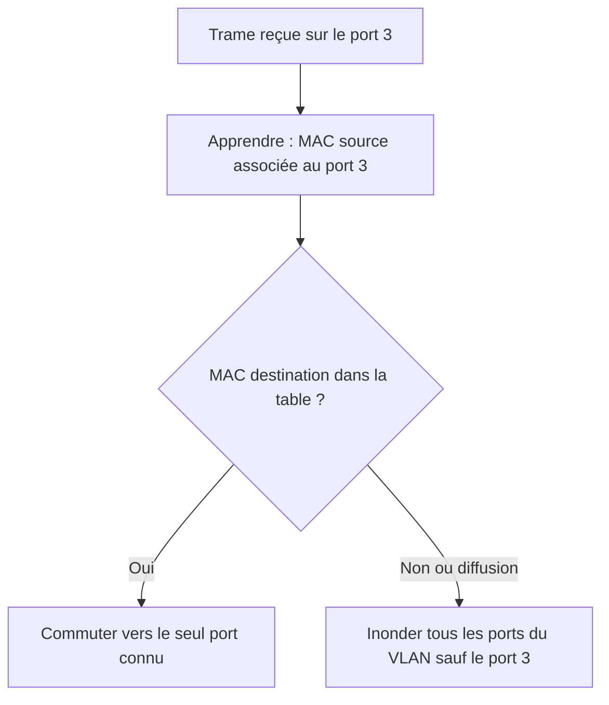
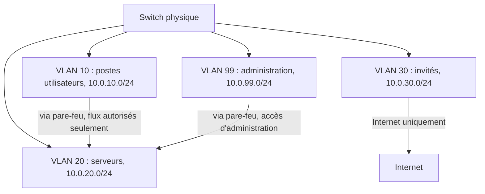
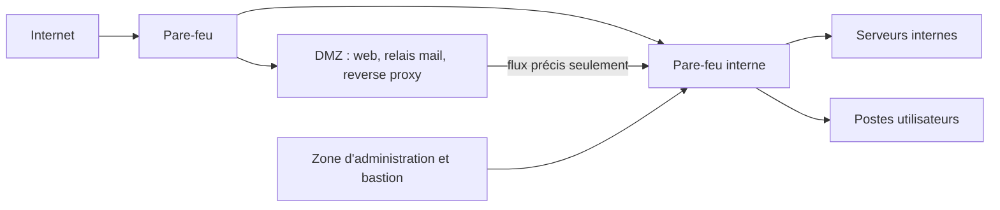

## Introduction

Un réseau n'est pas qu'une collection d'adresses : c'est une architecture physique et logique faite d'équipements, de câbles et de règles. Cette architecture détermine directement la **surface d'attaque**. Dans un **réseau plat**, sans segmentation, toutes les machines se voient : un attaquant qui compromet un seul poste, par exemple via un e-mail piégé, peut atteindre les serveurs, les sauvegardes et les interfaces d'administration sans franchir le moindre contrôle. C'est exactement ce qui permet aux rançongiciels de chiffrer tout un système d'information en quelques heures.

À l'inverse, un réseau bien découpé oblige chaque déplacement à traverser un point de contrôle où il peut être filtré, journalisé et détecté. La segmentation n'empêche pas la première compromission, mais elle en limite le **rayon d'impact** et donne du temps aux défenseurs.

À la fin de ce chapitre, tu sauras dire quel équipement travaille à quelle couche, expliquer le fonctionnement interne d'un switch, lire un tag 802.1Q dans une capture, distinguer port d'accès et trunk, comprendre pourquoi le VLAN hopping fonctionne et comment le rendre impossible, et proposer un zonage cohérent pour une entreprise.

## Les équipements et leur couche

### Du hub au switch

Le **hub** (concentrateur) est un équipement de couche 1 aujourd'hui obsolète : il répète chaque signal reçu sur tous ses ports. Toutes les machines partagent le même support, forment un seul **domaine de collision**, et chacune voit le trafic de toutes les autres. Tu n'en croiseras plus guère, mais il explique pourquoi l'écoute réseau était triviale autrefois.

Le **switch** (commutateur) travaille en couche 2. Il lit l'adresse MAC de destination de chaque trame et ne l'envoie que sur le port où se trouve le destinataire. Chaque port forme son propre domaine de collision, et une machine ne reçoit normalement que le trafic qui lui est destiné, plus les diffusions. Tous les ports d'un même VLAN restent cependant dans le même **domaine de diffusion** (broadcast domain) : une trame envoyée à `ff:ff:ff:ff:ff:ff`, comme une requête ARP ou un Discover DHCP, atteint tout le monde.

Le **routeur** travaille en couche 3. Il relie des réseaux IP différents et choisit le chemin d'un paquet grâce à sa table de routage. Il **arrête les diffusions** : chaque interface de routeur délimite un domaine de diffusion. Le **switch de niveau 3** combine les deux rôles : il commute en couche 2 à l'intérieur d'un VLAN et route entre VLANs à grande vitesse, grâce à des interfaces virtuelles appelées SVI (Switched Virtual Interface).

<CompareTable
  titleA="Équipement"
  titleB="Rôle et couche OSI"
  rows={[
    { a: "Hub (concentrateur)", b: "Répète le signal sur tous les ports, couche 1 ; obsolète" },
    { a: "Switch (commutateur)", b: "Relie des machines au sein d'un même réseau local en se basant sur les adresses MAC, couche 2" },
    { a: "Routeur", b: "Relie des réseaux différents entre eux en se basant sur les adresses IP, couche 3" },
    { a: "Switch de niveau 3", b: "Commutation en couche 2 et routage inter-VLAN en couche 3 dans le même équipement" },
    { a: "Point d'accès Wi-Fi", b: "Étend un réseau local par liaison radio 802.11, essentiellement couche 2" },
    { a: "Pare-feu", b: "Filtre le trafic entre zones selon des règles, de la couche 3 à la couche 7 selon le modèle" },
  ]}
/>

### Comment un switch apprend les adresses MAC

Un switch maintient une **table d'adresses MAC**, appelée aussi table CAM (Content Addressable Memory). Son fonctionnement tient en trois verbes. Il **apprend** : à chaque trame reçue, il note l'adresse MAC source et le port d'arrivée. Il **commute** : si l'adresse de destination figure dans la table, il envoie la trame uniquement sur le port correspondant. Il **inonde** (flooding) : si la destination est inconnue, ou s'il s'agit d'une diffusion, il envoie la trame sur tous les ports du VLAN sauf celui d'arrivée. Les entrées vieillissent et disparaissent après quelques minutes d'inactivité, généralement 300 secondes.



Ce comportement d'inondation a une conséquence de sécurité. La table a une taille finie ; si elle est saturée de fausses adresses, le switch ne peut plus apprendre les vraies et se met à inonder une grande partie du trafic, se comportant alors comme un hub. C'est le principe du **MAC flooding**, dont la parade est la limitation du nombre d'adresses par port, vue plus bas.

<TipCallout>
Un switch fonctionne par défaut en diffusion au sein d'un même VLAN pour toute trame dont l'adresse MAC de destination est inconnue : il l'envoie sur tous les ports. C'est ce comportement qu'exploitent certaines techniques d'écoute comme le MAC flooding, et c'est pour cela que la taille et le contenu de la table MAC doivent être maîtrisés.
</TipCallout>

Sous Linux, un **bridge** logiciel se comporte exactement comme un switch. C'est d'ailleurs ce que Docker utilise pour relier les conteneurs d'un même réseau, y compris ceux des labs Nyx. Tu peux en observer la table d'apprentissage :

```bash
# Lister les bridges et leurs ports
ip -br link show type bridge
bridge link show

# Afficher la table MAC apprise (équivalent de la table CAM)
bridge fdb show br docker0 | grep -v permanent
```

```text
docker0          UP             02:42:5c:1e:8a:10 <BROADCAST,MULTICAST,UP,LOWER_UP>
7: veth3a1f2c9@if6: <BROADCAST,MULTICAST,UP,LOWER_UP> mtu 1500 master docker0 state forwarding priority 32 cost 2
02:42:ac:11:00:02 dev veth3a1f2c9 master docker0
```

### Le point d'accès Wi-Fi

Un **point d'accès** relie des clients sans fil au réseau filaire. Il peut diffuser plusieurs **SSID** (noms de réseau) et associer chacun à un VLAN différent : un SSID pour les salariés, un pour les invités, un pour les objets connectés. Le Wi-Fi étant un média partagé que l'on ne peut pas confiner aux murs du bâtiment, l'authentification et le chiffrement y sont essentiels. La norme actuelle est **WPA3**, avec SAE en mode personnel et 802.1X en mode entreprise ; WPA2 reste très répandu, tandis que WEP et WPA (TKIP) sont cassés et ne doivent plus être utilisés.

## Les VLANs : plusieurs réseaux logiques sur un seul réseau physique

### Le principe

Un **VLAN** (Virtual LAN) découpe un switch, ou un ensemble de switches, en plusieurs réseaux logiques étanches. Deux machines branchées sur le même switch mais placées dans des VLANs différents ne peuvent pas communiquer directement : chaque VLAN est un domaine de diffusion distinct, en pratique associé à son propre sous-réseau IP. Pour passer de l'un à l'autre, le trafic doit être **routé**, ce qui permet de l'obliger à traverser un pare-feu ou des listes de contrôle d'accès.



Les VLANs apportent trois bénéfices : ils réduisent la taille des domaines de diffusion, ce qui améliore les performances ; ils regroupent logiquement des machines indépendamment de leur emplacement physique ; et surtout ils créent des **frontières de sécurité** là où l'on place des contrôles.

### Le tag 802.1Q

Quand plusieurs VLANs doivent circuler sur un même câble, entre deux switches ou entre un switch et un routeur, chaque trame doit indiquer à quel VLAN elle appartient. C'est le rôle de la norme **IEEE 802.1Q**, qui insère un **tag de 4 octets** entre l'adresse MAC source et l'EtherType.

```text
Trame Ethernet standard : [MAC dest 6][MAC src 6][EtherType 2][Données][FCS 4]
Trame taguée 802.1Q     : [MAC dest 6][MAC src 6][Tag 802.1Q 4][EtherType 2][Données][FCS 4]

Détail du tag (32 bits) :
  TPID  16 bits : 0x8100, signale qu'un tag suit
  PCP    3 bits : priorité de qualité de service (0 à 7)
  DEI    1 bit  : trame éligible à la suppression en cas de congestion
  VID   12 bits : identifiant de VLAN, de 1 à 4094 (0 et 4095 sont réservés)
```

Avec 12 bits, on peut coder 4096 valeurs, dont deux sont réservées : il reste donc **4094 VLANs** utilisables. Voici à quoi ressemble une trame taguée dans le VLAN 10, capturée avec `tcpdump -e -XX` sur l'interface physique : l'option `-e` affiche l'en-tête de couche 2 et `-XX` la trame complète en hexadécimal, en-tête Ethernet compris.

```text
10:42:07.118204 02:42:ac:1e:00:05 > 02:42:ac:1e:00:01, ethertype 802.1Q (0x8100), length 62: vlan 10, p 0, ethertype IPv4 (0x0800), 10.10.10.5 > 10.10.10.1: ICMP echo request, id 7211, seq 1, length 24
	0x0000:  0242 ac1e 0001 0242 ac1e 0005 8100 000a  .B.....B........
	0x0010:  0800 4500 002c 3d7a 4000 4001 d53d 0a0a  ..E..,=z@.@..=..
	0x0020:  0a05 0a0a 0a01 0800 2313 1c2b 0001 1011  ........#..+....
	0x0030:  1213 1415 1617 1819 1a1b 1c1d 1e1f       ..............
```

Après les deux adresses MAC, tu retrouves `8100` (le TPID), puis `000a` : priorité 0, DEI 0 et VID 10 en hexadécimal. Vient ensuite le véritable EtherType `0800`, qui annonce un paquet IPv4, comme dans le premier chapitre. En filtre de capture, le mot-clé `vlan` sélectionne les trames taguées, et `vlan 10` celles du VLAN 10.

### Ports d'accès, trunks et VLAN natif

Un **port d'accès** (access port) appartient à un seul VLAN. Il sert à brancher un poste, une imprimante ou un serveur : les trames y circulent **sans tag**, et c'est le switch qui sait à quel VLAN elles appartiennent. Un **trunk** transporte plusieurs VLANs à la fois, avec des trames **taguées** ; il relie les switches entre eux, ou un switch à un routeur, à un pare-feu ou à un hyperviseur.

Sur un trunk, un VLAN particulier circule sans tag : c'est le **VLAN natif**, par défaut le VLAN 1 sur de nombreux équipements. Ce détail, anodin en apparence, est au cœur d'une des attaques classiques de couche 2.

### Le routage entre VLANs

Puisque les VLANs sont étanches, il faut un équipement de couche 3 pour les relier. Deux architectures dominent. Le **router-on-a-stick** utilise un seul lien trunk vers un routeur ou un pare-feu, qui possède une sous-interface par VLAN. Le **switch de niveau 3** route lui-même entre ses SVI. Du point de vue de la sécurité, la question essentielle est **où sont appliqués les filtres** : un switch de niveau 3 qui route tout entre tous les VLANs sans liste de contrôle d'accès annule l'intérêt de la segmentation. Les flux entre zones sensibles doivent passer par un pare-feu ou par des ACL explicites.

Sous Linux, tu peux créer une interface VLAN qui tague le trafic sur une interface physique ; c'est exactement ce que fait une sous-interface de routeur.

```bash
# Créer une sous-interface taguée VLAN 10 sur eth0 (nécessite les droits root et la capacité NET_ADMIN)
sudo ip link add link eth0 name eth0.10 type vlan id 10
sudo ip addr add 10.10.10.5/24 dev eth0.10
sudo ip link set eth0.10 up

# Vérifier l'identifiant de VLAN
ip -d link show eth0.10 | grep -o 'vlan protocol 802.1Q id [0-9]*'
```

```text
vlan protocol 802.1Q id 10
```

## Le VLAN hopping : pourquoi un VLAN n'est pas une frontière absolue

Le **VLAN hopping** désigne toute technique permettant à du trafic de sortir de son VLAN pour atteindre un autre VLAN sans passer par l'équipement de couche 3 censé le filtrer. Il en existe deux familles, et toutes deux exploitent des **erreurs de configuration**, pas des failles logicielles.

### L'usurpation de switch

Certains switches négocient automatiquement le mode de leurs ports grâce à un protocole propriétaire Cisco, **DTP** (Dynamic Trunking Protocol). Si un port utilisateur est laissé en mode de négociation automatique, une machine qui se présente comme un switch peut obtenir que ce port devienne un trunk, et recevoir alors le trafic de tous les VLANs autorisés sur ce trunk. La cause est donc un port d'accès qui n'est pas explicitement configuré comme tel.

### Le double tagging

La seconde technique repose sur le VLAN natif. Une machine placée dans le VLAN natif d'un trunk envoie une trame portant **deux tags 802.1Q empilés** : le tag externe correspond au VLAN natif, le tag interne au VLAN visé. Le premier switch retire le tag externe, puisqu'il s'agit du VLAN natif qui circule sans tag sur le trunk, et transmet la trame qui porte encore le tag interne. Le switch suivant lit ce tag interne et livre la trame dans le VLAN visé. L'attaque est **unidirectionnelle** : la réponse éventuelle ne revient pas par le même chemin. Elle ne fonctionne que si le port de l'attaquant appartient au VLAN natif du trunk, ce qui explique pourquoi la parade est si simple.

<CehCallout>
Le VLAN hopping, par usurpation de switch ou par double tagging 802.1Q, est une attaque de couche 2 classique du référentiel CEH. Retiens le mécanisme du double tagging : le switch d'entrée retire le tag externe attendu, celui du VLAN natif, et transmet la trame avec le tag interne intact vers un autre VLAN. Une trame légitime ne devrait jamais porter plus d'un tag sur un réseau d'entreprise classique.
</CehCallout>

### Les configurations qui l'empêchent

Les contre-mesures sont des règles de configuration à appliquer systématiquement. Elles sont présentées ici en syntaxe Cisco IOS, à titre d'illustration ; les autres constructeurs proposent des équivalents.

```text
! Port utilisateur : forcer le mode accès et couper la négociation DTP
interface GigabitEthernet1/0/12
 switchport mode access
 switchport access vlan 10
 switchport nonegotiate

! Trunk : VLAN natif dédié et inutilisé, liste explicite des VLANs autorisés
interface GigabitEthernet1/0/48
 switchport mode trunk
 switchport trunk native vlan 999
 switchport trunk allowed vlan 10,20,30,99
 switchport nonegotiate

! Option : taguer aussi le VLAN natif sur les trunks
vlan dot1q tag native

! Ports inutilisés : désactivés et placés dans un VLAN « parking »
interface range GigabitEthernet1/0/40 - 47
 switchport access vlan 998
 shutdown
```

Désactiver le trunking automatique empêche un poste de transformer son port en trunk. Placer le VLAN natif sur un identifiant qui n'est attribué à aucun port d'accès rend le double tagging inopérant, puisque plus aucun utilisateur ne se trouve dans ce VLAN. Limiter les VLANs autorisés sur chaque trunk réduit ce qu'une erreur pourrait exposer. Enfin, ne jamais utiliser le VLAN 1 pour des utilisateurs ou pour l'administration est une recommandation constante des guides de durcissement.

## Protéger les ports d'accès

### Port security

La fonction **port security** limite le nombre d'adresses MAC autorisées sur un port physique, voire fixe la liste exacte de ces adresses. Elle répond directement au MAC flooding et au branchement d'équipements non autorisés.

```text
interface GigabitEthernet1/0/12
 switchport port-security
 switchport port-security maximum 2
 switchport port-security mac-address sticky
 switchport port-security violation shutdown
```

Le mot-clé `sticky` fait mémoriser les premières adresses apprises. En cas de violation, trois réactions sont possibles : `protect` ignore silencieusement les trames en excès, `restrict` les ignore et journalise l'événement, `shutdown` désactive le port.

<TipCallout>
La violation « shutdown » désactive automatiquement le port, qui passe à l'état err-disabled, dès qu'une adresse MAC non autorisée apparaît. C'est une mesure radicale mais efficace contre le MAC flooding et le branchement d'équipements non autorisés. Prévois une procédure de réactivation pour le support informatique, sinon les équipes finiront par désactiver la protection.
</TipCallout>

### 802.1X et le contrôle d'accès réseau

Port security reconnaît des adresses MAC, qui sont faciles à usurper. **IEEE 802.1X** va plus loin : le port reste fermé tant que l'équipement ne s'est pas authentifié. Trois acteurs interviennent. Le **supplicant** est le poste qui demande l'accès ; l'**authenticator** est le switch ou le point d'accès ; le **serveur d'authentification** est un serveur **RADIUS** qui vérifie l'identité, par certificat ou par identifiants, avec une méthode EAP comme EAP-TLS. Le serveur RADIUS peut ensuite placer dynamiquement l'équipement dans le bon VLAN selon son identité. C'est le principe des solutions de **NAC** (Network Access Control). En Wi-Fi, c'est le mode WPA2 ou WPA3-Enterprise, qui remplace la clé partagée par une authentification individuelle.

### Les autres protections de couche 2

D'autres fonctions complètent le dispositif. **BPDU Guard** coupe un port d'accès qui reçoit des messages du protocole Spanning Tree, signe qu'on y a branché un switch. **DHCP snooping**, vu au chapitre précédent, bloque les serveurs DHCP non autorisés. **Dynamic ARP Inspection** valide les réponses ARP et sera détaillée au dernier chapitre. Les **Private VLANs** isolent les machines d'un même VLAN entre elles, utile pour des serveurs en DMZ qui n'ont aucune raison de se parler.

<AttackDefenseTable rows={[
  { phase: "Mouvement latéral", attack: "Un poste utilisateur compromis tente d'atteindre directement les serveurs", defense: "VLAN dédié aux serveurs et règles de pare-feu strictes entre VLANs" },
  { phase: "Réseau invité", attack: "Un visiteur connecté au Wi-Fi invité explore le réseau interne", defense: "VLAN invité totalement isolé, avec accès Internet uniquement" },
  { phase: "VLAN hopping par usurpation de switch", attack: "Négociation d'un trunk sur un port utilisateur laissé en mode automatique", defense: "switchport mode access et désactivation de DTP sur tous les ports utilisateurs" },
  { phase: "VLAN hopping par double tagging", attack: "Trame à deux tags émise depuis le VLAN natif du trunk", defense: "VLAN natif dédié et inutilisé, tag du VLAN natif, liste explicite des VLANs autorisés" },
  { phase: "Saturation de la table MAC", attack: "Inondation de fausses adresses MAC pour forcer le switch à diffuser", defense: "Port security avec un nombre maximal d'adresses par port" },
  { phase: "Branchement non autorisé", attack: "Équipement personnel ou malveillant branché sur une prise libre", defense: "802.1X avec RADIUS, ports inutilisés désactivés, BPDU Guard" },
]} />

## Zonage réseau et moindre exposition

### Les zones types

La segmentation suit le **principe de moindre privilège appliqué au réseau** : chaque zone ne peut joindre que ce dont elle a réellement besoin. Une architecture d'entreprise type sépare au minimum les zones suivantes.

| Zone | Contenu | Règle de flux typique |
| --- | --- | --- |
| Utilisateurs | Postes de travail, imprimantes | Accès aux services applicatifs nécessaires, jamais aux interfaces d'administration |
| Serveurs internes | Applications métier, bases de données, annuaire | Accessibles uniquement sur les ports applicatifs utiles |
| DMZ | Services exposés publiquement : site web, relais de messagerie, reverse proxy | Accessible depuis Internet sur des ports précis ; vers l'interne, uniquement les flux indispensables, initiés depuis l'interne si possible |
| Administration | Bastion, postes d'administration, interfaces de gestion des équipements | Seule zone autorisée à joindre les ports d'administration, avec authentification forte |
| Invités | Wi-Fi visiteurs | Internet uniquement |
| IoT et OT | Caméras, badgeuses, automates | Isolés, flux sortants limités au strict nécessaire |
| Sauvegardes | Serveurs et stockage de sauvegarde | Accès très restreint, idéalement copie hors ligne ou immuable |

La **DMZ** (zone démilitarisée) mérite une attention particulière. Elle accueille les services qui doivent être joints depuis Internet, et que l'on considère donc comme les plus exposés. Si l'un d'eux est compromis, la DMZ empêche l'attaquant d'atteindre directement le réseau interne : il doit encore franchir un pare-feu dont les règles ne laissent passer que quelques flux précis.



<AuditCallout>
Cette logique de zonage correspond au principe de défense en profondeur. Dans ISO/IEC 27001:2022, elle relève de l'Annexe A, contrôles A.8.20 (sécurité des réseaux), A.8.21 (sécurité des services réseau) et surtout A.8.22 (cloisonnement des réseaux). Les CIS Controls v8 la traitent dans le contrôle 12 consacré à la gestion de l'infrastructure réseau. La segmentation est l'une des mesures les plus vérifiées en audit, et les auditeurs demandent la matrice des flux autorisés entre zones.
</AuditCallout>

### Documenter : la matrice de flux

Une segmentation n'a de valeur que si les flux autorisés sont documentés et revus. La **matrice de flux** liste, pour chaque couple de zones, les protocoles et ports autorisés, la justification métier et le responsable. Tout flux absent de la matrice doit être bloqué par défaut. C'est aussi un outil de détection : un flux observé qui ne figure pas dans la matrice est soit une erreur de documentation, soit un comportement anormal à investiguer.

Le modèle **Zero Trust**, présenté au chapitre suivant, pousse cette logique plus loin avec la **micro-segmentation** : au lieu de grandes zones, chaque charge de travail ne peut parler qu'à ses interlocuteurs explicitement autorisés.

## Erreurs fréquentes

La plus répandue consiste à créer des VLANs puis à laisser un switch de niveau 3 router librement entre eux : la segmentation existe sur le papier, mais aucun flux n'est filtré. Une autre erreur est de laisser les ports utilisateurs en mode de négociation automatique et d'utiliser le VLAN 1 à la fois comme VLAN natif et comme VLAN de production, ce qui ouvre la voie au VLAN hopping.

On confond aussi souvent domaine de collision et domaine de diffusion : un switch sépare les collisions par port, mais seul un routeur ou un VLAN sépare les diffusions. Beaucoup oublient enfin les réseaux « invisibles » : imprimantes, caméras, interfaces de gestion à distance des serveurs, laissées dans le VLAN utilisateurs alors qu'elles sont rarement mises à jour. Et une segmentation non documentée finit toujours par dériver, règle temporaire après règle temporaire.

## Lab — Mise en pratique

**Environnement** : Kali Linux (terminal Nyx Shell) et réflexion guidée. Les étapes qui créent des interfaces nécessitent les droits root et la capacité NET_ADMIN ; dans un conteneur qui ne les possède pas, réalise-les dans une VM Kali personnelle.

<Steps steps={[
  { title: "Observer les voisins de ton segment", description: "Affiche la table des voisins, l'équivalent moderne de arp -a. Chaque ligne associe une adresse IP à une adresse MAC et à une interface : ce sont les machines de ton domaine de diffusion que ta machine a contactées récemment.", code: "ip neigh show\nip -br addr show" },
  { title: "Observer un switch logiciel", description: "Si ta machine héberge Docker ou un bridge Linux, liste les bridges, leurs ports et la table MAC apprise. Associe chaque adresse MAC à un port, comme le ferait la table CAM d'un switch.", code: "ip -br link show type bridge\nbridge fdb show | grep -v permanent | head" },
  { title: "Créer une interface VLAN", description: "Crée une sous-interface taguée VLAN 10 et vérifie son identifiant. Observe que l'interface eth0.10 a la même adresse MAC que eth0 : c'est le tag qui distingue les VLANs, pas la carte.", code: "sudo ip link add link eth0 name eth0.10 type vlan id 10\nsudo ip addr add 10.10.10.5/24 dev eth0.10\nsudo ip link set eth0.10 up\nip -d link show eth0.10" },
  { title: "Voir le tag 802.1Q sur le fil", description: "Capture les trames taguées sur l'interface physique pendant qu'un ping part de la sous-interface. Repère 8100 puis 000a dans l'hexadécimal, et la mention vlan 10 dans l'en-tête.", code: "sudo tcpdump -i eth0 -e -nn -XX -c 2 vlan &\nping -c 2 -I eth0.10 10.10.10.1" },
  { title: "Nettoyer", description: "Supprime l'interface de test pour revenir à l'état initial.", code: "sudo ip link delete eth0.10" },
  { title: "Concevoir un zonage", description: "Pour une PME de 50 postes, 5 serveurs internes, un site web public, 10 caméras IP et un Wi-Fi invité, propose un plan de VLANs avec leurs sous-réseaux, puis une matrice de flux d'au moins six lignes (source, destination, protocole et port, justification)." },
  { title: "Auditer une configuration de switch", description: "Relis l'extrait suivant et liste chaque problème de sécurité avec sa correction : port utilisateur en switchport mode dynamic auto, trunk avec native vlan 1 et allowed vlan all, VLAN 1 utilisé pour les postes, ports inutilisés actifs, aucune port security." },
  { title: "Raisonner sur un incident", description: "Explique en quelques phrases pourquoi l'absence de segmentation aggrave l'impact d'un rançongiciel, puis indique quels journaux, sur quel équipement, permettraient de détecter un poste utilisateur qui tente de joindre les serveurs de sauvegarde." },
]} />

## À retenir

- Le hub répète en couche 1, le switch commute sur les adresses MAC en couche 2, le routeur relie des réseaux IP en couche 3 ; le switch de niveau 3 fait les deux.
- Un switch apprend les adresses MAC sources, commute vers le port connu et inonde les destinations inconnues ; saturer sa table le fait se comporter comme un hub.
- Un VLAN est un domaine de diffusion séparé ; passer d'un VLAN à l'autre exige un routage, qui doit être filtré.
- Le tag 802.1Q fait 4 octets, commence par le TPID 0x8100 et contient un VID de 12 bits, soit 4094 VLANs utilisables.
- Le VLAN hopping exploite des erreurs de configuration : négociation DTP sur les ports utilisateurs et VLAN natif partagé ; on le neutralise avec des ports d'accès forcés, DTP désactivé et un VLAN natif dédié et inutilisé.
- Port security limite les adresses MAC par port ; 802.1X avec RADIUS authentifie réellement chaque équipement.
- Un zonage minimal sépare utilisateurs, serveurs, DMZ, administration, invités et IoT, avec une matrice de flux documentée et un refus par défaut.

## Questions de révision

1. À quelle couche OSI opère un switch, et à quelle couche un routeur ? Lequel des deux sépare les domaines de diffusion ?
2. Décris les trois actions d'un switch face à une trame entrante, et explique ce qui se passe quand sa table MAC est saturée.
3. Combien de bits le tag 802.1Q réserve-t-il à l'identifiant de VLAN, et combien de VLANs cela permet-il d'utiliser ?
4. Quelle est la différence entre un port d'accès et un trunk, et qu'est-ce que le VLAN natif ?
5. Explique le principe du VLAN hopping par double tagging et les deux configurations qui le rendent impossible.
6. Pourquoi désactiver le trunking automatique sur les ports utilisateurs réduit-il le risque de VLAN hopping ?
7. Quel est le rôle d'une DMZ, et quels flux devrait-on autoriser entre la DMZ et le réseau interne ?
8. Pourquoi 802.1X avec un serveur RADIUS offre-t-il une meilleure protection que port security seul ?
