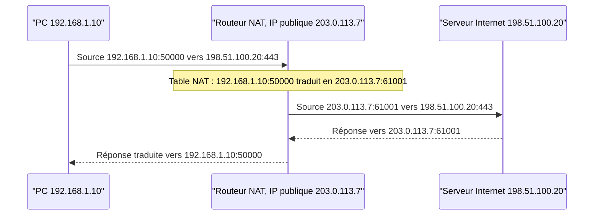

## Introduction

Ce chapitre couvre trois briques que tu rencontreras dans tous les réseaux d'entreprise : le **pare-feu**, qui décide quel trafic passe ; le **NAT**, qui traduit les adresses entre réseau privé et Internet ; et le **VPN**, qui transporte du trafic de façon chiffrée sur un réseau non fiable. Elles sont souvent réunies dans le même boîtier, ce qui entretient une confusion fréquente : on croit que le NAT protège, que le VPN authentifie, que le pare-feu voit tout. Ce chapitre remet chaque rôle à sa place.

L'enjeu est très concret. Les équipements de bordure, pare-feu et passerelles VPN, sont exposés en permanence à Internet ; ils figurent parmi les cibles les plus visées des dernières années, et leurs vulnérabilités occupent une place importante du catalogue CISA KEV des failles activement exploitées. À l'intérieur, une politique de filtrage trop permissive transforme une compromission locale en compromission générale.

À la fin de ce chapitre, tu sauras distinguer les types de pare-feu, écrire une politique à état avec nftables, expliquer chaque forme de NAT, choisir et évaluer une solution VPN, et reconnaître conceptuellement les techniques de contournement pour savoir les détecter.

## Les pare-feu

### Le rôle d'un pare-feu

Un **pare-feu** (firewall) applique une **politique de filtrage** entre deux zones ou plus. Chaque paquet est comparé à une liste ordonnée de **règles** ; la première règle qui correspond décide du sort du paquet : l'accepter, le rejeter en prévenant l'émetteur, ou l'ignorer silencieusement. Si aucune règle ne correspond, la **politique par défaut** s'applique. Le principe de base de toute politique sérieuse est le **refus par défaut** (default deny) : tout ce qui n'est pas explicitement autorisé est interdit.

Un pare-feu filtre dans les deux sens. Le **filtrage entrant** (ingress) protège le réseau contre ce qui arrive de l'extérieur. Le **filtrage sortant** (egress) est tout aussi important et beaucoup plus souvent négligé : il limite ce qu'un poste compromis peut joindre, gêne l'exfiltration de données et le contact avec un serveur de commande et contrôle. Un serveur de base de données n'a, par exemple, aucune raison d'ouvrir une connexion vers Internet.

### Sans état, à état, applicatif

<CompareTable
  titleA="Type de pare-feu"
  titleB="Fonctionnement"
  rows={[
    { a: "Stateless (sans état)", b: "Filtre chaque paquet indépendamment selon des règles statiques : adresses IP, protocole, ports" },
    { a: "Stateful (à état)", b: "Suit l'état des connexions établies et autorise automatiquement le trafic retour légitime" },
    { a: "Applicatif : proxy et WAF", b: "Analyse le contenu de couche 7 ; le WAF protège les applications web, le proxy filtre la navigation" },
    { a: "Next-Gen (NGFW)", b: "Combine filtrage à état, identification des applications et des utilisateurs, IDS/IPS intégré, souvent inspection TLS" },
  ]}
/>

Un pare-feu **sans état** regarde chaque paquet isolément. Pour autoriser un poste à naviguer sur le web, il faut alors une règle pour l'aller vers le port 443 et une autre pour le retour depuis le port 443, ce qui ouvre en pratique tous les ports hauts au trafic venant de n'importe quel serveur se présentant avec le port source 443. Les listes de contrôle d'accès simples des routeurs fonctionnent ainsi.

Un pare-feu **à état** maintient une **table des connexions**. Quand un poste ouvre une connexion autorisée, le pare-feu mémorise le quintuplet (adresses source et destination, ports source et destination, protocole) ; les paquets de retour qui correspondent à une connexion connue sont acceptés sans règle spécifique. Tout paquet de « retour » qui ne correspond à rien est rejeté. C'est le fonctionnement de tous les pare-feu modernes, y compris celui du noyau Linux.

Un pare-feu **applicatif** comprend le protocole. Un **WAF** (Web Application Firewall) inspecte les requêtes HTTP pour bloquer des motifs d'injection ; un **proxy** web filtre les URL et peut journaliser chaque requête. Un **NGFW** ajoute l'identification des applications indépendamment du port, l'intégration avec l'annuaire pour filtrer par utilisateur, et un moteur de prévention d'intrusion.

### Le suivi de connexion sous Linux

Le noyau Linux suit les connexions grâce au module **conntrack**. Chaque paquet reçoit un état : **NEW** pour le premier paquet d'une connexion, **ESTABLISHED** pour les paquets d'une connexion déjà vue dans les deux sens, **RELATED** pour une connexion liée à une autre (un message ICMP d'erreur, par exemple), et **INVALID** pour un paquet qui ne correspond à aucun état cohérent.

<TipCallout>
La plupart des pare-feu modernes, iptables et nftables compris, sont à état : la règle `ct state established,related accept`, ou `-m conntrack --ctstate ESTABLISHED,RELATED` en syntaxe iptables, que tu as vue dans le cours Linux, autorise justement le trafic retour d'une connexion déjà initiée sans qu'il faille écrire une règle explicite dans les deux sens.
</TipCallout>

Voici une politique minimale pour un serveur web, écrite pour **nftables**, le successeur d'iptables sur les distributions actuelles. Elle refuse tout en entrée par défaut et n'ouvre que SSH depuis le réseau d'administration, et HTTP et HTTPS pour tous.

```bash
# /etc/nftables.conf — politique d'un serveur web
table inet filtre {
  chain entree {
    type filter hook input priority 0; policy drop;   # refus par défaut

    ct state established,related accept              # trafic retour des connexions connues
    ct state invalid drop                              # paquets incohérents
    iif "lo" accept                                    # boucle locale
    meta l4proto { icmp, ipv6-icmp } accept            # ICMP utile au diagnostic et à IPv6

    ip saddr 10.0.99.0/24 tcp dport 22 accept          # SSH uniquement depuis l'administration
    tcp dport { 80, 443 } accept                       # service web public

    log prefix "nft-drop " limit rate 10/minute        # journaliser ce qui est refusé
  }
}
```

```bash
# Charger la politique, puis vérifier ce qui est réellement appliqué
sudo nft -f /etc/nftables.conf
sudo nft list ruleset

# Observer la table des connexions suivies (paquet conntrack)
sudo conntrack -L -p tcp --state ESTABLISHED
```

```text
tcp      6 431998 ESTABLISHED src=203.0.113.25 dst=10.0.20.10 sport=51544 dport=443 src=10.0.20.10 dst=203.0.113.25 sport=443 dport=51544 [ASSURED] mark=0 use=1
conntrack v1.4.8 (conntrack-tools): 1 flow entries have been shown.
```

Chaque entrée conntrack montre le sens aller et le sens retour attendu. Le chiffre après le protocole est le temps restant avant expiration de l'entrée, en secondes.

<WarningCallout>
Une politique `drop` appliquée à distance sans règle autorisant ta propre session SSH te coupe immédiatement l'accès au serveur. Teste toujours une nouvelle politique depuis une console locale, ou programme son retrait automatique au bout de quelques minutes tant que tu n'as pas confirmé qu'elle fonctionne.
</WarningCallout>

### L'ordre des règles et l'hygiène d'une politique

Comme la première règle qui correspond l'emporte, l'**ordre** est essentiel : une règle trop large placée en haut rend inutiles toutes les règles plus fines qui la suivent. Avec le temps, les politiques s'encombrent de règles temporaires jamais retirées, de règles qui en masquent d'autres et de règles `any any` ajoutées pour « débloquer » une urgence. Une **revue périodique** des règles, avec pour chacune un propriétaire, une justification et une date, fait partie des contrôles attendus en audit.

<AuditCallout>
La revue des règles de pare-feu est une exigence explicite de PCI DSS 4.0.1 (exigence 1, revue au moins tous les six mois) et relève, dans ISO/IEC 27001:2022, des contrôles A.8.20 (sécurité des réseaux) et A.8.22 (cloisonnement des réseaux). Les auditeurs vérifient la présence d'un refus par défaut, d'un filtrage sortant, de la journalisation des refus et de la justification de chaque ouverture.
</AuditCallout>

## Le NAT : traduire les adresses

### Pourquoi le NAT existe

Le **NAT** (Network Address Translation) modifie les adresses IP, et souvent les ports, des paquets qui traversent un équipement. Il est né de la pénurie d'adresses IPv4 : les réseaux internes utilisent les plages privées de la RFC 1918, non routables sur Internet, et partagent une ou quelques adresses publiques.



### Les formes de NAT

<CompareTable
  titleA="Type de NAT"
  titleB="Usage"
  rows={[
    { a: "NAT statique (1:1)", b: "Une adresse privée est systématiquement traduite vers la même adresse publique" },
    { a: "SNAT et masquerade", b: "Traduction de l'adresse source à la sortie ; masquerade utilise automatiquement l'adresse de l'interface, utile si elle change" },
    { a: "PAT ou NAT overload (le plus courant)", b: "Plusieurs adresses privées partagent une adresse publique, distinguées par les numéros de port" },
    { a: "DNAT ou port forwarding", b: "Redirige un port public vers une machine et un port internes, par exemple pour publier un serveur web" },
    { a: "CGNAT", b: "NAT réalisé par l'opérateur, avec la plage partagée 100.64.0.0/10 : plusieurs clients partagent une même adresse publique" },
  ]}
/>

Le **PAT** (Port Address Translation) est la forme que tu utilises chez toi : ta box remplace l'adresse source de chaque connexion par son adresse publique et choisit un port source unique pour pouvoir aiguiller les réponses. Le **DNAT** fait l'inverse : il réécrit l'adresse de destination des connexions entrantes pour les envoyer vers un serveur interne.

```bash
# Extrait nftables : masquerade en sortie et publication d'un serveur web interne
table ip nat {
  chain postrouting {
    type nat hook postrouting priority srcnat;
    oifname "wan0" masquerade                                     # PAT vers Internet
  }
  chain prerouting {
    type nat hook prerouting priority dstnat;
    iifname "wan0" tcp dport 443 dnat to 192.168.1.50:8443        # port forwarding
  }
}
```

### Le NAT n'est pas un pare-feu

Le NAT a un effet de bord qui ressemble à de la sécurité : comme une machine interne n'a pas d'adresse publique, une connexion venue d'Internet ne peut pas l'atteindre sans traduction prévue. Mais ce n'est qu'un effet de bord. Le NAT ne **filtre** rien : il ne regarde ni le contenu, ni la légitimité du trafic, et toute connexion **sortante** initiée par un poste compromis est traduite sans difficulté, ce qui est précisément ce dont un malware a besoin pour joindre son serveur de commande. Une règle de port forwarding mal pensée expose directement un service interne à tout Internet.

<CehCallout>
Le NAT n'est pas un mécanisme de sécurité à proprement parler : il masque l'adressage interne mais ne filtre rien par lui-même. Un port forwarding mal configuré expose directement une machine interne, avec ou sans NAT. La sécurité vient du pare-feu à état qui accompagne presque toujours le NAT, pas de la traduction elle-même.
</CehCallout>

En **IPv6**, l'espace d'adressage est si vaste que le NAT n'est plus nécessaire : chaque machine peut avoir une adresse globale. Cela rend d'autant plus indispensable un pare-feu à état qui refuse par défaut les connexions entrantes. Un réseau qui comptait sur le NAT IPv4 pour se « protéger » et qui active IPv6 sans pare-feu équivalent expose soudain toutes ses machines.

## Les VPN : chiffrer et relier

### Le principe

Un **VPN** (Virtual Private Network) crée un **tunnel** : les paquets d'origine sont chiffrés et encapsulés dans d'autres paquets qui traversent un réseau non fiable, comme Internet. À l'arrivée, ils sont déchiffrés et réinjectés comme s'ils avaient voyagé sur un réseau privé. Un VPN apporte la confidentialité et l'intégrité du trafic, ainsi que l'authentification des deux extrémités du tunnel.

<CompareTable
  titleA="Type de VPN"
  titleB="Usage typique"
  rows={[
    { a: "Site à site", b: "Relie deux réseaux d'entreprise entre eux de façon permanente, de passerelle à passerelle" },
    { a: "Accès distant (client to site)", b: "Permet à un utilisateur nomade de rejoindre le réseau de l'entreprise depuis son poste" },
    { a: "VPN commercial grand public", b: "Fait sortir le trafic d'un particulier par un serveur tiers ; protège sur un Wi-Fi public mais déplace la confiance vers le fournisseur" },
  ]}
/>

### Les protocoles

| Protocole | Fonctionnement | Points clés |
| --- | --- | --- |
| IPsec avec IKEv2 | Suite normalisée de couche 3 : IKE négocie les clés (UDP 500, et 4500 avec NAT), ESP chiffre les paquets | Standard des VPN site à site entre équipements de constructeurs différents ; modes tunnel et transport |
| WireGuard | Protocole moderne et minimaliste sur UDP, port 51820 par convention, intégré au noyau Linux depuis la version 5.6 | Cryptographie fixe et récente (Curve25519, ChaCha20-Poly1305), configuration courte, très performant |
| OpenVPN | VPN basé sur TLS, sur UDP 1194 par défaut ou sur TCP | Très configurable, traverse facilement les pare-feu |
| VPN SSL des passerelles | Accès distant par portail web ou client propriétaire, sur TCP 443 | Pratique, mais les passerelles exposées sont une cible majeure |

En IPsec, **AH** (Authentication Header) authentifie les paquets sans les chiffrer ; il est peu utilisé aujourd'hui. **ESP** (Encapsulating Security Payload) les chiffre et les authentifie. En **mode tunnel**, tout le paquet d'origine est encapsulé : c'est le mode des VPN site à site. En **mode transport**, seule la charge utile est protégée, entre deux hôtes.

Une configuration WireGuard montre bien la logique du protocole : chaque pair est identifié par sa clé publique, et `AllowedIPs` dit quelles adresses passent par le tunnel.

```bash
# Générer une paire de clés WireGuard (la clé privée ne doit jamais quitter la machine)
umask 077
wg genkey | tee client.key | wg pubkey > client.pub
```

```text
# /etc/wireguard/wg0.conf côté client
[Interface]
PrivateKey = <contenu de client.key>
Address = 10.200.0.2/32
DNS = 10.0.20.53

[Peer]
PublicKey = <clé publique du serveur>
Endpoint = vpn.example.com:51820
AllowedIPs = 10.0.0.0/16          # split tunnel : seul le réseau d'entreprise passe dans le tunnel
# AllowedIPs = 0.0.0.0/0, ::/0    # full tunnel : tout le trafic passe dans le tunnel
PersistentKeepalive = 25
```

### Ce qu'un VPN ne fait pas

Un VPN chiffre le transport ; il ne dit rien de la confiance qu'on peut accorder au poste ou à l'utilisateur. Si l'authentification repose uniquement sur un identifiant et un mot de passe, le vol de ces identifiants, par phishing ou par fuite d'une autre base, suffit à entrer dans le réseau. Une fois connecté, l'utilisateur, ou l'attaquant, se retrouve souvent avec un accès réseau large.

<WarningCallout>
Un VPN chiffre le trafic mais n'authentifie pas nécessairement fortement l'utilisateur : un VPN sans MFA (authentification multifacteur) reste un point d'entrée vulnérable au vol d'identifiants. L'accès VPN par identifiants valides compte parmi les vecteurs d'accès initial les plus utilisés par les groupes de rançongiciels, aux côtés de l'exploitation de vulnérabilités des passerelles VPN elles-mêmes.
</WarningCallout>

Le second risque vient de l'équipement. Les passerelles VPN et pare-feu exposés ont connu de nombreuses vulnérabilités critiques activement exploitées, par exemple chez Fortinet (CVE-2018-13379), Citrix (CVE-2019-19781), Ivanti Connect Secure (CVE-2023-46805 et CVE-2024-21887) ou Palo Alto Networks (CVE-2024-3400). La défense consiste à suivre de près les avis de sécurité de son constructeur, à appliquer les correctifs en urgence quand une faille figure au catalogue KEV de la CISA, à réduire l'interface d'administration exposée et à surveiller les journaux de la passerelle.

### Split tunneling

En accès distant, le **split tunneling** ne fait passer dans le tunnel que le trafic destiné au réseau d'entreprise ; le reste sort directement par la connexion locale de l'utilisateur.

<CompareTable
  titleA="Avantage"
  titleB="Risque de sécurité"
  rows={[
    { a: "Moins de charge sur la passerelle VPN d'entreprise", b: "Le poste reste exposé directement à Internet pendant la session VPN, hors des protections de l'entreprise" },
    { a: "Meilleure latence pour le trafic non professionnel", b: "Un poste compromis via son trafic direct peut ensuite pivoter vers le réseau d'entreprise via le tunnel" },
  ]}
/>

<AuditCallout>
De nombreuses politiques de sécurité interdisent le split tunneling pour les postes ayant accès à des systèmes sensibles, ou le compensent par une protection locale forte (EDR, filtrage DNS, proxy cloud). L'ANSSI recommande que l'accès distant au système d'information passe par un VPN robuste avec authentification forte, et que l'administration des équipements ne soit jamais exposée directement sur Internet.
</AuditCallout>

## Contournement de pare-feu et d'IDS : comprendre pour détecter

Le module CEH associé à ce chapitre traite du contournement des pare-feu et des systèmes de détection d'intrusion. L'intérêt pour un défenseur est de connaître les principes, car chacun laisse des traces observables. Ces techniques ne s'emploient que dans un test d'intrusion autorisé.

<CompareTable
  titleA="Technique"
  titleB="Principe et détection"
  rows={[
    { a: "Fragmentation de paquets", b: "Découper un paquet en fragments trop petits pour que l'IDS reconstitue et analyse la signature complète ; parade : réassemblage et normalisation avant inspection, alerte sur les fragments anormalement petits" },
    { a: "Manipulation du port source", b: "Utiliser un port source réputé fiable, comme 53 pour DNS, pour passer des règles trop permissives qui acceptent tout ce qui vient de ce port ; parade : pare-feu à état, aucune règle fondée sur le seul port source" },
    { a: "Tunneling applicatif", b: "Faire transiter du trafic non autorisé à l'intérieur d'un protocole autorisé, comme DNS ou HTTPS ; parade : résolveur DNS interne obligatoire, analyse du volume et de la forme des requêtes, proxy avec inspection" },
    { a: "Chiffrement et protocoles légitimes", b: "Se fondre dans le trafic HTTPS vers des services cloud courants ; parade : inspection TLS là où c'est légal et proportionné, analyse comportementale des flux" },
  ]}
/>

Le **tunnel DNS** illustre bien l'approche défensive. Pour sortir des données ou recevoir des ordres, l'attaquant les encode dans des noms de sous-domaines interrogés vers un domaine qu'il contrôle, et reçoit les réponses dans des enregistrements, souvent de type TXT. Le trafic passe parce que DNS est presque toujours autorisé. Mais il est anormal : beaucoup de requêtes vers un même domaine, des sous-domaines très longs et d'apparence aléatoire, une forte proportion de requêtes TXT, et un poste qui interroge directement un serveur externe au lieu du résolveur interne. Un défenseur qui surveille un volume anormalement élevé de requêtes TXT, ou la longueur et l'entropie des noms demandés, repère ce type d'évasion.

<AttackDefenseTable rows={[
  { phase: "Accès initial", attack: "Connexion au VPN avec des identifiants volés", defense: "MFA résistante au phishing, alerte sur connexions depuis des pays ou horaires inhabituels" },
  { phase: "Exploitation de la bordure", attack: "Vulnérabilité de la passerelle VPN ou du pare-feu exposé", defense: "Correctifs prioritaires (KEV), surface d'administration non exposée, surveillance des journaux" },
  { phase: "Mouvement latéral", attack: "Accès réseau large une fois dans le tunnel", defense: "Filtrage des utilisateurs VPN par groupe, segmentation, ZTNA" },
  { phase: "Commande et contrôle", attack: "Connexion sortante d'un poste compromis, traduite sans difficulté par le NAT", defense: "Filtrage sortant, proxy obligatoire, détection des connexions périodiques" },
  { phase: "Exfiltration", attack: "Données encodées dans des requêtes DNS", defense: "Blocage du DNS sortant direct, analyse des requêtes TXT et de l'entropie" },
]} />

## Zero Trust : repenser le modèle périmétrique

Le modèle traditionnel ressemble à un château fort : un pare-feu solide en bordure, et une confiance implicite à l'intérieur. Les attaques modernes ont montré sa faiblesse : une fois à l'intérieur, par un VPN compromis ou un poste piégé, l'attaquant profite de cette confiance pour se déplacer. L'approche **Zero Trust**, formalisée par le NIST dans la publication **SP 800-207**, part du principe inverse : « ne jamais faire confiance, toujours vérifier », quelle que soit la position réseau. Chaque requête, même interne, est authentifiée et autorisée individuellement, en fonction de l'identité de l'utilisateur, de l'état de son équipement et du contexte.

Concrètement, cela se traduit par une authentification forte partout, la micro-segmentation, et le remplacement progressif des VPN d'accès global par du **ZTNA** (Zero Trust Network Access), qui donne accès à une application précise plutôt qu'à un réseau entier. Zero Trust n'est pas un produit qu'on achète : c'est une stratégie de long terme, qui s'appuie sur les pare-feu, la segmentation et la journalisation vues dans ce chapitre, et ne les remplace pas.

## Erreurs fréquentes

La première erreur est de compter sur le NAT pour se protéger, et de découvrir le jour où IPv6 est activé que toutes les machines sont joignables. La deuxième est de négliger le filtrage sortant : un pare-feu qui laisse tout sortir n'empêche ni la communication avec un serveur de commande ni l'exfiltration. La troisième est d'accumuler des règles sans propriétaire ni date, jusqu'à ce que plus personne n'ose en supprimer.

Côté VPN, les erreurs classiques sont l'absence de MFA, des passerelles non mises à jour, et un accès réseau complet donné à tout utilisateur connecté. Enfin, on oublie souvent de journaliser les refus du pare-feu : sans ces journaux, impossible de repérer un balayage ou un poste qui tente de joindre des destinations interdites.

## Lab — Mise en pratique

**Environnement** : Kali Linux (terminal Nyx Shell). Les étapes qui modifient le pare-feu se font dans un espace de noms réseau isolé, pour ne jamais toucher à la connectivité de ta session ; elles nécessitent les droits root et la capacité NET_ADMIN, sinon réalise-les dans une VM Kali personnelle.

<Steps steps={[
  { title: "Inspecter la politique existante", description: "Affiche les règles actives avec nftables, puis avec la commande iptables qui, sur les distributions récentes, passe par la couche de compatibilité nftables. Repère la politique par défaut de chaque chaîne et une éventuelle règle established,related.", code: "sudo nft list ruleset\nsudo iptables -L -n -v" },
  { title: "Créer un environnement isolé", description: "Crée un espace de noms réseau relié à ta machine par une paire d'interfaces virtuelles. C'est un mini-réseau privé sur lequel tu peux expérimenter sans risque.", code: "sudo ip netns add fwlab\nsudo ip link add veth-h type veth peer name veth-l\nsudo ip link set veth-l netns fwlab\nsudo ip addr add 10.99.0.1/24 dev veth-h && sudo ip link set veth-h up\nsudo ip netns exec fwlab ip addr add 10.99.0.2/24 dev veth-l\nsudo ip netns exec fwlab ip link set veth-l up\nsudo ip netns exec fwlab ip link set lo up" },
  { title: "Appliquer une politique à refus par défaut", description: "Dans l'espace de noms, charge une politique qui refuse tout en entrée sauf les connexions établies et le port 8080. Démarre ensuite un petit serveur web sur 8080 et un autre sur 9090.", code: "sudo ip netns exec fwlab nft add table inet f\nsudo ip netns exec fwlab nft 'add chain inet f in { type filter hook input priority 0; policy drop; }'\nsudo ip netns exec fwlab nft add rule inet f in ct state established,related accept\nsudo ip netns exec fwlab nft add rule inet f in tcp dport 8080 accept\nsudo ip netns exec fwlab python3 -m http.server 8080 >/dev/null 2>&1 &\nsudo ip netns exec fwlab python3 -m http.server 9090 >/dev/null 2>&1 &" },
  { title: "Vérifier l'effet de la politique", description: "Depuis ta machine, le port 8080 doit répondre et le port 9090 doit expirer sans réponse, car le paquet est ignoré silencieusement. Note la différence de comportement entre drop et reject si tu remplaces la politique.", code: "curl -s -o /dev/null -w '%{http_code}\\n' http://10.99.0.2:8080/\ncurl -s -m 3 -o /dev/null -w '%{http_code}\\n' http://10.99.0.2:9090/ || echo 'bloqué'" },
  { title: "Observer le suivi de connexion", description: "Pendant qu'une connexion est ouverte vers le port 8080, affiche la table conntrack de l'espace de noms. Repère l'état, le sens aller et le sens retour attendu.", code: "sudo ip netns exec fwlab conntrack -L 2>/dev/null | head" },
  { title: "Comparer adresse privée et adresse publique", description: "Compare l'adresse de ton interface à l'adresse publique vue par un service externe. Si elles diffèrent, tu es derrière au moins un NAT. Si l'adresse publique est dans 100.64.0.0/10, ton opérateur pratique le CGNAT.", code: "ip -4 -br addr show\ncurl -s https://ifconfig.me; echo" },
  { title: "Préparer une configuration WireGuard", description: "Génère une paire de clés et écris un fichier de configuration client en split tunnel, sans l'activer. Explique ce que changerait AllowedIPs = 0.0.0.0/0 et pourquoi la clé privée doit avoir des droits 600.", code: "umask 077 && wg genkey | tee /tmp/client.key | wg pubkey > /tmp/client.pub\nls -l /tmp/client.key && cat /tmp/client.pub" },
  { title: "Nettoyer et raisonner", description: "Supprime l'espace de noms de test. Puis décris la règle DNAT nécessaire pour publier en HTTPS, sur le port 443 de l'adresse publique, un serveur interne 192.168.1.50 qui écoute sur 8443, et la règle de filtrage qui doit l'accompagner.", code: "sudo ip netns delete fwlab\nsudo ip link delete veth-h 2>/dev/null; true" },
]} />

Sortie attendue à l'étape 4 : la première commande affiche `200`, la seconde expire après trois secondes et affiche `000` puis `bloqué`.

## À retenir

- Un pare-feu applique une liste ordonnée de règles avec une politique par défaut, qui doit être le refus ; le filtrage sortant est aussi important que le filtrage entrant.
- Le pare-feu sans état filtre chaque paquet isolément ; le pare-feu à état suit les connexions et autorise le trafic retour grâce à established,related.
- WAF et proxy inspectent la couche 7 ; un NGFW ajoute identification des applications, des utilisateurs et prévention d'intrusion.
- Le NAT traduit les adresses ; le PAT fait partager une adresse publique à plusieurs machines grâce aux ports ; le NAT ne filtre rien et disparaît en IPv6.
- IPsec IKEv2, WireGuard et OpenVPN chiffrent le transport ; un VPN sans MFA reste vulnérable au vol d'identifiants, et les passerelles VPN doivent être corrigées en priorité.
- Le split tunneling allège la passerelle mais expose le poste et ouvre un chemin de pivot vers le réseau interne.
- Fragmentation, port source de confiance et tunneling applicatif se détectent par la normalisation, le suivi d'état et l'analyse des volumes et des formes de requêtes ; Zero Trust supprime la confiance implicite liée à la position réseau.

## Questions de révision

1. Quelle est la différence entre un pare-feu sans état et un pare-feu à état, et pourquoi le second facilite-t-il l'écriture des règles ?
2. Pourquoi le filtrage sortant est-il important, même sur un réseau dont les postes ne sont pas joignables depuis Internet ?
3. Le NAT est-il à lui seul une mesure de sécurité suffisante ? Justifie, en évoquant le cas d'IPv6.
4. Quelle est la particularité du PAT par rapport au NAT statique, et que fait une règle DNAT ?
5. Compare IPsec et WireGuard : couche, ports, cas d'usage typiques.
6. Pourquoi un VPN sans MFA reste-t-il un point d'entrée vulnérable, et quel autre risque pèse sur les passerelles VPN ?
7. Quels indices dans les journaux DNS permettent de soupçonner un tunnel DNS ?
8. Quel principe fondamental distingue Zero Trust du modèle périmétrique, et pourquoi Zero Trust ne remplace-t-il pas le pare-feu ?
