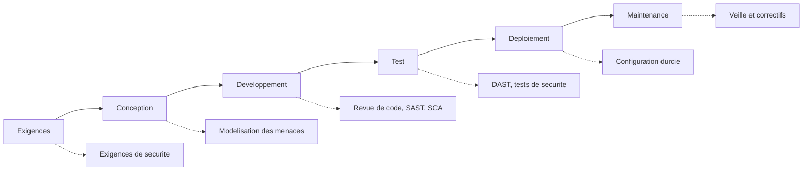
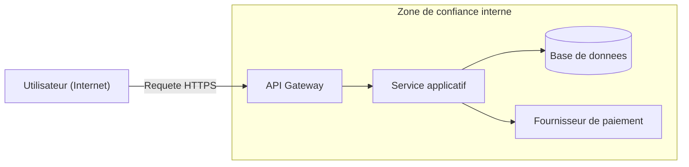

## Introduction

Le cours Sécurité Web (OWASP) t'a appris à reconnaître et corriger des vulnérabilités déjà présentes dans une application. Ce cours adopte un angle différent et complémentaire : comment concevoir et développer une application, et en particulier ses API, pour qu'un maximum de ces vulnérabilités n'apparaissent jamais. C'est la démarche du développeur et de l'architecte sécurité, pas seulement celle de l'auditeur.

Ce premier chapitre pose deux fondations. La première est le **SSDLC** (Secure Software Development Life Cycle), qui intègre la sécurité à chaque étape du développement. La seconde est la **modélisation des menaces** (threat modeling), l'exercice qui permet d'identifier ce qui pourrait mal tourner avant d'écrire la moindre ligne de code. À la fin, tu sauras dessiner un diagramme de flux de données, y placer les frontières de confiance, appliquer STRIDE à chaque élément et transformer les menaces trouvées en exigences de sécurité concrètes.

## Pourquoi la sécurité en fin de cycle coûte plus cher

Dans un cycle de développement traditionnel, la sécurité intervient à la fin : un audit ou un test d'intrusion juste avant la mise en production. Cette approche a un défaut structurel. Une faille de conception découverte à ce stade oblige à reprendre l'architecture, à réécrire du code déjà testé et à repousser la livraison. Découverte en production, elle coûte encore davantage : correction en urgence, éventuel incident, notification réglementaire, atteinte à la réputation.

<CehCallout>
Corriger une faille découverte en production coûte généralement bien plus cher, en temps, en réputation et en urgence, que la même faille détectée à la conception. C'est le principe qui justifie le SSDLC : intégrer la sécurité à chaque étape du développement plutôt qu'en test final. On parle aussi de « shift left », déplacer la sécurité vers la gauche de la frise du projet.
</CehCallout>



Chaque étape reçoit une activité de sécurité adaptée. Aux **exigences**, on formule des besoins de sécurité (authentification forte, journalisation, chiffrement des données sensibles). À la **conception**, on modélise les menaces. Au **développement**, on applique des règles de codage sécurisé et on outille la revue (chapitre 7). Au **test**, on vérifie dynamiquement. Au **déploiement**, on durcit la configuration. En **maintenance**, on surveille les nouvelles vulnérabilités des dépendances (chapitre 6).

## Les référentiels du développement sécurisé

Plusieurs référentiels publics structurent le SSDLC. Il n'est pas nécessaire de les appliquer tous ; il faut savoir à quoi chacun sert.

<CompareTable
  titleA="Referentiel"
  titleB="Usage"
  rows={[
    { a: "NIST SP 800-218 (SSDF)", b: "Secure Software Development Framework : pratiques de developpement securise regroupees en quatre familles (preparer l'organisation, proteger le logiciel, produire un logiciel bien securise, repondre aux vulnerabilites)" },
    { a: "OWASP SAMM", b: "Modele de maturite permettant d'evaluer et d'ameliorer progressivement le programme de securite logicielle d'une organisation" },
    { a: "OWASP ASVS", b: "Liste d'exigences de verification de securite applicative, utilisable comme cahier des charges et comme grille de test" },
    { a: "ISO/IEC 27001:2022", b: "L'annexe A contient un controle dedie au cycle de developpement securise et des controles sur le codage securise et les tests de securite (theme technologique A.8)" },
  ]}
/>

<AuditCallout>
L'ISO/IEC 27001:2022 a regroupé ses contrôles en quatre thèmes (A.5 organisationnels, A.6 liés aux personnes, A.7 physiques, A.8 technologiques). Le développement sécurisé relève du thème A.8, qui inclut le cycle de développement sécurisé, les principes d'ingénierie et d'architecture sécurisées, le codage sécurisé et les tests de sécurité. N'utilise plus l'ancienne numérotation de 2013 dans un rapport d'audit. Du côté réglementaire, le Cyber Resilience Act européen impose progressivement aux fabricants de produits comportant des éléments numériques une conception sécurisée et une gestion des vulnérabilités tout au long du cycle de vie.
</AuditCallout>

## La modélisation des menaces

La **modélisation des menaces** est un exercice structuré, réalisé dès la conception, qui consiste à identifier systématiquement ce qui pourrait mal tourner dans une application avant même d'écrire le code. C'est un raisonnement proactif, à l'opposé de l'approche réactive du pentest, qui teste une application déjà construite. Les deux sont complémentaires : la modélisation évite les erreurs de conception, le pentest trouve celles qui ont échappé.

Une manière simple de la retenir tient en quatre questions, popularisées par le Threat Modeling Manifesto : sur quoi travaillons-nous, qu'est-ce qui peut mal tourner, que faisons-nous pour y remédier, et avons-nous fait du bon travail ?

<Steps steps={[
  { title: "Modéliser l'architecture", description: "Representer les composants de l'application et leurs flux de donnees, le plus souvent via un diagramme de flux de donnees (DFD)." },
  { title: "Identifier les frontières de confiance", description: "Reperer les points ou les donnees passent d'une zone de confiance a une autre, par exemple d'Internet vers le serveur applicatif." },
  { title: "Énumérer les menaces", description: "Pour chaque element et chaque frontiere, se demander systematiquement ce qui pourrait etre attaque : c'est ici qu'intervient STRIDE." },
  { title: "Prioriser et traiter", description: "Classer les menaces par risque et definir pour chacune une mesure : attenuer, eliminer, transferer ou accepter explicitement." },
  { title: "Valider", description: "Verifier que chaque mesure decidee a bien ete implementee et testee, et mettre a jour le modele quand l'architecture evolue." },
]} />

### Le diagramme de flux de données

Le **DFD** (Data Flow Diagram) utilise quelques éléments simples : des **entités externes** (un utilisateur, un service tiers), des **processus** (le serveur applicatif, une fonction), des **stockages de données** (une base, un cache, un fichier) et des **flux** qui les relient. On y superpose les **frontières de confiance**, ces lignes que les données franchissent en changeant de niveau de confiance.



Une **frontière de confiance** est un point où les données traversent une zone dont le niveau de confiance change, par exemple d'Internet vers le serveur. Chaque frontière est un endroit où l'on doit authentifier, valider et autoriser, parce que ce qui arrive de l'autre côté n'est pas fiable.

## Le modèle STRIDE

**STRIDE**, conçu chez Microsoft, structure l'énumération des menaces en six catégories, chacune violant une propriété de sécurité.

<CompareTable
  titleA="Categorie STRIDE"
  titleB="Menace et propriete violee"
  rows={[
    { a: "Spoofing (usurpation)", b: "Se faire passer pour un autre utilisateur ou systeme ; viole l'authentification" },
    { a: "Tampering (alteration)", b: "Modifier des donnees ou du code sans autorisation ; viole l'integrite" },
    { a: "Repudiation (repudiation)", b: "Nier avoir realise une action, faute de journalisation suffisante ; viole la non-repudiation" },
    { a: "Information disclosure (divulgation)", b: "Exposer des informations a des personnes non autorisees ; viole la confidentialite" },
    { a: "Denial of Service (deni de service)", b: "Rendre un service indisponible ; viole la disponibilite" },
    { a: "Elevation of privilege (elevation de privilege)", b: "Obtenir des droits superieurs a ceux accordes ; viole l'autorisation" },
  ]}
/>

<TipCallout>
STRIDE structure la réflexion pour ne rien oublier. Pour chaque composant et chaque flux du DFD, on se demande méthodiquement s'il est exposé à chacune des six catégories, plutôt que de réfléchir aux menaces de façon improvisée. Des outils comme OWASP Threat Dragon ou Microsoft Threat Modeling Tool aident à dessiner le DFD et à générer une première liste de menaces.
</TipCallout>

D'autres méthodes existent et répondent à d'autres besoins : **PASTA**, orientée risque métier, ou **LINDDUN**, centrée sur la vie privée et utile pour l'analyse d'impact relative à la protection des données exigée par le RGPD. STRIDE reste la méthode d'entrée la plus répandue.

## Modélisation des menaces appliquée à une API

Une API expose généralement une frontière de confiance très nette entre un client potentiellement non maîtrisé et le système d'information. Le client peut être une application mobile décompilable, un script, ou un attaquant qui forge ses requêtes à la main. Tout ce qu'il envoie doit être considéré comme non fiable.

<CehCallout>
Le threat modeling d'une API doit porter une attention particulière à trois thèmes. L'authentification, parce qu'une authentification faible expose d'abord au spoofing. La validation des entrées, parce que son absence expose au tampering. Et le contrôle d'accès sur chaque endpoint et chaque objet, parce que son absence expose à l'élévation de privilège. Ces thèmes sont détaillés dans les chapitres 2 à 4.
</CehCallout>

```text
Exemple d'analyse STRIDE pour l'endpoint GET /api/commandes/{id}

S - Spoofing     : un jeton vole ou forge permet d'agir au nom d'un autre client
                   -> jetons a courte duree de vie, verification stricte de la signature
T - Tampering    : le client modifie l'identifiant ou le corps de la requete
                   -> validation de schema cote serveur
R - Repudiation  : un client nie avoir consulte ou modifie une commande
                   -> journalisation horodatee de l'identite et de l'action
I - Disclosure   : la reponse renvoie des champs internes inutiles
                   -> filtrage explicite des champs renvoyes
D - DoS          : appels massifs sur l'endpoint
                   -> limitation de debit par client
E - Elevation    : acces a la commande d'un autre client (BOLA)
                   -> verification de propriete de l'objet a chaque requete
```

## Angle offensif et défensif

<AttackDefenseTable rows={[
  { phase: "Conception", attack: "Exploiter un defaut d'architecture impossible a corriger par un simple patch", defense: "Modelisation des menaces des la conception, exigences de securite explicites" },
  { phase: "Frontiere de confiance", attack: "Envoyer des donnees non fiables a travers une frontiere non controlee", defense: "Authentifier, valider et autoriser a chaque frontiere" },
  { phase: "Tracabilite", attack: "Agir sans laisser de trace exploitable", defense: "Journalisation horodatee couvrant la menace de repudiation" },
]} />

## Erreurs fréquentes

La première erreur est de considérer la modélisation des menaces comme un document ponctuel, rédigé une fois puis oublié : le modèle doit évoluer avec l'architecture. La deuxième est de vouloir tout modéliser d'un coup et d'abandonner face à la complexité ; il vaut mieux commencer par la fonctionnalité la plus exposée. La troisième est d'oublier la colonne « traitement » : une liste de menaces sans mesure décidée n'apporte rien. La quatrième est d'ignorer la répudiation, en négligeant la journalisation qui permet pourtant de reconstituer un incident.

## Lab — Mise en pratique

**Environnement** : réflexion guidée (sans terminal), ou OWASP Threat Dragon si disponible

<Steps steps={[
  { title: "Dessiner le DFD", description: "Pour une application web classique (client, API gateway, service applicatif, base de donnees, fournisseur de paiement), dessine le diagramme de flux de donnees." },
  { title: "Placer les frontières de confiance", description: "Identifie les frontieres traversees par une requete utilisateur et justifie le changement de niveau de confiance a chacune." },
  { title: "Appliquer STRIDE à un formulaire de connexion", description: "Identifie au moins une menace plausible pour chacune des six categories de STRIDE." },
  { title: "Appliquer STRIDE à un endpoint d'API", description: "Reprends l'endpoint GET /api/commandes/{id} et propose une mesure d'attenuation par menace." },
  { title: "Prioriser", description: "Classe les menaces trouvees selon leur probabilite et leur impact, et choisis les trois a traiter en premier." },
  { title: "Formuler des exigences", description: "Transforme chaque mesure retenue en exigence de securite verifiable, par exemple sous la forme d'un critere d'acceptation." },
]} />

## À retenir

- Le SSDLC intègre la sécurité à chaque étape du développement, car une faille détectée tard coûte bien plus cher à corriger.
- Le NIST SSDF, l'OWASP SAMM et ASVS, et l'ISO/IEC 27001:2022 (thème A.8) structurent le développement sécurisé.
- La modélisation des menaces est proactive et menée dès la conception, à l'opposé du pentest réactif.
- Sa démarche : modéliser l'architecture en DFD, identifier les frontières de confiance, énumérer les menaces, prioriser et traiter, valider.
- STRIDE couvre six catégories : usurpation, altération, répudiation, divulgation, déni de service, élévation de privilège.
- Pour une API, l'attention se porte en priorité sur l'authentification, la validation des entrées et le contrôle d'accès.

## Questions de révision

1. Pourquoi une faille de sécurité détectée en production coûte-t-elle généralement plus cher qu'une faille détectée à la conception ?
2. En quoi la modélisation des menaces se distingue-t-elle fondamentalement d'un test d'intrusion ?
3. Qu'est-ce qu'une frontière de confiance dans un diagramme de flux de données ?
4. Que signifient les six lettres de STRIDE, et quelle propriété de sécurité chaque catégorie viole-t-elle ?
5. Pourquoi la répudiation est-elle liée à la journalisation ?
6. Quels thèmes faut-il examiner en priorité lors de la modélisation des menaces d'une API, et pourquoi ?
7. Pourquoi un modèle de menaces doit-il être mis à jour au fil de l'évolution de l'architecture ?
