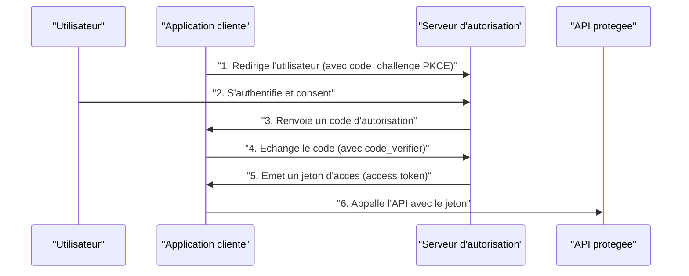

## Introduction

Ce chapitre prolonge le chapitre « Authentification et gestion de sessions » du cours Sécurité Web, dans un contexte différent : le client d'une API n'est pas toujours un navigateur avec des cookies, mais souvent une application mobile, une application monopage, un script ou un service tiers. Il faut alors répondre à deux questions distinctes. **Qui est l'appelant ?** C'est l'authentification. **Que peut-il faire ?** C'est l'autorisation.

Tu apprendras ici le fonctionnement d'OAuth 2.0 et d'OpenID Connect, les flux recommandés aujourd'hui et ceux à abandonner, la structure et les pièges des JWT, et la place des clés API. L'angle est celui du concepteur : comprendre les vulnérabilités pour bien configurer et bien valider.

## OAuth 2.0 — déléguer l'accès sans partager de mot de passe

**OAuth 2.0** (RFC 6749) est un protocole de **délégation d'autorisation**. Il permet à une application tierce d'accéder à des ressources pour le compte d'un utilisateur, sans que celui-ci partage jamais son mot de passe avec cette application. L'utilisateur s'authentifie auprès d'un **serveur d'autorisation** de confiance, consent explicitement à l'accès, et l'application reçoit un **jeton d'accès** (access token) limité en portée et en durée.

Le protocole définit quatre rôles. Le **propriétaire de la ressource** est l'utilisateur. Le **client** est l'application qui veut accéder. Le **serveur d'autorisation** authentifie l'utilisateur et émet les jetons. Le **serveur de ressources** est l'API protégée qui accepte les jetons.



<CehCallout>
OAuth 2.0 permet de déléguer l'accès à une application tierce via un jeton limité en portée (scope) et en durée, sans jamais partager le mot de passe. Dans le flux par code d'autorisation, l'application reçoit d'abord un code, qu'elle échange ensuite auprès du serveur d'autorisation contre un jeton d'accès. La **portée** applique directement le principe de moindre privilège : un jeton « lecture seule du profil » ne permet rien d'autre.
</CehCallout>

### OAuth n'est pas un protocole d'authentification

OAuth 2.0 répond à la question « que peut faire ce client ? », pas « qui est cet utilisateur ? ». Pour l'authentification, on utilise **OpenID Connect** (OIDC), une couche construite au-dessus d'OAuth 2.0 qui ajoute un **jeton d'identité** (ID token, au format JWT) décrivant l'utilisateur authentifié. Le bouton « Se connecter avec… » d'un fournisseur d'identité repose sur OIDC.

### Les flux recommandés aujourd'hui

Les bonnes pratiques ont beaucoup évolué depuis 2012. La **RFC 9700** (OAuth 2.0 Security Best Current Practice, publiée en janvier 2025) et le projet de spécification OAuth 2.1 consolident les règles actuelles.

<CompareTable
  titleA="Flux ou pratique"
  titleB="Statut actuel"
  rows={[
    { a: "Code d'autorisation + PKCE", b: "Recommande pour tous les clients, y compris applications mobiles et monopages" },
    { a: "Client credentials", b: "Adapte aux appels de service a service, sans utilisateur" },
    { a: "Flux implicite (jeton dans l'URL)", b: "Deconseille : le jeton transite dans l'URL et peut fuiter" },
    { a: "Resource Owner Password Credentials", b: "A proscrire : le client manipule directement le mot de passe de l'utilisateur" },
    { a: "URI de redirection", b: "Correspondance exacte obligatoire, jamais de joker ni de redirection ouverte" },
  ]}
/>

**PKCE** (Proof Key for Code Exchange, RFC 7636) protège l'échange du code : le client génère un secret aléatoire, en envoie une empreinte au début du flux, et doit présenter le secret original lors de l'échange. Un code intercepté devient inutilisable par un tiers. Le paramètre `state`, lui, protège contre les attaques de type CSRF sur le retour de redirection.

## JWT — JSON Web Token

Un **JWT** (RFC 7519) est un format de jeton **auto-porteur** (self-contained) : il contient lui-même, signé, les informations nécessaires à sa vérification (identité, rôles, expiration). Le serveur peut ainsi le valider sans interroger une base de données à chaque requête, contrairement à un identifiant de session opaque.

```text
Un JWT est compose de trois parties separees par des points :
en-tete.charge_utile.signature

En-tete      : algorithme de signature utilise (ex. RS256, ES256, HS256)
Charge utile : les informations (claims) - sub, iss, aud, exp, roles...
Signature    : garantit que le jeton n'a pas ete altere depuis son emission
```

```text
Exemple de charge utile decodee (claims standards)
{
  "iss": "https://auth.exemple.fr",   -> emetteur
  "sub": "user-4821",                 -> sujet (utilisateur)
  "aud": "api-commandes",             -> audience (API destinataire)
  "exp": 1767225600,                  -> expiration (horodatage)
  "scope": "commandes:lecture"
}
```

<WarningCallout>
La charge utile d'un JWT n'est pas chiffrée par défaut : elle est seulement encodée en Base64URL, donc lisible par quiconque intercepte le jeton. Seule la signature garantit l'intégrité. Ne place jamais d'information sensible en clair dans un JWT ; si la confidentialité est nécessaire, il faut un JWE (jeton chiffré) ou, plus simplement, ne pas y mettre la donnée.
</WarningCallout>

### Les vulnérabilités classiques des JWT

<CompareTable
  titleA="Vulnerabilite JWT"
  titleB="Principe et defense"
  rows={[
    { a: "Algorithme 'none' accepte", b: "Une implementation mal configuree accepte un jeton sans signature si l'en-tete l'indique. Defense : rejeter none, fixer la liste des algorithmes acceptes" },
    { a: "Confusion d'algorithme (RS256 vers HS256)", b: "Le serveur verifie avec une cle symetrique que l'attaquant connait (la cle publique) au lieu de la cle asymetrique attendue. Defense : algorithme impose cote serveur" },
    { a: "Secret HS256 faible", b: "Un secret court ou previsible peut etre retrouve par force brute. Defense : secret aleatoire long, ou signature asymetrique" },
    { a: "Expiration non verifiee", b: "Un jeton expire reste accepte si le claim exp n'est pas controle. Defense : verifier exp, nbf, iss et aud" },
  ]}
/>

La racine commune de ces failles est la même : laisser le jeton dicter au serveur la façon de le vérifier. La **RFC 8725** (JWT Best Current Practices) résume les règles : imposer l'algorithme attendu, valider systématiquement l'émetteur (`iss`), l'audience (`aud`) et l'expiration (`exp`), utiliser des bibliothèques maintenues, et préférer des jetons d'accès à courte durée de vie associés à des jetons de rafraîchissement renouvelés à chaque usage.

```python
# Validation stricte d'un JWT avec PyJWT : algorithme, audience et emetteur imposes
import jwt

claims = jwt.decode(
    token,
    key=cle_publique,
    algorithms=["RS256"],          # jamais deduit de l'en-tete du jeton
    audience="api-commandes",
    issuer="https://auth.exemple.fr",
)                                   # exp est verifie par defaut
```

### Révocation et durée de vie

Un JWT auto-porteur a un inconvénient : il reste valide jusqu'à son expiration, même si l'utilisateur se déconnecte. On compense par une **durée de vie courte** du jeton d'accès (quelques minutes), des **jetons de rafraîchissement** stockés de façon sûre et renouvelés à chaque utilisation (rotation), et si nécessaire une **liste de révocation** ou l'introspection du jeton auprès du serveur d'autorisation.

## Clés API — authentification simple entre systèmes

Une **clé API** est un identifiant secret, généralement statique, transmis à chaque requête pour authentifier une application ou un service, et non un utilisateur individuel. Elle est plus simple à mettre en œuvre qu'OAuth 2.0 mais offre beaucoup moins de granularité : pas de portée limitée ni d'expiration automatique par défaut.

<CompareTable
  titleA="Cle API"
  titleB="OAuth 2.0 / JWT"
  rows={[
    { a: "Authentifie generalement une application entiere", b: "Peut authentifier un utilisateur avec une portee precise" },
    { a: "Souvent statique, sans expiration automatique", b: "Limite en duree (exp) et en portee (scope)" },
    { a: "Simple, mais rotation manuelle", b: "Plus complexe, mais granulaire et revocable" },
  ]}
/>

<WarningCallout>
Une clé API codée en dur dans une application distribuée au client (mobile, front-end JavaScript) est une erreur fréquente et critique : n'importe qui peut l'extraire du code. Une clé API doit rester côté serveur, être stockée dans un gestionnaire de secrets, transmise dans un en-tête (jamais dans l'URL, où elle finit dans les journaux), restreinte au strict nécessaire et renouvelée régulièrement. Des outils de détection de secrets dans le code (chapitre 7) aident à repérer les fuites avant publication.
</WarningCallout>

## Angle offensif et défensif

<AttackDefenseTable rows={[
  { phase: "Flux OAuth", attack: "Intercepter un code d'autorisation ou detourner une redirection", defense: "PKCE obligatoire, URI de redirection en correspondance exacte, parametre state" },
  { phase: "Validation JWT", attack: "Jeton non signe ou confusion d'algorithme", defense: "Algorithme impose, verification de iss, aud et exp, bibliotheque maintenue" },
  { phase: "Duree de vie", attack: "Reutiliser un jeton vole longtemps apres", defense: "Jetons d'acces courts, rotation des jetons de rafraichissement, revocation" },
  { phase: "Secrets", attack: "Extraire une cle API du code client ou des journaux", defense: "Cle cote serveur, gestionnaire de secrets, en-tete, rotation, detection de secrets" },
]} />

<AuditCallout>
La gestion des informations d'authentification et des secrets est couverte par l'ISO/IEC 27001:2022 (annexe A, contrôles sur l'authentification sécurisée et la gestion des informations d'authentification). Pour les services financiers, le règlement européen DORA renforce les exigences de gestion des accès, et PCI DSS 4.0.1 impose l'authentification multifacteur pour les accès à l'environnement des données de carte.
</AuditCallout>

## Erreurs fréquentes

Les erreurs récurrentes sont : utiliser OAuth 2.0 seul pour authentifier un utilisateur au lieu d'OpenID Connect ; conserver le flux implicite par habitude ; accepter des URI de redirection avec joker ; laisser la bibliothèque JWT déduire l'algorithme de l'en-tête ; oublier de vérifier l'audience, ce qui permet de réutiliser un jeton émis pour une autre API ; émettre des jetons valables plusieurs jours ; et stocker des clés API dans le dépôt Git ou dans une application mobile.

## Lab — Mise en pratique

**Environnement** : Kali Linux (terminal Nyx Shell) et API de lab (analyse et correction)

<Steps steps={[
  { title: "Décoder un JWT", description: "Decode la charge utile d'un JWT de lab sans connaitre son secret et constate que son contenu est lisible.", code: "echo '<partie_charge_utile_du_jwt>' | base64 -d" },
  { title: "Inventorier les claims", description: "Identifie dans la charge utile les claims iss, aud, exp et scope ; calcule la duree de vie du jeton a partir de exp." },
  { title: "Auditer la validation", description: "Dans le code de l'API de lab, verifie si l'algorithme est impose, et si iss, aud et exp sont controles." },
  { title: "Corriger la validation", description: "Modifie le code pour imposer l'algorithme attendu et verifier emetteur, audience et expiration." },
  { title: "Raccourcir la durée de vie", description: "Configure une duree de vie courte pour les jetons d'acces et observe le comportement de rafraichissement." },
  { title: "Chasser les secrets", description: "Recherche dans le depot du lab une cle API ou un secret code en dur, puis deplace-le dans une variable d'environnement ou un gestionnaire de secrets." },
  { title: "Vérifier", description: "Confirme qu'un jeton expire ou destine a une autre audience est desormais refuse par l'API." },
]} />

## À retenir

- OAuth 2.0 délègue l'accès via un jeton limité en portée et en durée, sans partage de mot de passe ; OpenID Connect ajoute l'authentification.
- Le flux par code d'autorisation avec PKCE est recommandé pour tous les clients ; le flux implicite et le flux par mot de passe sont à abandonner (RFC 9700).
- Un JWT est auto-porteur et signé, mais sa charge utile est seulement encodée, jamais chiffrée par défaut.
- Les failles JWT (none, confusion d'algorithme, secret faible, expiration non vérifiée) se préviennent en imposant l'algorithme et en vérifiant iss, aud et exp.
- Les clés API authentifient une application entière avec peu de granularité ; elles doivent rester côté serveur, dans un gestionnaire de secrets.

## Questions de révision

1. Quel est l'intérêt principal d'OAuth 2.0 par rapport au partage direct d'un mot de passe ?
2. Pourquoi OAuth 2.0 seul ne suffit-il pas à authentifier un utilisateur, et que lui ajoute OpenID Connect ?
3. Quel problème PKCE résout-il, et pourquoi le flux implicite est-il déconseillé ?
4. Quelles sont les trois parties d'un JWT, et pourquoi ne faut-il pas y placer d'information sensible ?
5. Pourquoi la confusion d'algorithme RS256 vers HS256 est-elle possible, et quelle règle l'empêche ?
6. Pourquoi faut-il vérifier le claim d'audience d'un JWT ?
7. Pourquoi une clé API codée en dur dans une application mobile est-elle dangereuse, et comment la gérer correctement ?
