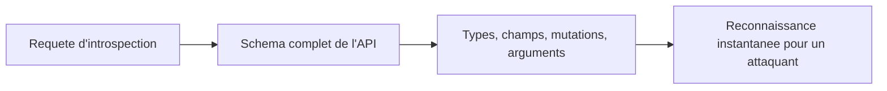

## Introduction

Le chapitre 2 a présenté la sécurité des API REST. Ce chapitre aborde **GraphQL**, une alternative de plus en plus répandue, créée chez Facebook puis confiée à la GraphQL Foundation. Sa flexibilité, qui fait sa force pour les développeurs front-end, introduit des risques structurellement différents de ceux d'une API REST : un unique point d'entrée, un langage de requête riche, et un client qui décide lui-même de la forme et de la profondeur des données qu'il demande.

À la fin de ce chapitre, tu sauras expliquer pourquoi les contrôles REST habituels ne se transposent pas tels quels à GraphQL, durcir un serveur GraphQL (introspection, profondeur, complexité, batching), placer l'autorisation au bon endroit, et identifier les points d'attention des autres API modernes que sont gRPC et les WebSockets.

## GraphQL — une API, un seul point d'entrée

Une API REST expose de nombreux endpoints, un par ressource et par action : `GET /utilisateurs/42`, `GET /utilisateurs/42/commandes`. Une API GraphQL expose généralement **un unique point d'entrée**, souvent `/graphql`, auquel le client envoie une requête décrivant précisément les données souhaitées. Le serveur répond avec exactement cette forme.

```graphql
# Requete GraphQL typique : le client choisit precisement les champs demandes
query {
  utilisateur(id: "42") {
    nom
    email
    commandes {
      id
      montant
    }
  }
}
```

Trois types d'opérations existent : les **queries** (lecture), les **mutations** (écriture) et les **subscriptions** (flux temps réel, souvent via WebSocket). Côté serveur, chaque champ est résolu par une fonction appelée **resolver**, qui va chercher la donnée dans une base ou un autre service.

<CehCallout>
Une API GraphQL expose généralement un unique point d'entrée où le client précise lui-même les données souhaitées. Cette flexibilité déplace une partie du contrôle habituellement côté serveur vers le client. Conséquence pour la sécurité : on ne peut plus raisonner « endpoint par endpoint » ; il faut raisonner « champ par champ » et « coût par requête ».
</CehCallout>

## Le contrôle d'accès en GraphQL

Une même vulnérabilité de contrôle d'accès (BOLA, chapitre 2) peut se manifester de façon bien plus subtile en GraphQL. En REST, chaque endpoint est un point de contrôle visible. En GraphQL, une requête peut traverser plusieurs relations imbriquées — d'un utilisateur à ses commandes, de ses commandes à leurs adresses de livraison, puis aux autres clients de ces adresses — sans jamais toucher un endpoint isolé et facilement identifiable.

<WarningCallout>
Une vulnérabilité BOLA peut être plus difficile à repérer en GraphQL qu'en REST, car un attaquant peut composer une requête qui traverse plusieurs relations imbriquées sans passer par un endpoint « sensible » isolé. Vérifier l'autorisation uniquement au niveau de la requête racine ne suffit pas : chaque resolver qui renvoie une donnée protégée doit appliquer sa propre vérification.
</WarningCallout>

La bonne pratique est de placer l'autorisation dans la **couche métier** appelée par les resolvers, et non dans chaque resolver de façon dispersée. Ainsi, quelle que soit la façon dont une donnée est atteinte dans le graphe, la même règle s'applique.

```javascript
// Autorisation dans la couche metier, appelee par tous les resolvers
const resolvers = {
  Utilisateur: {
    commandes: (parent, _args, ctx) =>
      commandeService.listerPour(parent.id, ctx.utilisateur), // verifie le droit d'acces
  },
}
```

## L'introspection — pratique en développement, risquée en production

GraphQL propose nativement l'**introspection** : interroger l'API pour obtenir la description complète de son schéma, c'est-à-dire tous les types, champs, arguments, queries et mutations disponibles. C'est ce qui permet aux outils de développement d'offrir l'autocomplétion et la documentation automatique.



<TipCallout>
L'introspection activée en production équivaut à fournir gratuitement à un attaquant le résultat de toute une phase de reconnaissance (rappel du cours Cybersécurité Offensive). La désactiver en production est une mesure de durcissement simple et à fort impact. Attention toutefois : ce n'est pas un contrôle d'accès. Les messages d'erreur de certains serveurs suggèrent des noms de champs proches, et le schéma peut être reconstitué progressivement ; la sécurité doit reposer sur l'autorisation, pas sur le secret du schéma.
</TipCallout>

## Déni de service : imbrication, alias et batching

La flexibilité de GraphQL permet à un client de construire des requêtes très coûteuses à partir d'un seul appel HTTP. Trois mécanismes sont en cause.

L'**imbrication profonde** exploite les relations cycliques du schéma : un utilisateur a des commandes, chaque commande a un client, chaque client a des commandes, et ainsi de suite. Une requête de quelques lignes peut alors déclencher des milliers d'appels aux resolvers.

Les **alias** permettent de demander plusieurs fois le même champ sous des noms différents dans une seule requête.

Le **batching** consiste à regrouper de nombreuses opérations en un seul envoi HTTP. Il contourne une limitation de débit qui compterait les requêtes HTTP plutôt que les opérations, et a été utilisé pour accélérer des tentatives répétées sur des mutations sensibles comme la connexion ou la vérification d'un code.

<Steps steps={[
  { title: "Limiter la profondeur", description: "Imposer un nombre maximal de niveaux d'imbrication autorises dans une requete." },
  { title: "Limiter la complexité calculée", description: "Attribuer un cout a chaque champ (plus eleve pour les listes) et refuser les requetes dont le cout total depasse un seuil." },
  { title: "Limiter alias et batching", description: "Plafonner le nombre d'alias et d'operations par envoi, et compter chaque operation dans la limitation de debit." },
  { title: "Limiter le débit", description: "Appliquer une limitation de debit sur le point d'entree unique, idealement ponderee par la complexite (rappel API4 du chapitre 2)." },
  { title: "Paginer et borner", description: "Imposer une pagination avec une taille maximale sur tous les champs de type liste, et un delai d'execution maximal." },
  { title: "Utiliser des requêtes persistées", description: "Pour une API consommee uniquement par vos propres clients, n'accepter que des requetes pre-enregistrees identifiees par leur empreinte." },
]} />

<AuditCallout>
Ces limites relèvent de la catégorie API4 (Unrestricted Resource Consumption) de l'OWASP API Security Top 10 2023 et de la gestion de la capacité attendue par l'ISO/IEC 27001:2022 (annexe A, thème technologique). L'OWASP publie une GraphQL Cheat Sheet qui récapitule ces mesures et constitue une bonne grille d'audit.
</AuditCallout>

## Les injections restent possibles

GraphQL n'est qu'une couche d'accès : si un resolver construit une requête SQL ou NoSQL par concaténation d'un argument, l'injection est exactement la même qu'en REST (chapitre 3 du cours Sécurité Web). Le typage du schéma aide (un argument déclaré `Int` rejette une chaîne), mais un argument de type `String` reste une entrée non fiable à paramétrer et à valider.

## Les autres API modernes : gRPC et WebSockets

**gRPC**, très utilisé entre microservices, transporte des messages binaires Protocol Buffers sur HTTP/2. Les principes restent les mêmes : authentification (souvent mTLS, chapitre 5), autorisation par méthode, validation des messages, limitation de taille et de débit. Sa réflexion de service (server reflection) joue un rôle comparable à l'introspection GraphQL et doit être désactivée en production.

Les **WebSockets** ouvrent un canal bidirectionnel persistant. Le serveur doit vérifier l'origine de la connexion (en-tête `Origin`), authentifier lors de la poignée de main, réautoriser chaque message sensible, et limiter le nombre de messages : une connexion authentifiée une seule fois et jamais réévaluée est une source fréquente d'erreurs.

## Angle offensif et défensif

<AttackDefenseTable rows={[
  { phase: "Reconnaissance", attack: "Recuperer le schema complet par introspection", defense: "Desactiver l'introspection en production ; securite fondee sur l'autorisation" },
  { phase: "Controle d'acces", attack: "Traverser des relations imbriquees vers des donnees d'autrui", defense: "Autorisation dans la couche metier appelee par chaque resolver" },
  { phase: "Deni de service", attack: "Requetes profondes, alias multiples, batching", defense: "Limites de profondeur, de complexite, d'alias, pagination bornee, rate limiting pondere" },
  { phase: "Injection", attack: "Argument concatene dans une requete de base", defense: "Requetes parametrees et validation des arguments dans les resolvers" },
]} />

## Erreurs fréquentes

Les erreurs typiques sont : transposer la logique REST en protégeant seulement la requête racine ; laisser l'introspection et l'interface d'exploration (GraphiQL) actives en production ; considérer la désactivation de l'introspection comme une mesure suffisante ; appliquer une limitation de débit qui compte les requêtes HTTP plutôt que les opérations ; oublier la pagination sur les listes ; et renvoyer des messages d'erreur détaillés qui révèlent la structure interne.

## Lab — Mise en pratique

**Environnement** : réflexion guidée et API GraphQL de lab (analyse et durcissement)

<Steps steps={[
  { title: "Cartographier le schéma", description: "Dans l'environnement de developpement du lab, consulte le schema documente et identifie les relations cycliques (par exemple utilisateur, commandes, client)." },
  { title: "Évaluer le coût d'une requête", description: "Pour la requete d'exemple de ce chapitre, estime combien d'appels aux resolvers seraient necessaires si la relation commandes etait imbriquee sur quatre niveaux avec cent elements par liste." },
  { title: "Vérifier l'introspection", description: "Verifie dans la configuration du serveur de lab si l'introspection est active pour l'environnement de production." },
  { title: "Durcir la configuration", description: "Desactive l'introspection en production et ajoute une limite de profondeur et de complexite." },
  { title: "Placer l'autorisation", description: "Deplace la verification d'acces aux commandes dans la couche metier appelee par le resolver, et non dans la seule requete racine." },
  { title: "Vérifier", description: "Confirme qu'une requete depassant la profondeur autorisee est refusee et qu'un utilisateur ne peut plus atteindre les commandes d'un autre via une relation imbriquee." },
]} />

## À retenir

- GraphQL expose généralement un unique point d'entrée où le client compose lui-même sa requête ; on raisonne par champ et par coût, plus par endpoint.
- BOLA est plus subtile en GraphQL : l'autorisation doit être appliquée dans la couche métier appelée par chaque resolver.
- L'introspection révèle tout le schéma ; elle doit être désactivée en production, sans pour autant remplacer l'autorisation.
- Imbrication, alias et batching permettent un déni de service ; on les limite par profondeur, complexité, plafonds et rate limiting pondéré.
- Les injections restent possibles dans les resolvers ; gRPC et WebSockets exigent les mêmes principes d'authentification, d'autorisation et de limitation.

## Questions de révision

1. En quoi la structure d'une API GraphQL diffère-t-elle fondamentalement de celle d'une API REST ?
2. Pourquoi une vulnérabilité BOLA peut-elle être plus difficile à repérer en GraphQL qu'en REST ?
3. Pourquoi l'introspection est-elle un risque en production, et pourquoi sa désactivation ne suffit-elle pas ?
4. Explique comment une requête de quelques lignes peut provoquer une charge disproportionnée côté serveur.
5. Qu'est-ce que le batching, et pourquoi contourne-t-il une limitation de débit naïve ?
6. Quelles mesures combinées limitent le risque de déni de service via GraphQL ?
7. Quels points de vigilance partagent gRPC et les WebSockets avec GraphQL ?
