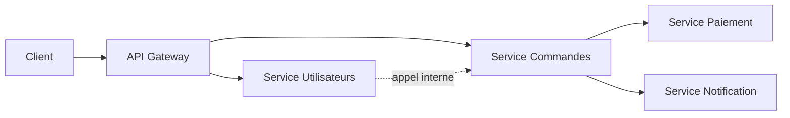

## Introduction

Une architecture en **microservices** découpe une application en de nombreux services indépendants, chacun responsable d'une fonction métier (utilisateurs, commandes, paiement, notifications), qui communiquent entre eux via des API. Ce modèle apporte de la souplesse : chaque équipe déploie son service à son rythme, chaque service peut monter en charge séparément. Mais il transforme profondément la sécurité. Ce qui était un appel de fonction à l'intérieur d'un même processus devient une requête réseau, et chaque requête réseau est une occasion d'interception, d'usurpation ou d'abus.

Ce chapitre t'apprend à raisonner sur cette surface d'attaque élargie, à sécuriser les échanges entre services par l'authentification mutuelle, à appliquer les principes du Zero Trust à l'intérieur du système, et à éviter qu'un service compromis devienne un tremplin vers le reste de l'architecture.

## Pourquoi les microservices élargissent la surface d'attaque

Un monolithe expose généralement peu de points d'entrée réseau : une seule application, quelques ports. Une architecture microservices multiplie les API internes. Chacune de ces communications inter-services est une **frontière de confiance** potentielle (rappel du chapitre 1) qui doit être sécurisée exactement comme une API exposée publiquement.

<CehCallout>
Dans une architecture microservices, chaque flèche du diagramme est une communication qui devrait être authentifiée et chiffrée. La supposer « sûre » simplement parce qu'elle reste interne au réseau de l'entreprise reproduit exactement l'erreur du modèle « château fort », critiqué par l'approche Zero Trust (rappel du cours Cybersécurité Défensive) : une fois le périmètre franchi, tout est accessible.
</CehCallout>

L'**API Gateway** est le point d'entrée unique depuis l'extérieur. Elle centralise l'authentification des clients, la limitation de débit, la validation de base et la journalisation. C'est une pièce importante, mais elle ne protège que la frontière externe : elle ne dit rien de ce qui se passe entre les services une fois la requête entrée.

## mTLS — authentification mutuelle entre services

Le **mTLS** (mutual TLS) étend le principe du TLS classique. Dans le TLS d'un site web, seul le serveur présente un certificat : le navigateur sait à qui il parle, mais le serveur ne sait pas cryptographiquement qui l'appelle. En mTLS, les deux parties présentent chacune un certificat, et chacune vérifie celui de l'autre avant tout échange de données.

<CompareTable
  titleA="TLS classique (client-serveur web)"
  titleB="mTLS (inter-services)"
  rows={[
    { a: "Seul le serveur presente un certificat", b: "Client ET serveur (chaque service) presentent un certificat" },
    { a: "Le client fait confiance au serveur identifie", b: "Chaque service verifie mutuellement l'identite de l'autre" },
    { a: "Empeche l'interception mais pas l'usurpation du client", b: "Empeche aussi qu'un service compromis ou non autorise s'insere dans la communication" },
  ]}
/>

Le mTLS apporte donc deux garanties : la **confidentialité** et l'**intégrité** des échanges (comme tout TLS), et l'**identité vérifiée** de chaque service. Cette identité devient la base de l'autorisation : le service Paiement peut décider de n'accepter que les appels provenant du service Commandes.

### Le service mesh

Gérer manuellement des certificats pour des dizaines de services, avec leur émission, leur rotation et leur révocation, est fastidieux et source d'erreurs. Dans une architecture à grande échelle, le mTLS est donc souvent géré automatiquement par un **service mesh**, une couche d'infrastructure dédiée. Des projets comme Istio ou Linkerd déploient à côté de chaque service un proxy qui établit les connexions mTLS, émet des certificats à courte durée de vie et les renouvelle automatiquement.

<TipCallout>
Le service mesh garantit une application cohérente du chiffrement mutuel sans dépendre de la rigueur de chaque équipe de développement. Il centralise aussi les politiques d'autorisation entre services (« Commandes peut appeler Paiement, Notification ne le peut pas ») et fournit une observabilité précieuse pour détecter des flux anormaux. Le standard **SPIFFE** (et son implémentation SPIRE) définit un format d'identité de service portable, utilisé par plusieurs de ces solutions.
</TipCallout>

## Le service compromis comme pivot

Dans une architecture sans authentification inter-services rigoureuse, un attaquant qui compromet un seul service périphérique, par exemple un service de notification peu critique et peu surveillé, peut ensuite l'utiliser comme pivot pour interroger librement des services bien plus sensibles comme le paiement ou les données personnelles. C'est exactement l'équivalent d'un mouvement latéral dans un environnement Active Directory (rappel du cours Cybersécurité Offensive).

<WarningCallout>
Un service périphérique compromis peut servir de pivot vers des services plus sensibles si les appels internes ne sont pas authentifiés et autorisés. La criticité d'un service ne se mesure donc pas seulement à ses propres données, mais aussi à ce qu'il peut atteindre. Le principe de moindre privilège impose qu'un service de notification n'ait besoin d'aucun accès aux données de paiement.
</WarningCallout>

<Steps steps={[
  { title: "Authentifier chaque appel inter-services", description: "Ne jamais faire confiance a une requete parce qu'elle provient du reseau interne : chaque appel presente une identite verifiee (mTLS, jeton de service)." },
  { title: "Autoriser par service", description: "Definir explicitement quels services peuvent appeler quelles operations, avec un refus par defaut." },
  { title: "Limiter les permissions de chaque service", description: "Moindre privilege : chaque service n'accede qu'aux donnees et aux autres services strictement necessaires a sa fonction." },
  { title: "Segmenter le réseau interne", description: "Restreindre les communications reseau possibles entre services, par exemple avec des politiques reseau Kubernetes (NetworkPolicy)." },
  { title: "Observer et alerter", description: "Journaliser les appels inter-services et alerter sur un flux inhabituel, comme le service Notification qui appelle le service Paiement." },
]} />

## Propager l'identité de l'utilisateur

Un appel inter-services porte deux identités : celle du **service** appelant (prouvée par le mTLS) et celle de l'**utilisateur** au nom de qui l'action est faite. Si le service Commandes appelle le service Paiement pour l'utilisateur 42, le service Paiement doit pouvoir vérifier que l'opération concerne bien l'utilisateur 42 et qu'il en a le droit. Transmettre simplement un identifiant d'utilisateur dans un en-tête que n'importe quel service pourrait forger est une erreur.

Les pratiques recommandées consistent à propager un **jeton signé** (par exemple un JWT émis ou échangé par le serveur d'autorisation, chapitre 3), dont l'audience est restreinte au service destinataire, et que chaque service valide. Le mécanisme d'échange de jetons d'OAuth 2.0 (Token Exchange, RFC 8693) permet d'obtenir un jeton dédié à un service aval plutôt que de réutiliser partout le jeton d'origine.

## Gérer les secrets

Chaque service a besoin de secrets : mots de passe de base de données, clés d'API tierces, clés de signature. Les placer dans le code source ou dans une image de conteneur est une erreur classique. Ils doivent être fournis à l'exécution par un **gestionnaire de secrets** (HashiCorp Vault, ou les services équivalents des fournisseurs cloud), avec des droits d'accès par service, une rotation régulière, et idéalement des secrets dynamiques à courte durée de vie.

<AuditCallout>
L'architecture Zero Trust est décrite par le NIST dans la publication SP 800-207. L'ISO/IEC 27001:2022 couvre la sécurité des réseaux, la ségrégation des réseaux et l'utilisation de la cryptographie dans son thème technologique (A.8). Pour les entités soumises à NIS2 ou, dans le secteur financier, à DORA, la segmentation et le contrôle des flux internes font partie des mesures de gestion des risques attendues.
</AuditCallout>

## Angle offensif et défensif

<AttackDefenseTable rows={[
  { phase: "Point d'entree", attack: "Compromettre un service peripherique peu surveille", defense: "Durcissement de chaque service, API Gateway, correctifs" },
  { phase: "Mouvement lateral", attack: "Utiliser le service compromis comme pivot vers des services sensibles", defense: "mTLS, autorisation par service avec refus par defaut, segmentation reseau" },
  { phase: "Usurpation d'utilisateur", attack: "Forger un en-tete d'identifiant utilisateur entre services", defense: "Jeton signe a audience restreinte, valide par chaque service" },
  { phase: "Secrets", attack: "Extraire des secrets d'une image ou d'un depot", defense: "Gestionnaire de secrets, rotation, secrets dynamiques" },
]} />

## Erreurs fréquentes

L'erreur fondatrice est de croire le réseau interne sûr. Viennent ensuite : sécuriser l'API Gateway en oubliant les flux internes ; activer le mTLS en mode permissif « temporairement » et ne jamais passer en mode strict ; authentifier les services sans définir d'autorisation entre eux, ce qui permet à tout service authentifié de tout appeler ; faire confiance à un en-tête d'identifiant utilisateur non signé ; et stocker les secrets dans les variables d'environnement d'images publiées.

## Lab — Mise en pratique

**Environnement** : réflexion guidée (sans terminal), sur l'architecture de ce chapitre

<Steps steps={[
  { title: "Identifier un pivot possible", description: "Si le service Notification est compromis, liste les services qu'il pourrait atteindre sans authentification inter-services rigoureuse." },
  { title: "Construire la matrice d'appels", description: "Pour chaque service, indique quels autres services il a reellement besoin d'appeler ; tout le reste doit etre refuse." },
  { title: "Expliquer l'intérêt du mTLS", description: "Explique pourquoi le mTLS protege mieux qu'un simple TLS a sens unique entre deux microservices." },
  { title: "Concevoir la propagation d'identité", description: "Decris comment le service Paiement peut verifier qu'une demande transmise par Commandes concerne bien l'utilisateur authentifie." },
  { title: "Planifier la gestion des secrets", description: "Pour le service Paiement, liste les secrets necessaires et explique comment ils seraient fournis et renouveles sans apparaitre dans le code." },
  { title: "Définir la détection", description: "Propose deux alertes qui signaleraient un mouvement lateral entre services." },
]} />

## À retenir

- Une architecture microservices multiplie les communications inter-services, chacune étant une frontière de confiance à sécuriser.
- L'API Gateway protège la frontière externe, mais pas les échanges internes.
- Le mTLS exige une authentification mutuelle : chaque service prouve son identité à l'autre.
- Un service mesh applique le mTLS et les politiques d'autorisation de façon cohérente, sans dépendre de chaque équipe.
- Un service périphérique compromis peut servir de pivot ; moindre privilège, autorisation par service et segmentation l'en empêchent.
- L'identité utilisateur se propage par jeton signé à audience restreinte, et les secrets proviennent d'un gestionnaire dédié.

## Questions de révision

1. Pourquoi une architecture microservices élargit-elle la surface d'attaque par rapport à un monolithe ?
2. Pourquoi supposer qu'une communication interne est sûre reproduit-il l'erreur du modèle « château fort » ?
3. Quelle est la différence entre TLS classique et mTLS ?
4. Quel est le rôle d'un service mesh dans une architecture à grande échelle ?
5. Pourquoi un service peu critique peut-il représenter un risque majeur s'il est compromis ?
6. Pourquoi ne faut-il pas transmettre l'identité de l'utilisateur dans un simple en-tête non signé entre services ?
7. Quelles mesures, en complément de l'authentification, limitent les communications entre microservices ?
