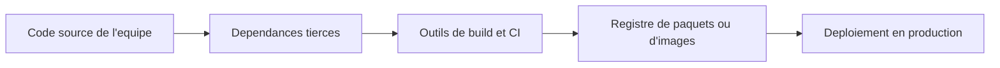

## Introduction

Le code qu'une équipe écrit elle-même ne représente généralement qu'une petite fraction du code réellement exécuté par une application moderne. L'essentiel provient de dépendances tierces : bibliothèques open source, frameworks, images de conteneurs de base, actions de CI, outils de build. Chacune de ces pièces est une porte d'entrée potentielle, et chacune dépend elle-même d'autres pièces, formant un arbre de dépendances transitives souvent composé de centaines d'éléments.

Les attaquants l'ont bien compris : plutôt que d'attaquer une application bien défendue, ils compromettent un composant qu'elle utilise et atteignent ainsi des milliers de cibles d'un coup. Ce chapitre t'apprend à cartographier cette chaîne, à en comprendre les risques, à produire et exploiter un SBOM, et à protéger l'intégrité de ce que tu construis et déploies. La sécurité de la chaîne d'approvisionnement figure d'ailleurs parmi les préoccupations mises en avant dans l'édition 2025 de l'OWASP Top 10.

## Qu'est-ce que la chaîne d'approvisionnement logicielle

La **chaîne d'approvisionnement logicielle** (software supply chain) désigne l'ensemble des composants, outils et dépendances qui interviennent entre l'écriture du code source et son exécution en production : bibliothèques open source, gestionnaires et registres de paquets, outils de build, plateforme de CI/CD, images de conteneurs de base, registres d'artefacts.



<WarningCallout>
Chaque maillon de cette chaîne est une cible potentielle. Une dépendance tierce compromise, malveillante dès sa publication ou compromise après coup, peut introduire du code malveillant dans des milliers d'applications qui la réutilisent, sans jamais toucher directement le code de ces applications.
</WarningCallout>

Quelques incidents publics illustrent ces risques. L'attaque **SolarWinds** (2020) a inséré une porte dérobée dans le processus de build d'un logiciel de supervision distribué à des milliers de clients. La vulnérabilité **Log4Shell** (CVE-2021-44228) dans la bibliothèque Java Log4j a montré combien il était difficile, sans inventaire, de savoir quelles applications l'embarquaient. La porte dérobée découverte en 2024 dans **xz-utils** (CVE-2024-3094) a été introduite par un contributeur qui avait patiemment gagné la confiance du projet pendant des années.

## Les risques classiques des dépendances tierces

<CompareTable
  titleA="Risque"
  titleB="Principe"
  rows={[
    { a: "Vulnerabilite connue non corrigee", b: "Une dependance contient une CVE publiee, mais l'application ne l'a jamais mise a jour" },
    { a: "Dependance abandonnee", b: "Un composant critique n'est plus maintenu : aucune correction de securite future n'est a attendre" },
    { a: "Typosquatting de paquet", b: "Un attaquant publie un paquet malveillant au nom tres proche d'un paquet legitime, esperant une faute de frappe a l'installation" },
    { a: "Confusion de dependances", b: "Un paquet public porte le meme nom qu'un paquet interne et est installe a sa place par un gestionnaire mal configure" },
    { a: "Compromission d'un mainteneur", b: "Le compte du mainteneur d'un paquet populaire est compromis, permettant de publier une version malveillante" },
    { a: "Compromission du build", b: "L'outil de build ou la CI est compromis et injecte du code dans l'artefact, sans trace dans le code source" },
  ]}
/>

La distinction entre une dépendance **vulnérable** et une dépendance **abandonnée** est importante. Une dépendance vulnérable mais maintenue recevra un correctif : il suffit de mettre à jour. Une dépendance abandonnée ne recevra plus rien : il faut la remplacer, la forker ou accepter un risque croissant. L'OpenSSF Scorecard aide à évaluer la santé d'un projet open source (maintenance, revue de code, protection des branches).

<CehCallout>
De la même façon qu'un audit de code cherche des vulnérabilités dans le code écrit par l'équipe, l'analyse de composition logicielle (SCA, chapitre 7) cherche systématiquement des vulnérabilités connues dans l'ensemble des bibliothèques tierces, souvent bien plus nombreuses que le code propre. Les deux sont complémentaires.
</CehCallout>

## Le SBOM — inventaire des composants logiciels

Un **SBOM** (Software Bill of Materials) est un inventaire structuré et exhaustif de tous les composants logiciels d'une application, avec leurs versions précises, leurs licences et leurs relations. Comme la liste des ingrédients d'un produit alimentaire, il permet de savoir exactement ce qui est utilisé, sans devoir le redécouvrir lorsqu'une nouvelle CVE critique est publiée. Deux formats standards dominent : **CycloneDX** (projet OWASP) et **SPDX** (Linux Foundation, norme ISO/IEC 5962).

<Steps steps={[
  { title: "Générer le SBOM au moment du build", description: "Le SBOM est genere automatiquement a partir des dependances reellement utilisees lors de la construction de l'application, pas declare a la main." },
  { title: "Conserver et versionner le SBOM", description: "Chaque version publiee dispose de son propre SBOM, permettant de savoir exactement quels composants elle contenait a un instant donne." },
  { title: "Croiser le SBOM avec les nouvelles CVE", description: "Quand une CVE critique est publiee, interroger les SBOM des applications en production pour identifier immediatement celles qui sont concernees." },
  { title: "Prioriser", description: "Croiser avec le catalogue CISA KEV et le score EPSS pour traiter d'abord les vulnerabilites activement exploitees." },
]} />

```bash
# Generer un SBOM CycloneDX a partir du repertoire du projet (Syft)
syft dir:. -o cyclonedx-json > sbom.cdx.json

# Analyser ce SBOM pour y rechercher des vulnerabilites connues (Grype)
grype sbom:./sbom.cdx.json
```

```text
# Extrait de sortie Grype
NAME        INSTALLED  FIXED-IN  TYPE  VULNERABILITY   SEVERITY
log4j-core  2.14.1     2.15.0    java  CVE-2021-44228  Critical
lodash      4.17.15    4.17.21   npm   CVE-2021-23337  High
```

<TipCallout>
Sans SBOM, répondre à la question « sommes-nous affectés par la CVE critique publiée ce matin ? » peut demander des heures d'investigation sur chaque application. Avec des SBOM à jour, la réponse devient quasi immédiate. C'est une capacité de plus en plus exigée réglementairement : le Cyber Resilience Act européen impose aux fabricants de produits comportant des éléments numériques d'identifier et documenter leurs composants, notamment sous forme de SBOM, et NIS2 renforce les exigences de sécurité de la chaîne d'approvisionnement.
</TipCallout>

## Protéger l'intégrité du build et des artefacts

Connaître ses composants ne suffit pas : il faut aussi garantir que ce qui est construit et déployé est bien ce qui était prévu.

Le **verrouillage des versions** via les fichiers de verrouillage (`package-lock.json`, `poetry.lock`, `go.sum`) fige les versions exactes et leurs empreintes, et l'installation en mode strict (`npm ci` plutôt que `npm install` en CI) refuse toute divergence. Pour prévenir la confusion de dépendances, on configure les gestionnaires de paquets pour que les noms internes ne soient résolus que depuis le registre interne, et on réserve ses espaces de noms (scopes) sur les registres publics.

Le cadre **SLSA** (Supply-chain Levels for Software Artifacts), porté par l'OpenSSF, définit des niveaux progressifs d'exigences sur le processus de build : build scripté et reproductible, plateforme de build durcie, et **provenance** signée décrivant comment, où et à partir de quoi l'artefact a été construit.

La **signature des artefacts** avec l'écosystème **Sigstore** (outil `cosign` pour les images de conteneurs) permet au déploiement de vérifier qu'une image provient bien de la CI de l'organisation et n'a pas été modifiée. Une politique d'admission dans le cluster peut alors refuser toute image non signée.

<AuditCallout>
L'ISO/IEC 27001:2022 contient des contrôles dédiés à la sécurité de l'information dans les relations avec les fournisseurs et dans la chaîne d'approvisionnement des technologies de l'information (thème A.5), ainsi qu'à la gestion des vulnérabilités techniques (thème A.8). Le NIST SSDF (SP 800-218) consacre des pratiques à la protection du logiciel et à la vérification de l'intégrité des composants tiers.
</AuditCallout>

## Angle offensif et défensif

<AttackDefenseTable rows={[
  { phase: "Dependance vulnerable", attack: "Exploiter une CVE connue dans une bibliotheque obsolete", defense: "SBOM, SCA en CI, priorisation KEV/EPSS, mises a jour regulieres" },
  { phase: "Paquet malveillant", attack: "Typosquatting ou confusion de dependances", defense: "Registre interne, scopes reserves, revue des nouvelles dependances, verrouillage" },
  { phase: "Mainteneur compromis", attack: "Publier une version malveillante d'un paquet populaire", defense: "Versions epinglees, delai avant adoption des nouvelles versions, surveillance" },
  { phase: "Build compromis", attack: "Injecter du code pendant la construction", defense: "SLSA, build isole, provenance et signature des artefacts (Sigstore)" },
]} />

## Erreurs fréquentes

Les erreurs courantes sont : ne regarder que les dépendances directes en ignorant les dépendances transitives ; générer un SBOM une fois et ne jamais le mettre à jour ; installer en CI sans fichier de verrouillage ; ajouter une dépendance pour une fonction triviale sans évaluer son mainteneur ; laisser la CI télécharger des actions tierces non épinglées par empreinte ; et considérer qu'un paquet populaire est forcément sûr.

## Lab — Mise en pratique

**Environnement** : Kali Linux (terminal Nyx Shell), sur un projet de lab

<Steps steps={[
  { title: "Inventorier les dépendances", description: "Ouvre le fichier de dependances et le fichier de verrouillage du projet de lab ; compare le nombre de dependances directes et transitives." },
  { title: "Générer un SBOM", description: "Genere un SBOM CycloneDX du projet et parcours sa structure (composants, versions, licences).", code: "syft dir:. -o cyclonedx-json > sbom.cdx.json" },
  { title: "Analyser le SBOM", description: "Recherche les vulnerabilites connues des composants inventories et note les plus severes.", code: "grype sbom:./sbom.cdx.json" },
  { title: "Prioriser", description: "Pour les deux vulnerabilites les plus severes, verifie leur presence au catalogue CISA KEV et leur score EPSS." },
  { title: "Corriger", description: "Mets a jour les composants concernes vers une version corrigee, regenere le fichier de verrouillage et relance les tests." },
  { title: "Vérifier", description: "Regenere le SBOM et relance l'analyse pour confirmer la disparition des vulnerabilites corrigees, puis archive ce SBOM avec la version." },
]} />

## À retenir

- La chaîne d'approvisionnement regroupe tous les composants, outils et dépendances entre le code source et la production.
- Une dépendance vulnérable, abandonnée, typosquattée, confondue ou compromise peut infecter une application sans toucher son code.
- Une dépendance abandonnée diffère d'une dépendance vulnérable : aucun correctif futur n'est à attendre.
- Le SBOM (CycloneDX, SPDX), généré au build et versionné, permet de répondre immédiatement à une nouvelle CVE critique.
- Verrouillage des versions, SLSA et signature des artefacts avec Sigstore protègent l'intégrité du build.
- Le Cyber Resilience Act et NIS2 rendent ces pratiques de plus en plus obligatoires.

## Questions de révision

1. Qu'est-ce que la chaîne d'approvisionnement logicielle, et pourquoi représente-t-elle un risque distinct du code propre ?
2. Pourquoi une dépendance compromise peut-elle affecter des milliers d'applications sans toucher leur code ?
3. Quelle différence fais-tu entre une dépendance vulnérable et une dépendance abandonnée ?
4. Explique le typosquatting et la confusion de dépendances, et comment s'en prémunir.
5. Qu'est-ce qu'un SBOM, quand est-il généré, et pourquoi faut-il le versionner ?
6. À quoi servent le cadre SLSA et la signature des artefacts ?
7. Quelles obligations réglementaires européennes poussent à la maîtrise de la chaîne d'approvisionnement ?
