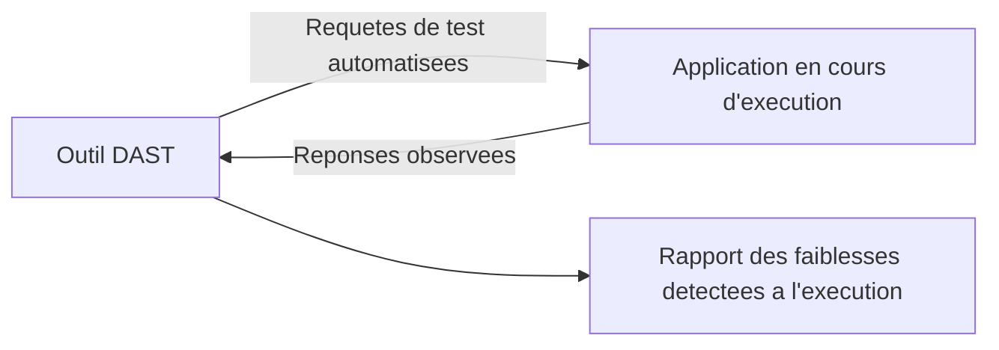

## Introduction

Les principes du SSDLC (chapitre 1) ne tiennent à grande échelle que s'ils sont outillés. Une équipe qui livre plusieurs fois par jour ne peut pas attendre un audit manuel pour chaque modification. Les **tests de sécurité automatisés** répondent à ce besoin : ils examinent le code, l'application en fonctionnement et ses dépendances de façon systématique et répétable.

Ce chapitre présente les trois grandes familles d'outils, **SAST**, **DAST** et **SCA**, ainsi que deux approches voisines utiles, l'IAST et la détection de secrets. Chacune détecte une catégorie différente de problèmes, et aucune ne suffit isolément. À la fin, tu sauras choisir l'outil adapté à une question donnée, interpréter ses résultats avec esprit critique et organiser leur tri pour qu'ils aboutissent à de vraies corrections.

## SAST — Static Application Security Testing

Le **SAST** analyse le code source d'une application **sans jamais l'exécuter**. Il recherche des motifs potentiellement vulnérables, par exemple une requête SQL construite par concaténation d'une variable issue de la requête HTTP. Les outils modernes suivent le **flux de données** : ils repèrent une **source** (une entrée non fiable, comme un paramètre de requête), suivent la donnée à travers le code, et signalent quand elle atteint un **puits** dangereux (sink), comme l'exécution d'une requête SQL ou d'une commande, sans passer par une fonction de nettoyage.

```bash
# Analyse SAST avec Semgrep et un jeu de regles choisi automatiquement selon le langage
semgrep scan --config auto
```

```text
# Extrait de resultat SAST
src/routes/produits.py
  python.lang.security.audit.formatted-sql-query
  Detected possible formatted SQL query. Use parameterized queries instead.
   24| cur.execute(f"SELECT * FROM produits WHERE id = {produit_id}")
```

Parmi les outils répandus figurent Semgrep, CodeQL (intégré à GitHub) et SonarQube. Le SAST s'utilise aussi directement dans l'éditeur du développeur, ce qui raccourcit au maximum la boucle entre l'erreur et sa correction.

<CompareTable
  titleA="Avantage du SAST"
  titleB="Limite du SAST"
  rows={[
    { a: "Detecte les vulnerabilites tres tot, des l'ecriture du code", b: "Genere souvent de nombreux faux positifs, qui exigent un tri manuel" },
    { a: "N'a besoin d'aucun environnement d'execution", b: "Ne detecte pas ce qui n'apparait qu'a l'execution (configuration serveur, en-tetes, comportement reel)" },
    { a: "Indique la ligne exacte a corriger", b: "Comprend mal la logique metier (un defaut d'autorisation BOLA lui echappe souvent)" },
  ]}
/>

## DAST — Dynamic Application Security Testing

Le **DAST** teste une application **en cours d'exécution, de l'extérieur**, en lui envoyant des requêtes construites pour révéler des faiblesses et en observant ses réponses. Il n'a pas accès au code source. Il se rapproche ainsi d'un test d'intrusion automatisé : il voit l'application comme la voit un client, avec sa configuration, ses en-têtes, ses messages d'erreur.



```bash
# Scan passif de base avec ZAP sur un environnement de test (image Docker officielle)
docker run --rm -t ghcr.io/zaproxy/zaproxy:stable zap-baseline.py -t https://staging.exemple.fr
```

```text
# Extrait de rapport ZAP baseline
WARN-NEW: Content Security Policy (CSP) Header Not Set [10038]
WARN-NEW: Cookie No HttpOnly Flag [10010]
WARN-NEW: Strict-Transport-Security Header Not Set [10035]
PASS: Vulnerable JS Library [10003]
```

Un scan **de base** (baseline) se contente d'observer le trafic sans envoyer de requêtes agressives, ce qui le rend adapté à une exécution fréquente. Un scan **actif** envoie des requêtes de test et ne doit être lancé que sur un environnement de test dédié, jamais en production.

<TipCallout>
Un outil DAST automatise à grande échelle le type de vérifications qu'un pentesteur mènerait manuellement avec Burp Suite. Son avantage est de pouvoir tourner à chaque déploiement, sans intervention humaine. Pour une API, fournis-lui la spécification OpenAPI ou le schéma GraphQL : sans elle, il ne découvre que ce qu'il trouve en explorant.
</TipCallout>

<WarningCallout>
Le DAST ne peut détecter que ce qui est réellement accessible et exercé pendant le test. Une fonctionnalité rarement utilisée, cachée derrière une authentification que l'outil ne sait pas franchir, ou absente des scénarios de test, peut dissimuler une vulnérabilité que le DAST ne détectera jamais. Configure l'authentification du scanner et fournis-lui la description complète de l'API.
</WarningCallout>

## SCA — Software Composition Analysis

Le **SCA** analyse les **dépendances tierces** de l'application, et non le code propre de l'équipe. Il compare la liste des dépendances utilisées, avec leurs versions précises, aux bases de données de vulnérabilités publiques (NVD, GitHub Advisory Database, OSV) pour signaler celles qui portent des CVE connues. C'est le prolongement opérationnel du SBOM vu au chapitre 6.

```bash
# Analyse des dependances du projet (fichiers de verrouillage) avec Trivy
trivy fs --scanners vuln .
```

Les outils SCA courants incluent Dependabot et Renovate (qui proposent aussi automatiquement des mises à jour), Trivy, OSV-Scanner et OWASP Dependency-Check. Un bon outil SCA indique la version corrigée, distingue dépendances directes et transitives, et signale les licences incompatibles avec la politique de l'organisation.

## Les approches voisines

L'**IAST** (Interactive Application Security Testing) place un agent à l'intérieur de l'application pendant qu'elle est exercée par des tests : il combine la vue de l'intérieur du SAST et la réalité d'exécution du DAST, avec moins de faux positifs, au prix d'une instrumentation de l'application.

La **détection de secrets** (Gitleaks, TruffleHog, ou la fonction intégrée des plateformes Git) recherche dans le code et l'historique des dépôts des clés API, mots de passe et jetons publiés par erreur. Un secret commité doit être considéré comme compromis et révoqué, même s'il est supprimé ensuite, car il reste dans l'historique.

<CompareTable
  titleA="Approche"
  titleB="Ce qu'elle analyse"
  rows={[
    { a: "SAST", b: "Le code source propre de l'application, sans execution" },
    { a: "DAST", b: "L'application en cours d'execution, testee de l'exterieur" },
    { a: "SCA", b: "Les dependances tierces et leurs vulnerabilites connues (CVE)" },
    { a: "IAST", b: "L'application de l'interieur, pendant son execution par des tests" },
    { a: "Detection de secrets", b: "Les identifiants et cles publies dans le code et l'historique Git" },
  ]}
/>

## Trier les résultats : faux positifs et faux négatifs

Un **faux positif** est une alerte qui ne correspond à aucune vulnérabilité réelle : par exemple une concaténation SQL signalée alors que la variable est une constante. Un **faux négatif** est une vulnérabilité réelle que l'outil ne signale pas. Les deux coûtent cher : trop de faux positifs et les équipes cessent de lire les alertes ; trop de faux négatifs et l'outil donne un faux sentiment de sécurité.

<Steps steps={[
  { title: "Qualifier", description: "Pour chaque alerte, verifier si le chemin de donnees est reellement atteignable par une entree non fiable." },
  { title: "Prioriser", description: "Classer selon la severite, l'exposition (endpoint public ou interne) et, pour le SCA, la presence au catalogue CISA KEV ou un EPSS eleve." },
  { title: "Corriger ou justifier", description: "Corriger la cause, ou documenter pourquoi l'alerte est un faux positif plutot que de la masquer silencieusement." },
  { title: "Ajuster l'outil", description: "Affiner les regles et les exclusions pour reduire durablement le bruit, sans desactiver des familles entieres de controles." },
]} />

## Pourquoi ces approches sont complémentaires

<WarningCallout>
Aucune approche ne couvre à elle seule l'ensemble des risques. Le SAST manque les failles qui n'apparaissent qu'à l'exécution, le DAST manque le code jamais exercé pendant le test, et le SCA ne dit rien du code propre de l'équipe. Ni le SAST ni le DAST ne ciblent spécifiquement les vulnérabilités connues des dépendances, d'où le SCA. Une stratégie robuste combine les trois, intégrés au pipeline CI/CD (chapitre 8), et les complète par une revue humaine et des tests d'intrusion pour la logique métier.
</WarningCallout>

<AuditCallout>
L'ISO/IEC 27001:2022 exige des tests de sécurité dans le développement et lors de l'acceptation (thème A.8). L'OWASP ASVS fournit une grille d'exigences qui sert de référence pour décider ce que chaque outil doit vérifier, et PCI DSS 4.0.1 exige la revue du code personnalisé et la protection des applications web exposées.
</AuditCallout>

## Angle offensif et défensif

<AttackDefenseTable rows={[
  { phase: "Code propre", attack: "Exploiter une injection introduite par un developpeur", defense: "SAST au plus tot, revue de code, regles de codage securise" },
  { phase: "Execution", attack: "Exploiter un en-tete manquant ou une mauvaise configuration", defense: "DAST sur l'environnement de test, durcissement" },
  { phase: "Dependances", attack: "Exploiter une CVE connue d'une bibliotheque", defense: "SCA continu, mises a jour automatisees, priorisation KEV/EPSS" },
  { phase: "Secrets", attack: "Recuperer une cle publiee dans un depot", defense: "Detection de secrets avant commit et en CI, revocation immediate" },
]} />

## Erreurs fréquentes

Les erreurs courantes sont : activer tous les outils avec leurs réglages par défaut et noyer les équipes sous des milliers d'alertes ; considérer un rapport vide comme une preuve d'absence de vulnérabilité ; lancer un DAST actif contre la production ; ne pas configurer l'authentification du scanner DAST, qui ne teste alors que la page de connexion ; masquer des alertes sans justification ; et supprimer un secret commité sans le révoquer.

## Lab — Mise en pratique

**Environnement** : Kali Linux (terminal Nyx Shell), sur un projet de lab

<Steps steps={[
  { title: "Choisir l'outil adapté", description: "Pour chacun de ces besoins, indique l'approche la plus adaptee et justifie : une CVE publiee la semaine derniere dans une bibliotheque, un en-tete CSP absent, une requete SQL concatenee." },
  { title: "Lancer un SAST", description: "Analyse le code du projet de lab et liste les alertes obtenues.", code: "semgrep scan --config auto" },
  { title: "Trier les résultats", description: "Pour chaque alerte, determine s'il s'agit d'un vrai positif ou d'un faux positif, en suivant le chemin de la donnee." },
  { title: "Lancer un SCA", description: "Analyse les dependances du projet et note les CVE trouvees avec leur version corrigee.", code: "trivy fs --scanners vuln ." },
  { title: "Corriger", description: "Corrige un vrai positif du SAST (par exemple en parametrant la requete) et mets a jour une dependance vulnerable." },
  { title: "Vérifier", description: "Relance les deux analyses et confirme la disparition des alertes corrigees sans nouvelle alerte introduite." },
  { title: "Analyser une limite du DAST", description: "Explique pourquoi un DAST ne detecterait pas une vulnerabilite situee dans une fonctionnalite d'administration rarement utilisee." },
]} />

## À retenir

- Le SAST analyse le code sans l'exécuter : il détecte tôt mais produit des faux positifs et manque les problèmes d'exécution.
- Le DAST teste l'application en fonctionnement de l'extérieur, comme un pentest automatisé, mais ne voit que ce qui est exercé.
- Le SCA compare les dépendances et leurs versions aux bases de CVE publiques ; il prolonge le SBOM.
- L'IAST et la détection de secrets complètent utilement ces trois approches.
- Le tri des faux positifs et des faux négatifs conditionne l'efficacité réelle des outils.
- Aucune approche ne suffit isolément ; elles se combinent dans le pipeline CI/CD et ne remplacent pas la revue humaine.

## Questions de révision

1. Quelle est la différence fondamentale entre l'approche du SAST et celle du DAST ?
2. Que signifient « source » et « puits » dans une analyse SAST par flux de données ?
3. Pourquoi un DAST pourrait-il ne jamais détecter une vulnérabilité présente dans l'application ?
4. Sur quoi un outil SCA base-t-il sa détection ?
5. Pourquoi un secret commité puis supprimé doit-il quand même être révoqué ?
6. Quelle différence fais-tu entre faux positif et faux négatif, et pourquoi les deux sont-ils coûteux ?
7. Pourquoi aucune des trois approches, isolément, ne suffit-elle à couvrir l'ensemble des risques ?
