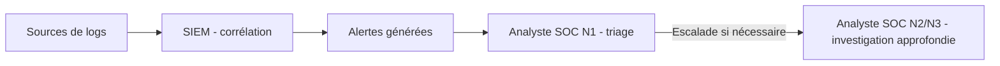
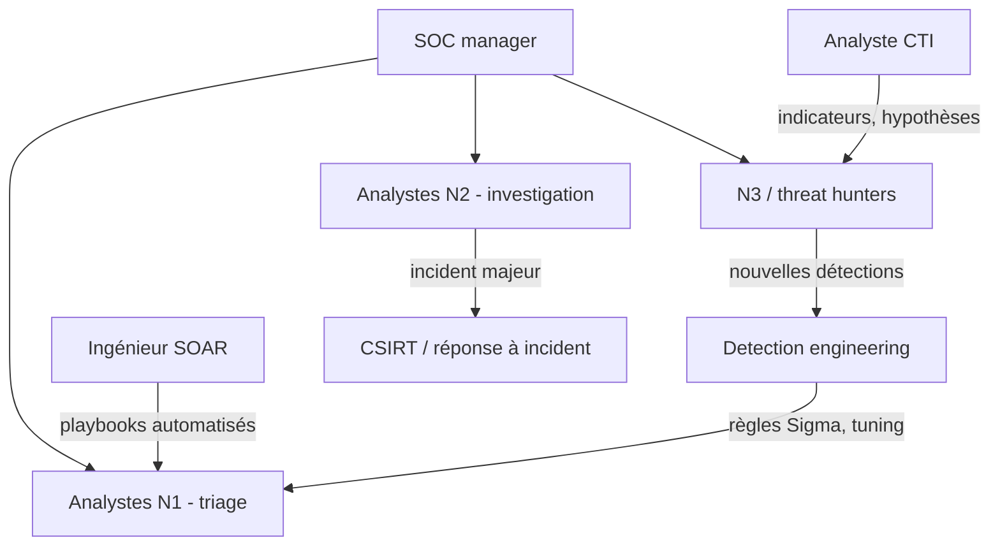

## Introduction

Ce cours couvre le métier d'analyste SOC (Security Operations Center) : celui qui reçoit et traite au quotidien les alertes générées par les systèmes de détection déjà étudiés (cours Data Science Complète, IA & Agents en Cybersécurité). C'est souvent le premier poste occupé par un débutant en cybersécurité défensive, et c'est aussi l'un des meilleurs terrains d'apprentissage : en quelques mois, un analyste voit passer plus de techniques d'attaque réelles qu'un étudiant n'en lira en plusieurs années.

Pourquoi ce métier compte-t-il autant ? Parce qu'aucune organisation n'empêche toutes les intrusions. Les rapports annuels des grands éditeurs et des CERT nationaux convergent sur un point : la différence entre un incident maîtrisé et une catastrophe, c'est le temps écoulé entre la première action de l'attaquant et la réaction des défenseurs. Un rançongiciel détecté pendant la phase de reconnaissance interne se règle en isolant un poste ; détecté au moment du chiffrement, il coûte des semaines d'arrêt. Le SOC existe pour raccourcir ce délai.

À la fin de ce chapitre, tu sauras expliquer la mission d'un SOC, situer les niveaux N1, N2 et N3 et les rôles qui gravitent autour, comparer les modèles d'organisation, décrire une journée type d'analyste N1, et lire les principaux indicateurs de performance qu'un responsable de SOC présente à sa direction.

## La mission d'un SOC

<CehCallout>
Un SOC (Security Operations Center) est l'équipe et l'infrastructure chargées de surveiller en continu (souvent 24h/24, 7j/7) l'ensemble du système d'information d'une organisation, pour détecter, analyser et répondre aux incidents de sécurité le plus rapidement possible.
</CehCallout>

Cette définition contient trois verbes qui structurent tout le métier. **Détecter**, c'est repérer qu'un événement anormal se produit, grâce aux journaux (logs) collectés et aux règles de détection. **Analyser**, c'est déterminer si cet événement est une vraie menace, quelle est son ampleur et ce que l'attaquant cherche. **Répondre**, c'est contenir la menace, ou transmettre aux bonnes équipes les éléments pour le faire.

Le chemin d'une donnée dans un SOC suit toujours le même flux, du journal brut jusqu'à l'analyste.



Les **sources de logs** sont très variées : contrôleurs de domaine Active Directory, pare-feux, proxys web, passerelles de messagerie, EDR (Endpoint Detection and Response, l'agent de sécurité installé sur les postes et serveurs), journaux d'audit des services cloud comme Microsoft 365, AWS CloudTrail ou Google Workspace. Le **SIEM** (Security Information and Event Management) centralise, normalise et corrèle ces événements ; il sera détaillé au chapitre 3. Les **alertes** sont le produit des règles de détection, et c'est là qu'intervient l'humain.

### SOC, CSIRT, CERT et NOC : ne pas confondre

Plusieurs équipes voisines sont souvent confondues. Le tableau suivant clarifie les responsabilités.

| Équipe | Mission principale | Horizon de travail |
| --- | --- | --- |
| SOC | Surveillance continue, détection et premier niveau de réponse | Temps réel, de la minute à la journée |
| CSIRT ou CERT | Gestion des incidents majeurs, coordination de crise, investigation forensique | De la journée à plusieurs semaines |
| NOC (Network Operations Center) | Disponibilité et performance du réseau et des services | Temps réel, orienté disponibilité |
| Équipe CTI | Renseignement sur la menace (acteurs, campagnes, indicateurs) | De la semaine au trimestre |

Dans une petite structure, une seule équipe cumule souvent SOC et CSIRT. Dans un grand groupe, le SOC détecte et qualifie, puis passe la main au CSIRT dès qu'un incident dépasse un certain seuil de gravité. Le terme CERT est historiquement une marque déposée de l'université Carnegie Mellon ; en France, on parle du CERT-FR, rattaché à l'ANSSI, et de CSIRT régionaux.

### Où se situe le SOC dans le NIST CSF 2.0

Le NIST Cybersecurity Framework 2.0, publié en février 2024, organise la cybersécurité en six fonctions : Govern (gouverner), Identify (identifier), Protect (protéger), Detect (détecter), Respond (répondre) et Recover (rétablir). La fonction Govern est la nouveauté de la version 2.0 : elle place la stratégie, les rôles et la gestion du risque au centre. Le SOC porte l'essentiel de **Detect** (surveillance continue, analyse des événements indésirables) et une large part de **Respond** (gestion, analyse, communication et atténuation des incidents). Il alimente aussi Identify et Govern en remontant des constats : un actif inconnu découvert pendant une investigation, une politique jamais appliquée.

## Les niveaux d'analystes SOC

<CompareTable
  titleA="Niveau"
  titleB="Rôle typique"
  rows={[
    { a: "Analyste N1", b: "Triage initial des alertes, application de procédures documentées, escalade des cas ambigus ou critiques" },
    { a: "Analyste N2", b: "Investigation approfondie des cas escaladés, corrélation de plusieurs sources, décisions de confinement" },
    { a: "Analyste N3 / Threat Hunter", b: "Recherche proactive de menaces non détectées, amélioration des règles de détection, réponse aux incidents majeurs" },
]}
/>

### L'analyste N1 : le premier filtre

L'analyste N1 voit toutes les alertes en premier. Son travail consiste à appliquer des **procédures documentées**, appelées runbooks ou fiches réflexes, qui disent pour chaque type d'alerte quoi vérifier et quand escalader. Il doit être rapide, rigoureux et honnête sur ses limites : une bonne escalade vaut mieux qu'une mauvaise clôture. Ses outils quotidiens sont la console du SIEM, la console EDR, l'outil de ticketing (par exemple TheHive, ServiceNow ou Jira Service Management) et des services d'enrichissement comme VirusTotal ou AbuseIPDB.

### L'analyste N2 : l'enquêteur

L'analyste N2 reprend les cas que le N1 n'a pas pu trancher. Il corrèle plusieurs sources (un log de proxy, une télémétrie EDR, un journal Active Directory), reconstruit la chronologie, et peut décider de mesures de **confinement** comme isoler un poste du réseau via l'EDR ou désactiver un compte. Il rédige aussi les retours vers l'équipe de détection quand une règle se révèle mal calibrée.

### L'analyste N3 et le threat hunter : l'anticipation

Le N3 ne se contente plus d'attendre les alertes. Il mène une **recherche proactive** de menaces que les règles n'ont pas détectées (le threat hunting, vu au chapitre 7), il conçoit de nouvelles règles, et il intervient sur les incidents majeurs aux côtés du CSIRT. C'est aussi lui qui transforme une investigation réussie en détection durable.

<TipCallout>
La progression N1 → N2 → N3 rejoint directement le système de progression de Nyx (Novice → Apprenti → Intermédiaire) : le N1 applique des procédures documentées, le N2 développe un jugement d'investigation autonome, le N3 anticipe des menaces avant même qu'une alerte ne se déclenche.
</TipCallout>

### Les rôles spécialisés autour des analystes

Un SOC mature ne se limite pas à trois niveaux. On y croise un **SOC manager**, responsable des effectifs, des indicateurs et de la relation avec la direction ; un **detection engineer** (ingénieur détection), qui écrit, teste et maintient les règles comme du code, souvent en format Sigma versionné dans Git ; un **analyste CTI**, qui transforme le renseignement sur les menaces en hypothèses et en indicateurs exploitables ; un **ingénieur SOAR**, qui automatise les actions répétitives ; et des **intervenants en réponse à incident**, capables d'acquérir une image mémoire ou disque pour une analyse forensique.



Ce schéma montre une boucle importante : ce que les analystes découvrent revient vers l'ingénierie de détection, et les règles améliorées réduisent ensuite la charge des N1. Un SOC qui n'a pas cette boucle s'enlise dans le bruit.

## Les modèles d'organisation d'un SOC

Toutes les organisations n'ont pas les moyens de maintenir une équipe interne qui tourne 24h/24. Pour assurer une présence continue, il faut au minimum cinq à six équivalents temps plein par poste couvert, à cause des nuits, des week-ends, des congés et de la formation. D'où plusieurs modèles.

| Modèle | Principe | Avantages | Limites |
| --- | --- | --- | --- |
| SOC interne | L'organisation recrute et outille sa propre équipe | Connaissance fine du contexte métier, maîtrise des données | Coût élevé, difficulté de recrutement |
| MSSP | Un prestataire surveille les alertes pour plusieurs clients | Couverture 24/7 mutualisée, coût prévisible | Connaissance du contexte limitée, réponse souvent restreinte à la notification |
| MDR (Managed Detection and Response) | Le prestataire détecte et agit directement, souvent via l'EDR | Capacité de confinement rapide, expertise | Dépendance à l'outillage du prestataire |
| Hybride | Équipe interne le jour, prestataire la nuit et le week-end, ou N1 externalisé | Équilibre coût et contexte | Passations délicates entre équipes |

En France, l'ANSSI a créé une qualification **PDIS** (Prestataires de Détection des Incidents de Sécurité) pour les prestataires de SOC, et la qualification **PRIS** pour la réponse à incident. Choisir un prestataire qualifié est souvent exigé pour les opérateurs les plus sensibles.

### Organisation des équipes dans le temps

Un SOC 24/7 fonctionne par rotations, par exemple en trois équipes de huit heures, ou en équipes de douze heures. Les grands groupes internationaux pratiquent le modèle **follow-the-sun** : un SOC en Europe passe la main à un SOC en Amérique, qui passe la main à un SOC en Asie, chacun travaillant en journée. Dans tous les cas, la **passation** entre équipes est un moment critique : c'est là que se perdent les informations si elle n'est pas structurée.

## Le quotidien réel d'un analyste SOC N1

<Steps steps={[
  { title: "Prise de poste et passation", description: "Consulter les incidents en cours et les alertes non résolues de l'équipe précédente." },
  { title: "Triage de la file d'alertes", description: "Examiner chaque nouvelle alerte selon une procédure documentée (approfondi au chapitre 2)." },
  { title: "Documentation systématique", description: "Chaque alerte traitée, même bénigne, doit être documentée avec la décision prise et sa justification." },
  { title: "Escalade des cas ambigus", description: "Transmettre à un analyste N2 les alertes qui dépassent le cadre des procédures documentées." },
]} />

### La passation, première tâche de la journée

La première chose que fait un analyste N1 en arrivant n'est pas de traiter de nouvelles alertes, mais de lire la passation. Quels incidents sont ouverts ? Quelles alertes sont en attente d'une réponse d'un utilisateur ou d'une autre équipe ? Y a-t-il une campagne de phishing en cours qui va générer des dizaines d'alertes similaires ? Ignorer cette étape, c'est risquer de clôturer une alerte qui faisait partie d'un incident déjà suivi, ou de relancer une investigation déjà menée.

### Le triage, cœur du métier

Le triage consiste à prendre chaque alerte, comprendre ce qu'elle signale, rassembler le contexte et décider. Le chapitre 2 détaille cette méthode et la priorisation entre criticité et confiance. Retiens dès maintenant qu'une alerte n'est jamais traitée isolément : elle s'inscrit dans l'historique de l'utilisateur, de la machine et des autres alertes du moment.

### La documentation, même pour le bénin

Chaque alerte traitée laisse une trace écrite. Voici à quoi ressemble une note de clôture correcte dans un outil de ticketing.

```text
Ticket SOC-2026-11-04-0187
Alerte     : Connexion depuis un pays inhabituel (règle AUTH-GEO-003)
Compte     : m.ngoma@exemple.cg
Source     : 102.218.xx.xx (Kinshasa, RDC) — fournisseur mobile
Contexte   : déplacement professionnel confirmé par le calendrier partagé et
             par le manager (message Teams 09:42) ; MFA validée depuis le
             téléphone enregistré ; aucune autre connexion simultanée.
Décision   : Faux positif (activité légitime) — clôture
Action     : Ajout d'une exception temporaire jusqu'au 08/11, ticket de
             suivi pour revoir la règle sur les déplacements déclarés.
Analyste   : N1 — équipe matin
```

Cette note répond à trois questions : qu'a-t-on observé, qu'a-t-on vérifié, et pourquoi a-t-on décidé ainsi. Elle permet à un collègue, à un auditeur ou à toi-même dans six mois de comprendre la décision. Elle alimente aussi les statistiques qui servent à améliorer les règles.

### L'escalade, un acte professionnel

Escalader n'est pas un aveu d'échec. Une escalade réussie transmet au N2 tout le contexte déjà rassemblé, ce qui lui fait gagner un temps précieux. Les procédures fixent des critères clairs : alerte sur un compte à privilèges, sur un serveur critique, indicateur connu d'un acteur malveillant, ou simplement doute persistant après les vérifications prévues.

<WarningCallout>
Le volume d'alertes traité quotidiennement par un analyste N1 peut être considérable — souvent des centaines par jour dans une organisation de taille moyenne à grande — un contexte qui rend la fatigue d'alerte (vue au cours Administration Systèmes et Réseaux, chapitre 6) un risque professionnel réel, pas une simple abstraction théorique.
</WarningCallout>

Ce volume pose un problème de sécurité, et pas seulement de charge : face à des centaines d'alertes majoritairement bénignes, la vigilance baisse, et l'analyste finit par clôturer machinalement une alerte pourtant légitime. C'est ce qu'on appelle la fatigue d'alerte, que le chapitre 2 traite en détail.

## Mesurer l'efficacité d'un SOC

Un SOC se pilote avec des indicateurs. Les plus courants sont exprimés en temps moyen, d'où l'abréviation MTT pour Mean Time To.

| Indicateur | Signification | Ce qu'il révèle |
| --- | --- | --- |
| MTTD (Mean Time To Detect) | Délai moyen entre le début d'une activité malveillante et sa détection | Qualité de la couverture de détection |
| MTTA (Mean Time To Acknowledge) | Délai moyen entre la création d'une alerte et sa prise en charge par un analyste | Dimensionnement de l'équipe, gestion de la file |
| MTTR (Mean Time To Respond ou Remediate) | Délai moyen entre la détection et le confinement ou la remédiation | Efficacité des procédures et de l'automatisation |
| Taux de faux positifs par règle | Part des alertes d'une règle clôturées comme bénignes | Règles à réviser en priorité |
| Couverture ATT&CK | Part des techniques MITRE ATT&CK pertinentes couvertes par une détection testée | Angles morts de la détection |

Prenons un exemple chiffré. Sur une semaine, un SOC a pris en charge cinq alertes avec les délais suivants entre création et prise en charge : 4, 12, 7, 45 et 2 minutes. Le MTTA vaut la somme, soit 70 minutes, divisée par 5, soit 14 minutes. Mais la médiane vaut 7 minutes : l'alerte à 45 minutes tire la moyenne vers le haut. Un bon responsable regarde donc la moyenne, la médiane et les valeurs extrêmes, car c'est souvent l'alerte oubliée pendant 45 minutes qui pose problème.

<WarningCallout>
Un indicateur mal choisi pervertit les comportements. Si l'on récompense le nombre d'alertes clôturées par heure, les analystes clôturent vite, et parfois à tort. Les indicateurs doivent mesurer la qualité de la détection et de la réponse, pas seulement la vitesse de vidage de la file.
</WarningCallout>

Pour évaluer la maturité globale d'un SOC, on utilise des référentiels comme le **SOC-CMM** (SOC Capability Maturity Model), qui note les domaines métier, humain, processus, technologie et services.

## Le cadre réglementaire qui pousse les SOC

Depuis la transposition de la directive européenne **NIS2** (applicable depuis octobre 2024 au niveau européen, avec des transpositions nationales échelonnées), les entités essentielles et importantes doivent notifier les incidents significatifs selon un calendrier serré défini à l'article 23 : une alerte précoce dans les 24 heures après en avoir pris connaissance, une notification d'incident dans les 72 heures, puis un rapport final dans un délai d'un mois. Sans capacité de détection et de qualification rapide, ces délais sont intenables.

Le règlement **DORA**, applicable depuis le 17 janvier 2025 au secteur financier, impose de même une classification et une notification des incidents majeurs liés aux technologies de l'information et de la communication, avec des délais encore plus courts pour la notification initiale. L'ISO/IEC 27001:2022 prévoit enfin des contrôles directement liés à l'activité d'un SOC, notamment A.8.15 sur la journalisation, A.8.16 sur les activités de surveillance, et A.5.24 à A.5.28 sur la gestion des incidents.

<LegalCallout>
L'analyste SOC manipule des données personnelles (identités, connexions, parfois contenus de messages). Le RGPD s'applique : principe de minimisation, durées de conservation définies, accès limité aux personnes habilitées. En France, la surveillance des salariés doit aussi être proportionnée et portée à leur connaissance. Un SOC ne fouille pas une boîte mail par curiosité : chaque accès doit être justifié par une investigation tracée.
</LegalCallout>

## Erreurs fréquentes du débutant en SOC

La première erreur est de **sauter la passation** pour attaquer directement la file d'alertes, au risque de dupliquer un travail ou de rater un incident en cours. La deuxième est de **clôturer sans justification** : une mention « FP » sans explication est inexploitable pour l'amélioration des règles et indéfendable en audit. La troisième est de **ne pas escalader par peur de déranger** : un N2 préfère dix escalades inutiles à une compromission ratée. La quatrième est de **faire confiance aveuglément à la sévérité affichée** par l'outil, qui dépend de la configuration de la règle et pas du contexte réel. La cinquième, enfin, est de **traiter chaque alerte isolément**, sans chercher si d'autres alertes concernent le même utilisateur ou la même machine.

## Lab — Mise en pratique

**Environnement** : terminal Kali ou tout Linux avec Python 3.12+. On simule une file d'alertes exportée du SIEM pour calculer des indicateurs et répartir les tâches.

<Steps steps={[
  { title: "Créer un export d'alertes", description: "Crée un fichier CSV simulant une file d'alertes avec l'heure de création, l'heure de prise en charge, la règle et la décision. Observe la structure : c'est le type d'export que fournit un SIEM ou un outil de ticketing.", code: "cat > alertes.csv << 'EOF'\nid,cree,pris,regle,decision\n1,08:00,08:04,AUTH-GEO-003,FP\n2,08:10,08:22,EDR-PS-ENC,escalade\n3,08:15,08:22,AUTH-BRUTE-001,FP\n4,08:30,09:15,AUTH-BRUTE-001,FP\n5,08:40,08:42,MAIL-PHISH-010,TP\nEOF\ncolumn -s, -t alertes.csv" },
  { title: "Compter les décisions par règle", description: "Utilise awk pour compter combien d'alertes chaque règle a produit et combien ont été clôturées comme faux positif. Observe quelle règle mériterait une révision.", code: "awk -F, 'NR>1 {total[$4]++; if ($5==\"FP\") fp[$4]++} END {for (r in total) printf \"%-16s %d alertes, %d FP\\n\", r, total[r], fp[r]}' alertes.csv" },
  { title: "Calculer le MTTA et la médiane", description: "Calcule en Python le délai de prise en charge de chaque alerte, puis la moyenne et la médiane. Compare les deux valeurs et identifie l'alerte qui tire la moyenne vers le haut.", code: "python3 - << 'EOF'\nimport csv, statistics\nfrom datetime import datetime\nfmt = '%H:%M'\ndelais = []\nfor row in csv.DictReader(open('alertes.csv')):\n    d = (datetime.strptime(row['pris'], fmt) - datetime.strptime(row['cree'], fmt)).seconds // 60\n    delais.append(d)\n    print(row['id'], row['regle'], d, 'min')\nprint('MTTA =', statistics.mean(delais), 'min | médiane =', statistics.median(delais), 'min')\nEOF" },
  { title: "Classer des tâches par niveau", description: "Classe ces tâches par niveau d'analyste (N1, N2, N3) : appliquer une procédure documentée pour une alerte de connexion échouée, rechercher proactivement des signes de compromission non détectés, corréler trois sources de logs pour confirmer une intrusion. Justifie chaque choix par le degré d'autonomie requis." },
  { title: "Rédiger une note de passation", description: "À partir du fichier, rédige une note de passation de cinq lignes pour l'équipe suivante : incidents ouverts (l'alerte escaladée et le vrai positif de phishing), points de vigilance et règle à signaler à l'ingénierie de détection." },
  { title: "Identifier un risque du quotidien N1", description: "Pourquoi un volume élevé d'alertes quotidiennes peut-il constituer un risque de sécurité en soi, au-delà de la simple charge de travail ? Relie ta réponse à l'alerte 4, prise en charge au bout de 45 minutes." },
]} />

## À retenir

- Un SOC surveille en continu, souvent 24h/24 et 7j/7, le système d'information d'une organisation pour détecter, analyser et répondre aux incidents.
- Le SOC se distingue du CSIRT, qui gère les incidents majeurs, et du NOC, qui veille à la disponibilité ; dans le NIST CSF 2.0, il porte surtout les fonctions Detect et Respond.
- Les analystes N1, N2 et N3 ont des rôles progressivement plus autonomes, du triage documenté à la recherche proactive de menaces, entourés de rôles spécialisés comme l'ingénierie de détection et la CTI.
- Les modèles interne, MSSP, MDR et hybride répondent à la contrainte de coût d'une couverture permanente.
- Le quotidien N1 suit une séquence : passation, triage, documentation systématique de chaque alerte même bénigne, puis escalade des cas ambigus.
- Les indicateurs MTTD, MTTA et MTTR pilotent le SOC, mais doivent mesurer la qualité et pas seulement la vitesse.
- NIS2 et DORA imposent des délais de notification courts qui rendent une capacité de détection rapide indispensable.

## Questions de révision

1. Quelle est la mission principale d'un SOC, et quels sont les trois verbes qui la résument ?
2. Quelle est la différence de rôle entre un analyste N1 et un analyste N3 ?
3. En quoi un SOC se distingue-t-il d'un CSIRT et d'un NOC ?
4. Pourquoi la passation est-elle la première tâche d'un analyste N1 lors de sa prise de poste ?
5. Pourquoi le volume élevé d'alertes quotidiennes constitue-t-il un risque de sécurité en soi ?
6. Quels avantages et quelles limites présente un MDR par rapport à un SOC interne ?
7. Pourquoi faut-il examiner la médiane en plus de la moyenne quand on calcule un MTTA ?
8. Quels délais de notification la directive NIS2 impose-t-elle, et pourquoi concernent-ils directement le SOC ?
