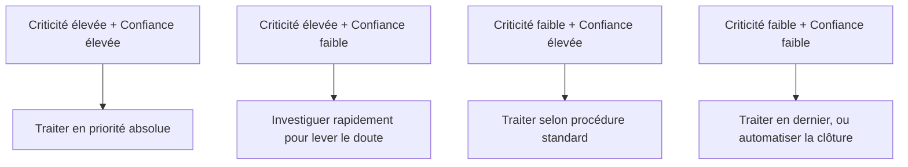

## Introduction

Ce chapitre détaille la compétence centrale d'un analyste N1 : transformer un flux continu d'alertes brutes en décisions rapides et justifiées — accepter, investiguer davantage, ou clôturer comme faux positif.

Le triage est souvent présenté comme une tâche répétitive. C'est en réalité un exercice de jugement sous contrainte de temps. Un analyste qui prend vingt minutes par alerte noie l'équipe ; un analyste qui en prend vingt secondes finit par clôturer une vraie intrusion. Le bon triage est celui qui consacre juste assez de temps à chaque alerte pour décider de façon défendable, et qui sait reconnaître les rares alertes qui méritent beaucoup plus.

À la fin de ce chapitre, tu sauras appliquer une méthode de triage reproductible, classer correctement le résultat d'une alerte, enrichir une alerte avec du contexte, la prioriser selon deux axes, et contribuer à réduire la fatigue d'alerte de ton équipe.

## Vocabulaire du triage : ce que peut être une alerte

Avant de trier, il faut savoir dans quelles cases ranger le résultat. Les termes suivants viennent de la statistique et sont utilisés dans tous les SOC.

| Résultat | Définition | Exemple |
| --- | --- | --- |
| Vrai positif (TP) | L'alerte s'est déclenchée et l'activité est réellement malveillante | Un mot de passe deviné par force brute puis utilisé |
| Faux positif (FP) | L'alerte s'est déclenchée mais l'activité est légitime ou la règle s'est trompée | Un scanner de vulnérabilités autorisé déclenche une alerte de scan |
| Vrai positif bénin (BTP) | La règle a correctement détecté le comportement visé, mais celui-ci est autorisé dans ce contexte | Un administrateur utilise PsExec pour une maintenance planifiée |
| Faux négatif (FN) | Une activité malveillante n'a déclenché aucune alerte | Une exfiltration via un service cloud non surveillé |
| Vrai négatif (TN) | Aucune alerte, aucune activité malveillante | Le fonctionnement normal |

La distinction entre faux positif et vrai positif bénin est importante pour l'amélioration des règles. Un faux positif signale une règle mal écrite qu'il faut corriger. Un vrai positif bénin signale une règle correcte mais un contexte légitime qu'il faut documenter, parfois par une exception ciblée. Le faux négatif, lui, est invisible par nature : on ne le découvre que par le threat hunting (chapitre 7), un exercice de purple team, ou malheureusement un incident.

### Le cycle de vie d'une alerte

Dans l'outil de ticketing, une alerte passe par des états successifs : nouvelle, assignée à un analyste, en cours d'analyse, puis soit clôturée avec un motif (TP, FP, BTP), soit escaladée vers le N2 ou transformée en incident. Chaque changement d'état est horodaté, ce qui permet de calculer les indicateurs MTTA et MTTR vus au chapitre 1.

## Une méthodologie de triage structurée

<Steps steps={[
  { title: "Comprendre ce que signale l'alerte", description: "Quelle règle de détection s'est déclenchée, et sur quel comportement précis ?" },
  { title: "Rassembler le contexte immédiat", description: "Utilisateur ou machine concernés, historique récent, réputation de l'IP source (rappel du cours IA & Agents en Cybersécurité, chapitre 5, sur l'enrichissement automatique de contexte)." },
  { title: "Évaluer la plausibilité", description: "Ce comportement est-il cohérent avec une activité légitime connue (voyage professionnel, changement d'horaire), ou clairement anormal ?" },
  { title: "Décider et documenter", description: "Clôturer avec justification, escalader avec le contexte rassemblé, ou déclencher une action de confinement immédiate si la criticité l'exige." },
]} />

### Étape 1 : comprendre ce que signale l'alerte

On ne trie pas une alerte dont on ne comprend pas la règle. La première question est donc : quelle règle s'est déclenchée, et sur quel comportement précis ? Une règle nommée « PowerShell suspect » peut détecter une ligne de commande encodée en Base64, un téléchargement depuis Internet, ou un contournement de la politique d'exécution. Ce sont trois situations très différentes. Ouvre la logique de la règle, lis sa description, et regarde les champs qui ont provoqué le déclenchement. Beaucoup d'équipes associent à chaque règle une fiche qui décrit le comportement visé, la technique MITRE ATT&CK correspondante et les causes connues de faux positifs.

### Étape 2 : rassembler le contexte immédiat

Une alerte brute ne suffit presque jamais. Il faut répondre à quatre familles de questions. Sur l'**actif** : quelle machine, quel rôle (poste utilisateur, serveur de fichiers, contrôleur de domaine), quelle criticité métier ? Sur l'**identité** : quel utilisateur, quel service, a-t-il des privilèges élevés, est-il en période de départ ? Sur les **indicateurs** : l'adresse IP, le domaine ou le hash de fichier sont-ils connus comme malveillants ? Sur l'**historique** : cette alerte s'est-elle déjà produite pour ce même utilisateur ou cette même machine, et comment avait-elle été traitée ?

L'enrichissement des indicateurs se fait en grande partie en ligne de commande ou via les intégrations du SIEM. Voici une interrogation de l'API VirusTotal v3 pour une adresse IP.

```bash
# Réputation d'une IP via l'API VirusTotal v3 (clé personnelle dans $VT_KEY)
curl -s -H "x-apikey: $VT_KEY" \
  "https://www.virustotal.com/api/v3/ip_addresses/185.220.101.4" \
  | jq '.data.attributes | {pays: .country, as_owner, stats: .last_analysis_stats}'
```

```text
{
  "pays": "DE",
  "as_owner": "Example Hosting GmbH",
  "stats": {
    "malicious": 12,
    "suspicious": 2,
    "undetected": 25,
    "harmless": 55
  }
}
```

Ce résultat indique que 12 moteurs considèrent l'adresse comme malveillante. Cela ne prouve pas que l'activité observée est une attaque, mais cela augmente fortement la suspicion. À l'inverse, une réputation propre ne prouve rien : les attaquants utilisent souvent des infrastructures neuves ou des services cloud légitimes.

<WarningCallout>
Ne soumets jamais un fichier interne ou un document client sur un service public d'analyse comme VirusTotal : les fichiers envoyés deviennent accessibles aux abonnés payants. Recherche d'abord par hash (SHA-256), et n'envoie un fichier qu'avec l'accord de ta procédure, ou utilise une sandbox interne.
</WarningCallout>

### Étape 3 : évaluer la plausibilité

C'est l'étape du raisonnement. Le comportement est-il cohérent avec une activité légitime connue ? Une connexion depuis l'étranger s'explique par un voyage professionnel ; une exécution de script à trois heures du matin, par une tâche planifiée de sauvegarde ; une connexion massive sur plusieurs serveurs, par un outil d'inventaire. Ou bien est-il clairement anormal : un comptable qui lance des commandes de reconnaissance Active Directory, un serveur web qui ouvre une connexion sortante vers un port inhabituel ?

Prenons un exemple concret. Une alerte EDR signale l'exécution de PowerShell avec le paramètre `-EncodedCommand`. Ce paramètre attend une chaîne Base64 d'un texte encodé en UTF-16LE. On peut la décoder directement sous Linux.

```bash
# Décodage d'une commande PowerShell encodée (Base64 de UTF-16LE)
echo 'SQBFAFgAIAAoAE4AZQB3AC0ATwBiAGoAZQBjAHQAIABOAGUAdAAuAFcAZQBiAEMAbABpAGUAbgB0ACkA' \
  | base64 -d | iconv -f UTF-16LE -t UTF-8; echo
```

```text
IEX (New-Object Net.WebClient)
```

Le résultat montre le début d'un motif classique de téléchargement et d'exécution en mémoire (`IEX` est l'alias d'Invoke-Expression). Combiné à un utilisateur non administrateur et à un processus parent comme Word, ce comportement est très peu plausible pour une activité légitime : l'alerte doit être escaladée sans attendre.

### Étape 4 : décider et documenter

Trois décisions sont possibles : **clôturer** avec une justification écrite (FP ou BTP), **escalader** au N2 avec tout le contexte rassemblé, ou **déclencher un confinement immédiat** si la procédure l'autorise et que la criticité l'exige, par exemple isoler un poste qui chiffre des fichiers. La documentation reprend le modèle vu au chapitre 1 : observation, vérifications, décision, justification.

## Prioriser selon criticité et confiance

Quand vingt alertes attendent, laquelle traiter en premier ? La réponse repose sur deux axes indépendants.

<CompareTable
  titleA="Axe"
  titleB="Question posée"
  rows={[
    { a: "Criticité", b: "Si cette alerte s'avère être une vraie attaque, quel serait l'impact (systèmes concernés, données en jeu) ?" },
    { a: "Confiance", b: "Quelle est la fiabilité de la règle de détection à l'origine de l'alerte — génère-t-elle souvent des faux positifs ?" },
]}
/>

La **criticité** dépend de l'actif et de l'identité : une alerte sur un contrôleur de domaine ou un compte d'administrateur de domaine est critique par nature. La **confiance** dépend de l'historique de la règle. On peut la mesurer par la précision, c'est-à-dire la part de vrais positifs parmi toutes les alertes de la règle. La formule est : précision égale vrais positifs divisés par la somme des vrais positifs et des faux positifs. Une règle qui a produit 40 alertes le mois dernier, dont 30 vraies, a une précision de 30 sur 40, soit 75 % : confiance élevée. Une règle qui a produit 200 alertes dont 5 vraies a une précision de 2,5 % : confiance faible.



<CehCallout>
Une alerte à criticité élevée mais confiance faible (par exemple, un comportement rare mais pas nécessairement malveillant sur un serveur critique) mérite souvent d'être investiguée AVANT une alerte à confiance élevée mais criticité faible — le risque potentiel, pas seulement la certitude, doit orienter la priorisation.
</CehCallout>

Autrement dit, la priorisation ne doit jamais reposer sur la seule confiance. Une alerte peu fiable sur un serveur de paie peut cacher une vraie attaque à fort impact ; une alerte très fiable sur un poste de test isolé peut attendre quelques minutes.

### Traduire la matrice en niveaux de priorité

En pratique, la plupart des SOC traduisent cette matrice en niveaux de priorité associés à des délais de prise en charge contractuels, appelés SLA (Service Level Agreement). Les valeurs ci-dessous sont un exemple courant ; chaque organisation fixe les siennes.

| Priorité | Combinaison typique | Délai cible de prise en charge |
| --- | --- | --- |
| P1 | Criticité élevée et confiance élevée, ou activité destructrice en cours | 15 minutes |
| P2 | Criticité élevée et confiance faible | 30 minutes à 1 heure |
| P3 | Criticité faible et confiance élevée | 4 heures |
| P4 | Criticité faible et confiance faible | Jour ouvré suivant ou clôture automatisée |

Certaines plateformes calculent automatiquement un score de risque par entité, en additionnant les petites observations rattachées à un même utilisateur ou à une même machine : c'est le principe de l'alerting basé sur le risque (risk-based alerting). Au lieu de recevoir dix alertes faibles, l'analyste reçoit une seule alerte quand le score cumulé d'une entité dépasse un seuil.

## La fatigue d'alerte — un risque à gérer activement

<WarningCallout>
Rappel du cours Administration Systèmes et Réseaux (chapitre 6) : un volume excessif d'alertes à faible valeur conduit inévitablement à la fatigue d'alerte, où même des analystes expérimentés commencent à clôturer machinalement sans examen suffisant — c'est un facteur documenté derrière plusieurs incidents majeurs où une alerte légitime avait pourtant été générée mais ignorée.
</WarningCallout>

La fatigue d'alerte est donc un risque de sécurité en soi, pas seulement un problème de confort. Lors de la compromission de l'enseigne américaine Target en 2013, l'outil de détection avait signalé l'activité malveillante, mais les alertes n'avaient pas donné lieu à une réaction à temps. Ce cas est régulièrement cité pour rappeler qu'une détection sans traitement ne protège rien.

<Steps steps={[
  { title: "Ajuster régulièrement les règles de détection", description: "Une règle qui génère un volume disproportionné de faux positifs doit être révisée, pas simplement supportée indéfiniment." },
  { title: "Automatiser le tri des cas les plus évidents", description: "Rappel du cours IA & Agents en Cybersécurité (chapitre 5) : un agent IA peut pré-trier les cas clairement bénins, sous garde-fous appropriés." },
  { title: "Faire des pauses et alterner les tâches", description: "Un triage continu sans interruption sur de longues périodes dégrade mécaniquement la vigilance et la qualité des décisions." },
]} />

La première mesure est la plus efficace car elle agit directement sur la **source du bruit** plutôt que sur l'analyste. Réviser une règle peut signifier affiner sa logique (ajouter une condition sur le processus parent), exclure précisément une cause connue (le compte de service du scanner autorisé, et pas toute une plage d'adresses), relever un seuil, ou regrouper les alertes identiques en une seule, ce qu'on appelle la déduplication. Les deux autres mesures traitent les effets sur l'humain : elles sont nécessaires, mais ne suffisent jamais seules.

<TipCallout>
Une exception de règle est une dette de sécurité. Documente toujours qui l'a demandée, pourquoi, et jusqu'à quand. Une exclusion trop large, comme ignorer tout ce qui vient du serveur d'administration, crée exactement l'angle mort qu'un attaquant ayant compromis ce serveur exploitera.
</TipCallout>

## L'angle offensif : comment les attaquants exploitent le triage

Les attaquants connaissent les SOC. Certains génèrent volontairement du bruit, par exemple un scan bruyant depuis une adresse jetable, pour occuper les analystes pendant qu'une action discrète a lieu ailleurs. D'autres utilisent des outils légitimes déjà présents sur le système, une approche appelée living off the land, pour que leurs actions ressemblent à de l'administration et soient classées en vrai positif bénin. D'autres encore agissent la nuit ou le week-end, quand l'équipe est réduite.

<AttackDefenseTable rows={[
  { phase: "Diversion", attack: "Générer une avalanche d'alertes faibles pour masquer une action ciblée", defense: "Corrélation par entité, alerting basé sur le risque, vigilance sur les pics soudains d'alertes" },
  { phase: "Mimétisme", attack: "Utiliser PowerShell, PsExec ou des outils RMM légitimes pour ressembler à un administrateur", defense: "Vérifier l'auteur réel, le ticket de changement et le processus parent avant de conclure à un vrai positif bénin" },
  { phase: "Timing", attack: "Agir hors des heures ouvrées ou pendant un jour férié", defense: "Couverture 24/7 ou MDR, règles plus sensibles hors heures ouvrées" },
  { phase: "Exclusions", attack: "Compromettre un compte ou un serveur exclu des règles", defense: "Exceptions étroites, datées et revues régulièrement" },
]} />

## Erreurs fréquentes en triage

La première erreur est de **se fier à la sévérité affichée par l'outil** sans réévaluer la criticité réelle de l'actif. La deuxième est de **conclure « faux positif » parce que l'IP a une bonne réputation** : l'absence de preuve n'est pas une preuve d'innocence. La troisième est de **confondre faux positif et vrai positif bénin**, ce qui pousse à modifier une règle correcte. La quatrième est de **créer des exceptions trop larges** pour faire baisser le volume. La cinquième est de **trier dans l'ordre d'arrivée** au lieu de trier par priorité. La sixième, enfin, est de **ne pas regarder les autres alertes de la même entité**, alors que trois alertes faibles sur le même poste en une heure racontent souvent une histoire.

## Lab — Mise en pratique

**Environnement** : terminal Kali avec `jq` et Python 3.12+. Les alertes sont simulées dans des fichiers locaux.

<Steps steps={[
  { title: "Décoder une commande PowerShell suspecte", description: "Décode la chaîne Base64 issue d'une alerte EDR. Observe qu'il faut convertir depuis UTF-16LE, l'encodage attendu par -EncodedCommand, et interprète le résultat.", code: "echo 'SQBFAFgAIAAoAE4AZQB3AC0ATwBiAGoAZQBjAHQAIABOAGUAdAAuAFcAZQBiAEMAbABpAGUAbgB0ACkA' | base64 -d | iconv -f UTF-16LE -t UTF-8; echo" },
  { title: "Créer un historique de règles", description: "Crée un fichier JSON contenant le nombre de vrais et de faux positifs de trois règles sur le dernier mois.", code: "cat > regles.json << 'EOF'\n[\n  {\"regle\": \"AUTH-BRUTE-001\", \"tp\": 5, \"fp\": 195},\n  {\"regle\": \"EDR-PS-ENC\", \"tp\": 30, \"fp\": 10},\n  {\"regle\": \"DC-DCSYNC\", \"tp\": 3, \"fp\": 1}\n]\nEOF" },
  { title: "Calculer la précision de chaque règle", description: "Calcule avec jq la précision de chaque règle. Observe laquelle a une confiance faible et pourrait justifier une révision.", code: "jq -r '.[] | \"\\(.regle): précision \\((.tp * 100 / (.tp + .fp)) | floor) %\"' regles.json" },
  { title: "Prioriser quatre alertes", description: "Classe ces quatre alertes par ordre de traitement : (a) criticité élevée/confiance élevée sur un serveur de test, (b) criticité élevée/confiance faible sur un serveur de production critique, (c) criticité faible/confiance élevée récurrente, (d) criticité faible/confiance faible isolée. Attribue à chacune un niveau P1 à P4 et justifie la place de (a) par rapport à (b)." },
  { title: "Rédiger une note de triage", description: "Pour la commande PowerShell décodée, rédige la note de triage complète : observation, contexte à vérifier (processus parent, utilisateur, réputation de l'URL), décision et justification." },
  { title: "Proposer une mesure contre la fatigue d'alerte", description: "Une règle de détection génère 200 alertes par jour, dont 195 sont systématiquement des faux positifs. Que proposerais-tu ? Distingue les actions sur la règle elle-même des actions sur l'organisation de l'équipe, et précise comment éviter une exception trop large." },
]} />

## À retenir

- Un triage structuré suit une séquence reproductible : comprendre l'alerte, rassembler le contexte, évaluer la plausibilité, décider et documenter.
- Le résultat d'une alerte se classe en vrai positif, faux positif ou vrai positif bénin ; le faux négatif ne se voit que par la recherche proactive.
- L'enrichissement couvre l'actif, l'identité, les indicateurs et l'historique ; une bonne réputation ne prouve jamais l'innocence.
- La priorisation combine criticité (impact potentiel) et confiance (fiabilité de la détection), pas la seule confiance.
- La précision d'une règle, vrais positifs divisés par toutes ses alertes, mesure objectivement sa confiance.
- La fatigue d'alerte est un risque professionnel réel à gérer activement, par l'ajustement des règles, l'automatisation du tri évident et l'alternance des tâches.
- Les attaquants exploitent le triage par la diversion, le mimétisme et les exclusions trop larges.

## Questions de révision

1. Quelles sont les quatre étapes d'une méthodologie de triage structurée ?
2. Quelle différence fais-tu entre un faux positif et un vrai positif bénin, et pourquoi cette distinction compte-t-elle ?
3. Pourquoi une alerte à criticité élevée mais confiance faible peut-elle mériter une priorité supérieure à une alerte à confiance élevée mais criticité faible ?
4. Comment calcule-t-on la précision d'une règle de détection, et que vaut-elle pour une règle ayant produit 200 alertes dont 5 vraies ?
5. Pourquoi une réputation propre d'adresse IP ne suffit-elle pas à clôturer une alerte ?
6. Cite deux mesures concrètes pour limiter la fatigue d'alerte dans une équipe SOC, dont une qui agit sur la source du bruit.
7. Comment un attaquant peut-il exploiter une exception de règle trop large ?
