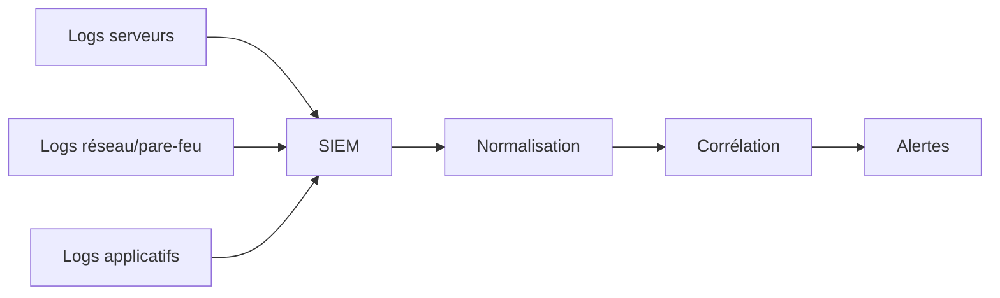
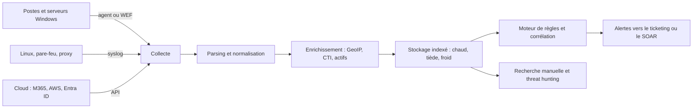

## Introduction

Le SIEM (Security Information and Event Management) est l'outil central du quotidien d'un analyste SOC — il collecte, normalise et corrèle les logs de l'ensemble du système d'information pour générer les alertes triées au chapitre précédent.

Sans SIEM, un analyste devrait se connecter à chaque serveur, chaque pare-feu et chaque console cloud pour lire les journaux un par un. Avec un SIEM, il interroge en quelques secondes des milliards d'événements, il voit sur une même chronologie la connexion VPN, l'ouverture de session Windows et la requête DNS suspecte, et surtout il laisse des règles surveiller en permanence les combinaisons d'événements qu'aucun humain ne pourrait repérer à l'œil nu.

À la fin de ce chapitre, tu sauras décrire l'architecture d'un SIEM, choisir les sources de logs utiles, expliquer le principe de la corrélation, écrire une règle de détection de force brute dans plusieurs langages, et anticiper la façon dont un attaquant tentera de la contourner.

## Le rôle d'un SIEM



<CehCallout>
Un SIEM ne se contente pas de stocker des logs — sa valeur principale vient de la corrélation : relier des événements provenant de sources différentes (un pare-feu, un serveur, un contrôleur de domaine) qui, pris isolément, sembleraient anodins, mais qui ensemble révèlent une attaque en cours.
</CehCallout>

Prends un exemple. Un échec de connexion sur un compte est banal : les utilisateurs se trompent de mot de passe tous les jours. Une connexion réussie est encore plus banale. Une connexion VPN depuis l'étranger peut s'expliquer par un déplacement. Mais cinq échecs, puis un succès, sur le même compte, depuis une adresse jamais vue, suivis dix minutes plus tard de la création d'une tâche planifiée sur un serveur : chaque événement isolé est anodin, leur enchaînement raconte une intrusion. C'est cela, la corrélation.

## L'architecture d'un SIEM

Un SIEM se décompose en plusieurs étages, chacun avec ses propres pièges.



### La collecte

Les journaux arrivent par trois grands canaux. Les **agents** installés sur les machines, comme Elastic Agent, le Splunk Universal Forwarder ou l'agent Azure Monitor pour Microsoft Sentinel, lisent les journaux locaux et les expédient. Le protocole **syslog**, historique sous Unix, transporte les journaux des équipements réseau et des systèmes Linux, de préférence sur TCP avec chiffrement TLS plutôt que sur UDP en clair. Enfin, les services **cloud** se collectent par API : journal d'audit unifié de Microsoft 365, journaux de connexion Microsoft Entra ID, AWS CloudTrail. Sous Windows, le mécanisme natif Windows Event Forwarding permet aussi de centraliser les journaux sans agent tiers.

### La normalisation

Chaque source a son propre format. Un pare-feu appelle l'adresse source `src`, un autre `SourceIP`, Windows `IpAddress`. La normalisation convertit tout vers un **schéma commun**, pour qu'une seule requête interroge toutes les sources. Les schémas les plus répandus sont l'Elastic Common Schema (ECS), le Common Information Model de Splunk (CIM), et OCSF (Open Cybersecurity Schema Framework), un standard ouvert soutenu par de nombreux éditeurs et adopté notamment par Amazon Security Lake. Un événement mal parsé est un événement invisible pour les règles : c'est l'une des causes les plus fréquentes de faux négatifs.

### Le stockage et la rétention

Les données récentes sont gardées sur un stockage rapide (dit chaud) pour les recherches courantes, puis déplacées vers des niveaux moins coûteux. La durée de rétention dépend des besoins d'investigation et des obligations. Par exemple, PCI DSS 4.0.1 exige à l'exigence 10.5.1 de conserver l'historique des journaux d'audit au moins douze mois, dont les trois derniers immédiatement disponibles pour l'analyse. Une compromission découverte après six mois ne peut être reconstituée que si les journaux existent encore.

<AuditCallout>
L'ISO/IEC 27001:2022 encadre ce sujet dans l'Annexe A : le contrôle A.8.15 (journalisation) demande de produire, conserver, protéger et analyser les journaux d'activités et d'événements ; A.8.16 (activités de surveillance) demande de surveiller les réseaux, systèmes et applications pour détecter les comportements anormaux ; A.8.17 (synchronisation des horloges) impose des sources de temps cohérentes, condition indispensable à toute corrélation.
</AuditCallout>

### Les principales solutions du marché

Les SIEM courants en 2026 incluent Splunk Enterprise Security, Microsoft Sentinel, Elastic Security, Google Security Operations et IBM QRadar, ainsi que Wazuh, une solution open source très utilisée pour apprendre et dans les petites structures. Chaque solution a son langage de requête : SPL pour Splunk, KQL (Kusto Query Language) pour Sentinel et Microsoft Defender XDR, KQL, EQL ou ES|QL pour Elastic. Les concepts restent les mêmes : filtrer, agréger, comparer à un seuil.

## Les sources de logs prioritaires

Tout collecter coûte cher, car la plupart des SIEM sont facturés au volume ingéré. Il faut donc prioriser les sources à plus forte valeur de détection.

| Source | Événements utiles | Ce qu'on détecte |
| --- | --- | --- |
| Contrôleurs de domaine | 4624, 4625, 4768, 4769, 4720, 4728, 4732 | Force brute, Kerberoasting, création de comptes, ajout à des groupes privilégiés |
| Postes et serveurs Windows | 4688 avec ligne de commande, 4698, 7045, 1102 | Exécution de processus, tâches planifiées, nouveaux services, effacement de journaux |
| Sysmon | ID 1, 3, 10, 11, 22 | Création de processus avec hash, connexions réseau, accès à LSASS, fichiers créés, requêtes DNS |
| EDR | Télémétrie et alertes comportementales | Exécution malveillante, injection, chiffrement massif |
| Identité cloud | Connexions Entra ID, consentements OAuth | Vol de session, connexions impossibles, applications malveillantes |
| Proxy web et DNS | URL, domaines, catégories | Commande et contrôle, téléchargement de charges, exfiltration |
| VPN et pare-feu | Connexions entrantes et sortantes | Accès distants anormaux, flux interdits |

Pour rappel, l'Event ID 4624 correspond à une ouverture de session réussie, 4625 à un échec, 4688 à la création d'un processus (la ligne de commande n'y figure que si la stratégie d'audit correspondante est activée), 4698 à la création d'une tâche planifiée, 7045 à l'installation d'un service et 1102 à l'effacement du journal de sécurité. Sysmon, l'outil gratuit de la suite Sysinternals de Microsoft, enrichit considérablement la télémétrie Windows.

## Le principe de la corrélation

<Steps steps={[
  { title: "Normaliser les formats de logs", description: "Des logs provenant de sources différentes (formats variés) sont convertis vers un schéma commun exploitable uniformément." },
  { title: "Définir une fenêtre temporelle", description: "La corrélation cherche des relations entre événements survenus dans un intervalle de temps limité, pas sur l'ensemble de l'historique." },
  { title: "Appliquer une règle de corrélation", description: "Ex : « une connexion échouée suivie de 4 autres échecs puis d'un succès, sur le même compte, en moins de 5 minutes » — signature typique d'une attaque par force brute réussie." },
]} />

La normalisation vient en premier, car on ne peut pas relier deux événements dont les champs ne portent pas le même nom. La fenêtre temporelle vient ensuite : chercher des relations sur tout l'historique serait à la fois coûteux et absurde, car cinq échecs répartis sur un an ne signifient rien. On distingue les **fenêtres fixes**, découpées en tranches régulières (de 10 h 00 à 10 h 05, puis de 10 h 05 à 10 h 10), et les **fenêtres glissantes**, qui regardent toujours les cinq dernières minutes à partir de chaque événement. Les fenêtres fixes sont plus simples mais ratent une séquence à cheval sur deux tranches.

On distingue aussi plusieurs familles de règles de corrélation : le **comptage** d'événements (au moins N échecs), le **comptage de valeurs distinctes** (une même adresse qui tente 30 comptes différents, signature de la pulvérisation de mots de passe, ou password spraying), et la **séquence temporelle** (un événement A suivi d'un événement B dans un délai donné).

<TipCallout>
Rappel du cours Active Directory & Windows (chapitre 3, sur les Event ID 4624/4625) : la corrélation d'un Event ID 4625 (échec de connexion) répété puis suivi d'un 4624 (succès), sur le même compte, en peu de temps, est une des règles de détection les plus classiques et les plus utiles d'un SIEM.
</TipCallout>

## Écrire une règle de détection simple

Commençons par la logique, indépendamment de tout outil.

```text
Exemple de règle de détection (pseudo-code SIEM) :

RÈGLE : Bruteforce réussi
CONDITION :
  Event ID = 4625 (échec de connexion)
  COMPTE identique
  RÉPÉTÉ >= 5 fois
  DANS une fenêtre de 5 minutes
  SUIVI DE Event ID = 4624 (succès) sur le même compte
ACTION : Générer une alerte de criticité ÉLEVÉE
```

### La même règle en KQL pour Microsoft Sentinel

```kql
// Échecs puis succès sur le même compte, par tranche de 5 minutes
SecurityEvent
| where TimeGenerated > ago(1h)
| where EventID in (4625, 4624)
| summarize Echecs = countif(EventID == 4625),
            Succes = countif(EventID == 4624),
            DernierEchec = maxif(TimeGenerated, EventID == 4625),
            PremierSucces = minif(TimeGenerated, EventID == 4624)
            by TargetAccount, IpAddress, bin(TimeGenerated, 5m)
| where Echecs >= 5 and Succes >= 1 and PremierSucces > DernierEchec
```

L'opérateur `summarize` agrège les événements par compte, par adresse et par tranche de cinq minutes produite par `bin`. Les fonctions `countif`, `maxif` et `minif` comptent ou datent seulement les événements qui vérifient la condition. La dernière ligne vérifie l'ordre : le succès doit survenir après le dernier échec.

### La même logique en SPL pour Splunk

```spl
index=wineventlog (EventCode=4625 OR EventCode=4624)
| bin _time span=5m
| stats count(eval(EventCode=4625)) AS echecs
        count(eval(EventCode=4624)) AS succes
        by _time, user, src
| where echecs>=5 AND succes>=1
```

Cette version SPL simplifiée ne vérifie pas l'ordre des événements ; en production, on la compléterait avec la commande `streamstats` ou une recherche de transaction. Ce genre de détail sépare une règle de démonstration d'une règle fiable.

### Le format Sigma : écrire une fois, traduire partout

Sigma est un format ouvert, écrit en YAML, pour décrire des règles de détection indépendamment du SIEM. Un outil comme `sigma-cli`, basé sur la bibliothèque pySigma, traduit ensuite la règle en SPL, KQL ou requête Elastic. Le dépôt public SigmaHQ en contient plusieurs milliers. Voici une règle Sigma simple qui détecte la création d'une tâche planifiée.

```yaml
title: Création d'une tâche planifiée
id: 6f1c2f5e-3a9b-4c1e-9d2a-7b8e0c4d1a23
status: experimental
description: Détecte la création d'une tâche planifiée (événement 4698)
logsource:
  product: windows
  service: security
detection:
  selection:
    EventID: 4698
  condition: selection
falsepositives:
  - Déploiements logiciels et outils d'administration légitimes
level: medium
tags:
  - attack.persistence
  - attack.t1053.005
```

```bash
# Installation et conversion vers Splunk (backend fourni par un plugin pySigma)
pipx install sigma-cli
sigma plugin install splunk
sigma convert -t splunk -p splunk_windows regle_tache.yml
```

Depuis 2024, la spécification Sigma inclut aussi des règles de corrélation (comptage d'événements, comptage de valeurs distinctes, séquence temporelle), qui permettent d'exprimer la règle de force brute de façon portable. Écrire ses règles en Sigma et les versionner dans Git est la base de la pratique appelée detection as code : chaque règle est revue, testée et déployée comme du logiciel.

<WarningCallout>
Une règle de détection trop rigide (seuil exact, fenêtre temporelle fixe) peut être facilement contournée par un attaquant qui espace légèrement ses tentatives — un principe similaire au scan discret vu au TP Nmap (cours Réseaux) — d'où l'intérêt de règles combinant plusieurs signaux plutôt qu'un seuil unique isolé.
</WarningCallout>

## L'angle offensif : comment contourner un SIEM

Un attaquant patient qui connaît la règle des cinq échecs en cinq minutes fera quatre tentatives toutes les six minutes. Un autre répartira ses tentatives sur trente comptes avec un seul mot de passe, pour ne jamais dépasser le seuil par compte. D'autres s'attaquent au SIEM lui-même : effacer les journaux (événement 1102), arrêter l'agent de collecte, ou agir sur des machines qui ne remontent aucun journal.

<AttackDefenseTable rows={[
  { phase: "Force brute lente", attack: "Espacer les tentatives pour rester sous le seuil", defense: "Règles complémentaires sur des fenêtres longues (24 h), score de risque cumulé par compte" },
  { phase: "Password spraying", attack: "Un mot de passe testé sur de nombreux comptes", defense: "Règle de comptage de comptes distincts par adresse source" },
  { phase: "Neutralisation des défenses", attack: "Effacer le journal de sécurité ou arrêter l'agent (T1685.005 et T1685 dans ATT&CK 2026, anciennement T1070.001 et T1562.001)", defense: "Alerte sur l'événement 1102 et sur l'arrêt de remontée d'une source (heartbeat)" },
  { phase: "Angle mort", attack: "Agir depuis un serveur non journalisé", defense: "Inventaire des sources, suivi de la couverture de collecte" },
]} />

La surveillance de l'absence de logs est aussi importante que celle des logs eux-mêmes : une source qui se tait brusquement doit générer une alerte.

## Corrélation et machine learning — un complément, pas un remplacement

<CehCallout>
Rappel du cours Data Science Complète (chapitre 6) : les règles de corrélation classiques détectent efficacement des motifs déjà connus et bien définis (comme le bruteforce ci-dessus), tandis que la détection d'anomalies par machine learning (ou par autoencodeur, cours IA & Agents en Cybersécurité, chapitre 2) complète ce dispositif en repérant des écarts inédits qu'aucune règle explicite n'a anticipés.
</CehCallout>

Les plateformes modernes intègrent des modules d'analyse comportementale des utilisateurs et des entités, appelés UEBA (User and Entity Behavior Analytics). Ils apprennent le comportement habituel de chaque compte et signalent les écarts, comme un accès inhabituel à un partage de fichiers. Ces modules produisent souvent plus de bruit que les règles, et leurs alertes sont plus difficiles à expliquer : elles servent de signal supplémentaire, pas de verdict.

## Erreurs fréquentes avec un SIEM

La première erreur est de **tout collecter sans stratégie**, ce qui fait exploser les coûts sans améliorer la détection. La deuxième est de **ne pas vérifier le parsing** : un champ vide ou mal nommé rend une règle muette. La troisième est d'**ignorer la synchronisation des horloges et les fuseaux horaires**, ce qui fausse toutes les séquences ; la bonne pratique est de tout stocker en UTC. La quatrième est de **déployer une règle sans la tester** contre des données réelles, ni bénignes ni malveillantes. La cinquième est de **ne pas surveiller la santé de la collecte**, et de découvrir pendant un incident que la source critique ne remontait plus depuis trois semaines.

## Lab — Mise en pratique

**Environnement** : terminal Kali avec Python 3.12+. On simule un journal normalisé au format JSON et on implémente soi-même la corrélation.

<Steps steps={[
  { title: "Générer un journal d'authentification", description: "Crée un fichier JSON Lines contenant des échecs puis un succès sur le compte alice, et du bruit normal sur bob. Chaque ligne suit un schéma commun : horodatage, Event ID, compte, adresse source.", code: "cat > auth.jsonl << 'EOF'\n{\"ts\": \"2026-11-09T10:00:05\", \"event_id\": 4625, \"user\": \"alice\", \"src\": \"203.0.113.50\"}\n{\"ts\": \"2026-11-09T10:00:40\", \"event_id\": 4625, \"user\": \"alice\", \"src\": \"203.0.113.50\"}\n{\"ts\": \"2026-11-09T10:01:10\", \"event_id\": 4625, \"user\": \"alice\", \"src\": \"203.0.113.50\"}\n{\"ts\": \"2026-11-09T10:01:50\", \"event_id\": 4625, \"user\": \"alice\", \"src\": \"203.0.113.50\"}\n{\"ts\": \"2026-11-09T10:02:30\", \"event_id\": 4625, \"user\": \"alice\", \"src\": \"203.0.113.50\"}\n{\"ts\": \"2026-11-09T10:03:00\", \"event_id\": 4624, \"user\": \"alice\", \"src\": \"203.0.113.50\"}\n{\"ts\": \"2026-11-09T10:04:00\", \"event_id\": 4625, \"user\": \"bob\", \"src\": \"10.0.0.12\"}\n{\"ts\": \"2026-11-09T10:04:20\", \"event_id\": 4624, \"user\": \"bob\", \"src\": \"10.0.0.12\"}\nEOF" },
  { title: "Écrire la règle de corrélation", description: "Écris un script Python qui, pour chaque succès 4624, compte les échecs 4625 du même compte dans les cinq minutes précédentes. Observe que seul alice déclenche l'alerte.", code: "cat > correl.py << 'EOF'\nimport json, sys\nfrom datetime import datetime, timedelta\nevts = [json.loads(l) for l in open(sys.argv[1])]\nfor e in evts:\n    e['ts'] = datetime.fromisoformat(e['ts'])\nfenetre = timedelta(minutes=5)\nfor s in (e for e in evts if e['event_id'] == 4624):\n    echecs = [e for e in evts if e['event_id'] == 4625 and e['user'] == s['user'] and s['ts'] - fenetre <= e['ts'] < s['ts']]\n    if len(echecs) >= 5:\n        print(f\"ALERTE ÉLEVÉE bruteforce réussi : {s['user']} depuis {s['src']} ({len(echecs)} échecs)\")\nEOF\npython3 correl.py auth.jsonl" },
  { title: "Simuler un attaquant patient", description: "Génère un journal où les tentatives sont espacées de deux minutes. Relance la règle et observe qu'elle ne déclenche plus : c'est la limite d'un seuil fixe.", code: "python3 - << 'EOF'\nimport json\nfrom datetime import datetime, timedelta\nt = datetime(2026, 11, 9, 11, 0)\nwith open('lent.jsonl', 'w') as f:\n    for i in range(6):\n        f.write(json.dumps({'ts': (t + timedelta(minutes=2*i)).isoformat(), 'event_id': 4625, 'user': 'carol', 'src': '198.51.100.7'}) + '\\n')\n    f.write(json.dumps({'ts': (t + timedelta(minutes=13)).isoformat(), 'event_id': 4624, 'user': 'carol', 'src': '198.51.100.7'}) + '\\n')\nEOF\npython3 correl.py lent.jsonl; echo \"code retour : $?\"" },
  { title: "Ajouter une règle complémentaire", description: "Modifie le script pour ajouter une seconde condition : au moins cinq échecs sur 60 minutes suivis d'un succès depuis la même adresse. Vérifie que carol est maintenant détectée, avec une criticité moindre." },
  { title: "Écrire une règle de corrélation métier", description: "Rédige une règle de détection (à la manière de l'exemple du chapitre) pour repérer un compte de service qui se connecte soudainement depuis une machine inhabituelle, suivi d'une création de tâche planifiée (4698). Précise la fenêtre temporelle et la source de référence des machines habituelles." },
  { title: "Identifier une limite d'une règle rigide", description: "Pourquoi une règle de détection basée sur un seuil exact et une fenêtre temporelle fixe peut-elle être contournée par un attaquant patient ? Propose aussi une règle de comptage de valeurs distinctes contre le password spraying." },
]} />

## À retenir

- Un SIEM collecte, normalise et corrèle des logs de sources multiples pour générer des alertes, sa valeur principale résidant dans la corrélation.
- La normalisation vers un schéma commun (ECS, CIM, OCSF) est la première étape de la corrélation ; un événement mal parsé est invisible.
- Les sources prioritaires sont les contrôleurs de domaine, la télémétrie des postes (4688, Sysmon, EDR), l'identité cloud, le proxy et le DNS.
- Une règle de détection combine généralement plusieurs conditions (type d'événement, compte, fenêtre temporelle, séquence) pour capturer un motif d'attaque connu.
- Le format Sigma permet d'écrire une règle une seule fois et de la traduire vers SPL, KQL ou Elastic, dans une logique de detection as code.
- Un seuil fixe se contourne en espaçant les tentatives : il faut combiner plusieurs signaux et surveiller aussi l'absence de logs.
- Les règles de corrélation classiques et la détection d'anomalies par machine learning se complètent, l'une couvrant les motifs connus, l'autre les écarts inédits.

## Questions de révision

1. Quelle est la valeur principale d'un SIEM, au-delà du simple stockage de logs ?
2. Pourquoi la normalisation doit-elle précéder la corrélation ?
3. Donne un exemple de règle de corrélation détectant un bruteforce réussi, en précisant les Event ID utilisés.
4. Quelle différence fais-tu entre une fenêtre temporelle fixe et une fenêtre glissante ?
5. Quel intérêt présente le format Sigma pour une équipe qui change de SIEM ?
6. Comment un attaquant peut-il échapper à une règle de force brute, et quelle règle complémentaire proposerais-tu ?
7. Pourquoi les règles de corrélation classiques et la détection par machine learning sont-elles complémentaires plutôt que substituables ?
