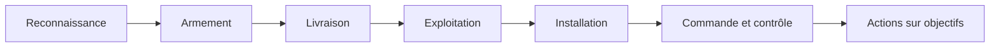
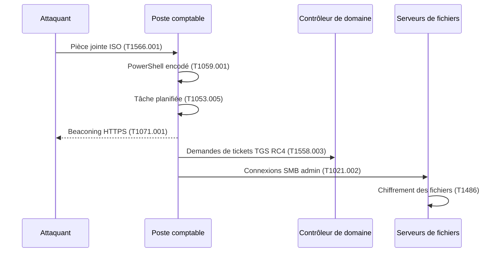

## Introduction

Une alerte isolée ne raconte souvent qu'une petite partie d'une histoire plus large. Ce chapitre présente deux cadres de référence qui aident un analyste SOC à situer une alerte dans le déroulement complet d'une attaque : la Cyber Kill Chain et MITRE ATT&CK.

Pourquoi ces modèles sont-ils indispensables au quotidien ? D'abord parce qu'ils permettent de **prioriser** : une alerte qui révèle un attaquant déjà installé et communiquant avec son serveur est bien plus grave qu'un simple balayage de ports. Ensuite parce qu'ils permettent de **poser les bonnes questions** : si j'observe une exécution malveillante, comment l'attaquant est-il entré, et qu'a-t-il fait ensuite ? Enfin parce qu'ils offrent un **langage commun** entre analystes, ingénieurs détection, équipes offensives et éditeurs : dire « T1558.003 » est plus précis que dire « une attaque Kerberos ».

À la fin de ce chapitre, tu sauras réciter et expliquer les phases de la Kill Chain, naviguer dans la matrice ATT&CK, rattacher une observation à une tactique et une technique avec son identifiant, et utiliser ATT&CK pour mesurer et améliorer la couverture de détection d'un SOC.

## La Cyber Kill Chain

<CehCallout>
La Cyber Kill Chain, développée par Lockheed Martin, modélise une attaque comme une séquence de sept phases — son intérêt principal pour un analyste SOC est de situer une alerte donnée dans cette chronologie : une alerte de « commande et contrôle » (phase 6) est généralement bien plus critique qu'une alerte de « reconnaissance » (phase 1), même si les deux méritent attention.
</CehCallout>

Ce modèle a été publié en 2011 par des chercheurs de Lockheed Martin, en transposant au cyberespace un concept militaire : une attaque est une chaîne, et casser n'importe quel maillon interrompt l'ensemble.

### Les sept phases en détail

La **reconnaissance** est la collecte d'informations sur la cible : noms et adresses électroniques des employés sur les réseaux professionnels, sous-domaines exposés, technologies utilisées, adresses IP. Elle peut être passive, sans contact avec la cible, ou active, comme un balayage de ports.

L'**armement** consiste à préparer la charge offensive : un document Office piégé, un exécutable malveillant, une page d'hameçonnage. Cette phase se déroule chez l'attaquant ; le SOC ne la voit pas directement, mais le renseignement sur la menace peut la révéler.

La **livraison** est le moment où la charge atteint la cible : courriel d'hameçonnage, lien malveillant, clé USB, exploitation d'un service exposé sur Internet.

L'**exploitation** est le déclenchement du code malveillant : l'utilisateur active les macros, une vulnérabilité du navigateur ou d'un VPN est exploitée.

L'**installation** correspond à l'établissement d'une présence durable, appelée persistance : clé de registre de démarrage, tâche planifiée, service, porte dérobée sur un serveur web.

La **commande et contrôle**, souvent abrégée C2, est le canal par lequel la machine compromise reçoit des ordres. Elle se manifeste souvent par du beaconing : des connexions sortantes régulières vers un serveur externe.

Les **actions sur objectifs** sont ce que l'attaquant est venu faire : voler des données, chiffrer le système d'information, saboter, ou s'en servir comme rebond vers d'autres cibles.

<TipCallout>
Le principe défensif clé de la Kill Chain : plus une attaque est stoppée tôt dans la chaîne (idéalement dès la reconnaissance ou la livraison), moins l'impact final est important — un analyste qui repère et bloque une tentative de livraison de malware évite d'avoir à gérer les phases bien plus coûteuses d'installation et d'exfiltration.
</TipCallout>

### Les limites de la Kill Chain

Le modèle a été pensé pour des intrusions par logiciel malveillant venues de l'extérieur. Il décrit mal les menaces internes, les attaques sur des services cloud sans aucun malware, ou les intrusions où l'attaquant entre avec des identifiants volés et utilise uniquement des outils légitimes. Il est aussi très linéaire, alors qu'une vraie intrusion boucle : après une première compromission, l'attaquant refait de la reconnaissance en interne, se déplace, élève ses privilèges et recommence. Pour combler ces limites, Paul Pols a proposé en 2017 la **Unified Kill Chain**, qui combine la Kill Chain et ATT&CK en dix-huit phases regroupées en trois cycles. Mais c'est surtout ATT&CK qui s'est imposé dans les SOC.

## MITRE ATT&CK — un niveau de détail supérieur

MITRE ATT&CK (Adversarial Tactics, Techniques, and Common Knowledge) est une base de connaissances publique et gratuite, maintenue par l'organisation à but non lucratif MITRE depuis 2013. Elle décrit les comportements réels des attaquants, tels qu'observés dans des incidents documentés. Elle est mise à jour environ deux fois par an et consultable sur attack.mitre.org.

<CompareTable
  titleA="Cyber Kill Chain"
  titleB="MITRE ATT&CK"
  rows={[
    { a: "7 phases générales et linéaires", b: "14 tactiques (15 depuis la mise à jour de 2026), chacune avec de nombreuses techniques précises documentées" },
    { a: "Vue d'ensemble simple, facile à communiquer", b: "Niveau de détail opérationnel exploitable pour la détection concrète" },
    { a: "Modèle plutôt séquentiel", b: "Les tactiques peuvent se combiner et se répéter dans un ordre variable" },
]}
/>

### La structure de la matrice

ATT&CK est organisé en plusieurs niveaux. Une **tactique** est l'objectif de l'attaquant à un instant donné, le « pourquoi ». Une **technique** est le moyen d'atteindre cet objectif, le « comment ». Une **sous-technique** précise une variante. Une **procédure** est la mise en œuvre concrète observée chez un groupe donné. Chaque élément a un identifiant stable : TA pour les tactiques, T suivi de quatre chiffres pour les techniques, et un suffixe à trois chiffres pour les sous-techniques. Ainsi, T1558 désigne le vol ou la falsification de tickets Kerberos, et T1558.003 sa sous-technique Kerberoasting.

La base contient aussi des fiches sur les **groupes** d'attaquants (par exemple APT29, identifiant G0016), les **logiciels** malveillants et outils, les **campagnes**, les **mitigations** (identifiants M) et des éléments sur les sources de données et la détection de chaque technique. Il existe trois matrices : Enterprise (Windows, Linux, macOS, cloud, réseau, conteneurs), Mobile et ICS pour les systèmes industriels. Le SOC utilise surtout Enterprise.

### Les tactiques Enterprise : de quatorze à quinze

| ID | Tactique | Objectif de l'attaquant | Exemple de technique |
| --- | --- | --- | --- |
| TA0043 | Reconnaissance | Recueillir des informations sur la cible | T1595 Active Scanning |
| TA0042 | Resource Development | Préparer son infrastructure et ses outils | T1583 Acquire Infrastructure |
| TA0001 | Initial Access | Entrer dans le réseau | T1566 Phishing |
| TA0002 | Execution | Exécuter du code | T1059.001 PowerShell |
| TA0003 | Persistence | Se maintenir malgré les redémarrages | T1053.005 Scheduled Task |
| TA0004 | Privilege Escalation | Obtenir des droits plus élevés | T1068 Exploitation for Privilege Escalation |
| TA0005 | Stealth (anciennement Defense Evasion) | Se dissimuler en imitant une activité normale | T1070 Indicator Removal |
| TA0112 | Defense Impairment | Neutraliser ou tromper les outils de défense | T1685.005 Clear Windows Event Logs |
| TA0006 | Credential Access | Voler des identifiants | T1558.003 Kerberoasting, T1003.001 LSASS Memory |
| TA0007 | Discovery | Explorer l'environnement | T1087 Account Discovery |
| TA0008 | Lateral Movement | Se déplacer vers d'autres machines | T1021.002 SMB/Windows Admin Shares |
| TA0009 | Collection | Rassembler les données visées | T1560 Archive Collected Data |
| TA0011 | Command and Control | Communiquer avec les machines compromises | T1071.001 Web Protocols |
| TA0010 | Exfiltration | Sortir les données | T1567 Exfiltration Over Web Service |
| TA0040 | Impact | Détruire, chiffrer, perturber | T1486 Data Encrypted for Impact |

Les deux premières tactiques, Reconnaissance et Resource Development, ont été intégrées à la matrice Enterprise en 2020 ; elles décrivent des activités souvent invisibles pour le SOC, mais utiles au renseignement. De 2020 à 2025, la matrice Enterprise a ainsi compté **14 tactiques**, chiffre que tu retrouveras dans la plupart des supports de formation et d'examen. La mise à jour publiée au printemps 2026 a scindé l'ancienne tactique Defense Evasion en deux : **Stealth** (TA0005, l'identifiant est conservé), pour les techniques qui se fondent dans l'activité normale sans toucher aux défenses, et **Defense Impairment** (TA0112), pour celles qui désactivent, modifient ou trompent les outils de sécurité et de journalisation. La matrice compte donc désormais 15 tactiques, et plusieurs techniques ont changé d'identifiant : l'effacement des journaux Windows, longtemps T1070.001, est devenu T1685.005. Le référentiel évolue à chaque version : vérifie toujours les identifiants sur le site officiel avant de les citer dans un rapport.

<CehCallout>
Rappel du cours Active Directory & Windows (chapitre 3, Kerberoasting) : cette technique précise est documentée dans MITRE ATT&CK sous la tactique « Credential Access » — chaque technique offensive étudiée dans les cours plus opérationnels (Active Directory, Cyber Offensive) trouve sa correspondance exacte dans ce référentiel, un langage commun entre attaquants, défenseurs et chercheurs.
</CehCallout>

## Situer une alerte dans une chronologie d'attaque

Voici la reconstitution simplifiée d'une intrusion typique par rançongiciel, telle qu'un SOC pourrait la reconstruire après coup. Chaque étape est rattachée aux deux modèles.

| Heure | Observation dans les logs | Phase Kill Chain | Tactique et technique ATT&CK |
| --- | --- | --- | --- |
| J-1 18:02 | Courriel avec pièce jointe ISO reçu par la comptabilité | Livraison | Initial Access, T1566.001 Spearphishing Attachment |
| J-1 18:10 | Exécution d'un raccourci LNK lançant PowerShell encodé | Exploitation | Execution, T1059.001 PowerShell |
| J-1 18:11 | Création d'une tâche planifiée nommée comme une mise à jour | Installation | Persistence, T1053.005 Scheduled Task |
| J-1 18:15 | Connexions HTTPS toutes les 60 secondes vers un domaine récent | Commande et contrôle | Command and Control, T1071.001 Web Protocols |
| J 02:30 | Requêtes de tickets de service Kerberos chiffrés en RC4 | Actions sur objectifs (préparation) | Credential Access, T1558.003 Kerberoasting |
| J 03:10 | Connexions SMB administratives vers vingt serveurs | Actions sur objectifs | Lateral Movement, T1021.002 |
| J 04:00 | Chiffrement massif de fichiers sur les partages | Actions sur objectifs | Impact, T1486 Data Encrypted for Impact |

Ce tableau montre l'intérêt combiné des deux modèles. La Kill Chain dit où en est l'attaquant : à 18 h 15, il est déjà en phase de commande et contrôle, donc l'urgence est maximale. ATT&CK dit précisément ce qu'il fait et quelles autres techniques chercher : si l'on voit du Kerberoasting, on doit vérifier les connexions avec les comptes de service dont les mots de passe ont pu être cassés. On remarque aussi que toutes les phases après l'installation se retrouvent tassées dans « actions sur objectifs », alors qu'ATT&CK les distingue finement : c'est la limite de la Kill Chain décrite plus haut.

Chaque flèche du diagramme est une occasion de détection. Un SOC qui détecte l'exécution PowerShell à 18 h 10 casse la chaîne avant le chiffrement de la nuit.

## Utiliser ATT&CK pour prioriser la détection

<Steps steps={[
  { title: "Identifier les techniques les plus probables pour son secteur", description: "Toutes les organisations ne font pas face aux mêmes groupes de menace ni aux mêmes techniques privilégiées." },
  { title: "Cartographier ses règles de détection existantes sur ATT&CK", description: "Identifier quelles tactiques/techniques sont déjà couvertes, et lesquelles présentent un angle mort." },
  { title: "Prioriser le développement de nouvelles règles", description: "Combler en priorité les angles morts sur les techniques les plus probables et les plus critiques pour l'organisation." },
]} />

Pour la première étape, on s'appuie sur les fiches des groupes qui ciblent son secteur, sur les rapports des CERT nationaux, et sur des travaux de synthèse comme le projet Top ATT&CK Techniques du Center for Threat-Informed Defense de MITRE. Pour la deuxième, l'outil de référence est **ATT&CK Navigator**, une application web gratuite qui affiche la matrice et permet de colorer chaque technique selon un score : par exemple vert pour une détection testée, orange pour une détection partielle, rouge pour aucune détection. Ces calques, appelés layers, s'exportent en JSON et se superposent : un calque « techniques utilisées par les groupes qui nous ciblent » superposé à un calque « techniques couvertes » fait apparaître immédiatement les angles morts prioritaires.

Une règle n'est vraiment comptée comme couvrant une technique que si elle a été **testée**. Des projets libres comme Atomic Red Team, de Red Canary, proposent pour chaque technique ATT&CK de petits tests reproductibles à exécuter dans un environnement de lab pour vérifier que l'alerte se déclenche. MITRE publie aussi D3FEND, une base de connaissances des contre-mesures défensives reliée à ATT&CK.

<WarningCallout>
Une erreur fréquente consiste à ne cartographier qu'après un incident, pour comprendre ce qui n'a pas été détecté — une cartographie proactive AVANT l'incident, révisée régulièrement, permet d'identifier les angles morts avant qu'ils ne soient exploités.
</WarningCallout>

## L'angle offensif et défensif

Les équipes offensives utilisent ATT&CK pour construire des scénarios d'émulation réalistes, en reproduisant les techniques d'un groupe donné lors d'un exercice red team ou purple team autorisé. Le SOC utilise les mêmes identifiants pour vérifier sa détection. C'est ce partage de vocabulaire qui rend possibles les exercices purple team.

<AttackDefenseTable rows={[
  { phase: "Initial Access (TA0001)", attack: "Hameçonnage avec pièce jointe ISO ou lien vers une page de vol d'identifiants", defense: "Filtrage de messagerie, blocage des montages ISO non nécessaires, alerte sur un processus enfant inhabituel de l'outil de messagerie" },
  { phase: "Credential Access (TA0006)", attack: "Kerberoasting pour casser hors ligne le mot de passe d'un compte de service", defense: "Alerte sur l'événement 4769 avec chiffrement RC4, mots de passe longs ou comptes de service gérés (gMSA)" },
  { phase: "Command and Control (TA0011)", attack: "Beaconing HTTPS régulier vers un domaine récemment enregistré", defense: "Analyse de la régularité des connexions, réputation et âge des domaines, inspection du proxy" },
  { phase: "Impact (TA0040)", attack: "Chiffrement massif des partages réseau", defense: "Détection comportementale EDR, isolement automatique, sauvegardes hors ligne" },
]} />

## Erreurs fréquentes avec ces modèles

La première erreur est de **viser une couverture de 100 % de la matrice** : certaines techniques sont impossibles à détecter de façon fiable, et toutes n'ont pas la même probabilité pour ton organisation. La deuxième est de **compter une technique comme couverte dès qu'une règle porte son étiquette**, sans l'avoir testée ni vérifié qu'elle couvre les principales variantes. La troisième est de **forcer chaque alerte dans une seule case** : une même action peut relever de plusieurs tactiques, comme une tâche planifiée qui sert à la fois la persistance et l'élévation de privilèges. La quatrième est de **citer des identifiants de mémoire** sans vérifier, alors que des techniques sont parfois renommées, fusionnées ou dépréciées entre deux versions. La cinquième, enfin, est de **cartographier une fois pour toutes** : la menace et le référentiel évoluent.

## Lab — Mise en pratique

**Environnement** : terminal Kali avec `curl`, `jq` et un navigateur. On interroge directement les données officielles d'ATT&CK, publiées au format STIX 2.1 dans le dépôt GitHub mitre/cti.

<Steps steps={[
  { title: "Télécharger les données ATT&CK Enterprise", description: "Récupère le fichier JSON officiel de la matrice Enterprise. Il pèse plusieurs dizaines de mégaoctets : c'est la même source que celle utilisée par le site et par Navigator.", code: "curl -sL -o enterprise-attack.json https://raw.githubusercontent.com/mitre/cti/master/enterprise-attack/enterprise-attack.json\nls -lh enterprise-attack.json" },
  { title: "Lister les tactiques", description: "Extrais les tactiques et leur identifiant. Compte-les et compare avec le tableau comparatif du chapitre : repère Stealth et Defense Impairment, issues de la scission de 2026.", code: "jq -r '.objects[] | select(.type==\"x-mitre-tactic\") | [(.external_references[] | select(.source_name==\"mitre-attack\") | .external_id), .name] | @tsv' enterprise-attack.json | sort" },
  { title: "Retrouver le Kerberoasting", description: "Cherche la technique Kerberoasting, son identifiant et la tactique à laquelle elle est rattachée. Observe le champ kill_chain_phases, qui fait le lien avec les tactiques. Le filtre sur revoked écarte l'ancien identifiant T1208, remplacé depuis longtemps par T1558.003.", code: "jq -r '.objects[] | select(.type==\"attack-pattern\" and .name==\"Kerberoasting\" and (.revoked|not)) | [(.external_references[0].external_id), .name, (.kill_chain_phases | map(.phase_name) | join(\",\"))] | @tsv' enterprise-attack.json" },
  { title: "Compter les techniques par tactique", description: "Compte les techniques et sous-techniques actives (non révoquées et non dépréciées) pour chaque tactique. Observe les tactiques les plus fournies.", code: "jq -r '.objects[] | select(.type==\"attack-pattern\" and (.revoked|not) and (.x_mitre_deprecated|not)) | .kill_chain_phases[]? | select(.kill_chain_name==\"mitre-attack\") | .phase_name' enterprise-attack.json | sort | uniq -c | sort -rn" },
  { title: "Situer une alerte dans la Kill Chain", description: "Une alerte signale une connexion sortante régulière et suspecte vers une IP externe inconnue (rappel du cours DFIR, chapitre 6, sur le beaconing). À quelle phase de la Cyber Kill Chain cela correspond-il le plus probablement, et quelle tactique ATT&CK lui associes-tu ? Quelles phases précédentes dois-tu maintenant rechercher ?" },
  { title: "Construire un calque Navigator", description: "Ouvre ATT&CK Navigator (mitre-attack.github.io/attack-navigator), crée un calque Enterprise et colore en vert les techniques que tu sais détecter grâce aux chapitres précédents (T1110 Brute Force, T1053.005, T1059.001), puis en rouge T1558.003 et T1071.001. Exporte le calque en JSON et explique quel angle mort traiter en premier." },
]} />

## À retenir

- La Cyber Kill Chain de Lockheed Martin modélise une attaque en sept phases séquentielles, de la reconnaissance aux actions sur objectifs, ce qui aide à évaluer la criticité d'une alerte selon sa position dans la chaîne.
- Plus une attaque est stoppée tôt dans la chaîne, moins l'impact final est important.
- La Kill Chain est simple à communiquer mais décrit mal les intrusions sans malware, les menaces internes et les boucles de mouvement latéral.
- MITRE ATT&CK offre un niveau de détail opérationnel supérieur, avec 14 tactiques Enterprise pendant des années (15 depuis la scission de Defense Evasion en 2026), des techniques et sous-techniques identifiées (comme T1558.003 pour le Kerberoasting, rattaché à Credential Access).
- Les deux modèles se complètent : la Kill Chain dit où en est l'attaquant, ATT&CK dit précisément ce qu'il fait.
- Cartographier ses règles de détection sur ATT&CK, avec Navigator et des tests comme Atomic Red Team, permet d'identifier proactivement des angles morts avant qu'ils ne soient exploités.

## Questions de révision

1. Cite dans l'ordre les sept phases de la Cyber Kill Chain.
2. Pourquoi une alerte de « commande et contrôle » est-elle généralement plus critique qu'une alerte de « reconnaissance » dans la Kill Chain ?
3. Quelle est la principale différence de niveau de détail entre la Cyber Kill Chain et MITRE ATT&CK ?
4. Explique la différence entre une tactique, une technique et une sous-technique, avec l'exemple du Kerberoasting.
5. Quelles limites de la Kill Chain apparaissent face à une intrusion menée uniquement avec des identifiants volés et des outils légitimes ?
6. Pourquoi une règle étiquetée avec une technique ATT&CK ne suffit-elle pas à considérer cette technique comme couverte ?
7. Pourquoi vaut-il mieux cartographier ses règles de détection sur ATT&CK avant un incident plutôt qu'après ?
