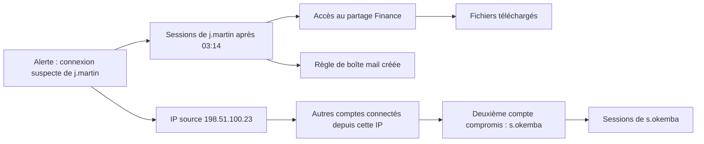

## Introduction

Ce chapitre s'adresse au travail d'un analyste N2 : une fois une alerte escaladée par le triage N1 (chapitre 2), comment mener une investigation complète, rigoureuse, jusqu'à une conclusion justifiée ?

La différence entre le triage et l'investigation tient en une question. Le triage demande : « cette alerte mérite-t-elle qu'on s'y arrête ? » L'investigation demande : « que s'est-il réellement passé, jusqu'où cela va-t-il, et que faut-il faire maintenant ? » Pour y répondre, l'analyste N2 doit raisonner comme un enquêteur : formuler des hypothèses, chercher des preuves qui pourraient les contredire, relier des sources différentes, et rendre une conclusion que d'autres pourront vérifier.

À la fin de ce chapitre, tu sauras dérouler une méthode d'investigation en cinq étapes, choisir l'ordre d'examen des preuves, pivoter d'un indicateur à l'autre pour évaluer l'étendue d'une compromission, construire une chronologie, et rédiger une conclusion qui distingue clairement ce qui est établi de ce qui est supposé.

## Une méthodologie d'investigation structurée

<Steps steps={[
  { title: "Reformuler l'hypothèse à vérifier", description: "Rappel du cours Forensics & DFIR (chapitre 1) : une investigation part d'une hypothèse à confirmer ou réfuter, jamais d'une conclusion déjà décidée." },
  { title: "Rassembler les preuves disponibles", description: "Logs SIEM, captures réseau (cours DFIR, chapitre 6), artefacts disque si nécessaire (cours DFIR, chapitre 4)." },
  { title: "Corroborer par plusieurs sources indépendantes", description: "Rappel du principe de corroboration du cours DFIR : ne jamais se fier à une seule source de preuve pour une conclusion importante." },
  { title: "Documenter la chronologie complète", description: "Construire une timeline claire des événements (rappel du cours DFIR, chapitre 5)." },
  { title: "Conclure et recommander", description: "Formuler une conclusion claire (faux positif, incident confirmé, ampleur) et des actions concrètes." },
]} />

### Étape 1 : reformuler l'hypothèse

Une alerte intitulée « Connexion depuis un pays inhabituel » n'est pas une hypothèse. Une hypothèse est une affirmation testable, par exemple : « le compte j.martin est utilisé par un tiers qui a obtenu son mot de passe ». On formule aussi l'**hypothèse concurrente** : « j.martin utilise un VPN personnel ou voyage ». Une bonne investigation cherche des éléments capables de départager les deux, et surtout des éléments qui pourraient **réfuter** l'hypothèse privilégiée. Partir d'une conclusion déjà décidée conduit à ne voir que les indices qui la confirment.

### Étape 2 : rassembler les preuves

On rassemble ce qui existe, en commençant par ce qui risque de disparaître (voir plus loin l'ordre de volatilité). Les sources typiques d'un N2 sont le SIEM, la console EDR et son arbre de processus, les journaux de connexion de l'annuaire et du cloud, les journaux de messagerie, le proxy et le DNS, et si nécessaire une collecte à distance sur la machine. Des outils comme Velociraptor, un logiciel libre de collecte et d'investigation à distance, ou osquery, qui permet d'interroger un système comme une base de données SQL, servent à récupérer rapidement des artefacts sur des dizaines de postes.

### Étape 3 : corroborer

Une seule source peut mentir, être incomplète ou mal interprétée. Un journal de connexion peut afficher une géolocalisation fausse parce que la base GeoIP est approximative ; un EDR peut avoir manqué un événement. On cherche donc au moins deux sources **indépendantes** qui racontent la même chose : la connexion vue dans Entra ID et la session VPN correspondante, l'exécution vue par l'EDR et le téléchargement vu par le proxy.

### Étape 4 : documenter la chronologie

La chronologie, ou timeline, est la colonne vertébrale de l'investigation. On y place chaque événement horodaté en UTC, avec sa source. Elle révèle l'ordre des actions, les trous à combler et le **patient zéro**, c'est-à-dire la première machine ou le premier compte compromis.

### Étape 5 : conclure et recommander

La conclusion répond à quatre questions : est-ce un incident, quelle est son ampleur, quel est le niveau de confiance, et que faut-il faire. Elle est détaillée plus bas.

## Ordre d'examen des sources de preuve

<CehCallout>
Rappel du principe de l'ordre de volatilité (cours Forensics & DFIR, chapitre 1) : en investigation SOC également, examiner d'abord les sources les plus éphémères (connexions actives, mémoire d'un processus suspect encore en cours) avant les sources plus stables (logs archivés, disque), pour ne pas perdre d'information qui disparaîtrait entre-temps.
</CehCallout>

Ce principe est formalisé dans la RFC 3227, qui propose un ordre allant des registres et du cache du processeur jusqu'aux supports d'archive. En pratique SOC, cela signifie : si le processus suspect tourne encore, on capture d'abord ses connexions réseau et sa mémoire, car un redémarrage ou un simple arrêt du processus les effacera. Les journaux archivés depuis une semaine, eux, seront encore là dans une heure.

<CompareTable
  titleA="Source de preuve"
  titleB="Ce qu'elle confirme ou infirme"
  rows={[
    { a: "Logs SIEM corrélés (chapitre 3)", b: "La séquence d'événements ayant déclenché l'alerte" },
    { a: "Historique de connexion de l'utilisateur", b: "Si le comportement est cohérent avec son activité habituelle" },
    { a: "Réputation de l'IP/domaine impliqué", b: "Si la source est déjà documentée comme malveillante" },
    { a: "Capture réseau en direct si l'activité est en cours", b: "La nature exacte du trafic échangé au moment présent" },
]}
/>

### Collecter les éléments volatils sur un système Linux

Sur un serveur Linux suspect, voici les premières commandes de collecte en direct. On écrit les résultats sur un support externe ou on les envoie vers le réseau, jamais sur le disque examiné si on peut l'éviter.

```bash
# Connexions TCP établies avec le processus associé (ss remplace netstat)
sudo ss -tnp state established

# Processus avec parent, utilisateur, date de démarrage et ligne de commande
ps -eo pid,ppid,user,lstart,cmd --sort=lstart | tail -n 20

# Binaire réellement exécuté par un PID suspect, même s'il a été supprimé du disque
sudo ls -l /proc/4242/exe
sudo sha256sum /proc/4242/exe
```

```text
State   Recv-Q Send-Q  Local Address:Port   Peer Address:Port  Process
ESTAB   0      0       10.0.5.20:51544      203.0.113.77:443   users:(("kworkerd",pid=4242,fd=3))

lrwxrwxrwx 1 www-data www-data 0 nov.  9 03:12 /proc/4242/exe -> /tmp/.x/kworkerd (deleted)
9f2c1e...a41b  /proc/4242/exe
```

La sortie est très parlante : un processus nommé pour ressembler à un thread du noyau, lancé par l'utilisateur du serveur web, depuis un dossier caché de `/tmp`, dont le binaire a été supprimé du disque et qui communique en HTTPS avec une adresse externe. Le hash calculé depuis `/proc` permet de rechercher ce binaire ailleurs dans le parc.

### Interroger les journaux Windows

Sur un poste Windows, PowerShell permet d'extraire rapidement des événements ciblés.

```powershell
# Ouvertures de session des dernières 24 heures pour un compte donné
Get-WinEvent -FilterHashtable @{LogName='Security'; Id=4624; StartTime=(Get-Date).AddDays(-1)} |
  Where-Object { $_.Properties[5].Value -eq 'j.martin' } |
  Select-Object TimeCreated, @{n='Type';e={$_.Properties[8].Value}}, @{n='IP';e={$_.Properties[18].Value}}
```

Dans l'événement 4624, la propriété d'index 8 est le type d'ouverture de session (2 pour interactif, 3 pour réseau, 10 pour bureau à distance) et l'index 18 l'adresse source. Le type de session est un indice précieux : une connexion de type 10 sur un serveur depuis un poste de comptabilité est inhabituelle.

## Pivoter pour mesurer l'étendue

Pivoter, c'est partir d'un indicateur confirmé pour en trouver d'autres. Le hash du binaire mène aux autres machines où il a été vu ; l'adresse IP du serveur de commande mène aux autres postes qui l'ont contacté ; le compte compromis mène aux machines sur lesquelles il s'est connecté. Chaque nouvel élément devient un nouveau point de pivot.



Voici comment pivoter dans Microsoft Sentinel à partir de l'adresse IP suspecte, pour savoir si d'autres comptes l'ont utilisée.

```kql
// Tous les comptes ayant réussi une connexion depuis l'IP suspecte sur 14 jours
SigninLogs
| where TimeGenerated > ago(14d)
| where IPAddress == "198.51.100.23" and ResultType == "0"
| summarize Premiere = min(TimeGenerated), Derniere = max(TimeGenerated),
            Applications = make_set(AppDisplayName) by UserPrincipalName
```

```text
UserPrincipalName        Premiere              Derniere              Applications
j.martin@exemple.fr      2026-11-08 03:14:02   2026-11-08 04:51:40   ["Office 365 Exchange Online","SharePoint Online"]
s.okemba@exemple.fr      2026-11-08 03:40:17   2026-11-08 03:58:09   ["Office 365 Exchange Online"]
```

Le pivot a révélé un second compte compromis. Dans le champ `ResultType`, la valeur 0 signifie une connexion réussie. Une recherche complémentaire sur la création de règles de boîte aux lettres est indispensable, car les attaquants qui compromettent une messagerie créent souvent une règle qui masque ou transfère les réponses, technique répertoriée dans ATT&CK sous T1564.008 (Email Hiding Rules).

```kql
OfficeActivity
| where TimeGenerated > ago(14d)
| where Operation in ("New-InboxRule", "Set-InboxRule")
| where UserId in ("j.martin@exemple.fr", "s.okemba@exemple.fr")
| project TimeGenerated, UserId, ClientIP, Parameters
```

## Construire une chronologie multi-sources

Une fois les preuves rassemblées, on les fusionne en une seule chronologie. Le tableau ci-dessous illustre le cas précédent.

| Heure UTC | Source | Événement | Statut |
| --- | --- | --- | --- |
| 08/11 02:51 | Passerelle de messagerie | Courriel « document partagé » reçu par j.martin, lien vers un domaine récent | Fait |
| 08/11 03:13 | Proxy | j.martin ouvre le lien depuis son téléphone personnel | Fait |
| 08/11 03:14 | Entra ID | Connexion réussie de j.martin depuis 198.51.100.23, MFA satisfaite | Fait |
| 08/11 03:22 | Journal d'audit M365 | Création d'une règle déplaçant les messages contenant « facture » vers un dossier caché | Fait |
| 08/11 03:40 | Entra ID | Connexion de s.okemba depuis la même IP | Fait |
| 08/11 04:30 | SharePoint | Téléchargement de 37 fichiers du site Finance par j.martin | Fait |
| 08/11 | Analyse | Vol de jeton de session par proxy d'hameçonnage de type AiTM | Hypothèse |

On remarque que la MFA a été satisfaite : cela oriente vers une attaque de type adversaire au milieu (AiTM, Adversary-in-the-Middle), où une page d'hameçonnage relaie l'authentification et vole le cookie de session. C'est encore une hypothèse, à confirmer par l'analyse du domaine d'hameçonnage.

Une règle pratique s'impose : toujours normaliser les horodatages en UTC avant de fusionner des sources. Un proxy configuré en heure locale et un SIEM en UTC décalent les événements d'une ou deux heures, ce qui peut inverser l'ordre apparent des actions et fausser complètement la conclusion.

## Les biais qui faussent une investigation

L'analyste est humain et son raisonnement a des failles connues. Le **biais de confirmation** pousse à ne chercher que les preuves qui confirment l'hypothèse initiale. Le **biais d'ancrage** fait accorder trop de poids à la première information reçue, souvent le titre de l'alerte. L'**excès de confiance dans l'outil** fait croire qu'un verdict « malveillant » de l'EDR suffit. Pour s'en protéger, on écrit explicitement l'hypothèse concurrente, on cherche activement ce qui pourrait la réfuter, et on fait relire les conclusions importantes par un pair.

Pour exprimer le niveau de certitude, beaucoup d'équipes utilisent une échelle simple. **Confiance élevée** : plusieurs sources indépendantes concordent, aucune explication alternative crédible. **Confiance moyenne** : les éléments concordent mais une source manque ou une explication alternative reste possible. **Confiance faible** : un seul indice, ou des éléments contradictoires.

## Distinguer investigation et enquête définitive

<WarningCallout>
Une investigation SOC de premier niveau n'a pas toujours vocation à établir une certitude absolue — elle vise à décider rapidement d'une action proportionnée (confinement, escalade vers une enquête DFIR complète, clôture) ; une investigation DFIR complète (cours Forensics & DFIR) intervient ensuite si l'ampleur de l'incident le justifie, avec des exigences de preuve plus strictes.
</WarningCallout>

Les exigences de l'enquête DFIR sont plus strictes parce que ses conclusions peuvent servir dans une procédure judiciaire, une déclaration à l'assureur ou une notification réglementaire. Elle impose une **chaîne de traçabilité des preuves** (chain of custody) documentée (qui a collecté quoi, quand, comment, avec quel hash) et des copies bit à bit. Le N2 doit donc éviter de détruire des preuves pendant son investigation : ne pas redémarrer une machine compromise sans capture mémoire, ne pas supprimer le fichier malveillant avant d'en avoir conservé une copie et son hash.

<LegalCallout>
Si l'incident touche des données personnelles, le RGPD (article 33) impose de notifier l'autorité de contrôle, la CNIL en France, dans les 72 heures après en avoir pris connaissance, sauf si la violation est peu susceptible d'engendrer un risque pour les personnes. Pour les entités soumises à NIS2, l'alerte précoce est attendue sous 24 heures. La qualité et la rapidité de l'investigation SOC conditionnent directement le respect de ces délais.
</LegalCallout>

## Conclure de façon rigoureuse

```text
Exemple de conclusion d'investigation SOC :

FAIT ÉTABLI : Le compte j.martin s'est connecté depuis une IP
en Roumanie à 03:14 UTC, un pays et un horaire jamais observés
pour ce compte sur les 90 derniers jours (vérifié via l'historique
de connexion).

HYPOTHÈSE CONFIRMÉE : Compromission probable du compte, action
immédiate recommandée : réinitialisation du mot de passe,
révocation des sessions actives, escalade vers l'équipe DFIR
pour investigation de l'étendue de l'accès obtenu.
```

Cet exemple montre la structure minimale : un fait établi, vérifié et sourcé, puis une hypothèse avec son niveau de confiance, puis des actions. Dans le cas complet reconstitué plus haut, on ajouterait le second compte s.okemba, la règle de boîte aux lettres à supprimer, la liste des 37 fichiers exfiltrés à transmettre au délégué à la protection des données, et le domaine d'hameçonnage à bloquer. La révocation des sessions est essentielle : si le jeton a été volé, réinitialiser seulement le mot de passe laisse l'attaquant connecté.

<CehCallout>
Rappel direct du cours Forensics & DFIR (chapitre 8) : une conclusion d'investigation SOC doit elle aussi distinguer explicitement les faits établis des hypothèses, même sous la pression du temps qui caractérise souvent le travail SOC.
</CehCallout>

## L'angle offensif : ce que l'attaquant fait pour brouiller l'enquête

<AttackDefenseTable rows={[
  { phase: "Effacement de traces", attack: "Supprimer le binaire après exécution, effacer les journaux locaux", defense: "Récupérer le binaire via /proc ou la mémoire, s'appuyer sur les journaux déjà centralisés dans le SIEM" },
  { phase: "Mimétisme", attack: "Nommer un processus comme un composant système (kworkerd, svchost)", defense: "Vérifier le chemin, le processus parent et la signature, pas seulement le nom" },
  { phase: "Infrastructure jetable", attack: "Changer d'adresse IP et de domaine à chaque étape", defense: "Pivoter sur des éléments plus stables : hash, empreinte TLS, comportements" },
  { phase: "Vol de session", attack: "Rejouer un cookie de session volé pour contourner la MFA", defense: "Révoquer les sessions, MFA résistante à l'hameçonnage (FIDO2), accès conditionnel lié à l'appareil" },
]} />

## Erreurs fréquentes en investigation

La première erreur est de **partir d'une conclusion** et de chercher seulement ce qui la confirme. La deuxième est de **s'arrêter au premier élément trouvé** sans pivoter, et de rater le second compte compromis. La troisième est de **détruire des preuves** en nettoyant trop vite. La quatrième est de **mélanger les fuseaux horaires**. La cinquième est de **rédiger une conclusion où faits et hypothèses se confondent**, ce qui empêche le lecteur de savoir sur quoi s'appuyer. La sixième, enfin, est de **réinitialiser un mot de passe sans révoquer les sessions** quand un vol de jeton est possible.

## Lab — Mise en pratique

**Environnement** : terminal Kali avec Python 3.12+. On simule trois sources de logs exportées et on reconstitue l'incident.

<Steps steps={[
  { title: "Observer les éléments volatils de ta machine", description: "Liste les connexions établies et les processus les plus récents de ta propre machine. Repère pour chaque connexion le processus responsable : c'est le réflexe à avoir sur un système suspect avant toute autre action.", code: "sudo ss -tnp state established\nps -eo pid,ppid,user,lstart,cmd --sort=lstart | tail -n 10" },
  { title: "Créer trois sources de logs", description: "Crée trois exports simulés : authentification, proxy et messagerie. Observe que le proxy est en heure locale (UTC+1) alors que les autres sources sont en UTC.", code: "cat > auth.csv << 'EOF'\n2026-11-08T03:14:02Z,auth,j.martin,login_ok,198.51.100.23\n2026-11-08T03:40:17Z,auth,s.okemba,login_ok,198.51.100.23\nEOF\ncat > proxy.csv << 'EOF'\n2026-11-08T04:13:10+01:00,proxy,j.martin,GET,https://partage-docs-secure.example/login\nEOF\ncat > mail.csv << 'EOF'\n2026-11-08T02:51:00Z,mail,j.martin,recu,Document partagé\n2026-11-08T03:22:45Z,mail,j.martin,new_inbox_rule,facture vers RSS\nEOF" },
  { title: "Fusionner en une chronologie UTC", description: "Écris un script qui convertit tous les horodatages en UTC puis trie les événements. Vérifie que l'ouverture du lien (proxy) se place bien entre la réception du courriel et la connexion suspecte.", code: "python3 - << 'EOF'\nimport csv\nfrom datetime import datetime, timezone\nevts = []\nfor f in ('auth.csv', 'proxy.csv', 'mail.csv'):\n    for ts, src, user, action, detail in csv.reader(open(f)):\n        t = datetime.fromisoformat(ts.replace('Z', '+00:00')).astimezone(timezone.utc)\n        evts.append((t, src, user, action, detail))\nfor t, src, user, action, detail in sorted(evts):\n    print(t.strftime('%d/%m %H:%M:%S UTC'), f'{src:6}', f'{user:9}', action, detail)\nEOF" },
  { title: "Pivoter sur l'adresse IP", description: "Recherche tous les comptes associés à l'adresse 198.51.100.23. Observe que le pivot fait apparaître un second compte à inclure dans le périmètre de l'incident.", code: "grep -h '198.51.100.23' auth.csv | cut -d, -f3 | sort -u" },
  { title: "Ordonner les sources de preuve", description: "Pour une alerte impliquant un processus suspect toujours en cours d'exécution ET des logs archivés d'il y a une semaine, dans quel ordre examinerais-tu ces deux sources, et pourquoi ? Cite le principe en jeu." },
  { title: "Formuler hypothèse et hypothèse concurrente", description: "Pour la connexion de j.martin, écris l'hypothèse principale, une hypothèse concurrente, et pour chacune un élément de preuve qui permettrait de la réfuter." },
  { title: "Rédiger une conclusion rigoureuse", description: "À partir des faits suivants, rédige une conclusion distinguant fait établi et hypothèse, avec un niveau de confiance et des recommandations : un compte s'est connecté à 2h du matin depuis une IP inhabituelle, puis a accédé à un partage de fichiers sensibles jamais consulté auparavant par ce compte." },
]} />

## À retenir

- Une investigation SOC part d'une hypothèse à vérifier, accompagnée d'une hypothèse concurrente, jamais d'une conclusion déjà décidée.
- Les preuves sont rassemblées puis corroborées par plusieurs sources indépendantes avant toute conclusion importante.
- L'ordre d'examen des preuves suit le principe de volatilité : les sources les plus éphémères d'abord, comme les connexions actives et la mémoire.
- Le pivot d'un indicateur à l'autre (IP, hash, compte, machine) permet de mesurer l'étendue réelle de l'incident.
- La chronologie multi-sources, normalisée en UTC, est la colonne vertébrale de l'investigation.
- Une investigation SOC vise une décision rapide et proportionnée ; l'enquête DFIR complète impose ensuite des exigences de preuve plus strictes.
- Une conclusion rigoureuse distingue toujours les faits établis des hypothèses, même sous la pression du temps caractéristique du travail SOC.

## Questions de révision

1. Pourquoi une investigation doit-elle toujours partir d'une hypothèse à vérifier plutôt que d'une conclusion déjà décidée ?
2. Pourquoi faut-il examiner en priorité les sources de preuve les plus éphémères ? Donne deux exemples de telles sources.
3. Qu'est-ce que pivoter dans une investigation, et pourquoi est-ce indispensable pour évaluer l'étendue d'un incident ?
4. Pourquoi faut-il corroborer une conclusion par au moins deux sources indépendantes ?
5. Dans le cas étudié, pourquoi la réinitialisation du mot de passe ne suffit-elle pas si un jeton de session a été volé ?
6. Quels biais cognitifs menacent un analyste en investigation, et comment s'en prémunir ?
7. Quelle est la différence entre une investigation SOC de premier niveau et une enquête DFIR complète ?
