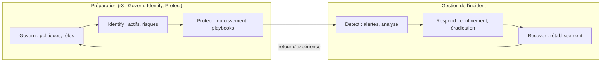
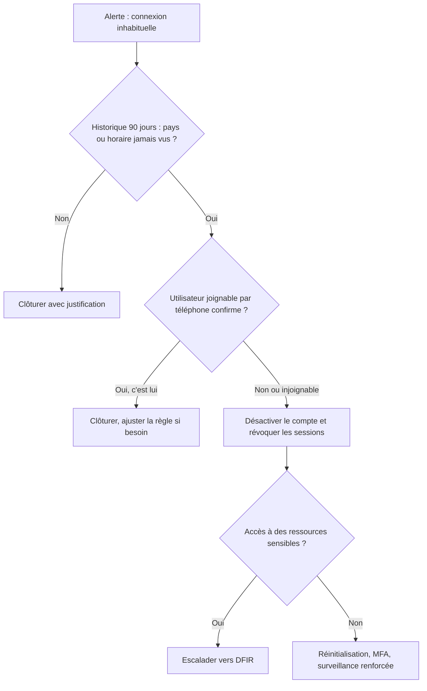

## Introduction

Ce chapitre couvre la mise en pratique opérationnelle du runbook déjà présenté au cours Rédaction de Rapports (chapitre 4) — dans le contexte spécifique du SOC, on parle plus précisément de « playbook », souvent intégré à une plateforme SOAR.

Pourquoi formaliser la réponse ? Parce qu'un incident se déroule toujours au pire moment : la nuit, pendant un week-end, quand l'analyste le plus expérimenté est en congé. Sous stress, même un professionnel oublie des étapes, inverse l'ordre des actions ou détruit une preuve. Le playbook transforme l'expérience collective de l'équipe en une procédure que n'importe quel analyste formé peut suivre. Le SOAR va plus loin : il exécute lui-même les étapes répétitives en quelques secondes, et laisse l'humain se concentrer sur les décisions.

À la fin de ce chapitre, tu sauras rédiger un playbook précis, le situer dans les référentiels de réponse à incident, expliquer ce qu'apporte un SOAR par rapport à un SIEM, et décider quelles actions automatiser en toute sécurité.

## Le cadre : les référentiels de réponse à incident

### Le modèle historique du NIST SP 800-61r2

Pendant plus de dix ans, le guide de référence a été la révision 2 du NIST SP 800-61, publiée en 2012. Elle décrivait un cycle de vie en quatre phases que tu rencontreras encore dans de nombreux supports et examens : **préparation** ; **détection et analyse** ; **confinement, éradication et rétablissement** ; **activité post-incident**, avec un retour de la dernière phase vers la préparation. Le SANS Institute propose un découpage voisin en six étapes, souvent résumé par l'acronyme PICERL : préparation, identification, confinement (containment), éradication, rétablissement (recovery) et retour d'expérience (lessons learned).

### Le NIST SP 800-61r3 (2025)

En avril 2025, le NIST a publié la révision 3, qui remplace la révision 2. Son changement majeur est d'abandonner le cycle autonome en quatre phases pour aligner la réponse à incident sur les six fonctions du NIST Cybersecurity Framework 2.0. Govern, Identify et Protect regroupent la préparation : politiques, rôles, inventaire, durcissement. Detect, Respond et Recover couvrent la gestion de l'incident proprement dite. L'idée est que la réponse à incident n'est pas une activité isolée, mais une partie de la gestion globale du risque, avec une amélioration continue présente dans toutes les fonctions.



Le playbook se situe à la charnière : il est rédigé pendant la préparation et exécuté pendant la réponse.

## Le playbook — une procédure opérationnelle précise

<CehCallout>
Rappel du cours Rédaction de Rapports (chapitre 4) : un playbook est un document vivant, prescriptif, écrit AVANT la crise — contrairement au rapport rédigé après. Un bon playbook donne des instructions exactes (« exécuter cette commande précise », « vérifier ce champ spécifique »), jamais des instructions vagues comme « analyser la situation ».
</CehCallout>

Pourquoi cette exigence de précision ? Une consigne comme « analyser la situation » laisse chaque analyste interpréter, ce qui produit des réponses inégales et des oublis. Une consigne comme « exécuter la requête X et vérifier si le champ Pays diffère des 90 derniers jours » produit le même résultat quel que soit l'analyste, se chronomètre, et s'automatise.

### La structure type d'un playbook

Un playbook complet contient plusieurs rubriques. Le **déclencheur** précise quelles alertes ou quels signalements l'activent. Le **périmètre** dit ce qu'il couvre et ce qu'il ne couvre pas. Les **rôles** indiquent qui exécute, qui décide et qui est informé, souvent sous la forme d'une matrice RACI (Responsable, Approbateur, Consulté, Informé). Les **étapes** sont numérotées, avec pour chacune la commande ou la requête exacte. Les **points de décision** disent quoi faire selon le résultat d'une vérification. La rubrique **communication** liste qui prévenir et par quel canal. Les **critères de clôture** définissent quand l'incident est terminé. Enfin, une **date de dernière révision** rappelle que le document est vivant.

```text
Exemple d'extrait de playbook — Compte potentiellement compromis :

1. Vérifier l'historique de connexion des 90 derniers jours (requête SIEM : ...)
2. Si géolocalisation ou horaire inhabituel confirmé :
   a. Désactiver le compte immédiatement (commande : ...)
   b. Révoquer toutes les sessions actives (commande : ...)
   c. Notifier le titulaire du compte via le canal secondaire (téléphone, pas email)
3. Escalader vers l'équipe DFIR si accès à des ressources sensibles confirmé
4. Documenter chaque action entreprise avec horodatage
```

Le point 2c mérite attention : si le compte est compromis, la messagerie de l'utilisateur l'est probablement aussi, et l'attaquant lirait la notification. On passe donc par un **canal secondaire**, comme le téléphone. Dans la version opérationnelle du playbook, les points de suspension sont remplacés par les commandes exactes. Pour un compte Microsoft Entra ID, on utiliserait par exemple le module Microsoft Graph PowerShell.

```powershell
# Connexion avec les permissions nécessaires
Connect-MgGraph -Scopes "User.ReadWrite.All"

# 2a. Désactiver le compte
Update-MgUser -UserId "j.martin@exemple.fr" -AccountEnabled:$false

# 2b. Révoquer les sessions : invalide les jetons d'actualisation et les cookies de session
Revoke-MgUserSignInSession -UserId "j.martin@exemple.fr"

# Équivalent pour un compte Active Directory local (module ActiveDirectory)
Disable-ADAccount -Identity "j.martin"
```

La révocation des sessions est indispensable : comme vu au chapitre 5, un attaquant qui a volé un jeton reste connecté même après un changement de mot de passe.

### Un playbook se représente aussi en arbre de décision



## Le SOAR — orchestrer et automatiser la réponse

SOAR signifie Security Orchestration, Automation and Response. Une plateforme SOAR reçoit les alertes, exécute des playbooks automatisés qui interrogent et pilotent les autres outils par leurs API, et gère les dossiers d'incident.

<CompareTable
  titleA="SIEM (chapitre 3)"
  titleB="SOAR"
  rows={[
    { a: "Collecte, corrèle et génère des alertes", b: "Orchestre et automatise les actions de réponse une fois l'alerte générée" },
    { a: "Répond à la question « que se passe-t-il ? »", b: "Répond à la question « que faire, et comment l'exécuter automatiquement ? »" },
    { a: "Sortie : une alerte à trier", b: "Sortie : des actions exécutées (isolement machine, blocage IP, notification)" },
]}
/>

Les trois mots du sigle ont un sens précis. L'**orchestration** consiste à coordonner plusieurs outils : le SIEM, l'EDR, le pare-feu, l'annuaire, la messagerie, le ticketing. L'**automatisation** consiste à exécuter sans intervention humaine des tâches répétitives : enrichir une alerte avec la réputation des indicateurs, extraire les URL d'un courriel signalé, créer un ticket. La **réponse** désigne les actions sur l'environnement : isoler, bloquer, désactiver.

Parmi les plateformes courantes figurent Splunk SOAR, Palo Alto Cortex XSOAR, les règles d'automatisation et playbooks de Microsoft Sentinel (fondés sur Azure Logic Apps), Tines, et des solutions open source comme Shuffle. Le couple TheHive et Cortex, très utilisé dans les SOC, combine gestion de dossiers et analyseurs automatiques. Pour rendre les playbooks portables entre outils, l'organisme de normalisation OASIS a publié la spécification CACAO (Collaborative Automated Course of Action Operations), qui décrit un playbook dans un format JSON standard.

<CehCallout>
Un SOAR peut automatiquement exécuter les premières étapes d'un playbook dès qu'une alerte de criticité suffisante se déclenche — par exemple, isoler automatiquement une machine du réseau dès la détection d'un comportement de ransomware caractéristique, avant même qu'un analyste humain n'ait pu intervenir manuellement.
</CehCallout>

Dans ce cas, chaque minute compte : un rançongiciel chiffre des milliers de fichiers par minute. L'isolation réseau proposée par les EDR, par exemple via l'API de Microsoft Defender for Endpoint, coupe toutes les communications de la machine sauf celles avec la console de l'EDR, ce qui permet de continuer à l'investiguer à distance.

### Le gain mesurable

Prenons un exemple chiffré. Un SOC reçoit 60 signalements de courriels suspects par jour. Le traitement manuel (extraire les URL et pièces jointes, vérifier leur réputation, chercher les autres destinataires, répondre à l'utilisateur) prend 12 minutes par signalement, soit 720 minutes, ou 12 heures d'analyste par jour. Un playbook SOAR qui automatise l'extraction, l'enrichissement et la recherche des autres destinataires ramène le travail humain à 2 minutes de décision par cas, soit 120 minutes. Le gain est de 10 heures par jour, que l'équipe peut consacrer à l'investigation et au threat hunting. C'est aussi l'un des meilleurs remèdes à la fatigue d'alerte vue au chapitre 2.

## Ce qui doit rester manuel vs ce qui peut être automatisé

<WarningCallout>
Rappel du cours IA & Agents en Cybersécurité (chapitre 5) : automatiser une action réversible et à faible risque (isoler temporairement une machine suspecte) est raisonnable ; automatiser une action irréversible ou à fort impact métier (supprimer des comptes, arrêter un serveur de production) sans validation humaine expose à des dégâts collatéraux potentiellement pires que l'incident lui-même.
</WarningCallout>

<CompareTable
  titleA="Action typiquement automatisable"
  titleB="Action nécessitant une validation humaine"
  rows={[
    { a: "Isolation réseau temporaire d'une machine suspecte", b: "Arrêt complet d'un serveur de production" },
    { a: "Blocage d'une IP malveillante confirmée au pare-feu", b: "Suppression ou désactivation définitive d'un compte utilisateur" },
    { a: "Notification automatique à l'équipe concernée", b: "Communication publique ou déclaration réglementaire (cours Droit et Réglementation)" },
]}
/>

Deux critères guident la décision : la **réversibilité** (peut-on annuler l'action en un clic sans perte ?) et l'**impact métier** (combien de personnes ou de processus seront bloqués si l'action est déclenchée à tort ?). Entre l'automatisation complète et l'action manuelle, il existe un intermédiaire très utilisé : l'**approbation humaine dans la boucle**. Le SOAR prépare tout, l'analyste reçoit une demande de validation sur son téléphone ou dans la console, et un clic déclenche l'action. On combine ainsi la vitesse de la machine et le jugement humain.

| Niveau d'automatisation | Exemple | Risque en cas d'erreur |
| --- | --- | --- |
| Enrichissement seul | Réputation des indicateurs, informations sur l'actif | Quasi nul |
| Action réversible automatique | Isoler un poste utilisateur, mettre un courriel en quarantaine | Faible, gêne temporaire d'un utilisateur |
| Action avec approbation | Désactiver un compte, bloquer un domaine pour toute l'entreprise | Moyen, validé par un humain |
| Action manuelle uniquement | Arrêter un serveur de production, notifier une autorité | Élevé, décision de la direction ou de la cellule de crise |

<LegalCallout>
Les déclarations réglementaires restent des décisions humaines engageant l'organisation : notification à la CNIL sous 72 heures au titre de l'article 33 du RGPD, alerte précoce sous 24 heures au titre de NIS2, notifications d'incidents majeurs au titre de DORA pour le secteur financier. Le SOAR peut préparer le dossier et rappeler les échéances, mais la décision et l'envoi relèvent des personnes désignées.
</LegalCallout>

## L'angle offensif : détourner l'automatisation

Un attaquant qui comprend les playbooks peut les retourner contre l'organisation. S'il sait qu'une adresse IP est bloquée automatiquement après dix échecs de connexion, il peut usurper des adresses de partenaires pour les faire bloquer. S'il sait qu'un compte est désactivé automatiquement en cas de connexion suspecte, il peut provoquer la désactivation du compte d'un dirigeant en pleine négociation. Il peut aussi injecter du contenu malveillant dans les champs que le SOAR transmet à d'autres outils.

<AttackDefenseTable rows={[
  { phase: "Déni de service par la réponse", attack: "Provoquer volontairement des alertes pour faire bloquer des adresses ou des comptes légitimes", defense: "Listes de protection (actifs et comptes critiques jamais bloqués automatiquement), approbation humaine pour ces cibles" },
  { phase: "Injection dans les données", attack: "Placer des chaînes malveillantes dans un nom de fichier ou un sujet de courriel traité par le playbook", defense: "Valider et échapper les entrées, ne jamais exécuter un contenu issu d'une alerte" },
  { phase: "Vol des secrets du SOAR", attack: "Compromettre la plateforme SOAR, qui détient des clés d'API puissantes sur tout le parc", defense: "Coffre-fort de secrets, moindre privilège par intégration, MFA, journalisation des actions du SOAR" },
  { phase: "Course de vitesse", attack: "Agir plus vite que la réponse manuelle, la nuit", defense: "Confinement automatique réversible pour les comportements les plus caractéristiques" },
]} />

## Erreurs fréquentes avec les playbooks et le SOAR

La première erreur est d'**écrire des playbooks vagues**, qui ne servent à rien sous stress. La deuxième est de **ne jamais les tester** : un playbook qui n'a jamais été joué, en exercice sur table ou en simulation, contient presque toujours une commande obsolète ou un contact qui a quitté l'entreprise. La troisième est d'**automatiser un processus mal compris** : automatiser un mauvais processus produit simplement des erreurs plus rapides. La quatrième est d'**automatiser des actions irréversibles** sans approbation. La cinquième est d'**oublier de journaliser les actions du SOAR**, ce qui rend l'incident impossible à reconstituer. La sixième, enfin, est de **notifier l'utilisateur par sa messagerie** alors qu'elle est peut-être compromise.

## Lab — Mise en pratique

**Environnement** : terminal Kali avec Python 3.12+. On écrit un mini-playbook automatisé simulé, avec enrichissement, décision et approbation humaine. Les appels aux outils sont simulés par des fonctions locales.

<Steps steps={[
  { title: "Créer une alerte au format JSON", description: "Crée un fichier représentant l'alerte reçue par le SOAR. Observe les champs utiles à l'automatisation : type, criticité, hôte, utilisateur, indicateurs.", code: "cat > alerte.json << 'EOF'\n{\"id\": \"ALR-2048\", \"type\": \"ransomware_behavior\", \"severity\": \"critical\", \"host\": \"PC-COMPTA-07\", \"host_role\": \"workstation\", \"user\": \"a.mabiala\", \"ioc\": {\"sha256\": \"9f2c1ea41b\", \"ip\": \"203.0.113.77\"}}\nEOF" },
  { title: "Écrire le playbook simulé", description: "Écris un script qui enrichit l'alerte, isole automatiquement un poste de travail (action réversible), mais demande une approbation pour désactiver le compte. Lis attentivement la fonction decide pour comprendre la logique.", code: "cat > playbook.py << 'EOF'\nimport json, sys\nfrom datetime import datetime, timezone\nPROTEGES = {'DC01', 'SRV-PAIE'}\ndef log(msg):\n    print(datetime.now(timezone.utc).strftime('%H:%M:%S'), msg)\ndef enrich(a):\n    a['ip_reputation'] = 'malicious' if a['ioc']['ip'].startswith('203.0.113.') else 'unknown'\n    log(f\"Enrichissement : IP {a['ioc']['ip']} -> {a['ip_reputation']}\")\ndef isoler(host):\n    log(f'ACTION AUTO : isolement réseau de {host} (réversible)')\ndef approbation(action):\n    rep = input(f'Approuver « {action} » ? [o/N] ')\n    return rep.strip().lower() == 'o'\ndef decide(a):\n    enrich(a)\n    if a['severity'] == 'critical' and a['host_role'] == 'workstation' and a['host'] not in PROTEGES:\n        isoler(a['host'])\n    else:\n        log('Isolement non automatique : validation analyste requise')\n    if approbation(f\"désactiver le compte {a['user']}\"):\n        log(f\"ACTION VALIDÉE : compte {a['user']} désactivé\")\n    else:\n        log('Action refusée : compte conservé, surveillance renforcée')\n    log('Ticket créé et équipe N2 notifiée')\ndecide(json.load(open(sys.argv[1])))\nEOF" },
  { title: "Exécuter le playbook", description: "Lance le playbook et réponds à la demande d'approbation. Observe l'horodatage de chaque action : c'est la trace qui permettra de reconstituer l'incident.", code: "python3 playbook.py alerte.json" },
  { title: "Tester une cible protégée", description: "Modifie l'alerte pour qu'elle concerne le contrôleur de domaine DC01 avec le rôle server, puis relance. Vérifie que l'isolement n'est plus automatique et explique pourquoi c'est souhaitable.", code: "sed -i 's/PC-COMPTA-07/DC01/; s/workstation/server/' alerte.json\npython3 playbook.py alerte.json" },
  { title: "Rédiger un extrait de playbook", description: "Rédige les 3 premières étapes d'un playbook pour une alerte de ransomware détecté sur un poste utilisateur, à la manière de l'exemple du chapitre, avec pour chaque étape l'action exacte, le responsable et le critère de passage à l'étape suivante." },
  { title: "Décider ce qui doit être automatisé", description: "Pour une alerte de connexion depuis un pays inhabituel, quelle action serait raisonnable d'automatiser immédiatement, et laquelle nécessiterait une validation humaine ? Justifie avec les critères de réversibilité et d'impact métier." },
]} />

## À retenir

- Un playbook est une procédure prescriptive et précise, écrite avant la crise, donnant des instructions exactes plutôt que vagues.
- Un playbook complet précise déclencheur, rôles, étapes, points de décision, communication et critères de clôture, et doit être testé régulièrement.
- Le NIST SP 800-61r3 (2025) remplace le cycle en quatre phases de la révision 2 par un alignement sur les six fonctions du NIST CSF 2.0.
- Un SOAR orchestre et automatise l'exécution des actions de réponse une fois qu'une alerte a été générée par le SIEM.
- Les actions réversibles et à faible risque se prêtent à l'automatisation ; les actions irréversibles ou à fort impact exigent une validation humaine, souvent via une approbation dans la boucle.
- Le titulaire d'un compte compromis se prévient par un canal secondaire, et la révocation des sessions accompagne toujours la désactivation.
- Un attaquant peut détourner une automatisation pour provoquer un déni de service : il faut protéger les actifs critiques et les secrets du SOAR.

## Questions de révision

1. Quelle est la différence de rôle entre un SIEM et un SOAR ?
2. Pourquoi un playbook doit-il donner des instructions exactes plutôt que des instructions vagues comme « analyser la situation » ?
3. Quelles sont les quatre phases du cycle de réponse à incident de la révision 2 du NIST SP 800-61, et qu'a changé la révision 3 ?
4. Pourquoi notifie-t-on le titulaire d'un compte compromis par téléphone plutôt que par courriel ?
5. Donne un exemple d'action qu'il serait risqué d'automatiser sans validation humaine, et explique pourquoi.
6. Qu'est-ce qu'une approbation humaine dans la boucle, et quel compromis offre-t-elle ?
7. Comment un attaquant pourrait-il exploiter un playbook de blocage automatique d'adresses IP ?
