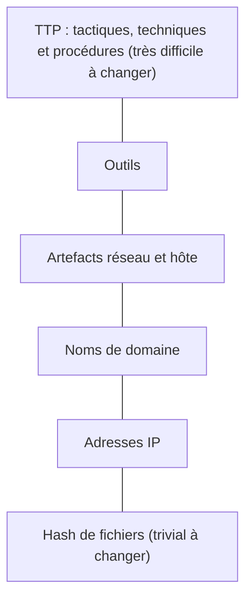
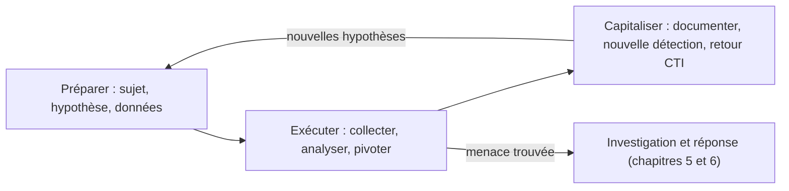

## Introduction

Ce chapitre couvre l'activité la plus avancée du travail SOC, typiquement associée au niveau N3 (chapitre 1) : le threat hunting, ou recherche proactive de menaces qui n'ont déclenché aucune alerte existante.

Pourquoi chasser si l'on a déjà un SIEM et un EDR ? Parce que toute détection repose sur des règles écrites à partir de ce que l'on connaît. Un attaquant compétent, qui utilise des outils légitimes, agit lentement et évite les comportements bruyants, peut rester des semaines dans un réseau sans déclencher une seule alerte. Les rapports annuels des grands cabinets de réponse à incident mesurent ce temps de présence non détectée, appelé dwell time : il s'est nettement réduit en dix ans, mais se compte encore souvent en jours ou en semaines. Le threat hunting est la réponse à ce constat : au lieu d'attendre, on part à la recherche des faux négatifs vus au chapitre 2.

À la fin de ce chapitre, tu sauras distinguer les types de chasse, formuler une hypothèse exploitable, mener une recherche avec des techniques d'analyse simples mais efficaces, et transformer une chasse, qu'elle trouve quelque chose ou non, en amélioration durable de la détection.

## Threat hunting vs détection réactive

<CompareTable
  titleA="Détection réactive (chapitres 2-3)"
  titleB="Threat hunting"
  rows={[
    { a: "Attend qu'une règle de détection se déclenche", b: "Cherche activement des signes de compromission, sans attendre d'alerte" },
    { a: "Limité aux motifs déjà anticipés par une règle", b: "Peut révéler des menaces qui échappent complètement aux règles existantes" },
    { a: "Processus largement automatisable", b: "Processus fondamentalement exploratoire, guidé par l'expertise humaine" },
]}
/>

<CehCallout>
Le threat hunting part d'un principe simple mais puissant : « supposons qu'un attaquant soit déjà présent dans le système sans avoir déclenché aucune alerte — quels indices chercherais-je pour le confirmer ou l'infirmer ? » Une posture fondamentalement différente de l'attente passive d'une alerte.
</CehCallout>

Cette posture s'appelle l'**hypothèse de compromission** (assume breach). Elle ne signifie pas que l'on croit l'organisation compromise, mais que l'on refuse de considérer l'absence d'alerte comme une preuve d'absence d'attaquant.

### Ce qui fait la valeur d'un indice : la pyramide de la douleur

Le chercheur David Bianco a proposé en 2013 la **pyramide de la douleur** (Pyramid of Pain), qui classe les indicateurs selon la difficulté qu'éprouve l'attaquant à les changer une fois détectés.



En bas, un hash change dès que l'attaquant modifie un seul octet de son binaire. Une adresse IP se remplace en quelques minutes. En haut, une **TTP**, c'est-à-dire une façon de procéder, oblige l'attaquant à réapprendre son métier s'il veut l'abandonner. Le threat hunting vise donc de préférence les comportements, pas seulement les indicateurs : chercher « une tâche planifiée créée par un compte qui n'en crée jamais » résiste mieux au changement qu'une liste de hash.

## Les types de chasse

| Type | Point de départ | Exemple |
| --- | --- | --- |
| Par hypothèse | Une technique ATT&CK jugée probable | « Un attaquant maintient sa persistance via des tâches planifiées » |
| Par renseignement | Un rapport de CTI, un avis du CERT-FR ou de la CISA | Rechercher les indicateurs et comportements d'une campagne qui vise ton secteur |
| Par référence (baseline) | La connaissance du comportement normal | Repérer les processus, services ou connexions qui s'écartent de la norme |
| Assistée par modèle | Un modèle statistique ou d'apprentissage automatique | Classer les connexions sortantes par score d'anomalie, puis examiner les plus atypiques |

Ces types correspondent à ceux du cadre **PEAK** (Prepare, Execute, Act with Knowledge), publié en 2023 par l'équipe de recherche de Splunk, qui distingue les chasses par hypothèse, les chasses par référence et les chasses assistées par modèle. Le cadre néerlandais **TaHiTI**, conçu par des banques des Pays-Bas, insiste quant à lui sur l'articulation entre chasse et renseignement sur la menace. Tous partagent une boucle en trois temps : préparer, exécuter, capitaliser.



### Mesurer la maturité de la chasse

Le Hunting Maturity Model, également proposé par David Bianco, décrit cinq niveaux, de HMM0 à HMM4. Au niveau 0, l'organisation s'appuie uniquement sur les alertes automatiques. Au niveau 1, elle recherche des indicateurs fournis par le renseignement. Au niveau 2, elle suit des procédures de chasse écrites par d'autres. Au niveau 3, elle crée ses propres procédures. Au niveau 4, elle automatise systématiquement les chasses réussies sous forme de détections. Ce dernier point est essentiel : une chasse qui réussit doit devenir une règle, pour que l'équipe puisse chasser autre chose la fois suivante.

## Formuler une hypothèse de chasse

<Steps steps={[
  { title: "Partir d'une technique MITRE ATT&CK (chapitre 4) précise", description: "Ex : « Un attaquant pourrait utiliser des tâches planifiées pour maintenir sa persistance (technique T1053) »." },
  { title: "Déterminer quelles données permettraient de vérifier cette hypothèse", description: "Quels logs, quelles sources de données révéleraient la présence (ou l'absence) de ce comportement ?" },
  { title: "Rechercher activement, sans attendre d'alerte", description: "Interroger directement les données disponibles à la recherche du motif suspecté, même en l'absence de toute alerte préexistante." },
  { title: "Documenter le résultat, positif ou négatif", description: "Une chasse qui ne trouve rien reste une information précieuse : elle confirme (avec les limites des données disponibles) l'absence de ce vecteur d'attaque spécifique." },
]} />

<TipCallout>
Une hypothèse de chasse bien formulée est spécifique et vérifiable — « chercher des tâches planifiées créées récemment par des comptes qui n'en créent habituellement jamais » est actionnable, contrairement à « chercher des activités suspectes » qui ne l'est pas, un principe qui rejoint directement la rigueur de formulation vue au cours Rédaction de Rapports.
</TipCallout>

Une bonne hypothèse précise quatre éléments : **qui** (quels comptes ou quelles machines), **quoi** (quel comportement observable), **où** (quel périmètre) et **comment le vérifier** (quelle source de données). Avant de lancer la recherche, on vérifie que les données existent : chercher des créations de tâches planifiées sans que l'événement 4698 soit audité produirait un résultat négatif trompeur. C'est pourquoi le résultat négatif est toujours qualifié par « dans les limites des données disponibles ».

## Les techniques d'analyse du chasseur

### Le stacking, ou comptage des occurrences rares

Le stacking consiste à regrouper une donnée sur tout le parc, puis à trier par nombre d'occurrences. L'idée est simple : un logiciel légitime est en général installé sur beaucoup de machines, alors qu'une porte dérobée posée par un attaquant n'apparaît que sur quelques-unes. Les valeurs les plus rares méritent donc un examen. Voici un exemple en KQL dans Microsoft Sentinel, qui recense les comptes créateurs de tâches planifiées sur 30 jours.

```kql
SecurityEvent
| where TimeGenerated > ago(30d) and EventID == 4698
| summarize Taches = count(), Machines = dcount(Computer),
            Exemples = make_set(TaskName, 5) by SubjectUserName
| order by Taches asc
```

```text
SubjectUserName   Taches  Machines  Exemples
p.loemba          1       1         ["\\MicrosoftEdgeUpdateCore"]
svc-backup        30      2         ["\\Backup-Nightly"]
SYSTEM            4120    310       ["\\Microsoft\\Windows\\...", ...]
```

Le compte p.loemba, un utilisateur standard, a créé une seule tâche sur une seule machine, avec un nom qui imite une tâche de mise à jour Microsoft. C'est exactement le type d'anomalie que le stacking fait remonter. Il ne prouve rien à lui seul, mais il désigne où regarder.

### La détection de beaconing

Un implant qui communique avec son serveur de commande et contrôle le fait souvent à intervalles réguliers, avec une petite variation aléatoire appelée jitter. Un humain qui navigue sur le web, lui, produit des connexions irrégulières. On peut mesurer cette régularité par le **coefficient de variation**, l'écart type des intervalles divisé par leur moyenne. Prenons un exemple chiffré : des intervalles de 60, 61, 59, 60 et 60 secondes ont une moyenne de 60 et un écart type d'environ 0,6 ; le coefficient vaut 0,01, ce qui est très régulier. Des intervalles de 5, 120, 30, 600 et 45 secondes donnent un coefficient supérieur à 1 : trafic humain. Les outils de référence pour cette analyse sont Zeek, qui produit des journaux réseau détaillés, et RITA, un outil libre d'Active Countermeasures qui analyse les journaux Zeek pour repérer le beaconing.

### La comparaison à une référence

On compare l'état actuel à un état connu sain : liste des services installés, des programmes au démarrage, des comptes membres des groupes privilégiés, des applications OAuth autorisées dans le tenant cloud. Tout ajout non expliqué est une piste. Sous Windows, l'outil Autoruns de Sysinternals liste tous les emplacements de démarrage automatique et peut être utilisé en ligne de commande pour comparer des machines.

## Exemple concret de chasse

```text
Hypothèse : Un attaquant pourrait avoir établi une persistance via
une tâche planifiée sur un serveur critique (technique MITRE ATT&CK T1053).

Recherche : Interroger les logs de création de tâches planifiées
(Event ID 4698 sur Windows) des 30 derniers jours, filtrés sur les
serveurs critiques, en excluant les comptes de service connus créant
légitimement des tâches planifiées.

Résultat : Une tâche planifiée créée par un compte utilisateur standard
(jamais observé créant de tâche auparavant), exécutant un script
PowerShell encodé en Base64 (rappel du cours Forensics & DFIR, ch.3,
sur l'obfuscation PowerShell) — investigation approfondie déclenchée.
```

Cet exemple suit exactement la méthode : une technique précise, T1053 (et plus précisément sa sous-technique T1053.005 pour les tâches planifiées Windows), une source de données identifiée, l'événement 4698, un filtre qui exclut le bruit connu, et un résultat qui déclenche l'investigation du chapitre 5. Le script PowerShell encodé en Base64 est une forme d'obfuscation : il cache le contenu réel à un lecteur pressé, mais il se décode facilement, comme vu au chapitre 2.

La chasse ne s'arrête pas là. Une fois l'incident traité, l'équipe écrit une règle Sigma qui alerte désormais automatiquement sur toute création de tâche planifiée par un compte non administrateur contenant un argument encodé, puis l'ajoute au calque ATT&CK Navigator de couverture vu au chapitre 4.

## L'angle offensif et défensif : pourquoi certains attaquants échappent aux règles

Les attaquants qui échappent le plus longtemps aux détections ont des traits communs, sans qu'il soit besoin de détailler leurs procédures : ils privilégient les outils déjà présents sur le système, imitent les noms et emplacements légitimes, agissent lentement, et utilisent des services cloud réputés comme canaux de communication. Le chasseur cherche précisément ces écarts subtils.

<AttackDefenseTable rows={[
  { phase: "Persistance discrète", attack: "Tâche planifiée ou service nommé comme un composant Microsoft", defense: "Stacking des créateurs et des chemins d'exécution, comparaison à une référence Autoruns" },
  { phase: "Commande et contrôle", attack: "Communications régulières vers un service cloud ou un domaine récent", defense: "Analyse de régularité des connexions (Zeek, RITA), âge et réputation des domaines" },
  { phase: "Living off the land", attack: "Utilisation d'outils natifs comme PowerShell, WMI ou certutil", defense: "Chasse sur les lignes de commande rares et les relations parent-enfant inhabituelles" },
  { phase: "Comptes dormants", attack: "Réactivation d'un compte inutilisé depuis des mois", defense: "Chasse sur les connexions de comptes inactifs depuis plus de 90 jours" },
]} />

<AuditCallout>
L'ISO/IEC 27001:2022 a introduit le contrôle A.5.7 sur le renseignement sur la menace, qui demande de collecter et d'analyser des informations sur les menaces pour produire du renseignement exploitable. Le threat hunting par renseignement en est une mise en œuvre directe, et ses résultats alimentent aussi A.8.16 sur les activités de surveillance.
</AuditCallout>

## Erreurs fréquentes en threat hunting

La première erreur est de **chasser sans hypothèse**, en parcourant les journaux au hasard dans l'espoir de trouver quelque chose. La deuxième est de **ne pas vérifier la disponibilité des données** avant de conclure à un résultat négatif. La troisième est de **se limiter aux indicateurs du bas de la pyramide**, comme des listes de hash, qui deviennent obsolètes en quelques jours. La quatrième est de **ne pas documenter les chasses négatives**, ce qui fait refaire le même travail six mois plus tard. La cinquième est de **ne pas transformer une chasse réussie en détection**, ce qui oblige à rechercher manuellement le même comportement indéfiniment. La sixième, enfin, est de **confondre threat hunting et triage** : un chasseur constamment interrompu par la file d'alertes ne chasse jamais.

## Lab — Mise en pratique

**Environnement** : terminal Kali avec Python 3.12+. On chasse dans des exports simulés de journaux, sans aucune action sur un système réel.

<Steps steps={[
  { title: "Formuler une hypothèse de chasse", description: "En t'appuyant sur une technique MITRE ATT&CK de ton choix (vue au chapitre 4), formule une hypothèse de chasse spécifique et vérifiable, en précisant qui, quoi, où et la source de données qui permettra de la vérifier." },
  { title: "Créer un export de tâches planifiées", description: "Crée un export simulé des événements 4698 : compte créateur, machine et nom de tâche. Il contient beaucoup de bruit légitime et un élément suspect.", code: "python3 - << 'EOF'\nimport csv, random\nrandom.seed(7)\nrows = [('SYSTEM', f'PC-{i:03}', '\\\\Microsoft\\\\Windows\\\\UpdateOrchestrator') for i in range(200)]\nrows += [('svc-backup', 'SRV-FICHIERS', '\\\\Backup-Nightly')] * 30\nrows += [('p.loemba', 'SRV-PAIE', '\\\\MicrosoftEdgeUpdateCore')]\nrandom.shuffle(rows)\nwith open('taches_4698.csv', 'w', newline='') as f:\n    w = csv.writer(f); w.writerow(['compte', 'machine', 'tache']); w.writerows(rows)\nprint(len(rows), 'événements écrits')\nEOF" },
  { title: "Appliquer le stacking", description: "Compte, pour chaque compte créateur, le nombre de tâches et de machines distinctes, puis trie par ordre croissant. Observe que la valeur la plus rare est un compte utilisateur standard sur un serveur critique.", code: "awk -F, 'NR>1 {n[$1]++; if (!vu[$1 FS $2]++) m[$1]++; ex[$1]=$2 \" \" $3} END {for (c in n) printf \"%5d tâches %4d machines  %-12s ex: %s\\n\", n[c], m[c], c, ex[c]}' taches_4698.csv | sort -n" },
  { title: "Générer des journaux de connexions sortantes", description: "Simule les connexions sortantes de deux postes : l'un navigue normalement, l'autre contacte un serveur toutes les 60 secondes environ, avec un faible jitter.", code: "python3 - << 'EOF'\nimport random\nrandom.seed(1)\nt1 = t2 = 0.0\nwith open('conn.log', 'w') as f:\n    for _ in range(40):\n        t1 += random.choice([3, 20, 45, 180, 600]) * random.random() + 1\n        f.write(f'{t1:.1f} PC-012 news.example.org\\n')\n        t2 += 60 + random.uniform(-2, 2)\n        f.write(f'{t2:.1f} PC-047 cdn-update.example.net\\n')\nEOF\nhead -n 4 conn.log" },
  { title: "Mesurer la régularité des connexions", description: "Calcule pour chaque couple poste et destination le coefficient de variation des intervalles. Observe la valeur très faible du poste PC-047 : c'est la signature d'un beaconing, à confirmer par une investigation.", code: "python3 - << 'EOF'\nimport statistics as st\nfrom collections import defaultdict\nflux = defaultdict(list)\nfor ligne in open('conn.log'):\n    t, hote, dest = ligne.split()\n    flux[(hote, dest)].append(float(t))\nfor (hote, dest), ts in flux.items():\n    ts.sort()\n    iv = [b - a for a, b in zip(ts, ts[1:])]\n    cv = st.stdev(iv) / st.mean(iv)\n    print(f'{hote} -> {dest} : {len(ts)} connexions, intervalle moyen {st.mean(iv):.0f} s, CV {cv:.2f}')\nEOF" },
  { title: "Documenter la chasse", description: "Rédige une fiche de chasse : hypothèse, données utilisées et leurs limites, requêtes exécutées, résultat (positif pour la tâche de p.loemba et le beaconing de PC-047), et décision d'escalade vers l'investigation." },
  { title: "Transformer la chasse en détection", description: "Rédige en pseudo-code ou au format Sigma (chapitre 3) une règle qui détecterait automatiquement à l'avenir la création d'une tâche planifiée par un compte non administrateur sur un serveur critique. Indique les faux positifs attendus." },
  { title: "Justifier la valeur d'un résultat négatif", description: "Pourquoi une chasse qui ne trouve aucun signe de compromission reste-t-elle une information utile pour l'organisation, plutôt qu'un simple « rien à signaler » ? Précise pourquoi la mention des limites des données est indispensable." },
]} />

## À retenir

- Le threat hunting cherche activement des signes de compromission sans attendre qu'une règle de détection existante se déclenche, en partant de l'hypothèse de compromission.
- La pyramide de la douleur montre que les comportements (TTP) sont plus durables à chasser que les hash ou les adresses IP.
- Les chasses se font par hypothèse, par renseignement, par référence ou assistées par modèle, dans une boucle préparer, exécuter, capitaliser comme dans le cadre PEAK.
- Une hypothèse de chasse doit être spécifique et vérifiable, souvent formulée à partir d'une technique MITRE ATT&CK précise comme T1053 et vérifiée par une source identifiée comme l'événement 4698.
- Le stacking fait ressortir les occurrences rares, et le coefficient de variation des intervalles révèle le beaconing.
- Un résultat négatif de chasse reste une information précieuse, confirmant l'absence (dans les limites des données disponibles) d'un vecteur d'attaque spécifique.
- Une chasse réussie doit devenir une détection automatique, pour libérer le chasseur vers de nouvelles hypothèses.

## Questions de révision

1. Quelle est la différence fondamentale entre le threat hunting et la détection réactive ?
2. Que représente la pyramide de la douleur, et pourquoi oriente-t-elle la chasse vers les TTP ?
3. Pourquoi une hypothèse de chasse doit-elle être spécifique et vérifiable plutôt que vague ? Donne un exemple de chaque.
4. Explique le principe du stacking et pourquoi les occurrences rares sont intéressantes.
5. Comment le coefficient de variation des intervalles de connexion aide-t-il à repérer un beaconing ?
6. Pourquoi un résultat négatif de chasse (rien trouvé) reste-t-il une information utile, et à quelle condition ?
7. Pourquoi le niveau le plus élevé du Hunting Maturity Model insiste-t-il sur l'automatisation des chasses réussies ?
