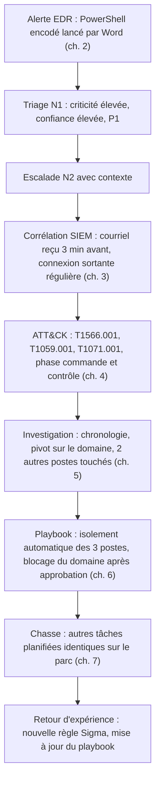

## Introduction

Ce dernier chapitre referme le cours en reliant explicitement chaque compétence acquise à la progression professionnelle réelle d'un analyste SOC — du triage N1 vers l'investigation et la chasse plus autonomes du N2/N3.

Passer de N1 à N2 ne se fait pas en accumulant des certificats. C'est un changement de posture : on passe de « j'applique correctement la procédure » à « je comprends assez bien la menace et mon environnement pour savoir quoi chercher quand la procédure ne suffit plus ». Ce chapitre t'aide à mesurer où tu en es, à voir comment les compétences du cours s'enchaînent sur un incident réel, et à construire un plan concret pour les prochains mois.

À la fin de ce chapitre, tu sauras situer chaque chapitre du cours dans cette progression, dérouler un cas complet de bout en bout, identifier tes lacunes, choisir des certifications et des plateformes d'entraînement adaptées, et monter un petit laboratoire de détection chez toi.

## Panorama des compétences et leur rôle dans la progression

<CompareTable
  titleA="Chapitre"
  titleB="Compétence pour la progression N1 → N2"
  rows={[
    { a: "1. Rôles et niveaux", b: "Comprendre où l'on se situe et ce qui différencie le niveau suivant" },
    { a: "2. Triage d'alertes", b: "Maîtriser la base : prioriser efficacement sans se fier à un seul critère" },
    { a: "3. SIEM et corrélation", b: "Comprendre l'outil pour aller au-delà de son usage superficiel" },
    { a: "4. Kill Chain et ATT&CK", b: "Situer une alerte isolée dans une attaque plus large — compétence clé du N2" },
    { a: "5. Investigation approfondie", b: "La compétence centrale distinguant le N2 du simple triage N1" },
    { a: "6. Playbooks et SOAR", b: "Comprendre les limites de l'automatisation pour savoir quand s'en remettre au jugement humain" },
    { a: "7. Threat hunting", b: "La compétence la plus avancée, typique du N3, à développer progressivement" },
]}
/>

Ce tableau se lit comme un escalier. Les chapitres 1 à 3 donnent les fondations du N1 : savoir où l'on est, trier, et utiliser l'outil. Le chapitre 4 est la charnière : un N1 voit des alertes, un N2 voit des attaques. Les chapitres 5 et 6 constituent le cœur du N2 : enquêter et agir de façon structurée. Le chapitre 7 ouvre vers le N3.

## Ce qui distingue concrètement un bon analyste N2

<CehCallout>
Un analyste N1 applique correctement des procédures documentées ; un analyste N2 développe un jugement d'investigation autonome — la capacité à formuler des hypothèses, chercher des preuves au-delà des procédures écrites, et corréler plusieurs sources sans qu'un playbook ne le lui dicte explicitement à chaque étape.
</CehCallout>

Prenons un exemple. Une alerte de connexion inhabituelle arrive. Le N1 applique la procédure : il vérifie l'historique de connexion, constate que le pays n'a jamais été vu, et escalade correctement. Le N2, lui, ne s'arrête pas là. Il se demande comment l'attaquant a obtenu l'accès et cherche un courriel d'hameçonnage reçu juste avant. Il pivote sur l'adresse IP et découvre un second compte. Il vérifie si une règle de boîte aux lettres a été créée. Il évalue l'étendue, propose le confinement et rédige une conclusion qui distingue faits et hypothèses. Enfin, il signale à l'ingénierie de détection qu'une règle sur la création de règles de messagerie manque. Toute la différence est là : le N2 raisonne au-delà de ce que la procédure lui dicte.

<Steps steps={[
  { title: "Développer sa connaissance de l'environnement surveillé", description: "Connaître les comportements normaux de son organisation (rythmes, applications, comptes de service) est indispensable pour repérer un écart réel." },
  { title: "Approfondir MITRE ATT&CK au-delà des bases", description: "Se familiariser avec les techniques les plus pertinentes pour son secteur d'activité, pas seulement les plus connues." },
  { title: "Pratiquer l'investigation sur des cas réels ou simulés", description: "Rappel des labs Nyx (Active Directory, DFIR) : l'investigation s'apprend par la pratique répétée, pas uniquement la théorie." },
  { title: "Cultiver la rigueur documentaire", description: "Rappel du cours Rédaction de Rapports : chaque investigation doit rester traçable et distinguer clairement faits établis et hypothèses." },
]} />

Le premier levier est souvent sous-estimé. Un analyste qui sait que le serveur de sauvegarde se connecte à tous les postes chaque nuit à deux heures, que le service comptable travaille tard en fin de mois, et que tel compte de service lance des scripts PowerShell tous les matins, repère immédiatement ce qui sort de l'ordinaire. Cette connaissance se construit en lisant la documentation interne, en posant des questions aux équipes d'exploitation, et en notant ce que l'on apprend à chaque alerte.

### La grille de compétences N1, N2 et N3

| Domaine | N1 | N2 | N3 |
| --- | --- | --- | --- |
| Triage | Applique la procédure, documente chaque décision | Ajuste la priorité selon le contexte métier | Conçoit les procédures de triage |
| Outils | Utilise les tableaux de bord et requêtes fournis | Écrit ses propres requêtes KQL, SPL ou équivalent | Écrit et teste des règles Sigma, automatise |
| Menace | Connaît les grandes familles d'attaques | Raisonne en tactiques et techniques ATT&CK | Suit les groupes qui ciblent son secteur |
| Investigation | Rassemble le contexte et escalade | Mène l'enquête, pivote, construit la chronologie | Dirige l'investigation des incidents majeurs |
| Réponse | Exécute les étapes simples d'un playbook | Décide du confinement, rédige les conclusions | Écrit et fait évoluer les playbooks |
| Communication | Notes de ticket claires | Rapports d'incident pour les équipes techniques | Restitutions à la direction et aux autorités |

Les compétences comportementales comptent autant que les techniques : la curiosité, la capacité à rester méthodique sous pression, l'honnêteté sur ce que l'on ne sait pas, et la capacité à expliquer un incident à un non-spécialiste.

## Un cas complet de bout en bout

Pour vérifier que les compétences du cours s'assemblent, suivons un incident simulé du début à la fin.

À 9 h 02, l'EDR signale qu'un document Word a lancé PowerShell avec une commande encodée. Le N1 décode la commande comme au chapitre 2, constate un téléchargement en mémoire, classe l'alerte en priorité P1 car la criticité et la confiance sont élevées, et escalade avec sa note. Le N2 interroge le SIEM et retrouve le courriel reçu à 8 h 59, puis des connexions HTTPS vers un domaine enregistré la veille, toutes les 60 secondes. Il situe l'attaque en phase de commande et contrôle de la Kill Chain : l'urgence est maximale. Il pivote sur le domaine et découvre deux autres postes qui le contactent. Le playbook rançongiciel déclenche l'isolement réseau des trois postes, action réversible automatisée, puis l'analyste approuve le blocage du domaine pour toute l'entreprise. Le lendemain, un N3 lance une chasse sur les tâches planifiées portant le même nom et n'en trouve pas d'autre, résultat négatif documenté. Le retour d'expérience produit une règle sur les processus enfants de Word et une mise à jour du playbook.

Chaque chapitre du cours a servi. C'est cette capacité à enchaîner les étapes sans qu'on te les dicte qui caractérise le N2.

## Compétences complémentaires à approfondir

<CompareTable
  titleA="Cours Nyx complémentaire"
  titleB="Apport pour la progression SOC"
  rows={[
    { a: "Forensics & DFIR", b: "Approfondir l'investigation au-delà du triage SOC, jusqu'à l'analyse mémoire et disque" },
    { a: "Active Directory & Windows", b: "Comprendre en profondeur les techniques d'attaque les plus fréquentes en environnement Windows d'entreprise" },
    { a: "IA & Agents en Cybersécurité", b: "Comprendre les outils d'automatisation qui transforment progressivement le métier" },
    { a: "Droit et Réglementation", b: "Comprendre les obligations légales déclenchées par certains types d'incidents" },
]}
/>

Le cours Forensics & DFIR est le prolongement le plus direct du chapitre 5 : il apprend à aller au-delà de la décision rapide, jusqu'à l'analyse de la mémoire et du disque. Au-delà des cours Nyx, trois compétences techniques font une vraie différence pour un N2 : la maîtrise d'un **langage de requête** (KQL ou SPL), un **langage de script** comme Python ou PowerShell pour automatiser ses analyses, et la **lecture du trafic réseau** avec Wireshark ou Zeek. L'IA générative s'invite aussi dans les SOC sous forme d'assistants qui résument des alertes ou proposent des requêtes : ils accélèrent le travail, mais ne dispensent jamais de vérifier leurs propositions, car ils peuvent se tromper avec assurance.

## Certifications et plateformes d'entraînement

Les certifications ne remplacent pas la pratique, mais elles structurent l'apprentissage et rassurent les recruteurs. Voici les plus reconnues pour un parcours SOC, de l'entrée vers l'avancé.

| Certification | Organisme | Niveau | Intérêt pour le SOC |
| --- | --- | --- | --- |
| Security+ (SY0-701) | CompTIA | Entrée | Socle général de sécurité, souvent demandé pour un premier poste |
| Blue Team Level 1 (BTL1) | Security Blue Team | Entrée à intermédiaire | Examen pratique de 24 heures centré sur l'analyse défensive |
| SC-200 Security Operations Analyst | Microsoft | Intermédiaire | Sentinel, Defender XDR et KQL, très demandé dans les environnements Microsoft |
| CySA+ (CS0-003) | CompTIA | Intermédiaire | Analyse de menaces, gestion des vulnérabilités, réponse à incident |
| CEH v13 | EC-Council | Intermédiaire | Vision offensive utile pour comprendre ce que l'on détecte |
| GCIH ou GCIA | GIAC (SANS) | Avancé | Gestion d'incidents ou détection d'intrusion réseau, très reconnues mais coûteuses |

<TipCallout>
Choisis une certification en fonction de l'environnement que tu vises : SC-200 si les entreprises de ta région utilisent massivement Microsoft 365 et Sentinel, une certification Splunk si les offres d'emploi mentionnent Splunk. Vérifie toujours la version en vigueur de l'examen sur le site de l'organisme, car les codes changent tous les trois ans environ.
</TipCallout>

Pour s'entraîner, plusieurs plateformes proposent des cas réalistes : les parcours SOC Level 1 et SOC Level 2 de TryHackMe, les simulations d'alertes de LetsDefend, les investigations sur des journaux réels de CyberDefenders et de Blue Team Labs Online. Splunk a aussi publié les jeux de données de sa compétition Boss of the SOC (BOTS), que l'on peut charger dans une instance Splunk gratuite pour s'exercer à l'investigation.

## Construire son laboratoire personnel de détection

Rien ne remplace un environnement où l'on génère soi-même des événements et où l'on observe ce que le SIEM en fait. Un laboratoire minimal comprend une machine virtuelle Windows avec Sysmon, un SIEM open source comme Wazuh ou la pile Elastic, et éventuellement une machine Linux. Le principe est de produire des actions contrôlées sur ses propres machines, puis de vérifier quelles alertes apparaissent et lesquelles manquent.

Attention : un laboratoire de détection doit rester isolé de ton réseau personnel et de toute machine qui ne t'appartient pas. N'y exécute jamais de vrai logiciel malveillant sans un isolement réseau strict, et ne génère des événements de test que sur tes propres systèmes. Les fichiers de test comme ceux d'Atomic Red Team modifient la configuration des machines : utilise des instantanés de machines virtuelles pour revenir à un état propre.

<LegalCallout>
En France, l'article 323-1 du Code pénal réprime l'accès ou le maintien frauduleux dans un système de traitement automatisé de données. S'entraîner sur des systèmes sans autorisation écrite, même « pour apprendre », expose à des poursuites. Les plateformes d'entraînement et ton propre laboratoire sont les seuls terrains légitimes.
</LegalCallout>

## Erreurs fréquentes dans la progression

La première erreur est de **collectionner les certifications sans pratiquer** : un recruteur reconnaît vite un candidat qui n'a jamais ouvert une console SIEM. La deuxième est de **rester dans sa zone de confort** en triant toujours le même type d'alertes, sans demander à suivre les investigations des N2. La troisième est de **négliger l'écrit** : un excellent analyste dont les rapports sont illisibles progresse moins vite. La quatrième est de **vouloir tout apprendre en même temps** au lieu de suivre un plan. La cinquième est d'**ignorer sa propre fatigue** : le travail en rotation et la charge d'alertes usent, et un analyste épuisé fait des erreurs. La sixième, enfin, est de **ne pas garder trace de ce qu'on apprend** : un carnet personnel de cas, de requêtes utiles et de leçons tirées devient vite ton outil le plus précieux.

## Lab — Mise en pratique

**Environnement** : terminal Kali avec Python 3.12+ et Docker avec Docker Compose v2 (au moins 8 Go de mémoire libre pour l'étape Wazuh).

<Steps steps={[
  { title: "Évaluer ses compétences", description: "Crée une grille d'auto-évaluation notée de 1 à 5 pour chaque chapitre du cours, puis affiche les écarts par rapport au niveau N2 attendu. Observe les domaines où l'écart est le plus grand : ce sont tes priorités.", code: "python3 - << 'EOF'\ncible = 4\nnotes = {'Rôles et niveaux': 4, 'Triage': 3, 'SIEM et corrélation': 2, 'Kill Chain et ATT&CK': 3, 'Investigation': 2, 'Playbooks et SOAR': 3, 'Threat hunting': 1}\nfor domaine, n in sorted(notes.items(), key=lambda x: x[1]):\n    print(f'{domaine:22} {\"#\" * n:5} écart {cible - n:+d}' if n < cible else f'{domaine:22} {\"#\" * n:5} OK')\nEOF" },
  { title: "Préparer l'hôte pour Wazuh", description: "Le moteur d'indexation de Wazuh, dérivé d'OpenSearch, exige d'augmenter le nombre de zones mémoire mappables. Vérifie la valeur avant et après.", code: "sysctl vm.max_map_count\nsudo sysctl -w vm.max_map_count=262144" },
  { title: "Déployer Wazuh en mode mono-nœud", description: "Clone le dépôt officiel wazuh-docker sur une version stable (vérifie la dernière dans la documentation Wazuh), génère les certificats puis démarre la pile. Observe les trois conteneurs : indexer, manager et dashboard.", code: "git clone https://github.com/wazuh/wazuh-docker.git -b v4.14.10\ncd wazuh-docker/single-node\ndocker compose -f generate-indexer-certs.yml run --rm generator\ndocker compose up -d\ndocker compose ps" },
  { title: "Observer les premières alertes", description: "Ouvre le tableau de bord sur https://localhost avec les identifiants par défaut indiqués dans la documentation, puis change-les immédiatement. Explore le module Security events et relie trois alertes à leur technique ATT&CK, que Wazuh affiche pour beaucoup de règles." },
  { title: "Dérouler le cas complet", description: "Reprends le cas de bout en bout du chapitre et, pour chaque étape, note le chapitre mobilisé, la décision prise et la personne (N1, N2 ou N3) qui la prend. Identifie l'étape que tu te sens le moins capable de mener seul." },
  { title: "Distinguer N1 et N2 sur un cas concret", description: "Une alerte de connexion inhabituelle est correctement escaladée par un N1 selon la procédure. Que ferait un N2 de plus, au-delà de cette escalade correcte ? Cite au moins quatre actions." },
  { title: "Construire un plan de 90 jours", description: "Parmi les 7 chapitres de ce cours, lequel te semble le plus éloigné de ta pratique actuelle, et quel lab ou TP Nyx pourrait t'aider à le renforcer ? Rédige un plan de 90 jours avec un objectif par mois : une compétence, une plateforme d'entraînement et un livrable vérifiable." },
]} />

## À retenir

- La progression N1 → N2 repose sur le développement d'un jugement d'investigation autonome, au-delà de l'application correcte de procédures.
- Le chapitre 4 est la charnière : un N1 voit des alertes isolées, un N2 les situe dans une attaque plus large.
- La connaissance approfondie de son environnement, la maîtrise d'ATT&CK, la pratique répétée de l'investigation et la rigueur documentaire sont les leviers concrets de cette progression.
- Un incident réel mobilise successivement triage, corrélation, ATT&CK, investigation, playbook et chasse, puis un retour d'expérience qui améliore la détection.
- Les cours Forensics & DFIR, Active Directory & Windows, IA & Agents en Cybersécurité et Droit et Réglementation complètent directement les compétences de ce cours.
- Les certifications (Security+, BTL1, SC-200, CySA+, GIAC) structurent l'apprentissage mais ne remplacent ni la pratique sur plateforme ni un laboratoire personnel isolé.

## Questions de révision

1. Qu'est-ce qui distingue fondamentalement un analyste N1 d'un analyste N2 ?
2. Pourquoi le chapitre sur la Kill Chain et ATT&CK est-il présenté comme la charnière entre N1 et N2 ?
3. Cite deux leviers concrets pour progresser du triage N1 vers l'investigation N2, et explique pourquoi la connaissance de l'environnement en fait partie.
4. Dans le cas complet du chapitre, quelle action est automatisée et laquelle est soumise à approbation, et pourquoi ?
5. Quel cours Nyx complémentaire approfondirait le plus directement les compétences d'investigation vues au chapitre 5 ?
6. Comment choisirais-tu entre la certification SC-200 et une certification Splunk ?
7. Quelles précautions techniques et légales faut-il prendre pour un laboratoire personnel de détection ?

Félicitations, tu viens de terminer le cours **Analyse SOC** ! Ces compétences s'appuient directement sur les cours Forensics & DFIR, Active Directory & Windows et IA & Agents en Cybersécurité — direction **Psychologie & Ingénierie Sociale** pour la suite de la roadmap.
