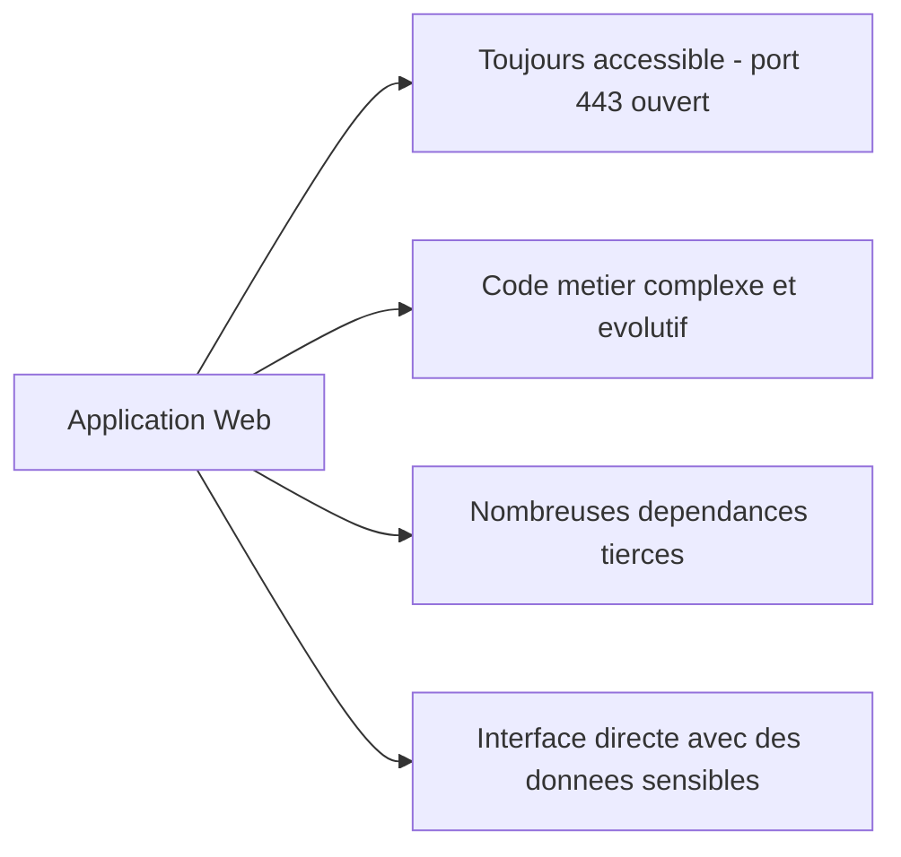

## Introduction

Les applications web sont, de loin, la surface d'attaque la plus exposée d'une organisation. Elles sont accessibles depuis Internet vingt-quatre heures sur vingt-quatre, développées par des équipes dont la maturité en sécurité varie énormément, et construites sur des piles technologiques complexes mêlant un framework serveur, une base de données, un cache, des API tierces et une interface JavaScript riche. Chacun de ces composants ajoute du code, et chaque ligne de code ajoute une possibilité d'erreur.

Ce cours applique directement les fondations réseau et Linux que tu as déjà acquises à l'exploitation méthodique d'applications web volontairement vulnérables, puis à leur durcissement. À la fin de ce chapitre, tu sauras expliquer pourquoi un pare-feu ne protège pas une application web, décrire les grandes familles de vulnérabilités référencées par l'OWASP, lire une requête HTTP ligne par ligne, et monter ton propre banc d'essai avec un proxy d'interception et une cible d'entraînement. Ces acquis conditionnent tout ce qui suivra : on n'exploite bien que ce que l'on sait observer.

## Pourquoi le web concentre l'essentiel du risque

Contrairement à un service interne qu'un administrateur peut cacher derrière un pare-feu et un VPN, une application web publique est **par construction** exposée à quiconque possède une connexion Internet. Un pare-feu réseau classique filtre des adresses IP et des ports ; or le service doit laisser le port 443 (HTTPS) ouvert en permanence pour fonctionner. Fermer ce port revient à éteindre le service. La sécurité ne peut donc pas se jouer au périmètre réseau : elle se joue dans le code applicatif et dans sa configuration.



Un pare-feu applicatif web, le **WAF** (Web Application Firewall), peut inspecter le contenu des requêtes HTTP et bloquer certains motifs d'attaque connus. C'est une mesure utile de défense en profondeur, mais jamais une protection suffisante à elle seule : un WAF filtre des signatures que l'on peut contourner, alors que la vulnérabilité, elle, reste dans le code. Tout au long de ce cours, nous verrons que la correction fiable d'une faille se trouve toujours dans l'application, pas dans un filtre placé devant.

### Le cycle requête/réponse HTTP

Toute attaque web consiste à forger ou modifier une requête HTTP et à observer la réponse. Il faut donc maîtriser leur structure. Une requête se compose d'une ligne de requête (méthode, chemin, version), d'en-têtes, puis éventuellement d'un corps.

```text
POST /login HTTP/1.1
Host: cible.lab
Cookie: session=abc123
Content-Type: application/x-www-form-urlencoded
Content-Length: 29

username=admin&password=secret
```

La réponse suit la même logique : une ligne de statut, des en-têtes, un corps.

```text
HTTP/1.1 200 OK
Server: nginx
Set-Cookie: session=def456; HttpOnly; Secure
Content-Type: text/html; charset=utf-8

<!DOCTYPE html>...
```

Les **méthodes** les plus courantes sont `GET` (lire une ressource, paramètres dans l'URL), `POST` (envoyer des données dans le corps), `PUT` et `PATCH` (modifier), `DELETE` (supprimer). Les **codes de statut** se lisent par familles : `2xx` succès, `3xx` redirection, `4xx` erreur côté client (401 non authentifié, 403 interdit, 404 introuvable), `5xx` erreur côté serveur. Savoir qu'un `302` masque parfois un `200` interdit, ou qu'un `500` révèle une entrée mal gérée, oriente directement un test d'intrusion.

## L'OWASP Top 10 : le référentiel de référence

L'**OWASP** (Open Web Application Security Project) est une fondation à but non lucratif qui publie régulièrement un classement des dix catégories de risques les plus critiques pour les applications web. Ce classement, appelé OWASP Top 10, s'appuie sur des données réelles collectées auprès de milliers d'applications et sur une enquête auprès des professionnels. Il sert de langage commun entre développeurs, auditeurs et pentesteurs.

### L'édition 2021, référence stable détaillée

L'édition 2021 reste la plus largement enseignée et celle à laquelle se réfèrent la plupart des certifications pratiques. En voici les dix catégories.

<CompareTable
  titleA="Categorie (edition 2021)"
  titleB="Ce qu'elle couvre"
  rows={[
    { a: "A01 - Broken Access Control", b: "Contournement des restrictions d'acces : IDOR, elevation de privileges horizontale et verticale" },
    { a: "A02 - Cryptographic Failures", b: "Chiffrement absent, faible ou mal implemente, protection insuffisante des donnees sensibles" },
    { a: "A03 - Injection", b: "SQL, commande, template, LDAP : injecter du code interprete cote serveur. Le XSS y est integre" },
    { a: "A04 - Insecure Design", b: "Defaut de conception : absence de modelisation des menaces, logique metier non securisee" },
    { a: "A05 - Security Misconfiguration", b: "Configuration par defaut, services exposes inutilement, en-tetes de securite absents" },
    { a: "A06 - Vulnerable and Outdated Components", b: "Bibliotheques, frameworks ou CMS obsoletes contenant des CVE connues" },
    { a: "A07 - Identification and Authentication Failures", b: "Authentification faible, gestion de session defaillante, absence de MFA" },
    { a: "A08 - Software and Data Integrity Failures", b: "Chaine d'approvisionnement non verifiee, deserialisation non securisee" },
    { a: "A09 - Security Logging and Monitoring Failures", b: "Journalisation absente ou insuffisante, detection tardive des incidents" },
    { a: "A10 - Server-Side Request Forgery (SSRF)", b: "Forcer le serveur a emettre une requete vers une destination choisie par l'attaquant" },
  ]}
/>

### L'édition 2025 et ce qui change

L'OWASP a publié une nouvelle édition du Top 10 en 2025. Les grandes tendances de cette édition sont stables et bien documentées, même si la numérotation détaillée a évolué. Le **Broken Access Control reste la catégorie numéro un**, confirmant qu'il s'agit de la faille la plus répandue et la plus impactante. Deux évolutions méritent d'être retenues : la **sécurité de la chaîne d'approvisionnement logicielle** prend une place de premier plan, reflet des attaques de supply chain des dernières années ; et la **mauvaise configuration de sécurité** gagne en importance, portée par la complexité des déploiements cloud et conteneurisés.

<CehCallout>
Dans ce cours, nous détaillons les catégories les plus fréquemment exploitées en pratique (contrôle d'accès, injection, authentification) dans des chapitres dédiés, et regroupons les autres dans un chapitre de synthèse. C'est la répartition suivie par la majorité des certifications pratiques : eJPT, OSCP+ (révision 2024) et PNPT. Pour l'examen, retiens que le Broken Access Control est resté numéro un du Top 10 en 2021 comme en 2025.
</CehCallout>

## Construire son environnement de test web

Un environnement de test web efficace repose sur trois éléments indissociables : un proxy d'interception, un navigateur configuré pour passer par ce proxy, et une cible que tu es légalement autorisé à attaquer.

Le **proxy d'interception** est l'outil central de tout pentest web. **Burp Suite** (édition Community, gratuite) et **OWASP ZAP** s'interposent entre le navigateur et l'application : ils capturent chaque requête avant son envoi, permettent de la modifier, de la rejouer et d'analyser la réponse. Burp écoute par défaut sur `127.0.0.1:8080`. Son onglet Proxy capture le trafic, son onglet Repeater rejoue une requête à volonté, son onglet Intruder automatise des variations. Nous y reviendrons en détail au chapitre suivant.

<CompareTable
  titleA="Outil"
  titleB="Role dans le banc d'essai"
  rows={[
    { a: "Burp Suite Community / OWASP ZAP", b: "Proxy d'interception : voir, modifier et rejouer chaque requete HTTP" },
    { a: "Navigateur avec profil de test (FoxyProxy)", b: "Rediriger tout le trafic vers 127.0.0.1:8080 sans gener la navigation quotidienne" },
    { a: "DVWA, OWASP Juice Shop", b: "Cibles volontairement vulnerables, concues pour l'apprentissage legal" },
    { a: "curl, httpie", b: "Forger des requetes depuis le terminal, scripter des tests reproductibles" },
  ]}
/>

<Steps steps={[
  { title: "Installer et lancer le proxy", description: "Burp Suite Community est preinstalle sur Kali. Lance-le et verifie dans Proxy que l'ecoute se fait bien sur 127.0.0.1:8080.", code: "burpsuite &" },
  { title: "Configurer le navigateur", description: "Avec l'extension FoxyProxy, cree un profil pointant vers 127.0.0.1:8080. Ainsi seul le trafic de test passe par Burp, ta navigation normale reste directe." },
  { title: "Installer le certificat de Burp", description: "Pour intercepter le HTTPS, importe le certificat de l'autorite de Burp dans le navigateur, sinon chaque page HTTPS leve une alerte de securite." },
  { title: "Choisir une cible legale", description: "DVWA (Damn Vulnerable Web Application), utilisee dans les labs Nyx, est concue specifiquement pour l'apprentissage. Ne teste jamais une cible reelle sans autorisation ecrite." },
]} />

<WarningCallout>
Toutes les techniques de ce cours doivent être pratiquées exclusivement sur les labs Nyx ou sur des applications que tu es explicitement autorisé à tester. Le rappel du chapitre légal du cours Introduction à la Cybersécurité s'applique intégralement ici : tester une application sans mandat écrit constitue une infraction pénale, même sans intention de nuire.
</WarningCallout>

<LegalCallout>
En France, l'accès ou le maintien frauduleux dans un système de traitement automatisé de données est réprimé par les articles 323-1 et suivants du Code pénal. Une autorisation de test (lettre de mission, règles d'engagement précisant le périmètre et les horaires) est la seule protection légale du pentesteur. DVWA et les labs Nyx fournissent un terrain où cette question ne se pose pas.
</LegalCallout>

## Angle offensif et défensif

Dès ce premier chapitre, prends l'habitude de penser aux deux faces de chaque sujet. L'attaquant cherche les points d'entrée exposés et les mauvaises configurations ; le défenseur réduit la surface d'attaque, applique des en-têtes de sécurité et journalise les accès pour détecter l'anomalie.

<AttackDefenseTable rows={[
  { phase: "Exposition", attack: "Decouvrir les services web publics et leurs technologies", defense: "Reduire la surface exposee, retirer les interfaces d'administration d'Internet" },
  { phase: "Interception", attack: "Rejouer et modifier des requetes via un proxy", defense: "Valider cote serveur chaque entree, ne jamais faire confiance au client" },
  { phase: "Detection", attack: "Agir discretement pour eviter l'alerte", defense: "Journaliser les acces anormaux (A09), alerter en temps reel" },
]} />

## Erreurs fréquentes

La première erreur du débutant est de croire qu'un site en HTTPS est « sécurisé » : le HTTPS chiffre le transport, il ne dit rien de la qualité du code applicatif. La deuxième est de confondre le WAF avec une correction : un WAF gagne du temps mais ne corrige rien. La troisième est de tester sans proxy, en se privant de la capacité à voir et modifier les requêtes. La dernière, plus grave, est de lancer un outil contre une cible réelle « juste pour voir » : sans autorisation, c'est une infraction.

## Lab — Mise en pratique

**Environnement** : Kali Linux (terminal Nyx Shell) et proxy Burp Suite

<Steps steps={[
  { title: "Observer une requete brute", description: "Recupere les en-tetes HTTP de la cible et identifie serveur et technologies apparentes.", code: "curl -I http://10.10.0.10" },
  { title: "Comparer GET et reponse", description: "Recupere le corps de la page d'accueil et repere commentaires et indices laisses dans le code source.", code: "curl -s http://10.10.0.10 | grep -i 'comment\\|todo\\|debug'" },
  { title: "Intercepter via Burp", description: "Navigue sur la cible avec le navigateur configure sur le proxy, puis observe la requete capturee dans l'onglet Proxy avant de la transmettre." },
  { title: "Rejouer dans Repeater", description: "Envoie la requete vers Repeater, modifie un en-tete (par exemple User-Agent) et observe si la reponse change." },
  { title: "Lister les codes de statut", description: "Teste plusieurs chemins et note le code renvoye pour chacun ; distingue un 404 d'un 403, indice d'une ressource existante mais protegee.", code: "for p in / /admin /backup /api; do curl -s -o /dev/null -w \"%{http_code} $p\\n\" http://10.10.0.10$p; done" },
  { title: "Documenter la cartographie initiale", description: "Consigne les technologies detectees et les chemins interessants : ce sera le point de depart de la reconnaissance du chapitre 2." },
]} />

## À retenir

- Une application web est exposée en continu sur le port 443 ; la sécurité se joue dans le code et la configuration, pas au pare-feu réseau.
- Un WAF est une défense en profondeur utile mais ne remplace jamais la correction du code vulnérable.
- Toute attaque web revient à forger ou modifier une requête HTTP et à interpréter la réponse ; maîtriser méthodes, en-têtes et codes de statut est indispensable.
- L'OWASP Top 10 catégorise les risques web majeurs ; le Broken Access Control est resté numéro un en 2021 comme en 2025.
- L'édition 2025 met davantage en avant la chaîne d'approvisionnement et la mauvaise configuration.
- Un proxy d'interception (Burp Suite, ZAP) est l'outil central du test web ; DVWA et les labs Nyx offrent un terrain légal.

## Questions de révision

1. Pourquoi une application web publique ne peut-elle pas être protégée uniquement par un pare-feu réseau ?
2. Quelle différence fais-tu entre un pare-feu réseau et un WAF, et pourquoi le WAF ne remplace-t-il pas la correction du code ?
3. Cite trois catégories de l'OWASP Top 10 2021 et indique laquelle est restée numéro un en 2025.
4. Décris la structure d'une requête HTTP et celle d'une réponse.
5. Que révèle la distinction entre un code de statut 403 et un code 404 lors d'une cartographie ?
6. Quel est le rôle d'un proxy d'interception comme Burp Suite, et pourquoi faut-il installer son certificat pour tester le HTTPS ?
7. Quelles conditions légales doivent être réunies avant de tester une application qui ne t'appartient pas ?
