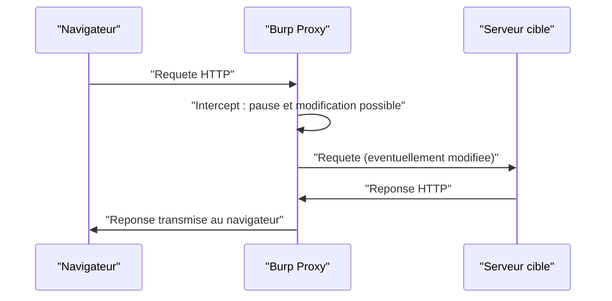

## Introduction

Avant d'exploiter la moindre vulnérabilité, il faut cartographier l'application : quelles pages existent, quels paramètres acceptent une entrée utilisateur, quelles technologies tournent derrière, quelles versions sont déployées. Cette phase de reconnaissance détermine directement la qualité de tout ce qui suivra. Un pentesteur qui néglige la reconnaissance passe à côté de la moitié de la surface d'attaque, parce qu'il ne teste que ce qu'il a vu dans son navigateur, alors que l'essentiel se cache souvent dans des endpoints non liés, des fichiers de sauvegarde ou des paramètres non documentés.

À la fin de ce chapitre, tu sauras distinguer reconnaissance passive et active, énumérer répertoires, fichiers, sous-domaines et paramètres cachés, lire les indices techniques laissés par le serveur, et piloter Burp Suite pour transformer chaque observation en test reproductible.

## Reconnaissance passive et active

La **reconnaissance passive** collecte de l'information sans envoyer de requête inhabituelle à la cible : consultation de `robots.txt`, du `sitemap.xml`, des en-têtes de réponse, des moteurs de recherche, des certificats TLS. Elle est discrète et constitue toujours le point de départ. La **reconnaissance active** sonde directement l'application avec des requêtes qui peuvent être détectées : énumération de répertoires, fuzzing de paramètres, scan de version. Elle est plus bruyante mais révèle ce que la cible ne publie pas volontairement.

```text
# Trois fichiers a lire en premier, souvent oublies
http://10.10.0.10/robots.txt      -> chemins que le site demande de ne pas indexer (donc interessants)
http://10.10.0.10/sitemap.xml     -> liste des pages connues du site
http://10.10.0.10/.well-known/    -> metadonnees standardisees (security.txt, etc.)
```

<TipCallout>
Le fichier `robots.txt` est une mine d'or paradoxale : en listant les répertoires que le site demande aux moteurs de ne pas indexer, il révèle souvent précisément les chemins sensibles (`/admin`, `/backup`, `/old`). Lis-le toujours en premier.
</TipCallout>

## Découverte de contenu par énumération

L'énumération de contenu consiste à tester un grand nombre de chemins depuis une liste de mots (wordlist) pour découvrir les ressources non liées depuis les pages visibles. **Gobuster** est l'outil de référence, rapide et simple ; **ffuf** et **feroxbuster** sont des alternatives modernes très utilisées, ffuf excellant au fuzzing de paramètres et feroxbuster à l'exploration récursive.

```bash
# Decouverte de repertoires et fichiers avec les extensions courantes
gobuster dir -u http://10.10.0.10 -w /usr/share/wordlists/seclists/Discovery/Web-Content/common.txt -x php,txt,bak

# Decouverte de sous-domaines (DNS)
gobuster dns -d example.com -w /usr/share/wordlists/seclists/Discovery/DNS/subdomains-top1million-5000.txt

# Fuzzing de parametres caches avec ffuf (le marqueur FUZZ est remplace par chaque mot)
ffuf -u "http://10.10.0.10/page.php?FUZZ=test" -w /usr/share/wordlists/seclists/Discovery/Web-Content/burp-parameter-names.txt -fs 0
```

Gobuster dispose aussi d'un mode `fuzz` qui remplace le mot-clé `FUZZ` dans une URL, par exemple `http://10.10.0.10/page.php?FUZZ=test`, pour découvrir les paramètres cachés acceptés par une page ; ffuf fait la même chose avec plus d'options de filtrage.

```text
# Sortie typique de gobuster
/index.php            (Status: 200) [Size: 4096]
/admin                (Status: 301) [Size: 169]   -> redirection, repertoire existant
/config.php.bak       (Status: 200) [Size: 812]   -> sauvegarde exposee, a inspecter
/login.php            (Status: 200) [Size: 1503]
```

<CompareTable
  titleA="Option gobuster"
  titleB="Effet"
  rows={[
    { a: "-u", b: "URL cible a enumerer" },
    { a: "-w", b: "Wordlist utilisee pour le brute-force des chemins" },
    { a: "-x", b: "Extensions de fichiers a tester (php, txt, bak, old, zip...)" },
    { a: "-t", b: "Nombre de threads : accelere le scan mais le rend plus detectable" },
    { a: "-s / -b", b: "Codes de statut a inclure (whitelist) ou exclure (blacklist)" },
  ]}
/>

<TipCallout>
Les fichiers de sauvegarde oubliés avec les extensions `.bak`, `.old` ou le suffixe `~` contiennent parfois le code source complet d'une page, y compris des identifiants de connexion à une base de données codés en dur. Inclure systématiquement ces extensions dans une découverte de contenu est l'un des réflexes les plus rentables de la reconnaissance web.
</TipCallout>

## Burp Suite : intercepter, rejouer, automatiser

Burp Suite place un proxy entre ton navigateur et la cible, te permettant de voir et modifier chaque requête avant son envoi. C'est l'outil que tu utiliseras le plus souvent dans ce cours.



<Steps steps={[
  { title: "Configurer le proxy du navigateur", description: "Pointe le proxy HTTP/HTTPS du navigateur vers 127.0.0.1:8080 (valeur par defaut de Burp)." },
  { title: "Intercepter une requete", description: "Active 'Intercept is on' dans l'onglet Proxy, puis navigue : chaque requete s'affiche et attend ta validation avant d'etre envoyee." },
  { title: "Envoyer vers Repeater", description: "Clic droit sur une requete puis 'Send to Repeater' pour la modifier et la rejouer autant de fois que necessaire en observant la reponse." },
  { title: "Explorer le site map", description: "L'onglet Target construit automatiquement une arborescence du site a partir de tout le trafic observe : une cartographie vivante." },
  { title: "Automatiser avec Intruder", description: "Pour tester une liste de valeurs sur un parametre (identifiants, chemins), Intruder automatise les variations ; l'edition Community est limitee en vitesse mais fonctionnelle." },
]} />

<CehCallout>
Le cycle de base de tout test d'injection ou de contrôle d'accès tient en trois gestes dans Repeater : modifier un paramètre, renvoyer la requête, observer la réponse. Maîtriser Repeater est plus important que de connaître par cœur des dizaines d'outils. C'est un point systématiquement évalué en OSCP+ et en eJPT.
</CehCallout>

## Identifier la stack technique (fingerprinting)

Identifier précisément le serveur, le langage, le framework et leurs versions oriente tout le reste du test : une version exacte permet de chercher des CVE connues (voir chapitre 7), une technologie révèle les types d'injection plausibles.

<CompareTable
  titleA="Indice"
  titleB="Ce qu'il revele"
  rows={[
    { a: "En-tete Server / X-Powered-By", b: "Serveur web et langage backend (Apache/PHP, nginx/Node, IIS/.NET...)" },
    { a: "Extension de fichier (.php, .aspx, .jsp)", b: "Langage de programmation cote serveur" },
    { a: "Cookies (PHPSESSID, JSESSIONID, ASP.NET_SessionId)", b: "Technologie de session, donc souvent le framework utilise" },
    { a: "Messages d'erreur detailles", b: "Version exacte du framework, parfois la requete SQL brute" },
    { a: "Commentaires HTML et chemins de ressources", b: "CMS, generateur de site, bibliotheques front chargees" },
  ]}
/>

```bash
# Identification des technologies web
whatweb -v http://10.10.0.10

# Enumeration ciblee d'un CMS WordPress (plugins vulnerables)
wpscan --url http://10.10.0.10 --enumerate vp --api-token <token>

# Inspection manuelle des en-tetes revelateurs
curl -sI http://10.10.0.10 | grep -iE 'server|x-powered-by|set-cookie'
```

```text
# Extrait d'une sortie whatweb
http://10.10.0.10 [200 OK] Apache[2.4.52], PHP[8.1.2], X-Powered-By[PHP/8.1.2],
Cookies[PHPSESSID], HTTPServer[Ubuntu Linux][Apache/2.4.52 (Ubuntu)]
```

Un cookie nommé `PHPSESSID` trahit un backend PHP ; `JSESSIONID` indique Java ; `ASP.NET_SessionId` pointe vers l'écosystème .NET. Ces détails ne sont pas anodins : ils déterminent la syntaxe d'injection à tenter et les fichiers de configuration à rechercher.

<WarningCallout>
Un message d'erreur détaillé affichant une trace d'exécution complète (stack trace) en production est une fuite d'information classique relevant de la mauvaise configuration (voir chapitre 7). Il révèle souvent la version exacte du framework, le chemin absolu des fichiers sur le serveur, et parfois la requête SQL brute, facilitant grandement la recherche d'exploits publics.
</WarningCallout>

## Angle offensif et défensif

<AttackDefenseTable rows={[
  { phase: "Decouverte de contenu", attack: "Enumerer repertoires et fichiers de sauvegarde avec une wordlist", defense: "Supprimer les fichiers .bak/.old, interdire le listing, retourner un 404 uniforme" },
  { phase: "Fingerprinting", attack: "Lire version et stack dans les en-tetes et messages d'erreur", defense: "Masquer les en-tetes Server/X-Powered-By, desactiver l'affichage des erreurs" },
  { phase: "Enumeration de sous-domaines", attack: "Decouvrir les environnements oublies (dev, staging)", defense: "Inventorier et retirer d'Internet les sous-domaines non necessaires" },
]} />

## Erreurs fréquentes

Le débutant limite souvent sa reconnaissance aux pages visibles dans le navigateur, oubliant que l'énumération révèle des endpoints non liés. Il choisit parfois une wordlist trop petite (ou trop grande et bruyante) sans l'adapter à la technologie détectée. Il néglige les sources passives (`robots.txt`, certificats, moteurs de recherche) qui livrent gratuitement des informations. Enfin, il oublie de documenter au fil de l'eau : une cartographie non consignée se perd, et le chapitre 8 montrera qu'un test non documenté n'a pas de valeur.

## Lab — Mise en pratique

**Environnement** : Kali Linux (terminal Nyx Shell) et proxy Burp Suite

<Steps steps={[
  { title: "Lire les sources passives", description: "Recupere robots.txt et sitemap.xml et note chaque chemin mentionne.", code: "curl -s http://10.10.0.10/robots.txt" },
  { title: "Cartographier les repertoires", description: "Lance une decouverte de contenu complete avec plusieurs extensions.", code: "gobuster dir -u http://10.10.0.10 -w /usr/share/wordlists/seclists/Discovery/Web-Content/common.txt -x php,txt,bak,old,zip" },
  { title: "Identifier la stack technique", description: "Utilise whatweb pour determiner serveur, langage et versions.", code: "whatweb -v http://10.10.0.10" },
  { title: "Chercher des parametres caches", description: "Fuzz les noms de parametres sur une page dynamique pour reveler des entrees non documentees.", code: "ffuf -u 'http://10.10.0.10/page.php?FUZZ=test' -w /usr/share/wordlists/seclists/Discovery/Web-Content/burp-parameter-names.txt -fs 0" },
  { title: "Observer dans Burp", description: "Navigue sur chaque page decouverte avec le proxy actif et laisse le site map de l'onglet Target se construire." },
  { title: "Rejouer et modifier une requete", description: "Choisis une requete interessante, envoie-la dans Repeater et modifie un parametre pour observer le comportement." },
  { title: "Documenter la cartographie", description: "Liste chaque page/endpoint decouvert avec son objectif apparent et les technologies associees, en vue des chapitres d'exploitation." },
]} />

## À retenir

- La reconnaissance se fait en deux temps : passive (discrète : robots.txt, en-têtes, certificats) puis active (énumération et fuzzing).
- Gobuster, ffuf et feroxbuster énumèrent répertoires, fichiers, sous-domaines et paramètres cachés à partir de wordlists.
- Les fichiers de sauvegarde (.bak, .old, ~) révèlent parfois le code source complet et des identifiants en dur.
- Burp Suite (Proxy, Repeater, Target, Intruder) est l'outil central pour intercepter, modifier, rejouer et cartographier.
- Les en-têtes, cookies et messages d'erreur révèlent la stack technique exacte, base de la recherche de CVE.
- Une cartographie doit être documentée au fil de l'eau pour nourrir les phases d'exploitation et le rapport final.

## Questions de révision

1. Quelle différence fais-tu entre reconnaissance passive et reconnaissance active, et par laquelle commence-t-on ?
2. Pourquoi `robots.txt` est-il paradoxalement utile à un attaquant ?
3. À quoi sert l'option `-x` de gobuster, et pourquoi inclure `.bak` et `.old` ?
4. Que permet l'onglet Repeater de Burp Suite, et pourquoi est-il central ?
5. Quels indices révèlent le langage backend d'une cible ?
6. Pourquoi un message d'erreur détaillé en production est-il un risque de sécurité ?
7. Comment un sous-domaine oublié (dev, staging) peut-il devenir un point d'entrée, et comment s'en prémunir ?
