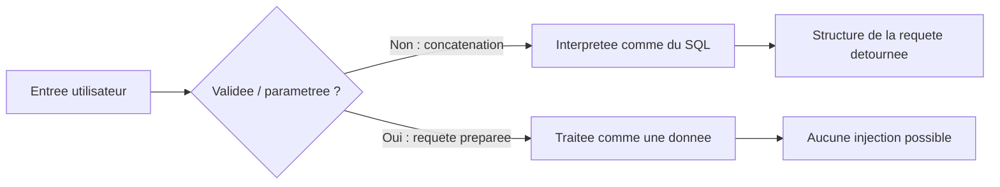

## Introduction

L'injection SQL reste, des décennies après son apparition, l'une des vulnérabilités les plus fréquemment rencontrées et les plus dévastatrices. Dans le pire des cas, elle permet de lire, modifier ou supprimer l'intégralité d'une base de données. Elle appartient à la catégorie **A03 - Injection** de l'OWASP Top 10 2021, place qu'elle conserve parmi les risques majeurs en 2025.

Ce chapitre adopte un angle de défenseur et de développeur : comprendre comment la faille naît dans le code, savoir la reconnaître à la lecture, la corriger de façon fiable, et détecter les tentatives d'exploitation dans les journaux. Les techniques offensives sont présentées au niveau conceptuel, pour comprendre ce que l'on protège, et dans le cadre strict des labs autorisés. À la fin, tu sauras expliquer pourquoi les requêtes préparées sont la seule défense réellement fiable et comment auditer un code pour les imposer.

## Le mécanisme d'une injection SQL

Une injection SQL survient quand une entrée utilisateur est concaténée directement dans une requête SQL sans validation ni paramétrage. Le serveur ne distingue alors plus le code que le développeur a écrit des données que l'utilisateur fournit : l'entrée est interprétée comme du SQL. C'est fondamentalement une **faille d'interprétation** où une donnée franchit la frontière qui la sépare du code.

```php
// Code VULNERABLE (PHP) : l'entree est collee dans la requete
$query = "SELECT * FROM users WHERE username = '" . $_GET['username'] . "'";
```

Si l'entrée contient elle-même des caractères SQL, comme une apostrophe suivie d'une condition toujours vraie, la structure de la requête est modifiée et la logique de l'application détournée. C'est ainsi qu'un contournement d'authentification ou une extraction massive de données devient possible, sans jamais connaître de mot de passe.



<CehCallout>
Pour l'examen, retiens la nature de la faille plutôt qu'une charge précise : l'injection est une confusion entre code et données. Toute entrée issue du client (paramètre d'URL, champ de formulaire, en-tête HTTP, cookie) est une donnée non fiable qui ne doit jamais être interprétée comme du code.
</CehCallout>

## Les principaux types d'injection

Toutes les injections ne se présentent pas de la même façon. Le type dépend de ce que l'application renvoie : des données directement, un simple comportement différent, un délai, ou un message d'erreur. Comprendre ces variantes est essentiel pour un défenseur, car elles expliquent pourquoi l'absence de message d'erreur ne signifie jamais l'absence de faille.

<CompareTable
  titleA="Type"
  titleB="Principe"
  rows={[
    { a: "Union-based", b: "Les resultats d'une requete arbitraire sont combines a la requete legitime et affiches directement a l'ecran" },
    { a: "Boolean-blind", b: "La page ne renvoie aucune donnee, mais son comportement differe selon qu'une condition injectee est vraie ou fausse" },
    { a: "Time-blind", b: "Une fonction de delai fait varier le temps de reponse, revelant l'information meme sans changement visible" },
    { a: "Error-based", b: "Les messages d'erreur SQL renvoyes exposent des donnees directement dans le texte de l'erreur" },
  ]}
/>

Les injections **aveugles** (boolean et time) sont les plus instructives pour le défenseur : elles prouvent qu'une application peut être pleinement vulnérable sans jamais afficher la moindre donnée ni la moindre erreur. Se fier à l'absence de symptôme visible est donc une erreur d'audit. L'injection **second-order** (différée) va plus loin encore : une entrée malveillante est d'abord stockée sans effet, puis interprétée plus tard par une autre partie de l'application, par exemple quand une interface d'administration réutilise un champ « nom » tel quel dans une nouvelle requête. La faille ne se déclenche pas là où la donnée est saisie, ce qui la rend difficile à repérer.

Deux notions complètent ce panorama. Les **requêtes empilées** (stacked queries) consistent à ajouter, après un point-virgule, une seconde requête de modification (INSERT, UPDATE, DROP) ; elles échouent souvent même quand l'injection est confirmée, parce que de nombreux pilotes de connexion, notamment PHP/MySQL, refusent par défaut d'exécuter plusieurs requêtes séparées par un point-virgule. Le **commentaire SQL** (`-- -` avec son espace final, ou `#` sous MySQL) sert à l'attaquant à neutraliser la fin de la requête originale pour éviter une erreur de syntaxe : le repérer dans un paramètre est un indice de tentative.

### Pourquoi l'automatisation change l'échelle du risque

Des outils comme **sqlmap** automatisent toute la chaîne : détection du type d'injection, énumération des bases de données accessibles (option `--dbs`), puis extraction du contenu d'une table entière (option `--dump`). Ses scripts de réécriture (`--tamper`, par exemple `space2comment` ou `randomcase`) transforment la charge pour contourner un filtrage naïf de WAF sans en changer l'effet. Et lorsque le compte SQL dispose de privilèges excessifs, comme `FILE` sous MySQL, l'option `--os-shell` peut transformer l'injection en exécution de commandes sur le système. Pour le défenseur, chacune de ces capacités justifie une mesure : les requêtes préparées rendent l'outil inopérant, le moindre privilège coupe la route vers le système, et un WAF ne doit jamais être considéré comme suffisant puisque ses filtres se réécrivent.

<WarningCallout>
Ne conclus jamais à l'absence d'injection parce qu'aucune erreur ni aucune donnée n'apparaît. Les injections aveugles et différées sont fréquentes et dangereuses précisément parce qu'elles sont silencieuses. Un audit sérieux vérifie le code, pas seulement le comportement observable.
</WarningCallout>

## Reconnaître un code vulnérable

La compétence défensive centrale est de repérer, à la lecture d'un code, le moment où une entrée non fiable entre dans une requête. Le signal d'alerte est la **construction dynamique d'une requête par concaténation ou interpolation de chaînes** contenant une variable issue du client.

```python
# Signaux d'alerte a reconnaitre en revue de code (exemples VULNERABLES)
cur.execute("SELECT * FROM produits WHERE id = " + request.args["id"])        # concatenation
cur.execute(f"SELECT * FROM users WHERE name = '{nom}'")                       # f-string
cur.execute("... WHERE ville = '%s'" % ville)                                  # formatage %
```

Chacune de ces trois lignes colle une donnée dans le texte de la requête. À l'inverse, une requête paramétrée confie la valeur au pilote de base de données, qui la traite comme une donnée pure. Savoir distinguer ces deux formes en un coup d'œil est la base d'une revue de code sécurisée.

## Détecter une tentative d'injection

Côté exploitation en production, les tentatives d'injection laissent des traces caractéristiques dans les journaux : apostrophes et mots-clés SQL dans les paramètres, pics d'erreurs `500`, requêtes anormalement lentes (signe d'une injection temporelle), ou volume inhabituel de requêtes quasi identiques (extraction caractère par caractère).

```text
# Extraits de journaux revelateurs (a reconnaitre, pas a produire)
GET /produit.php?id=1%27 ...                 -> apostrophe encodee dans un parametre numerique
GET /produit.php?id=1%20AND%20... SLEEP ...  -> motif temporel, reponse anormalement lente
POST /login  status=500 (x40 en 10 s)        -> rafale d'erreurs SQL
```

<AuditCallout>
La journalisation et la détection des accès anormaux relèvent de la catégorie A09 de l'OWASP (défauts de journalisation et de surveillance) et des contrôles de journalisation de l'ISO/IEC 27001:2022 (annexe A, thème opérationnel, contrôles A.5 à A.8). Un WAF ou un IDS applicatif peut alerter sur ces motifs, mais ces alertes servent à détecter, jamais à corriger la faille sous-jacente.
</AuditCallout>

## Corriger : les requêtes préparées

La seule défense réellement fiable est structurelle : séparer le code SQL des données grâce aux **requêtes préparées** (prepared statements) avec paramètres liés. La valeur fournie par l'utilisateur n'est alors jamais interprétée comme du SQL, quel que soit son contenu, parce que la structure de la requête est figée avant que la donnée n'y soit injectée par le pilote.

```php
// Code CORRIGE : requete preparee avec parametre lie (PDO)
$stmt = $pdo->prepare("SELECT * FROM users WHERE username = ?");
$stmt->execute([$_GET['username']]);
```

```python
# Code CORRIGE : parametre lie (Python, driver standard)
cur.execute("SELECT * FROM produits WHERE id = %s", (request.args["id"],))
```

En complément, une **validation d'entrée** stricte (un identifiant attendu numérique doit être rejeté s'il ne l'est pas) et un **mapping objet-relationnel** utilisé correctement réduisent encore la surface. Mais ces mesures viennent après la règle fondamentale, elles ne la remplacent pas.

<AttackDefenseTable rows={[
  { phase: "Cause", attack: "Concatenation d'une entree dans une requete SQL", defense: "Requetes preparees avec parametres lies : la seule protection reellement fiable" },
  { phase: "Fuite d'information", attack: "Messages d'erreur SQL detailles exposes", defense: "Desactiver l'affichage des erreurs en production, journaliser cote serveur uniquement" },
  { phase: "Limitation d'impact", attack: "Un compte SQL trop privilegie amplifie l'injection", defense: "Moindre privilege : pas de FILE, acces restreint aux seules tables necessaires" },
  { phase: "Detection", attack: "Extraction progressive et requetes lentes", defense: "Journaliser et alerter sur les motifs anormaux (A09), WAF en defense en profondeur" },
]} />

<AuditCallout>
Un compte de base de données applicatif ne devrait jamais disposer de droits d'administration complets. Même si une injection passait malgré tout, un compte aux droits restreints limite fortement l'impact. Ce principe de moindre privilège est un contrôle attendu par l'ISO/IEC 27001:2022 (annexe A, thème du contrôle d'accès).
</AuditCallout>

Un WAF reste une mesure de défense en profondeur : il ralentit l'attaquant et bloque les tentatives automatisées les plus grossières. Mais il filtre des motifs que l'on peut réécrire ; il ne corrige pas la vulnérabilité. Ne jamais le présenter comme une correction dans un rapport.

## Erreurs fréquentes

Le débutant confond souvent « pas de message d'erreur visible » avec « pas d'injection », alors que les injections aveugles existent précisément pour ces cas. Il se repose sur l'échappement manuel des apostrophes comme s'il s'agissait d'une défense fiable, alors que seules les requêtes préparées le sont et que l'échappement se contourne selon l'encodage. Il croit qu'un WAF suffit, et présente son déploiement comme une correction. Enfin, il oublie le compte SQL : une application correctement paramétrée mais connectée avec un compte administrateur reste une bombe à retardement si une seule requête échappe à la règle.

## Lab — Mise en pratique

**Environnement** : Kali Linux (terminal Nyx Shell), labs web-001 et web-002 (observation et correction)

<Steps steps={[
  { title: "Observer un comportement anormal", description: "Sur la cible de lab, ajoute une apostrophe a un parametre et observe si la reponse change (erreur, page differente) : c'est le symptome d'une entree non parametree.", code: "curl \"http://10.10.0.10/produit.php?id=1'\"" },
  { title: "Localiser la cause dans le code", description: "Ouvre le code source de la page concernee et identifie la ligne ou le parametre est concatene dans la requete SQL." },
  { title: "Reconnaitre le type", description: "Determine si l'application renvoie des donnees, un simple changement de comportement, ou un delai : union, boolean-blind ou time-blind." },
  { title: "Corriger le code", description: "Reecris la requete en requete preparee avec parametre lie, et ajoute une validation du type attendu pour le parametre." },
  { title: "Durcir le compte SQL", description: "Verifie que le compte applicatif n'a que les droits strictement necessaires et retire tout privilege FILE ou administrateur." },
  { title: "Verifier la correction", description: "Repasse les memes entrees qu'a l'etape 1 et confirme que l'application les traite desormais comme de simples donnees sans changement de comportement." },
  { title: "Mettre en place la detection", description: "Ajoute une regle de journalisation qui signale les parametres contenant des caracteres SQL suspects, pour detecter de futures tentatives." },
]} />

## À retenir

- Une injection SQL est une faille d'interprétation : une donnée du client franchit la frontière qui la sépare du code.
- Les quatre types (union, boolean-blind, time-blind, error-based) montrent qu'une faille peut exister sans message d'erreur ni donnée visible.
- On reconnaît un code vulnérable à la construction dynamique d'une requête par concaténation ou interpolation d'une entrée.
- Les requêtes préparées avec paramètres liés sont la seule contre-mesure réellement fiable.
- Le moindre privilège sur le compte SQL limite l'impact ; la journalisation (A09) permet de détecter les tentatives ; un WAF complète sans remplacer.

## Questions de révision

1. Pourquoi une injection SQL est-elle fondamentalement une faille d'interprétation entre code et données ?
2. Pourquoi l'absence de message d'erreur ne prouve-t-elle jamais l'absence d'injection ?
3. Quels signaux, à la lecture d'un code, trahissent une requête vulnérable ?
4. En quoi une injection second-order est-elle plus difficile à repérer qu'une injection directe ?
5. Quelles traces une tentative d'injection laisse-t-elle dans les journaux ?
6. Pourquoi les requêtes préparées sont-elles fiables alors qu'un WAF ou l'échappement manuel ne le sont pas ?
7. Pourquoi le principe de moindre privilège sur le compte de base de données est-il essentiel même quand le code est corrigé ?
