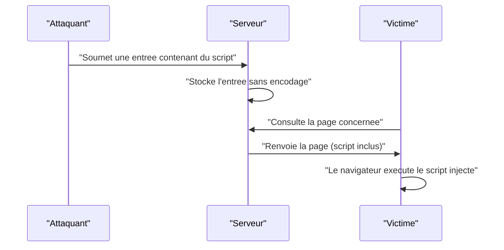

## Introduction

Le Cross-Site Scripting (XSS) permet d'exécuter du code JavaScript arbitraire dans le navigateur d'une victime, au sein du contexte de confiance d'un site légitime. Contrairement à l'injection SQL qui vise le serveur, le XSS vise directement les utilisateurs de l'application : vol de session, usurpation d'identité, hameçonnage intégré à la page, détournement d'actions. Dans l'OWASP Top 10 2021, le XSS est rattaché à la catégorie **A03 - Injection**, car il procède du même défaut fondamental qu'une injection SQL : une donnée non fiable interprétée comme du code.

Ce chapitre t'apprend à reconnaître les contextes où un XSS naît dans le code, à appliquer les défenses qui l'éliminent de façon fiable, et à vérifier qu'une correction tient. L'angle offensif reste conceptuel : comprendre l'impact sert à mesurer l'enjeu de la défense.

## Le mécanisme : une donnée interprétée comme du code

Un XSS survient quand une application insère une entrée utilisateur dans une page HTML sans l'encoder selon le contexte où elle atterrit. Le navigateur, incapable de distinguer le contenu légitime du contenu injecté, exécute le script comme s'il provenait du site. La cause est symétrique de l'injection SQL : là, une donnée devenait du SQL ; ici, une donnée devient du HTML ou du JavaScript.

## Les trois variantes de XSS

<CompareTable
  titleA="Type"
  titleB="Mecanisme"
  rows={[
    { a: "XSS Stocke (Persistent)", b: "L'entree malveillante est enregistree cote serveur (commentaire, profil) et renvoyee a chaque visiteur de la page" },
    { a: "XSS Reflechi (Reflected)", b: "L'entree est renvoyee immediatement dans la reponse, sans stockage : il faut pieger la victime via un lien" },
    { a: "XSS DOM-based", b: "L'entree n'atteint jamais le serveur : elle est traitee entierement cote client par du JavaScript qui manipule le DOM" },
  ]}
/>



<CehCallout>
Le XSS stocké est considéré comme le plus dangereux des trois : contrairement au réfléchi, il ne nécessite aucune ingénierie sociale pour piéger la victime. N'importe quel visiteur de la page compromise est automatiquement touché. Le XSS DOM-based est particulier car l'entrée n'atteint jamais le serveur : l'exécution a lieu entièrement côté client, ce qui le rend invisible aux défenses purement serveur.
</CehCallout>

## Comprendre les contextes d'injection

La clé de la défense est la notion de **contexte**. Une même donnée est dangereuse de façons différentes selon l'endroit du HTML où elle est insérée : dans le corps d'une page, dans un attribut, dans du JavaScript, dans une URL. L'encodage correct dépend du contexte, et un encodage adapté à un contexte ne protège pas un autre.

```text
Contexte corps HTML   : une donnee non encodee peut introduire une balise active
Contexte attribut     : une donnee peut fermer l'attribut puis en ouvrir un autre, ex. un gestionnaire d'evenement
Contexte JavaScript   : une donnee inseree dans un script existant peut en modifier la logique
Contexte URL          : une donnee peut introduire un schema d'URL executable
```

C'est pourquoi un filtrage naïf qui se contente de supprimer la balise `<script>` ne suffit pas : d'autres éléments, comme les **attributs gestionnaires d'événements** (par exemple `onerror` sur une balise `img`), peuvent exécuter du JavaScript sans aucune balise `script`. De même, dans un contexte d'attribut, une donnée non encodée peut d'abord fermer l'attribut HTML en cours (d'où la nécessité pour l'attaquant de « sortir » du contexte) avant d'introduire son propre code. Comprendre ces contextes explique pourquoi la seule approche fiable est d'encoder systématiquement la sortie, et non de chercher à interdire une liste de motifs.

## L'impact réel et ce qu'il nous apprend sur la défense

Un XSS n'est pas une simple fenêtre d'alerte. Son impact typique inclut le vol du cookie de session, qui permet une prise de contrôle du compte sans jamais connaître le mot de passe, l'injection d'un faux formulaire de connexion (hameçonnage dans la page légitime), ou l'exécution d'actions au nom de la victime. Cet impact justifie deux défenses de limitation : rendre le cookie de session inaccessible au JavaScript, et restreindre les scripts que le navigateur accepte d'exécuter.

<WarningCallout>
Un cookie de session volé permet souvent une prise de contrôle totale du compte sans jamais connaître le mot de passe. L'attribut `HttpOnly` sur les cookies sensibles les rend inaccessibles à JavaScript (`document.cookie`), ce qui limite l'impact d'un XSS même réussi. C'est une mesure à appliquer indépendamment de tout filtrage.
</WarningCallout>

## Corriger : encodage, HttpOnly, CSP

La défense fiable contre le XSS repose sur trois piliers complémentaires.

Le premier est l'**encodage de sortie contextuel** : toute donnée issue du client doit être encodée au moment de son insertion dans la page, selon le contexte (corps HTML, attribut, JavaScript, URL). Les frameworks modernes (React, Angular, Vue, moteurs de templates côté serveur) encodent par défaut ; le danger réapparaît lorsqu'un développeur contourne cet encodage, par exemple avec une insertion de HTML brut.

```jsx
// VULNERABLE : insertion de HTML brut, l'encodage par defaut est contourne
<div dangerouslySetInnerHTML={{ __html: commentaireUtilisateur }} />

// CORRIGE : laisser le framework encoder la donnee comme du texte
<div>{commentaireUtilisateur}</div>
```

Le deuxième pilier est l'attribut **HttpOnly** sur les cookies de session, qui réduit l'impact en interdisant leur lecture par JavaScript. Le troisième est la **Content Security Policy (CSP)**, une défense en profondeur qui restreint les sources de script autorisées. Une politique telle que `script-src 'self'` empêche le navigateur d'exécuter un script injecté provenant d'une origine non autorisée, même si un XSS parvient à s'insérer dans la page.

<AuditCallout>
La Content Security Policy est une mesure de défense en profondeur particulièrement recommandée. Même si un XSS parvient à s'injecter, une CSP bien configurée peut empêcher l'exécution du script. Elle complète l'encodage sans le remplacer, et s'inscrit dans les bonnes pratiques de configuration sécurisée attendues par l'ISO/IEC 27001:2022 (annexe A, contrôles A.5 à A.8) et le NIST CSF 2.0.
</AuditCallout>

<AttackDefenseTable rows={[
  { phase: "Cause", attack: "Donnee inseree dans la page sans encodage contextuel", defense: "Encodage de sortie systematique selon le contexte HTML/attribut/JS/URL" },
  { phase: "Limitation d'impact", attack: "Vol du cookie de session via JavaScript", defense: "Attribut HttpOnly sur les cookies sensibles" },
  { phase: "Defense en profondeur", attack: "Contournement d'un filtre de sortie unique", defense: "Content Security Policy restreignant les sources de script" },
  { phase: "Detection", attack: "Injection persistante dans un champ stocke", defense: "Journaliser et alerter sur les entrees contenant du balisage actif" },
]} />

## Détecter un XSS

Côté détection, on recherche dans les champs stockés et les journaux la présence de balisage actif ou d'attributs gestionnaires d'événements dans des données qui ne devraient contenir que du texte. Un champ « nom » ou « commentaire » contenant des chevrons et des mots-clés JavaScript est un signal fort. Les violations de CSP peuvent par ailleurs être remontées automatiquement par le navigateur via un point de collecte de rapports, ce qui transforme la CSP en capteur de tentatives d'injection.

## Erreurs fréquentes

Le débutant croit souvent qu'il suffit de « bloquer la balise script », en ignorant les gestionnaires d'événements et les autres contextes. Il applique un encodage HTML dans un contexte JavaScript ou d'attribut où il ne protège pas. Il oublie le XSS DOM-based parce qu'il ne regarde que le trafic serveur. Il considère la CSP comme une correction suffisante alors qu'elle est une défense en profondeur. Enfin, il néglige l'attribut HttpOnly, laissant le cookie de session à portée de tout script injecté.

## Lab — Mise en pratique

**Environnement** : Kali Linux (terminal Nyx Shell) et navigateur de test (observation et correction)

<Steps steps={[
  { title: "Observer une reflexion d'entree", description: "Soumets une chaine de texte reconnaissable dans un champ de lab et observe si elle reapparait telle quelle dans la page renvoyee : symptome d'une sortie non encodee." },
  { title: "Identifier le contexte", description: "Inspecte le code source HTML genere pour determiner ou atterrit l'entree : corps HTML, attribut, ou bloc JavaScript." },
  { title: "Localiser la cause dans le code", description: "Repere l'endroit ou la donnee est inseree dans la page sans passer par l'encodage du framework ou du moteur de template." },
  { title: "Corriger par l'encodage", description: "Remplace l'insertion brute par une insertion encodee adaptee au contexte, en t'appuyant sur les protections par defaut du framework." },
  { title: "Durcir le cookie de session", description: "Ajoute l'attribut HttpOnly (et Secure) au cookie de session et verifie qu'il n'est plus lisible via document.cookie dans la console." },
  { title: "Deployer une CSP", description: "Mets en place une politique script-src 'self' et observe, dans la console du navigateur, le blocage d'un eventuel script d'origine non autorisee." },
  { title: "Verifier la correction", description: "Resoumets l'entree de l'etape 1 et confirme qu'elle est desormais affichee comme du texte inerte, sans execution." },
]} />

## À retenir

- Le XSS exécute du JavaScript dans le navigateur de la victime au sein du contexte de confiance du site ; c'est une injection côté client.
- Trois variantes : stocké (le plus dangereux), réfléchi, et DOM-based (l'entrée n'atteint jamais le serveur).
- La défense dépend du contexte d'insertion ; un filtrage de la seule balise `script` est insuffisant car d'autres contextes exécutent du code.
- Les trois piliers fiables sont l'encodage de sortie contextuel, l'attribut HttpOnly sur les cookies, et une Content Security Policy restrictive.
- La CSP sert aussi de capteur : ses rapports de violation détectent des tentatives d'injection.

## Questions de révision

1. Pourquoi le XSS et l'injection SQL procèdent-ils du même défaut fondamental ?
2. Pourquoi le XSS stocké est-il considéré comme plus dangereux que le XSS réfléchi ?
3. Qu'est-ce qui distingue le XSS DOM-based des deux autres variantes ?
4. Pourquoi filtrer uniquement la balise `script` ne suffit-il pas à prévenir un XSS ?
5. À quoi sert l'attribut HttpOnly sur un cookie de session, et que ne protège-t-il pas ?
6. Que permet de restreindre une Content Security Policy, et pourquoi est-elle une défense en profondeur et non une correction ?
7. Comment vérifierais-tu qu'un XSS a bien été corrigé après modification du code ?
