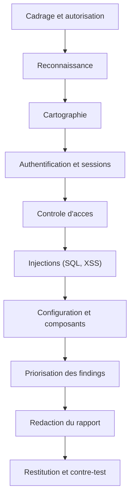

## Introduction

Ce dernier chapitre referme le cours en réunissant tout ce qui précède dans une méthodologie structurée, puis en abordant l'étape trop souvent négligée par les débutants : la rédaction du rapport. Le rapport est en réalité le livrable qui donne toute sa valeur au test d'intrusion. Un client ne voit jamais tes requêtes Burp ni tes heures d'analyse ; il voit un document. Si ce document est confus, non reproductible ou sans recommandation claire, le travail technique, aussi brillant soit-il, n'aura servi à rien.

À la fin de ce chapitre, tu sauras dérouler une méthodologie couvrant l'ensemble des risques vus dans ce cours, prioriser objectivement les découvertes avec les référentiels à jour, et rédiger un rapport qui permette à une direction de décider et à une équipe technique de corriger.

## Une méthodologie de test web complète

Une méthodologie sert d'abord de **liste de couverture** : elle garantit qu'aucune famille de risques n'est oubliée. La référence publique est l'**OWASP Web Security Testing Guide** (WSTG), qui détaille des centaines de cas de test classés par catégorie. Les phases ci-dessous en reprennent la logique, reliée aux chapitres de ce cours.



<CompareTable
  titleA="Phase"
  titleB="Chapitres de ce cours associes"
  rows={[
    { a: "Reconnaissance / Cartographie", b: "Chapitres 1 et 2" },
    { a: "Injection (SQL, XSS)", b: "Chapitres 3 et 4" },
    { a: "Authentification et controle d'acces", b: "Chapitres 5 et 6" },
    { a: "Configuration et composants", b: "Chapitre 7" },
    { a: "Priorisation et rapport", b: "Chapitre 8" },
  ]}
/>

Deux phases encadrent ce schéma et sont souvent oubliées. En amont, le **cadrage** : périmètre exact (domaines, adresses, environnements), dates et horaires autorisés, comptes de test fournis, exclusions (par exemple aucun test de déni de service), et contact d'urgence. Ce cadrage se formalise dans les règles d'engagement signées. En aval, la **restitution** et le **contre-test** : présenter les résultats, puis vérifier, après correction, que chaque vulnérabilité a bien disparu.

<TipCallout>
Suivre cette séquence dans l'ordre n'est pas obligatoire en test réel : certaines vulnérabilités se révèlent en cascade, une IDOR pouvant par exemple révéler un endpoint qui présente ensuite une injection. Garde cette structure comme checklist de couverture, pas comme un ordre rigide. Coche chaque catégorie testée, qu'elle ait révélé une faille ou non.
</TipCallout>

## Prioriser avec CVSS, EPSS et CISA KEV

Toutes les vulnérabilités ne se valent pas, et le client doit savoir par où commencer. Le **CVSS** (Common Vulnerability Scoring System) attribue un score de 0 à 10 selon des critères objectifs : vecteur d'attaque, complexité, privilèges requis, interaction utilisateur, et impact sur la confidentialité, l'intégrité et la disponibilité. La version **4.0**, publiée par le FIRST fin 2023, remplace progressivement la 3.1 : elle affine notamment la notion de complexité, ajoute des métriques de menace et d'environnement, et distingue l'impact sur le système vulnérable de l'impact sur les systèmes en aval. Les plages de sévérité restent identiques.

<CompareTable
  titleA="Score CVSS"
  titleB="Severite"
  rows={[
    { a: "9.0 - 10.0", b: "Critique" },
    { a: "7.0 - 8.9", b: "Elevee" },
    { a: "4.0 - 6.9", b: "Moyenne" },
    { a: "0.1 - 3.9", b: "Faible" },
    { a: "0.0", b: "Aucune" },
  ]}
/>

Le CVSS mesure la **gravité**, pas la **probabilité**. Deux référentiels complètent donc l'analyse. L'**EPSS** (Exploit Prediction Scoring System), également maintenu par le FIRST, estime la probabilité qu'une CVE soit exploitée dans les trente jours. Le catalogue **CISA KEV** (Known Exploited Vulnerabilities) recense les vulnérabilités dont l'exploitation active est avérée. Pour des composants tiers porteurs de CVE (chapitre 7), une vulnérabilité présente au KEV ou à fort EPSS doit passer devant une vulnérabilité au CVSS plus élevé mais jamais exploitée.

<CehCallout>
Une injection SQL donnant un accès administrateur complet à la base de données obtient généralement un score CVSS critique (autour de 9.8 en 3.1), tandis qu'une fuite d'information mineure, comme la version du serveur dans un en-tête, reste faible. Pour l'examen, retiens les plages de sévérité et la différence entre gravité (CVSS) et probabilité d'exploitation (EPSS).
</CehCallout>

### Gravité technique et impact métier

Le score n'est pas tout. Une faille « critique » sur un serveur de test isolé, sans données réelles, n'a pas le même impact qu'en production. Le rapport doit donc contextualiser : quelles données sont exposées, quel processus métier est touché, quelle obligation réglementaire est engagée (RGPD pour des données personnelles, PCI DSS 4.0.1 pour des données de carte de paiement, NIS2 pour une entité essentielle ou importante).

## Structure d'un rapport de pentest professionnel

<Steps steps={[
  { title: "Synthèse exécutive (1 à 2 pages)", description: "Destinee a la direction : contexte, nombre de vulnerabilites par severite, niveau de risque global, recommandations prioritaires, sans jargon technique." },
  { title: "Méthodologie et périmètre", description: "Perimetre teste, dates, approche (boite noire, grise, blanche), referentiels suivis (OWASP WSTG), limites du test et ce qui n'a PAS ete teste." },
  { title: "Détail de chaque vulnérabilité", description: "Description, preuve de concept reproductible, score CVSS avec son vecteur, impact metier, recommandation de correction precise." },
  { title: "Annexes techniques", description: "Sorties d'outils, journaux, captures detaillees, matrice de couverture : pour l'equipe technique qui devra corriger." },
]} />

```text
Exemple de fiche pour UNE vulnerabilite dans le rapport :

Titre           : Injection SQL sur le parametre 'id' de /produit.php
Severite        : Critique (CVSS 4.0, vecteur joint en annexe)
Description     : Le parametre 'id' est concatene dans la requete SQL sans parametrage.
Preuve          : requete et reponse demontrant le comportement anormal (voir annexe B).
Impact          : lecture complete de la base clients, mots de passe hashes inclus ;
                  donnees personnelles exposees (obligation RGPD de notification a evaluer).
Recommandation  : remplacer la requete par une requete preparee avec parametre lie
                  (ex. PDO::prepare) ; restreindre les droits du compte SQL applicatif.
Reference       : OWASP Top 10 2021 A03 - Injection ; OWASP WSTG, tests d'injection SQL.
```

<AuditCallout>
Une recommandation vague comme « sécuriser l'application » n'a aucune valeur actionnable. Une bonne recommandation est spécifique, technique et directement exploitable par l'équipe de développement, par exemple « utiliser `PDO::prepare()` avec des paramètres liés ». Elle peut aussi rattacher la correction à un contrôle de l'ISO/IEC 27001:2022 ou du NIST CSF 2.0, ce qui aide le client à l'intégrer dans son plan de traitement des risques.
</AuditCallout>

### Écrire pour deux publics

Le même rapport est lu par deux publics aux besoins opposés. La direction veut savoir si le risque est acceptable et combien coûte la correction ; elle lit la synthèse exécutive et s'arrête souvent là. L'équipe technique veut reproduire et corriger ; elle lit les fiches et les annexes. Écris la synthèse en termes de risque métier (« un attaquant non authentifié peut lire les données de tous les clients »), et les fiches en termes techniques précis.

## Erreurs de rapport fréquentes

<WarningCallout>
Un rapport sans preuve de concept reproductible — « j'ai trouvé une injection SQL » sans la requête exacte — n'est pas crédible et ralentit considérablement la correction. Le client doit pouvoir reproduire le problème pour valider le correctif appliqué. Veille aussi à ne pas inclure de données personnelles réelles dans les preuves : masque-les.
</WarningCallout>

Plusieurs erreurs reviennent chez les débutants. Ils confondent sévérité technique et impact métier réel, notant « critique » une faille sur un environnement sans données. Ils copient-collent la sortie brute d'un outil sans l'expliquer en langage clair. Ils oublient de documenter ce qui a été testé sans trouver de vulnérabilité, alors que cette information prouve la couverture réelle du test. Ils rédigent des recommandations génériques. Enfin, ils livrent le rapport en clair par courriel, alors qu'un rapport de pentest est un document hautement sensible qui doit être chiffré et transmis par un canal sûr.

## Angle offensif et défensif

Le rapport est le point où l'angle offensif se convertit en amélioration défensive. Chaque fiche doit répondre à trois questions : qu'est-ce qui est vulnérable, comment le corriger, et comment détecter une exploitation future.

<AttackDefenseTable rows={[
  { phase: "Constat", attack: "Vulnerabilite identifiee pendant le test", defense: "Fiche reproductible avec preuve, severite et impact metier" },
  { phase: "Correction", attack: "Cause racine dans le code ou la configuration", defense: "Recommandation precise et actionnable, rattachee a un referentiel" },
  { phase: "Detection", attack: "Exploitation future possible avant correction", defense: "Regle de journalisation ou d'alerte proposee en mesure transitoire" },
  { phase: "Verification", attack: "Correctif partiel ou contournable", defense: "Contre-test apres correction et mise a jour du rapport" },
]} />

## Lab — Mise en pratique

**Environnement** : réflexion guidée et Kali Linux (terminal Nyx Shell)

<Steps steps={[
  { title: "Rédiger une synthèse exécutive", description: "En cinq lignes maximum, resume pour une direction non technique les resultats d'un test ayant trouve une faille critique et trois moyennes, en termes de risque metier." },
  { title: "Prioriser des vulnérabilités", description: "Attribue une severite a ces trois cas et justifie : (a) injection SQL avec acces administrateur a la base, (b) en-tete Server revelant la version d'Apache, (c) IDOR permettant de lire les commandes d'autres clients." },
  { title: "Affiner avec EPSS et KEV", description: "Pour un composant obsolete identifie au chapitre 7, recherche si sa CVE figure au catalogue CISA KEV et note sa valeur EPSS ; explique si cela modifie ta priorite." },
  { title: "Documenter une vulnérabilité complète", description: "Reprends une vulnerabilite observee dans un lab Nyx precedent et redige sa fiche complete selon la structure de ce chapitre, avec recommandation precise." },
  { title: "Construire la matrice de couverture", description: "Liste les categories testees (authentification, controle d'acces, injection, configuration) et indique pour chacune le resultat, y compris quand rien n'a ete trouve." },
  { title: "Planifier le contre-test", description: "Pour chaque fiche, ecris le test qui permettra de verifier que la correction est effective." },
]} />

## À retenir

- Une méthodologie structurée, alignée sur l'OWASP WSTG, sert de liste de couverture de la reconnaissance jusqu'au contre-test.
- Le cadrage (règles d'engagement) et le contre-test encadrent toute mission.
- Le CVSS 4.0 mesure la gravité ; l'EPSS estime la probabilité d'exploitation ; le CISA KEV signale l'exploitation avérée.
- Un rapport professionnel comprend synthèse exécutive, méthodologie, détail de chaque vulnérabilité et annexes techniques.
- Chaque recommandation doit être spécifique, actionnable et vérifiable ; une preuve reproductible est indispensable.
- Documenter ce qui a été testé sans résultat prouve la couverture du test.

## Questions de révision

1. Que signifie l'acronyme CVSS et que mesure-t-il exactement ?
2. Quelle différence fais-tu entre CVSS, EPSS et le catalogue CISA KEV ?
3. Cite les quatre sections principales d'un rapport de pentest professionnel.
4. Pourquoi la synthèse exécutive doit-elle être rédigée sans jargon technique ?
5. Pourquoi une recommandation vague comme « sécuriser l'application » n'a-t-elle aucune valeur ?
6. Pourquoi faut-il documenter ce qui a été testé sans trouver de vulnérabilité ?
7. Pourquoi une faille critique sur un environnement de test isolé n'a-t-elle pas le même impact qu'en production ?

Félicitations, tu viens de terminer le cours **Sécurité Web (OWASP)** ! Direction le cours **Active Directory & Windows** pour appliquer une méthodologie similaire à un environnement d'entreprise.
